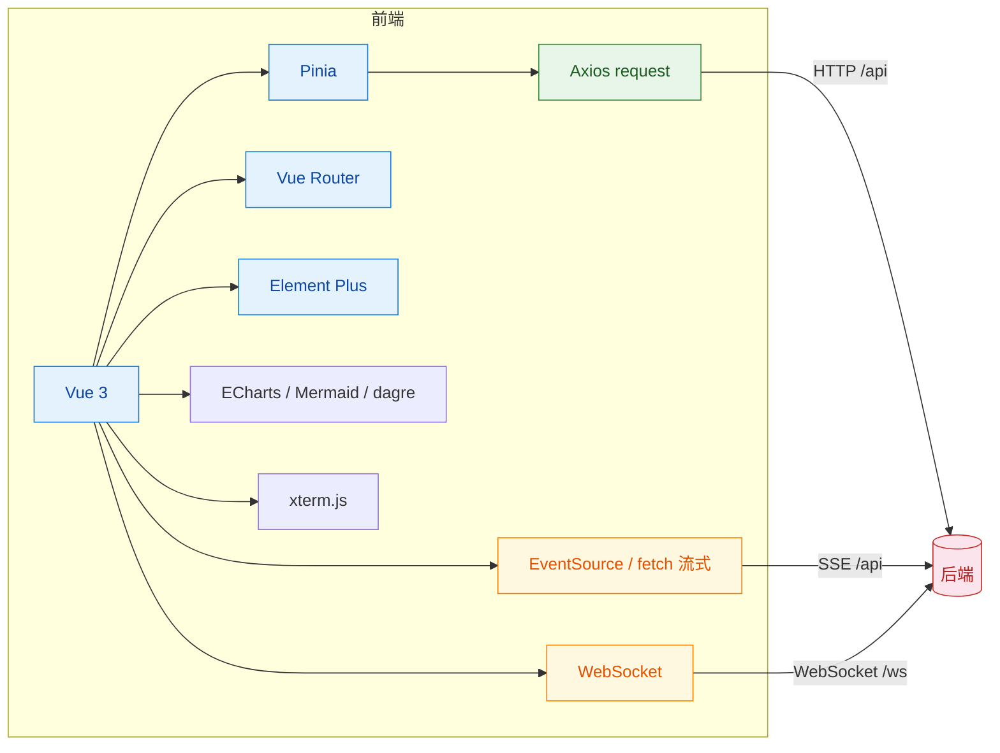
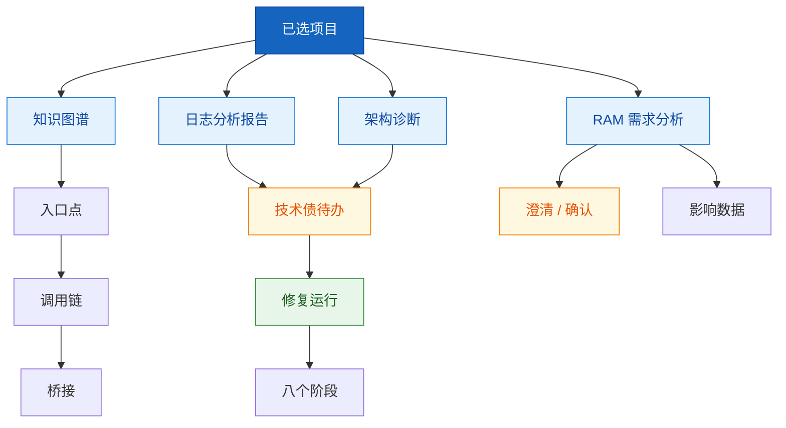

> 自动生成于 2026-11-26，基于 `99d0037` 版本

# 项目概览

---

## 1. 使命与定位

### 1.1 项目使命

> `hisi-dev-tool-frontend` 是 HiSi DevTool 的 Web 前端：为后端的代码知识图谱、智能体分析与调试能力提供一个单页应用，让开发者在一个界面里完成"理解代码 → 分析问题 → 修复问题"的闭环。

本手册只覆盖前端。后端（`hisi-dev-tool`）有自己的手册；MCP 工具由后端的进程内服务提供（`/mcp`），前端不直接使用。

### 1.2 目标用户

| 用户角色 | 使用场景 | 核心诉求 |
|---------|---------|---------|
| 开发者 | 理解陌生项目、定位改动影响、排查线上异常 | 少翻代码，直接看到入口、调用链与影响面 |
| 测试 / 联调人员 | 对着接口发请求、看链路耗时 | 不写脚本就能调试一个接口 |
| 维护者 | 管理参与分析的项目、查看并清零技术债待办 | 待办集中、进度可见 |
| 管理员 | 管理账号与角色、修改后端运行配置 | 权限受控、配置可改 |

### 1.3 项目边界

| 范围 | 说明 |
|------|------|
| **做** | 项目管理、知识图谱浏览与生成、架构诊断、APM 调试、RAM 需求分析与对话、合入分析、日志分析、异常修复、工作台、Claude 终端与对话、技能与提示词配置、用户与系统管理 |
| **不做** | 代码解析、图谱存储、智能体执行——这些都在后端；前端只负责发起、展示与人工确认 |
| **不做** | 代码编辑器、Git 客户端（只有围绕项目的少量 Git 查询与拉取操作） |
| **未在代码中确认** | 后续规划。前端代码里没有路线图信息，本手册不作推测 |

---

## 2. 技术栈

版本号取自 `package.json`。

### 2.1 运行时依赖

| 领域 | 技术 | 版本约束 | 用途 |
|------|------|---------|------|
| 框架 | Vue | `^3.5.30` | 全部组件用 `<script setup>` |
| 路由 | Vue Router | `^4.6.4` | history 模式，路由级懒加载 |
| 状态管理 | Pinia | `^3.0.4` | 11 个 Store |
| UI 组件库 | Element Plus + `@element-plus/icons-vue` | `^2.13.5` / `^2.3.2` | 界面组件；图标全量全局注册 |
| HTTP | Axios | `^1.13.6` | 统一的 `request` 实例 |
| 图表 | ECharts | `^6.0.0` | 架构总览、DSM、架构诊断 |
| 图 | Mermaid | `^11.15.0` | 技术方案、深度分析、对话里的图 |
| 布局 | `@dagrejs/dagre` | `^1.1.8` | 影响 DAG 与调用链流程图的分层布局 |
| 终端 | `@xterm/xterm`、`@xterm/addon-fit`、`@xterm/addon-web-links` | `^6.0.0` 等 | 浏览器内的 PTY 终端 |
| Markdown | `marked` + `dompurify` | `^18.0.4` / `^3.4.11` | 渲染并净化 |
| 工具 | `lodash-es` | `^4.18.1` | 只用到 `debounce` |

### 2.2 开发依赖

| 领域 | 技术 | 版本约束 |
|------|------|---------|
| 构建 | Vite + `@vitejs/plugin-vue` | `^8.0.16` / `^6.0.7` |
| 类型检查 | TypeScript + `vue-tsc` | `~5.9.3` / `^3.3.0` |
| 单元测试 | Vitest + `@vitest/coverage-v8` + `happy-dom` + `@vue/test-utils` | `^4.1.7` / `^20.9.0` / `^2.4.10` |
| 端到端测试 | `@playwright/test` | `^1.58.2` |

### 2.3 技术栈关系图



---

## 3. 项目结构

### 3.1 目录树

```
hisi-dev-tool-frontend/
├── src/
│   ├── api/                  # 34 个 API 模块 + request 入口
│   ├── components/           # 公共组件（布局、登录、RAM、日志、对话等）
│   ├── composables/          # 11 个组合式函数（SSE / WebSocket 会话封装等）
│   ├── constants/            # 分层顺序常量
│   ├── router/               # 路由表与全局守卫
│   ├── stores/               # 11 个 Pinia Store
│   ├── styles/               # 全局样式与 Element Plus 覆盖
│   ├── themes/               # 终端主题类型与 6 套预设
│   ├── types/                # 18 个类型文件（含汇总出口 index.ts）
│   ├── utils/                # request、markdown、下载、日志解析等
│   ├── views/                # 18 个功能目录
│   ├── App.vue
│   └── main.ts
├── e2e/                      # Playwright 用例（默认配置）
├── e2e-real/                 # 真实后端 + 真实模型的 E2E
├── public/
├── docs/codewiki/            # 本手册
├── index.html
├── package.json
├── playwright.config.ts
├── playwright.real.config.ts
├── tsconfig*.json
├── vite.config.ts
└── vitest.config.ts
```

### 3.2 目录职责

| 目录 | 职责 | 非测试文件数 |
|------|------|-------------|
| `src/views/` | 页面与页面专属组件 | 88 |
| `src/components/` | 跨页面组件 | 31 |
| `src/api/` | 与后端通信的函数 | 35 |
| `src/stores/` | 共享状态 | 12 |
| `src/composables/` | 可复用的响应式逻辑 | 11 |
| `src/types/` | TypeScript 类型 | 18 |
| `src/utils/` | 工具函数 | 7 |
| `src/themes/` | 主题 | 3 |
| `src/router/` | 路由 | 1 |
| `src/constants/` | 常量 | 1 |
| `src/`（根） | `main.ts`、`App.vue` | 2 |

合计 209 个非测试的 `.ts` / `.vue` 文件，约 5.4 万行；另有 24 个单元测试文件，约 5000 行。其中一部分文件从入口不可达，清单见 [组件层](../03-模块说明/组件层.md)。

### 3.3 `views/` 下的 18 个功能目录

| 目录 | 路由 | 模块文档 |
|------|------|---------|
| `workbench/` | `/workbench` | [工作台](../03-模块说明/工作台.md) |
| `architecture-diagnosis/` | `/architecture` | [架构诊断](../03-模块说明/架构诊断.md) |
| `ram/` | `/ram*` | [RAM需求分析](../03-模块说明/RAM需求分析.md)、[RAM对话与异常修复](../03-模块说明/RAM对话与异常修复.md) |
| `fix/` | `/fix/chat*` | [RAM对话与异常修复](../03-模块说明/RAM对话与异常修复.md) |
| `apm-debug/` | `/apm-debug` | [APM调试](../03-模块说明/APM调试.md) |
| `knowledge-graph/` | `/knowledge-graph` | [知识图谱](../03-模块说明/知识图谱.md) |
| `call-chain/` | 无（旧路由重定向） | [知识图谱](../03-模块说明/知识图谱.md) |
| `log-analysis/` | `/log-analysis*` | [日志分析](../03-模块说明/日志分析.md) |
| `merge-analysis/` | `/merge-analysis*` | [合入分析](../03-模块说明/合入分析.md) |
| `claude-terminal/` | `/claude-terminal` | [Claude终端与会话](../03-模块说明/Claude终端与会话.md) |
| `claude-session/` | `/claude-session` | [Claude终端与会话](../03-模块说明/Claude终端与会话.md) |
| `project/` | `/project` | [项目管理](../03-模块说明/项目管理.md) |
| `skill-market/` | `/skill-market` | [技能与KG套件](../03-模块说明/技能与KG套件.md) |
| `kg-skills-kit/` | `/kg-skills-kit` | [技能与KG套件](../03-模块说明/技能与KG套件.md) |
| `prompt-config/` | `/prompt-config` | [提示词与术语](../03-模块说明/提示词与术语.md) |
| `glossary/` | `/glossary` | [提示词与术语](../03-模块说明/提示词与术语.md) |
| `settings/` | `/settings` | [认证与系统管理](../03-模块说明/认证与系统管理.md) |
| `admin/` | `/admin/users` | [认证与系统管理](../03-模块说明/认证与系统管理.md) |

---

## 4. 快速启动

详细的操作步骤与环境说明见 [07-部署运维](../07-部署运维/index.md)，这里只列最短路径。

```bash
cd hisi-dev-tool-frontend
npm install
npm run dev
```

### 4.1 验证运行

| 检查 | 预期 |
|------|------|
| 浏览器打开 `http://localhost:5173` | 自动跳到 `/workbench`，左侧出现侧边栏 |
| 右上角有"登录"按钮 | 说明前端已正常渲染 |
| 打开"知识图谱" | 未选项目时被重定向到项目管理并提示 |

后端是否可用不在前端代码中体现；接口失败时页面会弹出拦截器给出的错误提示。

### 4.2 常见启动问题

| 问题 | 原因 | 解决 |
|------|------|------|
| 页面能打开但所有请求报网络错误 | 后端未启动，或不在 `localhost:8080` | 启动后端，或修改 `vite.config.ts` 的代理目标 |
| 登录后刷新又变成未登录 | 浏览器清除了 `localStorage` | 重新登录 |
| 图谱页进不去 | 未选中项目 | 到项目管理页勾选项目 |

---

## 5. 核心概念

### 5.1 概念一览

| 概念 | 英文 / 代码 | 定义 | 代码对应 |
|------|------------|------|---------|
| **已选项目** | `selectedProjects` | 当前参与分析的项目集合，跨页面共享 | `useAppStore` |
| **工作流会话** | workflow session | 后端一次智能体分析的实例，有唯一的 `sessionId` 与事件序号 | `useWorkflow`、`useRamSession` |
| **HITL** | Human-in-the-Loop | 分析过程中停下来等用户澄清或确认 | `ClarifyModal`、`ConfirmModal` |
| **CHECKPOINT** | — | 某个节点完成时推送的事件，载荷里带该节点的输出 | 各 SSE Composable |
| **入口点** | Entry Point | 系统对外的调用入口，如 HTTP 接口 | `knowledgeGraphApi.getEntryPoints` |
| **调用链** | Call Chain | 从入口出发的方法调用路径 | `ChainChart`、`FlowDag` |
| **桥接** | Bridge | 跨越 MyBatis、MQ、Feign 等边界的调用关系 | `BridgeType` |
| **待办** | Workbench item | 由日志或架构分析产出的技术债条目 | `WorkbenchItem` |
| **修复运行** | Fix run | 针对一条待办发起的自动修复流程，分八个阶段 | `WorkbenchFixRun` |
| **技术债清零** | — | 待办被修复并验证通过后的状态 `DONE` | `ItemStatus` |

### 5.2 概念关系图



---

## 6. 项目演进

以下日期取自 git 历史，只列代码能支撑的节点。

| 日期 | 事件 | 依据 |
|------|------|------|
| 2026-05-08 | monorepo 初始化提交已包含前端（当时的版本号为 v4.3） | 首个触及 `src/` 的提交 |
| 2026-05-19 | 新增 APM 运行期追踪分析模块 | 提交说明 |
| 2026-05-23 | RAM 的 DAG 主视图与三环图重写，依赖中加入 `@vue-flow/*` 与 `cytoscape` | 提交说明与 `package.json` |
| 2026-05-24 | 改用 `@dagrejs/dagre` 做影响 DAG 布局 | 提交说明 |
| 2026-05-30 | 加入 Mermaid | `package.json` |
| 2026-06-11 | 加入登录与角色（`stores/auth.ts`） | 文件首次提交 |
| 2026-06-17 | 加入 KG Skills 套件页 | 文件首次提交 |
| 2026-06-22 | 加入 Phase2 分析 | 提交说明 |
| 2026-06-23 | 加入通用工作流接口与 `useWorkflow`；加入 DOMPurify | 文件首次提交 |
| 2026-06-30 | 加入 RAM 对话页 | 文件首次提交 |
| 2026-07-01 | 加入异常修复页 | 文件首次提交 |
| 2026-08-31 | 从依赖中移除 `@vue-flow/*` 与 `cytoscape` | `package.json` 差异 |
| 2026-10-13 | 加入架构诊断页 | 文件首次提交 |
| 2026-11-26 | 加入工作台页面、修复运行事件流与工作台 Store | 文件首次提交 |

### 6.1 当前状态

| 维度 | 说明 |
|------|------|
| 分支 | `feat/workbench-pi-agent-infra` |
| 触及 `src/` 的提交数 | 156 |
| 测试 | 单元测试集中在 RAM 组件与会话逻辑；`e2e/` 下 27 个 Playwright 用例文件，`e2e-real/` 下 1 个；没有覆盖率门槛配置 |
| 文档 | 仓库里的 `README.md` 是 Vite 模板自带的说明，不含项目信息 |

---

## 7. 与相关项目的关系

| 项目 | 关系 | 交互方式 |
|------|------|---------|
| `hisi-dev-tool`（后端） | 唯一的服务端依赖 | HTTP `/api/*`、SSE、WebSocket `/ws/*`（MCP `/mcp` 也由后端进程内提供） |
| `hisi-capture-spring-boot-starter` 等 | 不直接交互 | — |

---

> **延伸阅读**：
> - 架构全貌 → [02-架构设计](../02-架构设计/index.md)
> - 各模块文档索引见 README 的模块列表
> - 术语详解 → [09-术语表](../09-术语表/index.md)
> - 部署指南 → [07-部署运维](../07-部署运维/index.md)
