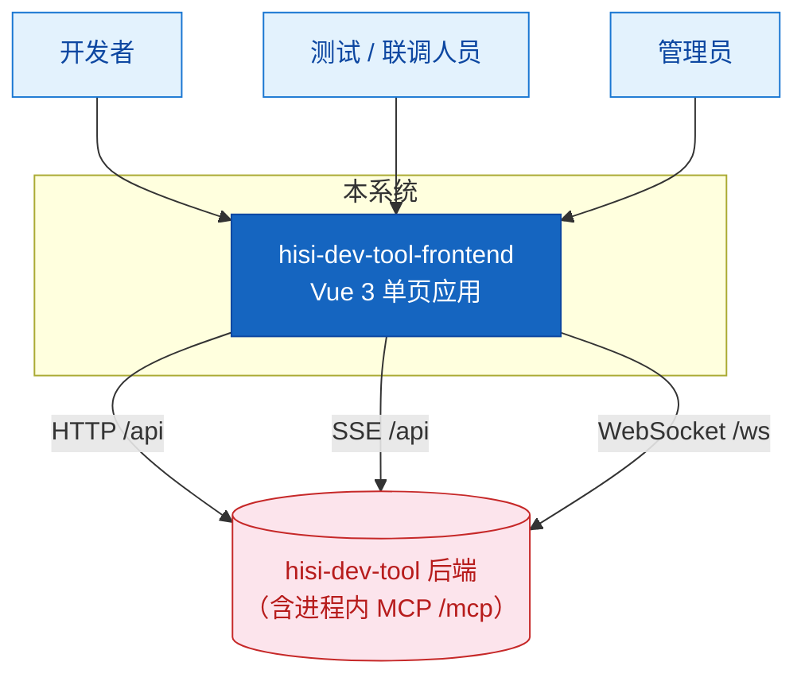
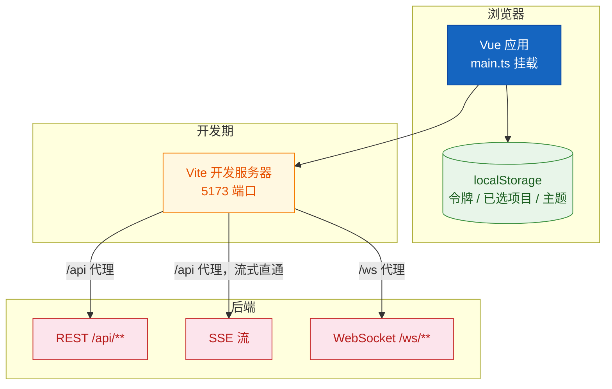
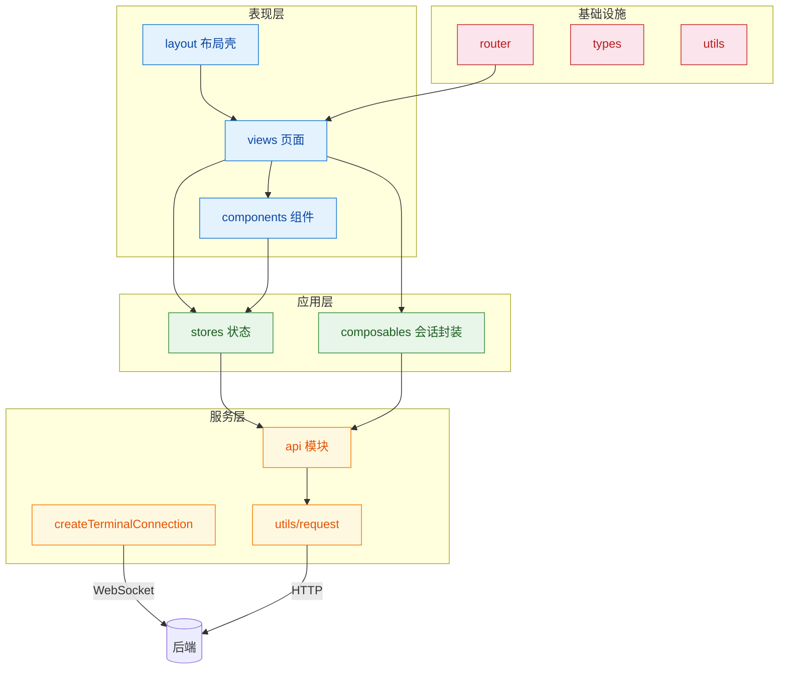
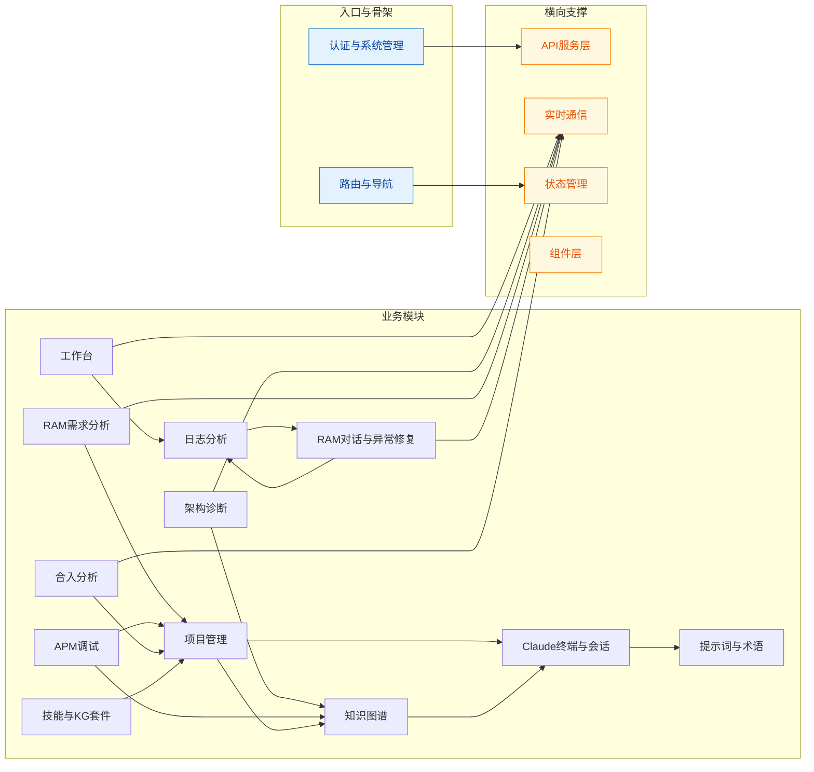
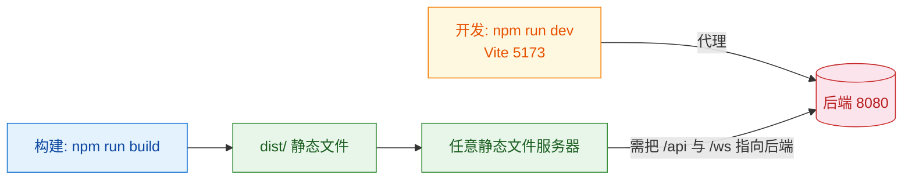

> 自动生成于 2026-11-26，基于 `99d0037` 版本

# 架构设计

---

## 1. 架构总览

前端是一个**单页应用 + 单后端**的两端结构：浏览器里只有这一个 Vue 应用，所有数据与计算都来自 `hisi-dev-tool` 后端，前端不直接连接数据库或模型服务。

### 1.1 系统上下文图

| 角色 / 系统 | 类型 | 交互方式 | 数据流向 |
|------------|------|---------|---------|
| 开发者、测试、管理员 | 人员 | 浏览器 | 发起分析、查看结果、人工确认 |
| `hisi-dev-tool` | 系统 | HTTP、SSE、WebSocket | 前端发请求与消息；后端回数据、推事件（MCP `/mcp` 由后端进程内提供，前端不直接调用） |

### 1.2 容器图

| 容器 | 技术 | 职责 | 端口 | 数据存储 |
|------|------|------|------|---------|
| Vue 应用 | Vue 3 + Pinia + Element Plus | 全部界面与交互逻辑 | — | `localStorage` 三个键 |
| Vite 开发服务器 | Vite | 开发期静态服务与代理 | 5173 | 无 |

前端没有自己的服务端持久化，也没有 Service Worker 或离线缓存。

---

## 2. 分层设计

### 2.1 分层架构图

### 2.2 各层职责

#### 表现层

- **职责**：渲染界面、承接交互。
- **核心组成**：31 个路由页面组件；页面专属组件；`AppLayout` 布局壳。
- **通信方式**：直接调用 Store 的动作或 Composable 暴露的方法；也直接调用 `api/*` 函数。
- **实际情况**：这一层并不强制"只经 Store 访问"。多数页面同时 import 了 `api` 模块、Store 和 Composable，项目选择这类跨页状态才放 Store，页面私有的请求状态留在组件内部。

#### 应用层

- **职责**：跨页共享状态；长连接会话的状态机。
- **核心组成**：11 个 Store；4 个 SSE 会话 Composable 与 6 个 WebSocket Composable（其中 2 个 WebSocket 的未接线）。
- **设计约束**：Store 之间互不引用；会话类 Composable 遵循"REST 为准 + SSE 增量"。

#### 服务层

- **职责**：与后端通信。
- **核心组成**：`utils/request.ts`（axios 实例 + 拦截器）；34 个 API 模块；`api/terminal.ts` 的 WebSocket 连接工厂。
- **设计约束**：`baseURL` 固定 `/api`，拦截器负责令牌注入、响应解包与错误提示。

#### 基础设施

- **职责**：路由、类型、工具函数、主题。
- **核心组成**：`router/index.ts`；`types/`；`utils/markdown.ts`、`download.ts`、`logParser.ts`；`themes/`。

---

## 3. 模块依赖关系

### 3.1 依赖关系图

> 图中箭头表示"依赖对方的数据或页面跳转"，例如日志分析页会跳到异常修复页、架构诊断页复用知识图谱的 `DsmMatrix`。所有业务模块都依赖"横向支撑"一栏，为保持可读没有逐条连线。

### 3.2 依赖规则

| 规则 | 现状 |
|------|------|
| 单向依赖 | 页面 → Store / Composable → API → `request`，没有反向引用 |
| 例外 | `utils/request.ts` 在收到 401 时动态导入 `stores/auth`（用动态导入打断循环） |
| 跨层直调 | 页面直接调用 `api/*` 很常见，是既定做法而非违规 |
| Store 之间 | 互不引用，联动发生在组件层 |

### 3.3 共享模块

| 共享模块 | 使用者 | 说明 |
|---------|--------|------|
| `types/` | 全部 | 多数类型定义在 API 模块内部，`types/` 里是跨模块复用的那部分 |
| `utils/markdown.ts` | 约 15 个组件 | 唯一的 Markdown 渲染入口，内置净化 |
| `utils/download.ts` | 日志分析、RAM、合入分析 | Blob 下载（架构诊断页自己实现了一份下载） |
| `themes/` | `themeStore` | 终端主题 |
| `constants/layerOrder.ts` | 知识图谱的架构总览 | 分层顺序 |

---

## 4. 架构质量属性

### 4.1 质量属性优先级

下表的"保障措施"都是代码里实际存在的机制；优先级是依据代码投入推断的。

| 优先级 | 质量属性 | 具体要求 | 架构保障措施 |
|--------|---------|---------|-------------|
| P0 | 可用性（长任务不丢进度） | 分析可能跑几分钟到几小时，刷新页面后要能恢复 | 所有 SSE 会话都是"REST 拉历史 + `afterSeq` 续流" |
| P0 | 安全性（渲染不可信内容） | 模型输出与代码片段要当 HTML 渲染 | `renderMarkdown` 统一过 DOMPurify |
| P1 | 可维护性 | 模块边界清晰 | 按功能域分目录，每个域自带页面、组件、API |
| P1 | 响应性 | 交互页面不卡顿 | 路由级懒加载、布局算法写成纯函数、轮询设上限 |
| P2 | 可观测性 | 出问题能定位 | 关键 Composable 有 `console` 日志，RAM 会话有带前缀的诊断日志 |
| P2 | 兼容性 | 适配 Windows | 终端指定 `conpty` 后端 |

### 4.2 架构权衡

| 权衡点 | 选择 | 放弃 | 依据 |
|--------|------|------|------|
| 实时通道 | SSE、`fetch` 流式、WebSocket 三种并用 | 单一通道的简洁 | 单向推送用 SSE，需要 POST 的用 `fetch`，双向的用 WebSocket，见 [实时通信](../03-模块说明/实时通信.md) |
| 状态归属 | 只有跨页状态进 Store | "全部状态集中"的一致性 | 页面私有状态留在组件里，Store 数量保持在 11 个 |
| 响应解包 | 在拦截器里统一剥掉 `code / data` 外壳 | 调用方拿到完整响应 | 调用方代码更短，但绕过 axios 的调用需要自己处理 |
| 图形渲染 | 手写 SVG + dagre 布局 | 现成的流程图库 | `DagFlow.vue` 的注释说明原因：流程图库自带样式重置，与 Element Plus 冲突 |

---

## 5. 跨切面关注点

### 5.1 错误处理策略

| 层 | 策略 |
|----|------|
| 请求层 | `utils/request.ts` 的响应拦截器统一弹提示；业务错误转成 `Error` 抛出 |
| Store 层 | 多数动作自行 `catch`，或写入 `error` 字段，或仅打日志 |
| 会话层 | SSE / WebSocket 连接失败反映为 `error` 状态，由页面展示 |
| 页面层 | 用户主动触发的操作在 `catch` 里 `ElMessage.error` |
| 全局 | 没有全局错误边界（`app.config.errorHandler`） |

### 5.2 日志策略

| 层 | 级别 | 输出 | 格式 |
|----|------|------|------|
| Composable | `info` / `warn` / `error` | 浏览器控制台 | RAM 会话日志带 `[RAM]` 前缀，对话连接带 `[RamChatWS]` 前缀 |
| Store | `error` / `warn` | 浏览器控制台 | 自由文本 |
| 请求层 | `warn` / `error` | 浏览器控制台 | 结构化对象（状态码、消息、地址） |

没有引入日志库，也没有远程上报。

### 5.3 安全策略

| 关注点 | 策略 | 实现位置 |
|--------|------|---------|
| 身份认证 | JWT，放在 `Authorization: Bearer` 头 | 请求拦截器 |
| 令牌存放 | `localStorage` 的 `hisi-token` | `stores/auth.ts` |
| 页面权限 | 路由 `meta.requiresAdmin` + 前置守卫 | `router/index.ts` |
| 项目前置条件 | 未选项目时拦截图谱页与架构页 | 同上 |
| XSS | Markdown 渲染后净化 | `utils/markdown.ts` |
| 图渲染 | Mermaid 初始化时 `securityLevel` 设为 `loose` | `MermaidDiagram.vue`、`MermaidBlock.vue` |
| SSE 鉴权 | 工作流流的令牌经查询参数传递 | `api/workflow.ts` |
| WebSocket 鉴权 | 代码中未附带令牌 | 各 WebSocket Composable |

### 5.4 国际化策略

没有国际化框架。界面文案以中文字面量直接写在模板和脚本里。`index.html` 的 `lang` 属性是 `en`、标题是脚手架默认值，运行后由路由守卫把标题改成"{页面标题} - HiSi Dev Tool"。

---

## 6. 部署架构

| 环境 | 用途 | 前端地址 | 后端地址 |
|------|------|---------|---------|
| 开发 | 本地开发 | `http://localhost:5173` | `http://localhost:8080`（写死在 `vite.config.ts`） |
| 生产 | 正式服务 | 未在代码中确认 | 未在代码中确认 |

仓库里没有 Dockerfile、反向代理配置或 CI 工作流，生产部署方式无法从代码确认。详见 [07-部署运维](../07-部署运维/index.md)。

---

## 7. 技术选型总结

| 领域 | 选择 | 代码中可见的替代痕迹 | 对应决策 |
|------|------|--------------------|---------|
| 前端框架 | Vue 3 | — | [08-技术决策](../08-技术决策/index.md) |
| 状态管理 | Pinia | — | 同上 |
| UI 库 | Element Plus | — | 同上 |
| 构建 | Vite 8 | — | 同上 |
| 实时通信 | SSE + `fetch` 流式 + WebSocket | — | 同上 |
| 图形 | ECharts + Mermaid + dagre + 手写 SVG | `@vue-flow/*`、`cytoscape`（2026-08-31 移除） | 同上 |
| 终端 | `@xterm/xterm` 6 | — | 同上 |

---

## 8. 架构约束与限制

| 约束类型 | 约束 | 影响 | 应对 |
|---------|------|------|------|
| 技术约束 | 路由用 history 模式 | 部署时服务器要把未知路径回退到入口页 | 见 [07-部署运维](../07-部署运维/index.md) |
| 技术约束 | `EventSource` 不能带请求头、只能发 GET | 工作流流的令牌走查询参数；需要 POST 的流改用 `fetch` | `api/workflow.ts`、`api/claude.ts` |
| 技术约束 | 后端把 `Long` 序列化成字符串 | 事件序号可能是字符串也可能是数字 | 各处解析时做双向兼容 |
| 技术约束 | Spring 的数组参数格式 | 数组要序列化成 `k=a&k=b` | axios 的 `paramsSerializer` |
| 组织约束 | 单后端、单前端团队规模 | 没有微前端、没有多环境配置层 | — |
| 合规约束 | 不可信内容渲染 | 必须净化 | DOMPurify |

---

> **延伸阅读**：
> - 各模块详细设计 → 见 README 的模块列表
> - 数据流转路径 → [04-数据流程](../04-数据流程/index.md)
> - 技术决策详情 → [08-技术决策](../08-技术决策/index.md)
> - 部署操作指南 → [07-部署运维](../07-部署运维/index.md)
