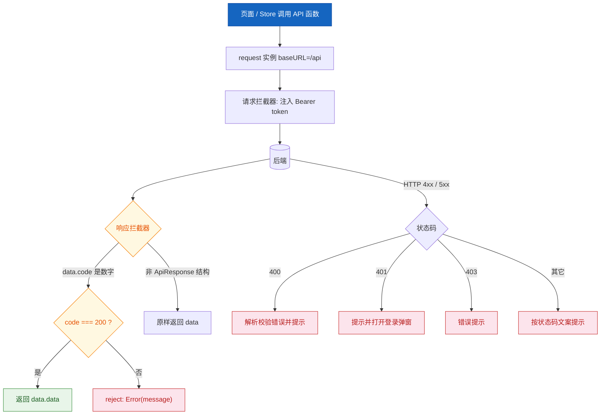

# API服务层

> 自动生成于 2026-11-26，基于 `99d0037` 版本

| 属性 | 值 |
|------|-----|
| **所属层** | 服务层（与后端通信的统一入口） |
| **目录** | `src/utils/request.ts`、`src/api/`、`src/types/api.ts` |
| **文件数** | 34 个 API 模块 + 1 个入口文件 + 1 个请求封装 + 1 个测试文件 |
| **依赖模块** | [状态管理](./状态管理.md)（仅 401 时动态引用 `auth`）、[认证与系统管理](./认证与系统管理.md) |

---

## 1. 模块概述

### 1.1 职责定义

**核心职责**：封装一个 axios 实例，统一处理基础路径、超时、令牌注入、响应解包与错误提示；再按业务域拆成一个个 API 模块供页面与 Store 调用。

**职责边界**：

| 本模块负责 | 本模块不负责 | 由谁负责 |
|-----------|-------------|---------|
| axios 实例与拦截器 | SSE / WebSocket 连接的生命周期 | [实时通信](./实时通信.md) |
| 按域组织请求函数 | 业务流程编排 | 各 Store 与 Composable |
| 生成 SSE 流地址（3 个 `*StreamUrl` 函数） | 建立 `EventSource` | [实时通信](./实时通信.md) |

### 1.2 核心文件清单

| 文件 | 类型 | 职责 | 行数 |
|------|------|------|------|
| `src/utils/request.ts` | 请求封装 | axios 实例、两个拦截器、HTTP 状态码文案 | 191 |
| `src/api/index.ts` | 入口 | 默认导出 `request` | 3 |
| `src/types/api.ts` | 类型 | `ApiResponse`、`UserInfo`、`AuthResponse`、校验错误解析 | 90 |
| `src/api/*.ts` | API 模块 | 34 个业务模块，见第 3 节 | 合计约 3300 |

---

## 2. 模块架构

### 2.1 请求处理流程



### 2.2 axios 实例配置

| 项 | 值 | 说明 |
|----|----|------|
| `baseURL` | `/api` | 开发环境由 Vite 代理到后端，见 [07-部署运维](../07-部署运维/index.md) |
| `timeout` | `120000` | 默认 2 分钟 |
| `headers` | `Content-Type: application/json` | — |
| `paramsSerializer.indexes` | `null` | 数组参数序列化为 `projectPaths=a&projectPaths=b`，以适配 Spring 的 `@RequestParam List<String>` |

### 2.3 两种响应结构

拦截器同时兼容后端的两种返回方式：

| 结构 | 判定 | 处理 |
|------|------|------|
| `ApiResponse<T>`：`{ code, message, data }` | `data.code` 是数字 | `code === 200` 时返回 `data.data`；否则以业务错误拒绝 |
| 直接返回数据（如 `ResponseEntity<T>`） | 没有 `code` 字段 | 原样返回 |

因此 `request.get<T>()` 的运行时返回值就是 `T`，调用方不需要再 `.data`。为此 `request.ts` 导出了 `UnwrappedAxios` 接口，把所有方法的返回类型声明成 `Promise<T>`。

---

## 3. API 模块清单

### 3.1 按业务域分组

| 模块文件 | 行数 | 导出形式 | 路径前缀 | 主要使用方 |
|---------|------|---------|---------|-----------|
| `apmDebug.ts` | 56 | 对象 `apmApi` | `/apm` | `apmStore` |
| `testCase.ts` | 54 | 对象 `testCaseApi` | `/apm/test-cases` | APM 调试页 |
| `architectureDiagnosis.ts` | 49 | 具名函数 | `/architecture-diagnosis` | 架构诊断页 |
| `auth.ts` | 16 | 对象 `authApi` | `/auth` | `auth` Store |
| `user.ts` | 12 | 对象 `userApi` | `/users` | 用户管理页 |
| `config.ts` | 54 | 对象 `configApi` | `/config` | `app` Store |
| `workbench.ts` | 53 | 对象 `workbenchApi` | `/workbench` | 工作台 |
| `workflow.ts` | 94 | 具名函数 | `/v2/workflow` | `useWorkflow`、`useFixRunStream` |
| `ram.ts` | 237 | 具名函数 | `/ram` | RAM 各页面、`useRamSession` |
| `ramChat.ts` | 72 | 对象 `ramChatApi` | `/ram/chat` | `ramChat` Store |
| `fix.ts` | 50 | 对象 `fixApi` | `/fix` | 异常修复页、日志报告页 |
| `merge-analysis.ts` | 88 | 具名函数 | `/merge-analysis` | 合入分析各页面 |
| `logAnalysis.ts` | 127 | 对象 `logAnalysisApi` | `/log`、`/v2/log` | 日志分析页 |
| `knowledgeGraph.ts` | 875 | 对象 `knowledgeGraphApi` + 类型 | `/knowledge-graph`、`/v2/knowledge-graph` | 知识图谱页、项目管理页、`apmStore` |
| `vectorSearch.ts` | 109 | 对象 `vectorSearchApi` | `/vector-search` | 语义搜索面板 |
| `vectorGeneration.ts` | 101 | 具名函数 + 对象 `vectorGenerationApi` | `/vector-generation` | 知识图谱页、项目管理页 |
| `binding.ts` | 44 | 对象 `bindingApi` | `/knowledge-graph/binding` | 绑定管理弹窗 |
| `frontendBackend.ts` | 53 | 对象 `frontendBackendApi` | `/v2/knowledge-graph` | `FrontendBackendTab`（见 3.3） |
| `callChain.ts` | 83 | 对象 `callChainApi` | `/callchain` | 见 3.3 |
| `project.ts` | 33 | 对象 `projectApi` | `/projects` | 项目管理、RAM、合入分析、技能市场 |
| `remote-project.ts` | 26 | 具名函数 | `/remote-projects` | 项目管理、RAM、合入分析、知识图谱 |
| `projectGroup.ts` | 37 | 对象 `projectGroupApi` | `/project-group` | 项目管理、日志分析、RAM 输入页 |
| `projectNameGroup.ts` | 32 | 对象 `projectNameGroupApi` | `/project-name-group` | 知识图谱页 |
| `kg-schedule.ts` | 18 | 具名函数 | `/kg-schedules` | 项目管理页 |
| `git.ts` | 91 | 对象 `gitApi` | `/git` | 项目管理页、终端侧栏、`GitOperations` |
| `session.ts` | 60 | 对象 `sessionApi` | `/sessions` | `session` Store |
| `claude.ts` | 278 | 对象 `claudeApi` | `/claude`、`/chat` | `session` Store、Claude 会话页、APM 诊断对话、方法引用图 |
| `workspaceSession.ts` | 65 | 对象 `workspaceSessionApi` | `/workspace-sessions` | `workspace` Store |
| `terminal.ts` | 144 | 函数 `createTerminalConnection` | WebSocket `/ws/terminal` | Claude 终端页 |
| `prompt.ts` | 39 | 对象 `promptApi` | `/prompts` | `prompt` Store |
| `glossary.ts` | 22 | 对象 `glossaryApi` | `/glossary` | 术语管理页、知识图谱页、项目管理页 |
| `skillMarket.ts` | 87 | 对象 `skillMarketApi` | `/skill-market` | `skill` Store |
| `kgSkillsKit.ts` | 74 | 对象 `kgSkillsKitApi` | `/kg-skills-kit` | KG Skills 套件页 |
| `ops.ts` | 27 | 对象 `opsApi` | `/ops` | 见 3.3 |

### 3.2 写法约定

- **导出形式不统一**：多数模块导出一个 `xxxApi` 对象（`apmApi`、`authApi` 等），`ram.ts`、`merge-analysis.ts`、`workflow.ts`、`remote-project.ts`、`kg-schedule.ts`、`architectureDiagnosis.ts` 则导出具名函数。
- **导入方式**：除 `kgSkillsKit.ts` 从 `./index` 导入外，其余模块都直接 `import request from '@/utils/request'`。
- **类型就近定义**：请求 / 响应类型大多定义在 API 模块内部并一并导出（如 `knowledgeGraph.ts` 的几十个接口类型），少数放在 `src/types/`。
- **文件命名**：大多数为小驼峰，`kg-schedule.ts`、`merge-analysis.ts`、`remote-project.ts` 三个为短横线。
- **版本前缀**：`workflow.ts` 固定走 `/v2/workflow`；`logAnalysis.ts` 的分析流走 `/v2/log`，列表、导出、追问仍走 `/log`。两处都有注释说明回滚时改回旧前缀即可。

### 3.3 存在于代码但当前无人引用的模块

以下结论来自对全仓库导入关系的检索：

| 模块 | 状态 |
|------|------|
| `ops.ts` | 没有任何文件导入 |
| `callChain.ts` | 仅被 `views/call-chain/ProjectList.vue` 与 `UriList.vue` 导入，而这两个组件本身没有路由或父组件引用 |
| `frontendBackend.ts` | 仅被 `views/knowledge-graph/components/FrontendBackendTab.vue` 导入，该组件本身没有父组件引用 |

这三个模块的接口路径见 [05-接口文档](../05-接口文档/index.md)，其中标注了"未接线"。

---

## 4. 内部实现

### 4.1 请求拦截器

每次请求从 `localStorage` 读取 `hisi-token`，存在则设置 `Authorization: Bearer {token}`。注意它不读取 `auth` Store，而是直接读存储，这保证了页面刷新后 token 尚未恢复到 Store 时请求也能带上令牌。

### 4.2 响应拦截器（成功分支）

```typescript
if (data && typeof data.code === 'number') {
  if (data.code === 200) return data.data
  const businessError = new Error(data.message || '请求失败')
  businessError.response = response
  return Promise.reject(businessError)
}
return data
```

### 4.3 响应拦截器（失败分支）

| 状态码 | 行为 |
|--------|------|
| 400 且消息可解析为校验错误 | 警告条列出"字段: 消息"，持续 5 秒可关闭；并把 `validationErrors` 挂到错误对象上 |
| 400 但无法解析 | 警告条显示后端原始 `message` |
| 401 | 警告条 + 动态导入 `auth` Store 并置 `showLoginDialog = true` |
| 403 | 错误条，默认文案"仅管理员可执行此操作" |
| 其它 | 错误条，优先用后端 `message`，否则按状态码取文案；同时 `console.error` |
| 请求发出但无响应 | "网络连接失败，请检查网络" |
| 请求未发出 | "请求配置错误" |

校验错误的解析函数 `parseValidationErrors` 位于 `types/api.ts`，约定的后端消息格式是 `参数校验失败: field1: message1, field2: message2`。

### 4.4 不经过 axios 实例的调用

| 位置 | 原因 | 鉴权方式 |
|------|------|---------|
| `claudeApi.streamAnalyze` | `EventSource` 不支持自定义请求头 | 代码中未附带 token |
| `claudeApi.streamChat`、`claudeApi.universalChat` | 需要 `POST` + 流式读取响应体，用 `fetch` + `ReadableStream` | 代码中未附带 token |
| `architectureDiagnosis.exportReport` | 直接下载文件，用 `fetch` 取 Blob | 手工读取 `hisi-token` 拼 `Authorization` |
| `workflowStreamUrl` | `EventSource` 不支持自定义请求头 | token 经查询参数 `?token=` 传递 |

后两类调用不经过响应拦截器，因此没有自动的解包和统一错误提示。

---

## 5. 依赖关系

| 方向 | 依赖 | 说明 |
|------|------|------|
| 上游 | `axios`、`element-plus`（`ElMessage`） | `request.ts` |
| 上游 | `stores/auth.ts` | 仅 401 时动态导入 |
| 上游 | `types/*` | 各模块的请求 / 响应类型 |
| 下游 | 11 个 Store 中的 9 个、绝大多数页面与 Composable | 见各模块文档 |

---

## 6. 配置项

`request.ts` 中没有读取环境变量，`baseURL`、`timeout` 都是硬编码常量。后端地址由 Vite 的开发代理决定，不在此模块配置。

---

## 7. 错误处理

| 层级 | 策略 |
|------|------|
| 传输层 | axios 超时 2 分钟；超时与断网都会走拦截器的错误分支并弹提示 |
| 业务层 | `code !== 200` 转成 `Error` 抛出，消息取后端 `message` |
| 表现层 | 拦截器已弹提示，所以多数调用方只需 `catch` 后做状态回滚，不必重复提示 |

HTTP 状态码默认文案（`getHttpErrorMessage`）：400 请求参数错误、401 未授权、403 拒绝访问、404 请求的资源不存在、405 请求方法不允许、408 请求超时、409 请求冲突、422 请求格式错误、429 请求过于频繁、500 服务器内部错误、501 服务未实现、502 网关错误、503 服务不可用、504 网关超时。

---

## 8. 性能考量

| 关注点 | 策略 | 实现 |
|--------|------|------|
| 长耗时分析接口 | 超时放宽到 2 分钟 | `timeout: 120000` |
| 避免循环依赖 | 401 分支动态导入 Store | `import('@/stores/auth')` |
| 大文件下载 | `responseType: 'blob'` | 会话导出、报告导出等 |

---

## 9. 已知问题与扩展点

| 类型 | 说明 |
|------|------|
| 已知问题 | 导出形式、文件命名风格不统一 |
| 已知问题 | `hisi-token` 键名在多处重复 |
| 已知问题 | `claude.ts` 中两个 `fetch` 调用没有附带令牌，是否需要鉴权未在代码中确认 |
| 已知问题 | 设置页的 4 个接口散落在视图里，没有对应的 `api/` 模块 |
| 扩展点 | 新增业务域：在 `src/api/` 下建模块，从 `@/utils/request` 导入 `request`，类型就近定义并导出 |

---

> **相关文档**：
> - 架构总览 → [02-架构设计](../02-架构设计/index.md)
> - 全部接口路径 → [05-接口文档](../05-接口文档/index.md)
> - SSE / WebSocket → [实时通信](./实时通信.md)
> - 代理配置 → [07-部署运维](../07-部署运维/index.md)
