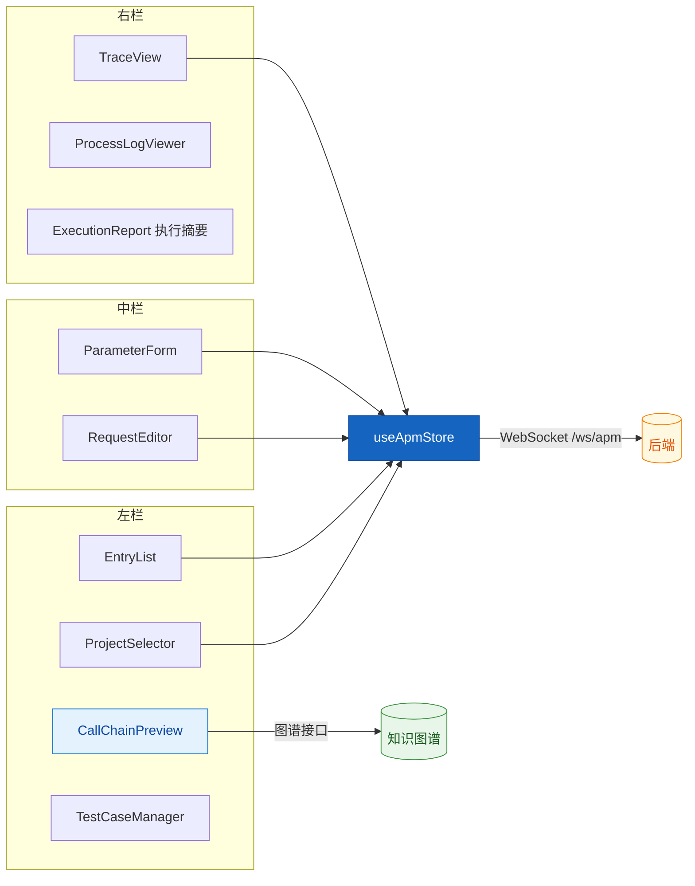
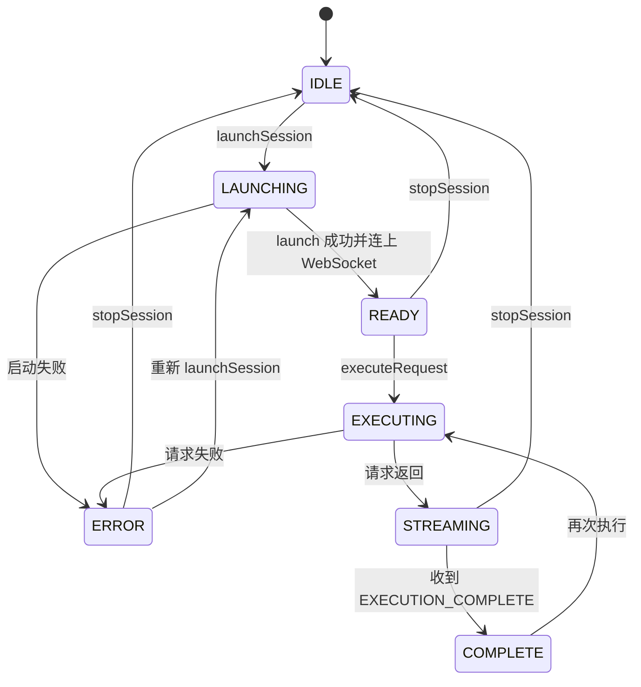
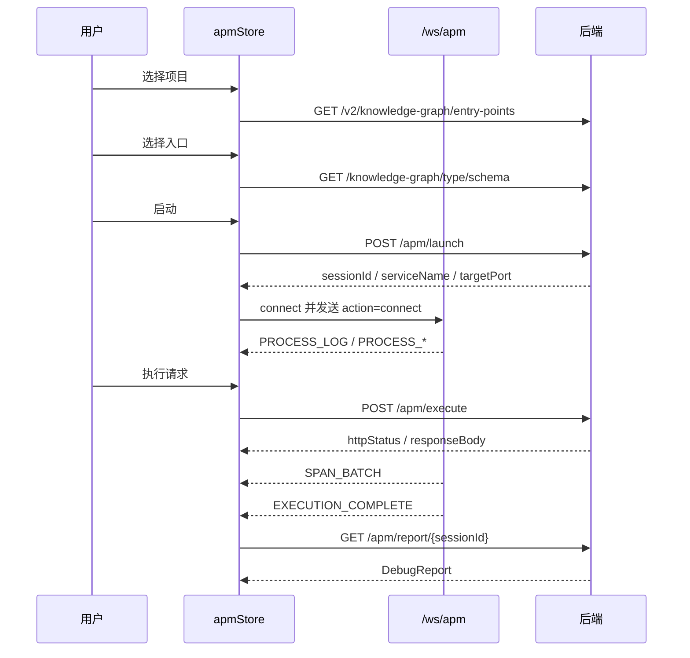

# APM调试

> 自动生成于 2026-11-26，基于 `99d0037` 版本

| 属性 | 值 |
|------|-----|
| **所属层** | 表现层 + 应用层 |
| **目录** | `src/views/apm-debug/`、`src/stores/apmStore.ts`、`src/composables/useApmWebSocket.ts`、`src/api/apmDebug.ts`、`src/api/testCase.ts`、`src/types/apm.ts` |
| **文件数** | 1 个页面 + 14 个子组件 + 1 个 Store + 1 个 Composable + 2 个 API 模块 + 1 个类型文件 |
| **路由** | `/apm-debug`（名称 `ApmDebug`） |
| **依赖模块** | [状态管理](./状态管理.md)、[实时通信](./实时通信.md)、[知识图谱](./知识图谱.md)（入口与 DTO 结构来自图谱接口） |

---

## 1. 模块概述

### 1.1 职责定义

**核心职责**：让开发者对着一个 Java 服务做"启动带埋点的实例 → 发一次 HTTP 请求 → 看调用链追踪与耗时热点 → 让 AI 诊断"的闭环调试。

**职责边界**：

| 本模块负责 | 本模块不负责 | 由谁负责 |
|-----------|-------------|---------|
| 选择项目与入口、拼装请求 | 启动被测进程、字节码埋点 | 后端 |
| 展示实时 span、进程日志与报告 | 产生 span 与日志 | 被测服务与后端 |
| 根据图谱给出的 DTO 结构生成请求体骨架 | 解析 DTO 字段 | 后端（图谱接口） |
| 调用链预览 | 调用关系数据 | 后端（图谱接口） |

### 1.2 核心文件清单

| 文件 | 类型 | 职责 | 行数 |
|------|------|------|------|
| `src/views/apm-debug/ApmDebugView.vue` | 页面 | 三栏布局与面板编排 | 306 |
| `src/views/apm-debug/components/ProjectSelector.vue` | 组件 | 项目下拉、埋点模式、启动 / 停止 | 331 |
| `src/views/apm-debug/components/EntryList.vue` | 组件 | 入口列表（搜索、按类分组） | 357 |
| `src/views/apm-debug/components/CallChainPreview.vue` | 组件 | 所选入口的图谱调用树与运行期 span 比对 | 571 |
| `src/views/apm-debug/components/TestCaseManager.vue` | 组件 | 请求配置的保存与回放 | 495 |
| `src/views/apm-debug/components/ParameterForm.vue` | 组件 | 按参数注解分组的表单 | 252 |
| `src/views/apm-debug/components/BodySchemaForm.vue` | 组件 | 请求体表单的顶层包装 | 134 |
| `src/views/apm-debug/components/SchemaObjectNode.vue`、`SchemaArrayNode.vue`、`SchemaPrimitiveInput.vue` | 组件 | 递归渲染 DTO 字段 | 172 + 123 + 104 |
| `src/views/apm-debug/components/RequestEditor.vue` | 组件 | 方法、URL（带自动补全）、查询参数、请求头、原始请求体 | 502 |
| `src/views/apm-debug/components/TraceView.vue` | 组件 | 按 trace 分组的链路瀑布图 | 828 |
| `src/views/apm-debug/components/ProcessLogViewer.vue` | 组件 | 进程日志控制台 | 331 |
| `src/views/apm-debug/components/ExecutionReport.vue` | 组件 | 执行摘要：匹配率、热点、错误点 | 174 |
| `src/views/apm-debug/components/AiDiagnosisChat.vue` | 组件 | 可拖动的 AI 诊断对话浮窗 | 715 |
| `src/stores/apmStore.ts` | Store | 全流程状态 | 701 |
| `src/composables/useApmWebSocket.ts` | Composable | `/ws/apm` 连接 | 113 |

---

## 2. 模块架构

### 2.1 三栏布局

各面板的显示条件（`ApmDebugView` 模板）：

| 面板 | 条件 |
|------|------|
| 错误提示条 | `store.status === 'ERROR'` |
| `ParameterForm` | 已选中入口 |
| `TraceView` | `store.showTracePanel`，即状态为 `EXECUTING` / `STREAMING` / `COMPLETE` |
| 追踪占位 | 不满足上述条件时显示"执行请求后显示链路追踪" |
| `ProcessLogViewer` | 状态不是 `IDLE`，或已有进程日志 |
| 执行摘要 | 状态为 `COMPLETE` 且有报告；新报告到达时自动展开 |
| `AiDiagnosisChat` | 挂载在视图底部，自身控制浮窗显隐 |

---

## 3. 对外接口

### 3.1 Store：`useApmStore`

状态与动作清单见 [状态管理](./状态管理.md)。本模块的要点：

- 请求编辑类动作（`setUrl`、`setBody`、`addQueryParam` 等）全部以展开语法返回新对象，采用不可变更新。
- Store 内部 `watch(wsEvents)`，在 `STREAMING` 状态下收到 `EXECUTION_COMPLETE` 时自动 `fetchReport()` 并把状态置 `COMPLETE`。
- `ApmDebugView` 在 `onUnmounted` 时显式调用 `store.cleanup()` 关闭 WebSocket。

### 3.2 API（`api/apmDebug.ts`）

| 函数 | 请求 | 前端调用方 |
|------|------|-----------|
| `launch(data)` | `POST /apm/launch` | `apmStore.launchSession` |
| `execute(data)` | `POST /apm/execute` | `apmStore.executeRequest` |
| `stop(sessionId)` | `POST /apm/stop`，体 `{ sessionId }` | `apmStore` |
| `getSessions(limit = 20)` | `GET /apm/sessions` | `apmStore.loadActiveSessions`（传 50） |
| `getSession(id)` | `GET /apm/session/{id}` | 无调用方 |
| `getSpans(sessionId)` | `GET /apm/spans/{sessionId}` | 无调用方（span 经 WebSocket 实时获得） |
| `getTrace(traceId)` | `GET /apm/trace/{traceId}` | 无调用方 |
| `getReport(sessionId)` | `GET /apm/report/{sessionId}` | `apmStore.fetchReport` |
| `getProcessOutput(sessionId, maxLines = 100)` | `GET /apm/process-output/{sessionId}` | 无调用方（日志经 WebSocket 实时获得） |

### 3.3 API（`api/testCase.ts`）

| 函数 | 请求 | 前端调用方 |
|------|------|-----------|
| `list(projectPath)` | `GET /apm/test-cases` | `TestCaseManager` |
| `getById(id)` | `GET /apm/test-cases/{id}` | 无调用方 |
| `create(testCase)` | `POST /apm/test-cases` | `TestCaseManager` |
| `update(id, testCase)` | `PUT /apm/test-cases/{id}` | `TestCaseManager` |
| `delete(id)` | `DELETE /apm/test-cases/{id}` | `TestCaseManager` |

### 3.4 对图谱接口的依赖

| 函数 | 用途 |
|------|------|
| `knowledgeGraphApi.getProjects()` | 项目下拉 |
| `knowledgeGraphApi.getEntryPoints([path], 'HTTP', 1, 10000)` | 入口列表。代码注释说明后端把 Controller 端点的入口类型记为 `HTTP` |
| `knowledgeGraphApi.getTypeSchema(className, projectPath)` | 请求体 DTO 的字段结构 |
| `knowledgeGraphApi.getCalleesTree(...)` | 调用链预览 |

---

## 4. 内部实现

### 4.1 会话状态机

状态取值 `ApmSessionStatus`：`IDLE` / `LAUNCHING` / `READY` / `EXECUTING` / `STREAMING` / `COMPLETE` / `ERROR`。上图按 `apmStore` 各动作的赋值整理；`canExecute` 在状态为 `IDLE`、`LAUNCHING`、`EXECUTING` 时为假（会话编号或 URL 为空时也为假），其余状态都允许再次执行。`launchSession` 开头会清掉上一次的全部残留状态。

### 4.2 埋点模式

| 取值 | 含义 |
|------|------|
| `FULL_PROJECT` | 全量项目埋点，默认值；不必先选入口 |
| `PRECISE` | 精准入口模式，按所选入口方法在图谱中的被调树生成埋点清单（`entryNodeId` 随启动请求提交） |
| `NONE` | 不做方法级埋点 |

选了 `PRECISE` 却没有选入口时，启动前会弹确认框说明后果，可选择"仍然启动"。

### 4.3 选中入口后的自动填充

`selectEntry` 依次做四件事：

1. 用 `parseEntryKey` 把 `GET /path` 形式的入口键拆成方法与路径。
2. 用 `parseEntryInfo` 解析入口信息 JSON，得到参数列表。
3. 按参数上的 Spring 注解分派：

| 注解 | 落点 |
|------|------|
| `RequestBody` | 生成请求体模板并加 `Content-Type: application/json`；记下类型以便加载结构 |
| `PathVariable` | 路径中的 `{name}` 占位保留给用户填 |
| `RequestParam` | 加入查询参数，默认勾选启用，预填 `defaultValue` |
| `RequestHeader` | 加入请求头，值为空 |
| 无注解 | 按 Spring 默认行为当作查询参数 |

4. 若存在 `RequestBody`，异步加载 DTO 结构并据此重写请求体。

代码注释记录了一条经验：可选的 `RequestParam` 也要默认启用，否则会被悄悄丢出 URL，导致后端 400。

### 4.4 请求体骨架的生成

`loadBodySchema(typeName, projectPath)`：

1. `unwrapGenericWrappers` 剥掉外层泛型包装（`List`、`Set`、`ResponseEntity`、`Result` 等），最多剥 6 层，遇到 `Map<K,V>` 这类多参数泛型即停；同时记录是否为集合。
2. 剥完后若是基本类型（`String`、`Integer`、`Date` 等）则不查结构。
3. 调 `getTypeSchema` 取 `DtoSchema`，递归生成 JSON：集合字段给 `[元素骨架]`，嵌套 DTO 递归，基本类型按类型给 `''` / `false` / `0` / `[]` / `{}` / `null`。
4. 顶层是集合时整体包成数组。

注释提醒这段逻辑要与后端 `DtoSchemaResolver.unwrapCollection` 保持一致。

### 4.5 WebSocket 消息（`/ws/apm`）

| 方向 | 消息 | 处理 |
|------|------|------|
| 发 | `{ action: 'connect', sessionId }` | 连接成功后立即发送 |
| 收 | `SPAN_BATCH` | 把 `spans[]` 追加到 `wsSpans` |
| 收 | `PROCESS_LOG` | 追加一行日志；超过 2000 行裁到 1500 行 |
| 收 | 其它 `PROCESS_*` | 用 `status` 或事件名更新进程状态；`ERROR` / `STOPPED` 时记录 `exitCode` 与 `tailLines` |
| 收 | `EXECUTION_COMPLETE` 等 | 全部进 `wsEvents`，由 Store 监听 |

### 4.6 追踪视图（`TraceView`）

- 按 `traceId` 把 span 分组，每组识别一个入口：优先 `spanKind === 'SERVER'`，其次操作名以 HTTP 方法开头的 span，最后取最早的根 span。
- 慢 span 阈值：耗时超过该组总耗时的 30%。
- 每组渲染为瀑布图，行数据含 `leftPercent` 与 `widthPercent`。

### 4.7 调用链预览（`CallChainPreview`）

选中入口变化时重新拉取图谱的被调树；同时把运行期没有匹配上图谱节点的 span（`kgNodeId` 为空或 `kgMatchLevel === 0`）单独列出，便于发现"图谱里没有、运行时却出现"的方法。

---

## 5. 交互流程

---

## 6. 依赖关系

| 方向 | 依赖 | 说明 |
|------|------|------|
| 上游 | `api/apmDebug.ts`、`api/testCase.ts`、`api/knowledgeGraph.ts` | 见第 3 节 |
| 上游 | `api/claude.ts` | `AiDiagnosisChat` 调 `universalChat`，场景 `APM_DIAGNOSIS` 对应 `POST /api/chat/apm-diagnose` |
| 上游 | `types/apm.ts` | 除类型外还含 `parseEntryKey`、`parseEntryInfo`、`extractProjectLabel`、`buildTraceTree` 四个工具函数 |
| 上游 | `utils/markdown.ts` | AI 诊断对话的 Markdown 渲染 |
| 下游 | 路由、侧边栏"APM 调试" | `menuKey: 'apm-debug'` |

---

## 7. 配置项

| 常量 | 值 | 位置 |
|------|----|------|
| 入口列表分页大小 | 10000 | `apmStore.loadEntryPoints` |
| 活跃会话查询条数 | 50 | `apmStore.loadActiveSessions` |
| 进程日志缓冲 | 2000 行裁到 1500 行 | `useApmWebSocket` |
| 慢 span 阈值 | 占比 0.3 | `TraceView` |
| 拖动判定阈值 | 5 px | `AiDiagnosisChat` |

---

## 8. 错误处理

| 场景 | 处理 | 用户感知 |
|------|------|---------|
| 未选项目就启动 | `ElMessage.warning` | "请先选择项目" |
| 启动 / 执行失败 | 状态置 `ERROR`，`errorMessage` 取异常消息 | 顶部错误条 |
| 进程以错误退出 | 记录退出码与末尾日志 | 日志面板的错误横幅 |
| 旧会话残留 | 可强制停止 | "已停止旧会话" / "停止旧会话失败，请稍后重试" |
| HTTP 层错误 | 交由拦截器提示 | 见 [API服务层](./API服务层.md) |

---

## 9. 性能考量

| 关注点 | 策略 | 实现 |
|--------|------|------|
| span 数量增长 | 追加式数组；追踪树由 `computed` 派生 | `apmStore.traceTree` |
| 日志内存 | 上限裁剪 | `useApmWebSocket` |
| 日志查看 | 正则过滤 + 级别过滤 + 自动滚动 | `ProcessLogViewer` |
| 离开页面 | 显式断开 WebSocket | `ApmDebugView.onUnmounted` |

---

## 10. 已知问题与扩展点

| 类型 | 说明 |
|------|------|
| 已知问题 | `apmApi` 的 `getSession`、`getSpans`、`getTrace`、`getProcessOutput` 与 `testCaseApi.getById` 没有调用方 |
| 已知问题 | `apmStore` 是仓库里最大的 Store（701 行），把项目、入口、请求、会话、WebSocket 五类状态放在一起 |
| 扩展点 | 新增请求来源（如 MQ 入口）需扩展 `loadEntryPoints` 的入口类型参数，当前写死为 `'HTTP'` |

---

> **相关文档**：
> - 架构总览 → [02-架构设计](../02-架构设计/index.md)
> - WebSocket 连接细节 → [实时通信](./实时通信.md)
> - 入口与 DTO 结构的来源 → [知识图谱](./知识图谱.md)
> - 接口清单 → [05-接口文档](../05-接口文档/index.md)
