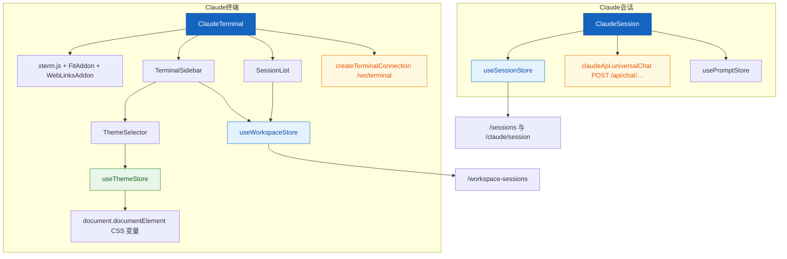
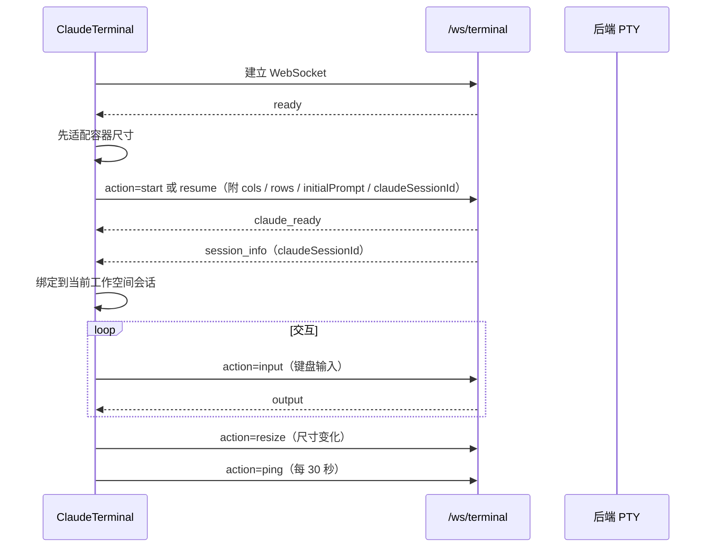

# Claude终端与会话

> 自动生成于 2026-11-26，基于 `99d0037` 版本

| 属性 | 值 |
|------|-----|
| **所属层** | 表现层 + 应用层 |
| **目录** | `src/views/claude-terminal/`、`src/views/claude-session/`、`src/stores/workspaceStore.ts`、`src/stores/sessionStore.ts`、`src/stores/themeStore.ts`、`src/themes/`、`src/api/terminal.ts`、`src/api/workspaceSession.ts`、`src/api/session.ts`、`src/api/claude.ts`、`src/types/terminal.ts`、`src/types/session.ts` |
| **文件数** | 2 个页面 + 3 个子组件 + 3 个 Store + 3 个主题文件 + 4 个 API 模块 + 2 个类型文件 |
| **路由** | `/claude-terminal`（名称 `ClaudeTerminal`）、`/claude-session`（名称 `ClaudeSession`） |
| **依赖模块** | [状态管理](./状态管理.md)、[实时通信](./实时通信.md)、[提示词与术语](./提示词与术语.md)、[项目管理](./项目管理.md) |

---

## 1. 模块概述

### 1.1 职责定义

**核心职责**：提供两种与 Claude 协作的方式——在浏览器里打开一个真正的命令行终端（PTY），或者在一个网页对话界面里按场景提问。两者各自有独立的会话模型。

**职责边界**：

| 本模块负责 | 本模块不负责 | 由谁负责 |
|-----------|-------------|---------|
| 终端的渲染、输入转发、尺寸同步 | PTY 进程与 Claude CLI | 后端 |
| 终端主题与配色 | — | — |
| 工作空间会话、对话会话的增删改查归档 | 会话的持久化 | 后端 |
| 网页对话的消息流式展示 | 模型回答 | 后端 |

### 1.2 两套会话模型的区别

| | 工作空间会话 | 对话会话 |
|---|-------------|---------|
| Store | `useWorkspaceStore`（`workspace`） | `useSessionStore`（`session`） |
| API 模块 | `api/workspaceSession.ts` | `api/session.ts` + `api/claude.ts` |
| 类型 | `ClaudeWorkspaceSession` | `Session` / `Message` |
| 路径前缀 | `/workspace-sessions` | `/sessions`、`/claude/session`、`/chat/{agentType}` |
| 使用页面 | Claude 终端 | Claude 会话 |
| 关联字段 | `claudeSessionId`（终端会话码） | `claudeSessionCode` |

两者名字相近但互不引用。

### 1.3 核心文件清单

| 文件 | 类型 | 职责 | 行数 |
|------|------|------|------|
| `src/views/claude-terminal/ClaudeTerminal.vue` | 页面 | xterm.js 终端与连接管理 | 516 |
| `src/views/claude-terminal/components/SessionList.vue` | 组件 | 工作空间会话列表（活跃 / 已归档两组） | 447 |
| `src/views/claude-terminal/components/TerminalSidebar.vue` | 组件 | 右侧信息栏：会话信息、连接状态、Git 状态 | 448 |
| `src/views/claude-terminal/components/ThemeSelector.vue` | 组件 | 主题选择与自定义主色调 | 178 |
| `src/views/claude-session/ClaudeSession.vue` | 页面 | 网页对话：会话列表、消息、导出 | 748 |
| `src/stores/workspaceStore.ts` | Store | 工作空间会话 | 132 |
| `src/stores/sessionStore.ts` | Store | 仓库里动作最多的 Store | 406 |
| `src/stores/themeStore.ts` | Store | 主题切换与 CSS 变量注入 | 206 |
| `src/themes/types.ts`、`presets.ts`、`index.ts` | 主题 | 类型、6 套预设、统一出口 | 111 + 272 + 23 |
| `src/api/terminal.ts` | API | WebSocket 终端连接工厂 | 144 |

---

## 2. 模块架构



---

## 3. 对外接口

### 3.1 路由与入口

| 路由 | 入口 |
|------|------|
| `/claude-terminal` | 侧边栏"Claude 终端"；[项目管理](./项目管理.md) 创建终端会话后带 `?sessionId=` 跳转 |
| `/claude-session` | 知识图谱"引用分析"页签的 AI 解读拿到会话编号后带 `?sessionId=` 跳转；无侧边栏入口 |

### 3.2 API（`api/workspaceSession.ts`）

| 函数 | 请求 |
|------|------|
| `list(status?)` | `GET /workspace-sessions` |
| `get(id)` | `GET /workspace-sessions/{id}`（无调用方） |
| `create(data)` | `POST /workspace-sessions`，体 `{ scene?, initialPrompt?, workingDirectory? }` |
| `update(id, data)` | `PUT /workspace-sessions/{id}` |
| `delete(id)` | `DELETE /workspace-sessions/{id}` |
| `archive(id)` | `POST /workspace-sessions/{id}/archive` |
| `bindClaudeSession(id, claudeSessionId)` | `POST /workspace-sessions/{id}/bind-claude-session` |

### 3.3 API（`api/session.ts` 与 `api/claude.ts`）

| 函数 | 请求 |
|------|------|
| `sessionApi.list(params)` | `GET /sessions`，参数 `status` / `page` / `pageSize` |
| `sessionApi.get(sessionId)` | `GET /sessions/{sessionId}` |
| `sessionApi.update(sessionId, data)` | `PATCH /sessions/{sessionId}` |
| `sessionApi.delete(sessionId)` | `DELETE /sessions/{sessionId}` |
| `sessionApi.archive(sessionId)` | `POST /sessions/{sessionId}/archive` |
| `sessionApi.export(sessionId, format)` | `GET /sessions/{sessionId}/export`（Blob） |
| `sessionApi.clearMessages(sessionId)` | `DELETE /sessions/{sessionId}/messages` |
| `claudeApi.universalChat(data, callbacks)` | `POST /api/chat/{agentType}`，`fetch` 流式 |
| `claudeApi.endSession(sessionId)` | `DELETE /claude/session/{sessionId}` |
| `claudeApi.resumeSession(sessionId)` | `POST /claude/session/{sessionId}/resume` |
| `claudeApi.getSessionCode(sessionId)` | `GET /claude/session/{sessionId}/code`（无调用方） |
| `claudeApi.streamAnalyze`、`streamChat` | `/api/claude/stream`、`/api/claude/chat`（均无调用方） |

> 后端没有任何 `/api/claude/*` 路由（2026-07-31 的提交 `73117ab` 清理时移除）。上表里的 `endSession`、`resumeSession`、`getSessionCode` 以及 `streamAnalyze`、`streamChat` 在后端都找不到对应接口；其中 `endSession`、`resumeSession` 仍被 `sessionStore` 调用。

### 3.4 `createTerminalConnection`

```typescript
export function createTerminalConnection(callbacks: TerminalCallbacks): TerminalConnection
// TerminalConnection = { send(message), close(), getStatus() }
```

回调：`onOpen`、`onClose`、`onError(error)`、`onOutput(data)`、`onSessionInfo(claudeSessionId)`、`onReady`、`onClaudeReady`、`onStatusChange(status)`。创建即连接。

---

## 4. 内部实现

### 4.1 终端握手流程



- **启动还是恢复**：当前工作空间会话已有 `claudeSessionId` 就发 `resume` 并带上它，否则发 `start`；`start` 时可附带会话的 `initialPrompt`。
- **绑定**：收到 `session_info` 后调用 `workspaceStore.bindClaudeSession`，把会话码写回工作空间会话，下次即可恢复。
- **尺寸**：`FitAddon` 自适应容器，变化时经 50 毫秒防抖后重新适配并向后端发 `resize`。

### 4.2 终端配置

| 项 | 值 |
|----|----|
| 字体 | `"JetBrains Mono", "Fira Code", "Consolas", monospace`，14px，行高 1.4 |
| 回滚行数 | 5000 |
| 光标 | 闪烁、块状 |
| Windows PTY 后端 | `conpty` |
| 主题 | 取自 `useThemeStore`，主题变化时即时更新 |

### 4.3 快捷键（仅在本页路由下生效）

| 快捷键 | 动作 |
|--------|------|
| `Ctrl + N` | 新建会话 |
| `Ctrl + L` | 清屏 |
| `Ctrl + R` | 重连 |
| `Ctrl + F` | 聚焦会话列表的搜索框 |

### 4.4 进入页面时的会话选择

依次尝试：地址栏 `?sessionId=`（最多重试 20 次、每次 50 毫秒等待其进入 Store，仍找不到则从服务端加载）→ Store 当前的会话 → 第一个活跃会话 → 都没有就新建一个。

### 4.5 终端侧栏

`TerminalSidebar` 展示会话标题、会话码、工作目录、终端行列数、连接时长，并用 `gitApi.getStatus(workingDirectory)` 显示当前分支与是否干净。向外抛三个事件：`executeCommand`、`reconnect`、`clear`。

### 4.6 主题系统

- **预设 6 套**：`dark-tech` 深色科技（默认）、`dark-monokai` Monokai 经典、`dark-dracula` Dracula、`light-minimal` 浅色简约、`light-sepia` 护眼暖色、`eye-care` 护眼绿色。
- **每个主题包含两组颜色**：界面色（四级背景、文字、强调色等）与终端色（前景、背景、光标、16 色）。
- **生效方式**：界面色写入 `document.documentElement` 的 16 个 CSS 变量；终端色通过 `terminal.options.theme` 交给 xterm.js。
- **持久化**：`localStorage` 键 `claude-terminal-theme`，存 `{ themeId, customAccent }`。
- **自定义主色调**：在预设之上覆盖 `accentPrimary` 与终端光标 / 选区色，不修改预设本身。

### 4.7 Claude 会话页

- 场景类型（`SceneType`）：`log-analysis` 日志分析、`code-analysis` 代码分析、`trace-analysis` 调用链分析、`impact-analysis` 影响分析、`free-chat` 自由对话、`APM_DIAGNOSIS` APM 诊断。
- 发送与新建都走 `claudeApi.universalChat`；新建会话的场景是 `free-chat`，提示词由 `promptStore` 渲染 `free-chat` 模板。
- 消息按会话缓存；页面显示当前项目名（取自 `useAppStore` 的 `selectedProject`）。
- 支持改标题、归档、删除、导出（Markdown 或 JSON）、复制内容。
- 监听地址栏 `?sessionId=`，变化时切换到对应会话。

---

## 5. 异常流程

| 场景 | 处理 | 用户感知 |
|------|------|---------|
| 终端连接出错 | 状态置 `error` | "终端连接错误: …"（手动断开引发的错误不提示） |
| 连接关闭 | 状态置 `disconnected`，停止计时 | 状态指示 |
| 工作空间会话写操作失败 | `ElMessage.error` | "创建会话失败"等 |
| 对话会话动作失败 | `console.error`，状态保持原样 | 无额外提示 |

---

## 6. 依赖关系

| 方向 | 依赖 | 说明 |
|------|------|------|
| 上游 | `@xterm/xterm`、`@xterm/addon-fit`、`@xterm/addon-web-links` | 终端渲染 |
| 上游 | `lodash-es` | 仅用到 `debounce` |
| 上游 | `api/git.ts` | 侧栏的 Git 状态 |
| 上游 | `stores/promptStore.ts` | 会话页的提示词模板 |
| 下游 | 路由、侧边栏"Claude 终端" | `menuKey: 'claude-terminal'` |
| 下游 | 项目管理页、知识图谱引用分析页签 | 带 `?sessionId=` 跳转 |

---

## 7. 配置项

| 项 | 值 | 位置 |
|----|----|------|
| 终端心跳 | 30 秒 | `api/terminal.ts` |
| 尺寸适配防抖 | 50 毫秒 | `ClaudeTerminal.vue` |
| 默认行列数 | 120 × 30 | `ClaudeTerminal.vue`、`TerminalSidebar.vue` |
| 主题持久化键 | `claude-terminal-theme` | `themes/types.ts` |

终端连接没有自动重连，需要用户手动触发（`Ctrl + R` 或侧栏按钮）。

---

## 8. 性能考量

| 关注点 | 策略 | 实现 |
|--------|------|------|
| 频繁 resize | 防抖 50 毫秒 | `debouncedFitTerminal` |
| 主题切换 | 只改 CSS 变量与 xterm 选项，不重建终端 | `themeStore` |
| 离开页面 | 释放终端实例、连接、观察器与全部监听 | `ClaudeTerminal.onUnmounted` |

---

## 9. 已知问题与扩展点

| 类型 | 说明 |
|------|------|
| 已知问题 | 终端 WebSocket 无自动重连 |
| 已知问题 | `workspaceSessionApi.get`、`claudeApi.getSessionCode`、`claudeApi.streamAnalyze`、`claudeApi.streamChat` 没有调用方 |
| 已知问题 | 两套会话模型命名相近（`ClaudeWorkspaceSession` / `Session`），容易混淆 |
| 扩展点 | 新增主题：在 `themes/presets.ts` 增加一个 `TerminalTheme` 并加入 `THEME_PRESETS` |

---

> **相关文档**：
> - 架构总览 → [02-架构设计](../02-架构设计/index.md)
> - WebSocket 细节 → [实时通信](./实时通信.md)
> - 提示词模板 → [提示词与术语](./提示词与术语.md)
> - 接口清单 → [05-接口文档](../05-接口文档/index.md)
