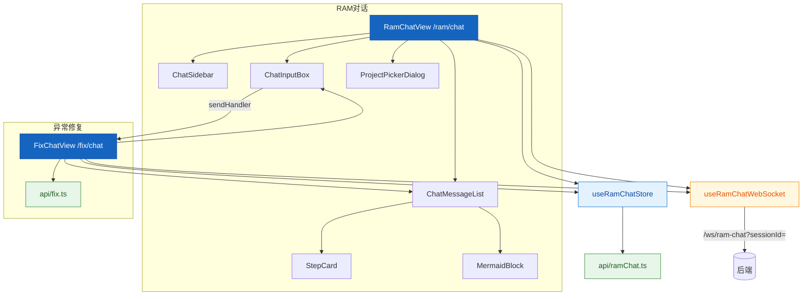
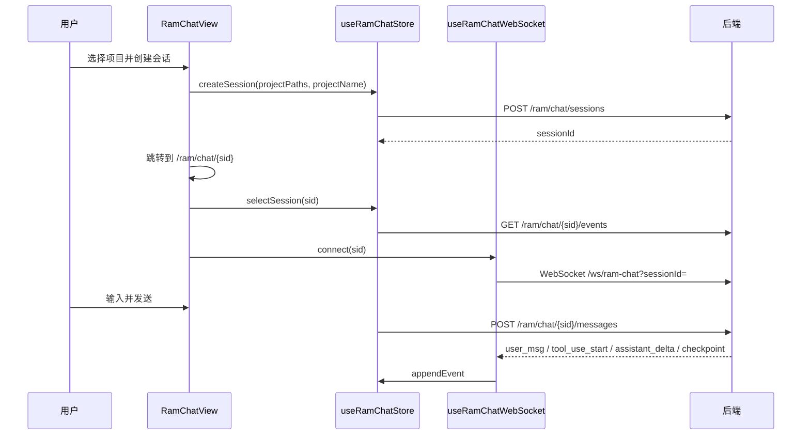
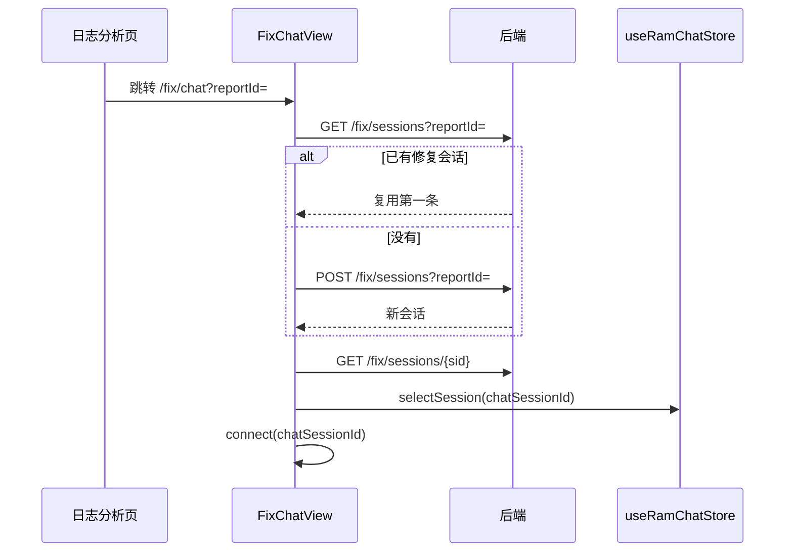

# RAM对话与异常修复

> 自动生成于 2026-11-26，基于 `99d0037` 版本

| 属性 | 值 |
|------|-----|
| **所属层** | 表现层 + 应用层 |
| **目录** | `src/views/ram/RamChatView.vue`、`src/views/ram/chat/`、`src/views/fix/`、`src/stores/ramChatStore.ts`、`src/composables/useRamChatWebSocket.ts`、`src/api/ramChat.ts`、`src/api/fix.ts` |
| **文件数** | 2 个页面 + 6 个对话子组件 + 1 个 Store + 1 个 Composable + 2 个 API 模块 |
| **路由** | `/ram/chat`、`/ram/chat/:sid`、`/fix/chat`、`/fix/chat/:sid` |
| **依赖模块** | [实时通信](./实时通信.md)、[状态管理](./状态管理.md)、[日志分析](./日志分析.md)（异常修复的入口） |

---

## 1. 模块概述

### 1.1 职责定义

**核心职责**：提供不走固定 DAG 的对话式入口——选若干项目后直接提问，由智能体边调用工具边流式回答；同一套对话组件又被"异常修复"复用，针对某份日志分析报告开展修复会话。

**职责边界**：

| 本模块负责 | 本模块不负责 | 由谁负责 |
|-----------|-------------|---------|
| 对话会话的增删改查与实时事件展示 | 智能体的工具调用与回答 | 后端 |
| 把事件流整理成"轮次" | 事件的生产 | 后端 |
| 异常修复会话的创建、绑定对话通道、追问 | 实际的代码修复 | 后端 |
| 节点式流程的需求分析 | — | [RAM需求分析](./RAM需求分析.md) |

### 1.2 核心文件清单

| 文件 | 类型 | 职责 | 行数 |
|------|------|------|------|
| `src/views/ram/RamChatView.vue` | 页面 | RAM 对话主页 | 128 |
| `src/views/ram/chat/ChatSidebar.vue` | 组件 | 会话列表 | 128 |
| `src/views/ram/chat/ChatMessageList.vue` | 组件 | 事件 → 轮次 → 消息 / 工具步骤 | 245 |
| `src/views/ram/chat/ChatInputBox.vue` | 组件 | 输入框 | 67 |
| `src/views/ram/chat/ProjectPickerDialog.vue` | 组件 | 新建会话时的项目选择 | 113 |
| `src/views/ram/chat/StepCard.vue` | 组件 | 一轮里的工具调用步骤 | 142 |
| `src/views/ram/chat/MermaidBlock.vue` | 组件 | 回答中的 Mermaid 图 | 95 |
| `src/views/fix/FixChatView.vue` | 页面 | 异常修复会话页 | 276 |
| `src/stores/ramChatStore.ts` | Store | 会话、当前事件、流式状态 | 102 |
| `src/composables/useRamChatWebSocket.ts` | Composable | `/ws/ram-chat` 连接 | 100 |
| `src/api/ramChat.ts` | API | 8 个对话接口 | 72 |
| `src/api/fix.ts` | API | 5 个修复会话接口 | 50 |

---

## 2. 模块架构

两个页面共用同一个 `useRamChatStore` 实例和同一组对话子组件。`ChatInputBox` 通过可选的 `sendHandler` 属性区分发送路径：不传则走 `store.sendMessage`，异常修复页传入自己的处理函数。

---

## 3. 对外接口

### 3.1 路由与入口

| 路由 | 名称 | 入口 |
|------|------|------|
| `/ram/chat` | `RamChat` | 侧边栏"RAM 对话" |
| `/ram/chat/:sid` | `RamChatSession` | 侧栏点击会话、新建会话后跳转 |
| `/fix/chat` | `FixChat` | 日志分析页跳转（带 `?reportId=`）、日志报告详情页（带 `?reportId=`） |
| `/fix/chat/:sid` | `FixChatSession` | 日志报告详情页（带会话编号）；地址栏带 `?sessionId=` 也可进入 |

异常修复页没有侧边栏入口，"返回"按钮固定回 `/log-analysis`。

### 3.2 API（`api/ramChat.ts`）

| 函数 | 请求 |
|------|------|
| `createSession(req)` | `POST /ram/chat/sessions`，体 `{ projectPaths, projectName?, initialQuestion? }` |
| `sendMessage(sid, text)` | `POST /ram/chat/{sid}/messages`，体 `{ text }` |
| `injectMessage(sid, content)` | `POST /ram/chat/{sid}/inject`，体 `{ content }` |
| `getEvents(sid)` | `GET /ram/chat/{sid}/events` |
| `listSessions()` | `GET /ram/chat/sessions` |
| `renameSession(sid, title)` | `PATCH /ram/chat/{sid}/title` |
| `deleteSession(sid)` | `DELETE /ram/chat/{sid}` |
| `interruptTurn(sid)` | `POST /ram/chat/{sid}/interrupt` |

### 3.3 API（`api/fix.ts`）

| 函数 | 请求 | 前端调用方 |
|------|------|-----------|
| `startSession(reportId)` | `POST /fix/sessions?reportId=` | 异常修复页 |
| `followUp(sessionId, message)` | `POST /fix/sessions/{sessionId}/follow-up`，`text/plain` | 异常修复页 |
| `getSession(sessionId)` | `GET /fix/sessions/{sessionId}` | 异常修复页 |
| `listByReport(reportId)` | `GET /fix/sessions?reportId=` | 异常修复页、日志报告详情页 |
| `getHistory(sessionId)` | `GET /fix/sessions/{sessionId}/history` | 无调用方 |

---

## 4. 内部实现

### 4.1 事件到轮次（`ChatMessageList`）

事件的 `payload` 是 JSON 字符串，组件先解析再按 `payload.turnId` 归并成轮次；没有 `turnId` 的事件（如连接确认）直接跳过。事件类型统一转小写后匹配：

| 事件类型 | 对轮次的影响 |
|---------|-------------|
| `user_msg` | 写入用户消息 |
| `assistant_delta` | 追加增量文本；轮次已结束则丢弃（防止迟到的增量污染已定稿的文本） |
| `tool_use` / `tool_use_start` | 追加一条工具步骤 |
| `tool_result` | 回填最后一条同名步骤的结果 |
| `checkpoint` | 轮次置为完成；`payload.finalText` 存在时覆盖助手文本 |
| `turn_interrupted` | 轮次置为完成；`payload.partialText` 存在时覆盖助手文本 |
| `error` | 轮次置为出错并记录消息 |

组件注释指出两套命名的来源：WebSocket 推送是小写下划线，而经 REST 取回的持久化事件类型是大写枚举名。

### 4.2 工具步骤卡（`StepCard`）

- 默认折叠规则：轮次已完成、步骤数不少于 3 且无出错步骤时默认折叠。
- 用户的展开 / 折叠选择写入 `localStorage`，键为 `ram-chat-step-collapse-{turnId}`，7 天后过期。

### 4.3 回答里的图

`ChatMessageList` 用正则把助手文本按 Mermaid 围栏代码块（三个反引号加 `mermaid` 语言标记）切块，图块交给 `MermaidBlock` 渲染，其余按 Markdown 渲染（经 DOMPurify 净化）。`MermaidBlock` 在解析失败时退回为源码加提示，避免一张坏图影响整条消息。

### 4.4 RAM 对话页

- 挂载时先拉会话列表；地址栏带 `sid` 则加载该会话的历史事件并建立 WebSocket。
- 路由参数变化时先断开旧连接，再选择新会话并重连。
- 新建会话成功后跳到 `/ram/chat/{sessionId}`；删除当前会话后跳到列表第一条，列表为空则回 `/ram/chat`。
- 项目来源与 [RAM需求分析](./RAM需求分析.md) 的输入页一致：本地扫描的仓库 + 已克隆的远程项目，按名称去重且远程优先。

### 4.5 异常修复页（`FixChatView`）

初始化按地址参数分三种情况：

| 参数 | 行为 |
|------|------|
| 路径里的 `sid` | 直接加载该修复会话 |
| 查询串里的 `reportId` | 先查该报告是否已有修复会话：有则复用第一条，没有才创建；随后把地址替换为 `/fix/chat/{sid}` |
| 查询串里的 `sessionId` | 同第一种 |

绑定对话通道：修复会话自带一个 `chatSessionId`，页面用它调用 `store.selectSession` 拉历史事件，再以它建立 `/ws/ram-chat` 连接。也就是说**修复会话是对话会话外面的一层壳**，消息展示完全复用对话通道；但追问走的是修复接口 `followUp`（纯文本体），而不是对话接口。

状态文案：`RUNNING` 进行中、`SUCCESS` 已完成、`FAILED` 失败、`PAUSED` 已暂停。类型定义里还有 `REPRO_FAILED`、`TEST_NOT_PASSED`、`ERROR` 三个取值，前端没有对应文案，会原样显示。"worktree"按钮把 `worktreePath` 复制到剪贴板。

---

## 5. 交互流程

### 5.1 新建 RAM 对话并发送一条消息

### 5.2 异常修复会话的建立

---

## 6. 依赖关系

| 方向 | 依赖 | 说明 |
|------|------|------|
| 上游 | `api/ramChat.ts`、`api/fix.ts` | 本模块专属 |
| 上游 | `api/project.ts`、`api/remote-project.ts` | 项目选择弹窗 |
| 上游 | `utils/markdown.ts`、`mermaid` | 渲染 |
| 下游 | 侧边栏"RAM 对话" | `menuKey: 'ram-chat'` |
| 下游 | 日志分析页、日志报告详情页 | 异常修复入口 |

---

## 7. 配置项

| 项 | 值 | 位置 |
|----|----|------|
| WebSocket 心跳 | 30 秒 | `useRamChatWebSocket.ts` |
| 重连次数上限 | 5 | 同上 |
| 步骤卡偏好保留 | 7 天 | `StepCard.vue` |

---

## 8. 错误处理

| 场景 | 处理 | 用户感知 |
|------|------|---------|
| 创建对话会话失败 | `ElMessage.error` 带错误信息 | 红色提示 |
| 未选项目就创建 | 不发请求 | "请选择至少一个项目" |
| 启动 / 加载修复会话失败 | `ElMessage.error` | 红色提示 |
| 地址缺少 `reportId` 与 `sessionId` | 警告 | "缺少 reportId 或 sessionId 参数" |
| 修复会话缺少 `chatSessionId` | 警告，不建连 | "会话缺少 chatSessionId" |
| 当前会话缺少 `reportId` 时点"新建" | 警告 | 不做任何请求 |
| 轮次出错 | 该轮显示错误消息 | 行内提示 |

---

## 9. 性能考量

| 关注点 | 策略 | 实现 |
|--------|------|------|
| 自动滚动到底 | 监听轮次变化，`nextTick` 后设置 `scrollTop` | `ChatMessageList` |
| 避免幽灵"思考中" | 跳过没有 `turnId` 的事件 | 同上 |
| 迟到增量 | 轮次结束后丢弃后续 `assistant_delta` | 同上 |
| 重连风暴 | 指数退避且上限 5 次 | `useRamChatWebSocket` |

---

## 10. 已知问题与扩展点

| 类型 | 说明 |
|------|------|
| 已知问题 | `ramChatStore.appendEvent` 用大写常量（`ASSISTANT_DELTA`、`CHECKPOINT`、`TURN_INTERRUPTED`）维护 `isStreaming`，而 `ChatMessageList` 的注释指出 WebSocket 事件类型是小写；两处大小写约定不一致，`isStreaming` 在实时事件下的取值未在代码中确认 |
| 已知问题 | `fixApi.getHistory` 没有调用方 |
| 扩展点 | 需要给其它来源接入对话式交互时，可仿照异常修复：新建页面并复用 `ChatMessageList` / `ChatInputBox`，通过 `sendHandler` 替换发送路径 |

---

## 11. 仍在路由中、已被对话页取代的页面

`src/views/ram/` 下还有四个页面，文件头注释标明已被 `/ram/chat`（及其内嵌的项目选择弹窗）取代，保留用于查看旧会话：

| 路由 | 页面 | 说明 |
|------|------|------|
| `/ram/status` | `StatusSessionListPage` | 项目现状分析历史列表，取 `sessionType = 'STATUS'` |
| `/ram/status/new` | `StatusInputPage` | 发起现状分析（`POST /ram/status/start`） |
| `/ram/status/:sid` | `StatusPage` | REST 先取报告；仍在运行则开 SSE 监听 `project_overview` 的 `CHECKPOINT`；SSE 失败时每 3 秒轮询兜底；可发起 Phase2 精确分析 |
| `/ram/phase2/:sid` | `Phase2Page` | 每 3 秒轮询 V2 报告接口，渲染汇总层与明细层 |

这四个页面都没有侧边栏入口，全仓库也没有其它页面跳转到 `/ram/status`，只能通过地址栏或它们互相之间的跳转到达。

---

> **相关文档**：
> - 架构总览 → [02-架构设计](../02-架构设计/index.md)
> - 节点式流程 → [RAM需求分析](./RAM需求分析.md)
> - WebSocket 连接细节 → [实时通信](./实时通信.md)
> - 异常修复的入口 → [日志分析](./日志分析.md)
