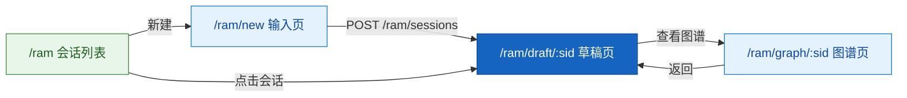
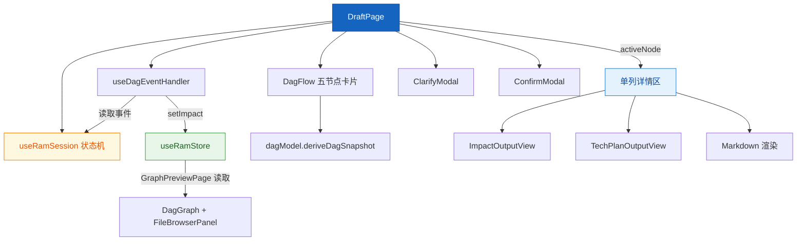
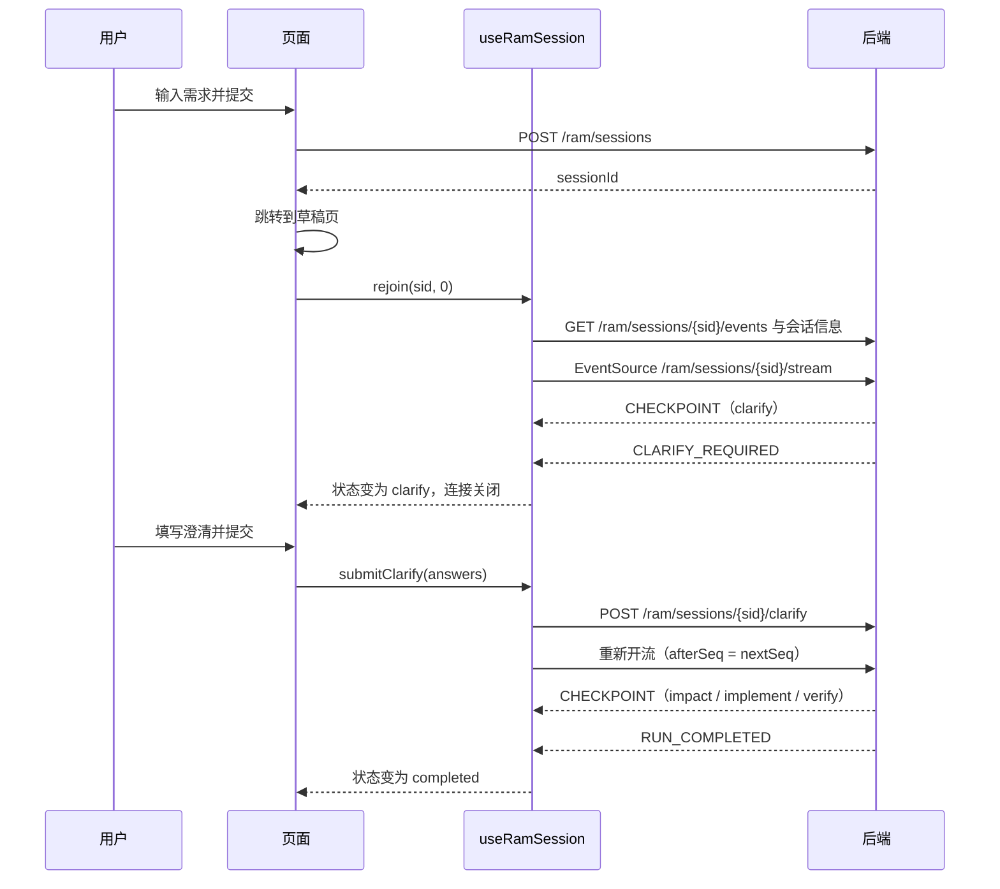

# RAM需求分析

> 自动生成于 2026-11-26，基于 `99d0037` 版本

| 属性 | 值 |
|------|-----|
| **所属层** | 表现层 + 应用层 |
| **目录** | `src/views/ram/`（不含 `chat/`）、`src/components/ram/`、`src/composables/useRamSession.ts`、`src/composables/useDagEventHandler.ts`、`src/stores/ram.ts`、`src/api/ram.ts` |
| **文件数** | 8 个页面 + 12 个组件 + 5 个布局 / 辅助 TS 文件 + 2 个 Composable + 1 个 Store + 1 个 API 模块 |
| **路由** | `/ram`、`/ram/new`、`/ram/draft/:sid`、`/ram/graph/:sid` |
| **依赖模块** | [实时通信](./实时通信.md)、[状态管理](./状态管理.md)、[项目管理](./项目管理.md)（项目选择器数据源） |

---

## 1. 模块概述

### 1.1 职责定义

**核心职责**：RAM（Requirement Analysis Master，需求分析大师）把一段需求文本经"澄清 → 影响分析 → 实现方案 → 验证"四个节点处理成结构化产物，前端负责发起会话、以 SSE 展示进度、承接澄清与人工确认、展示各节点结果，并把影响数据画成图谱。

**职责边界**：

| 本模块负责 | 本模块不负责 | 由谁负责 |
|-----------|-------------|---------|
| 发起、重连、中止会话 | 节点的实际分析逻辑 | 后端编排器 |
| 澄清与 HITL 确认的表单 | 判断何时需要澄清 / 确认 | 后端（前端只响应事件） |
| 节点输出的可读化渲染 | 生成这些输出 | 后端各节点 |
| 影响图谱的布局与交互 | 影响范围的计算 | 后端影响分析节点 |

### 1.2 核心文件清单

| 文件 | 类型 | 职责 | 行数 |
|------|------|------|------|
| `src/views/ram/SessionListPage.vue` | 页面 | 历史会话列表（路由 `/ram`） | 191 |
| `src/views/ram/InputPage.vue` | 页面 | 需求输入与项目选择（路由 `/ram/new`） | 535 |
| `src/views/ram/DraftPage.vue` | 页面 | 会话主页面（路由 `/ram/draft/:sid`） | 1050 |
| `src/views/ram/GraphPreviewPage.vue` | 页面 | 影响图谱（路由 `/ram/graph/:sid`） | 113 |
| `src/composables/useRamSession.ts` | Composable | 会话状态机与 SSE | 434 |
| `src/composables/useDagEventHandler.ts` | Composable | 事件 → 各节点输出 | 608 |
| `src/components/ram/dagModel.ts` | 纯函数 | 事件流折叠为节点快照 | 269 |
| `src/components/ram/DagFlow.vue` | 组件 | 五张横向卡片的 DAG | 323 |
| `src/components/ram/ClarifyModal.vue`、`clarify.ts` | 组件 | 澄清表单 | 149 + 41 |
| `src/components/ram/ConfirmModal.vue` | 组件 | 节点确认弹窗 | 482 |
| `src/components/ram/ImpactOutputView.vue` | 组件 | 影响分析结果渲染 | 740 |
| `src/components/ram/TechPlanOutputView.vue` | 组件 | 技术方案结果渲染 | 496 |
| `src/components/ram/DagGraph.vue`、`dagLayout.ts` | 组件 | 分层 SVG 影响 DAG | 195 + 139 |
| `src/components/ram/FileBrowserPanel.vue` | 组件 | 影响文件列表 | 156 |
| `src/components/ram/ThreeRingGraph.vue`、`threeRingLayout.ts` | 组件 | 三环图（经 `Minimap` 使用） | 331 + 264 |
| `src/components/ram/MermaidDiagram.vue` | 组件 | Mermaid 渲染 | 100 |

---

## 2. 模块架构

### 2.1 页面流转



### 2.2 草稿页的分层



页面自上而下是四块：顶栏、澄清提示条、DAG 卡片区、**单列**详情区。

---

## 3. 对外接口

### 3.1 页面入口

| 路由 | 名称 | 入口方式 |
|------|------|---------|
| `/ram` | `RamSessions` | 侧边栏"需求分析大师" |
| `/ram/new` | `RamInput` | 会话列表页的"新建" |
| `/ram/draft/:sid` | `RamDraft` | 输入页创建成功后、列表点击、图谱页返回 |
| `/ram/graph/:sid` | `RamGraph` | 草稿页顶栏"查看图谱"（需已有影响数据） |

### 3.2 `useRamSession`

状态机与接口详见 [实时通信](./实时通信.md)。草稿页用到：`sessionId`、`events`、`status`、`clarifyQuestions`、`hitlSchema`、`submitClarify`、`submitConfirm`、`abort`、`rejoin`、`disconnect`，并直接写 `status.value`。

### 3.3 `useDagEventHandler`

```typescript
export function useDagEventHandler(options: { session: UseRamSessionReturn; sid: ComputedRef<string> }): {
  draftMd, impactMd, implementMd, verifyMd, techPlanMd,          // 各节点 Markdown
  impactOutputData, techPlanOutputData, impactPayload,           // 结构化输出
  nodeReasoning, progressMessage, clearedNodeKeys,               // 辅助状态
  processEvent(evt), clearNode(key), resetProcessedSeq(seq?), getProcessedSeq(), dagNodes
}
```

---

## 4. 内部实现

### 4.1 五个节点

| 键 | 草稿页标题 | 触发方式 | 专用渲染器 |
|----|-----------|---------|-----------|
| `clarify` | 澄清草稿 | 自动 | Markdown + 澄清轮次历史 |
| `impact` | 影响分析报告 | 自动 | `ImpactOutputView` |
| `implement` | 实现三联草案 | 自动 | Markdown |
| `verify` | 验证清单 | 自动 | Markdown |
| `tech_plan` | 技术方案 | **手动**：验证完成后点"生成技术方案" | `TechPlanOutputView` |

### 4.2 事件到节点状态的折叠规则（`dagModel.ts`）

| 规则 | 效果 |
|------|------|
| 某节点的首个事件 | `pending` → `running` |
| `CHECKPOINT` 或 `*_DONE` | 该节点 → `done` |
| `CLARIFY_REQ` / `CLARIFY_REQUIRED` / `HITL_REQ` / `HITL_REQUIRED` | 该节点 → `awaiting-hitl` |
| `CIRCUIT_OPEN` | 最近一个运行中的节点 → `circuit-open` |
| `NODES_CLEARED` | `payload.clearedNodes` 列出的节点回到 `pending` 并清零计数 |
| `RUN_FAILED` / `ERROR` | 最近一个运行中的节点 → `failed` |
| `RUN_COMPLETED` | 未完成的节点全部 → `done` |
| 会话状态为 `running` 但没有节点在运行 | 把第一个 `pending` 节点提升为 `running`，保证界面始终有"执行中" |

节点归属由 `payload.nodeName` 或 `payload.phase` 决定，也兼容 `IMPACT_DONE` 这类把阶段写进事件名的旧格式。节点状态中文：待执行 / 执行中 / 待确认 / 完成 / 失败 / 熔断。

### 4.3 状态药丸

草稿页顶栏把会话状态转成中文药丸：

| 会话状态 | 文案 | 颜色 |
|---------|------|------|
| `running` | 运行中 | primary |
| `clarify` | 待澄清 | warning |
| `confirm` | 待确认 | warning |
| `completed` | 已完成 | success |
| `error` / `failed` | 失败 | danger |
| `aborted` | 已中止 | info |

### 4.4 澄清与确认

- 需要澄清时**不再自动弹窗**，而是在 DAG 上方显示一条警告条，用户点"打开"才弹出 `ClarifyModal`；关掉弹窗后顶栏出现"继续澄清"按钮。
- 需要确认时弹出 `ConfirmModal`，支持三种动作：`approve`、`reject`（反馈为可选项，按文件注释的语义是带反馈重跑该节点）、`edit`（在文本框里修改输出 JSON，解析失败会就地提示）。`reject` 与 `edit` 都是两步操作：第一次点击切换到对应模式，第二次点击才提交。
- `ClarifyModal` 兼容两种结构：带类型的字段列表，以及一组纯字符串问题（自动合成 `q0..qN` 的字符串字段）。

### 4.5 重跑

| 入口 | 接口 | 行为 |
|------|------|------|
| 详情区"从此节点重跑" | `POST /ram/sessions/{sid}/rerun-from/{nodeName}` | 弹确认框，列出本节点与全部下游节点；调用后清空这些节点的输出 |
| 澄清轮次面板"从本轮重跑后续节点" | `POST /ram/sessions/{sid}/rerun-from-round/{roundNo}` | 清空影响分析及其下游 |
| 顶栏"生成技术方案" | `POST /ram/sessions/{sid}/nodes/tech-plan` | 仅在验证完成且尚无技术方案时可用 |

三者都依赖响应里的 `nextSeq`：把本地已处理序号拨到该值，再以 `rejoin(sid, nextSeq)` 重新开流，从而跳过全部历史事件。

### 4.6 后端重启检测

草稿页初始化时记录 `GET /ram/health` 返回的 `startedAt`。一旦会话进入 `error`，再查一次健康接口；若 `startedAt` 变大，提示"后端已重启，正在恢复会话"并自动 `rejoin`。

### 4.7 输入页

- **项目来源**：`appId` 分组（`GET /project-group`）、本地扫描到的 Git 仓库（`GET /projects/scan-git-repos`）、已克隆的远程项目（`GET /remote-projects`）。本地与远程按项目名去重，远程优先。
- **手动路径**：可展开高级选项手填路径。
- **图片**：最多 5 张、单张不超过 500 KB、类型限 JPEG / PNG / GIF / WebP，转 Base64 后随请求提交。
- 输入页只创建会话，不开 SSE——流由草稿页独占，避免重复订阅。

### 4.8 图谱页

| 区域 | 组件 | 说明 |
|------|------|------|
| 主图 | `DagGraph` | 左 → 右分层 SVG；位置表示层、大小表示入度、颜色表示风险、线宽表示风险流量 |
| 缩略图 | `Minimap` → `ThreeRingGraph` | 三环图：受影响的入口 / 修改 / 影响 |
| 右侧列表 | `FileBrowserPanel` | 搜索、按环或按包分组、多选、导出 `impact-files.csv` |

边由页面按"入口 → 修改 → 影响"相邻两环做全连接生成，复杂度是两环规模的乘积；代码注释标注规模上百后需要重新评估。悬停节点时沿反向边做一次深度优先搜索，把上游路径写入 `useRamStore.highlightPath`，主图与列表同时高亮。离开页面时清空联动状态。

---

## 5. 交互流程

### 5.1 一次完整的会话



### 5.2 异常流程

| 场景 | 处理 | 用户感知 |
|------|------|---------|
| 会话流彻底断开 | 状态置 `error`，触发重启检测 | 红色"失败"药丸 |
| 缺少路由参数 `sid` | `router.replace` 回会话列表 | 错误提示 |
| 没有影响数据就点"查看图谱" | 不跳转 | "尚未生成影响图" |
| 直接打开图谱页而无数据 | 停留并提示 | "未发现影响数据…" |
| 进入图谱页时 Store 里没有影响数据 | 警告 | 同上 |

---

## 6. 依赖关系

| 方向 | 依赖 | 说明 |
|------|------|------|
| 上游 | `api/ram.ts` | 需求分析流程用到 15 个函数（该模块共导出 22 个） |
| 上游 | `api/project.ts`、`api/remote-project.ts`、`api/projectGroup.ts` | 输入页的项目选项 |
| 上游 | `stores/app.ts` | 预填已选项目 |
| 上游 | `utils/markdown.ts`、`utils/download.ts` | 渲染与导出 |
| 下游 | 路由、侧边栏"需求分析大师" | `menuKey: 'ram-demand'` |

### 存在于代码但未被引用的文件

| 文件 | 状态 |
|------|------|
| `components/ram/CostMeter.vue` | 只有测试引用；`DraftPage` 没有解构 `useRamSession` 的 `cost`，费用不显示 |
| `components/ram/ImpactSankeyGraph.vue`、`impactSankeyTransform.ts` | 没有生产代码引用 |

---

## 7. 配置项

| 常量 | 值 | 位置 |
|------|----|------|
| 图片上限 | 5 张、单张 500 KB | `InputPage.vue` |
| 会话列表条数 | 50 | `SessionListPage.vue` |
| 每环最多节点 | 24 | `threeRingLayout.ts` 的 `MAX_NODES_PER_RING` |
| Mermaid 安全级别 | `loose` | `MermaidDiagram.vue` |

---

## 8. 错误处理

| 场景 | 处理 |
|------|------|
| 提交澄清 / 确认失败 | `ElMessage.error`，弹窗保持可重开 |
| 重跑失败 | 红色提示 |
| 加载澄清轮次失败 | 面板不显示 |
| 加载会话信息失败但流已建立 | 黄色警告，页面继续可用 |
| 图形渲染失败 | `MermaidDiagram` 显示错误占位并清理残留 DOM |

---

## 9. 性能考量

| 关注点 | 策略 | 实现 |
|--------|------|------|
| 切换会话时的旧状态 | `initSession` 先把全部局部状态清空 | `DraftPage.vue` |
| 重复处理事件 | `processedSeq` 单调递增 | `useDagEventHandler` |
| 标签正则 | 提到模块顶层，避免每次渲染重新编译 | `DagGraph.vue` |
| 纯逻辑可测 | 布局与折叠都是纯函数，不依赖渲染环境 | `dagModel.ts`、`dagLayout.ts`、`threeRingLayout.ts` |

---

## 10. 测试

本模块是仓库里单元测试最集中的地方：`components/ram/__tests__/` 下 10 个测试文件，另有 `useRamSession`、SSE 序号去重、`ram` Store、`GraphPreviewPage` 各一份测试。测试框架为 Vitest + happy-dom。

---

## 11. 已知问题与扩展点

| 类型 | 说明 |
|------|------|
| 已知问题 | `dagModel.ts` 的文件头注释仍写着「4 阶段」和用 vue-flow 渲染；实际是 5 个节点（含 `tech_plan`），由 `DagFlow` 渲染 |
| 已知问题 | 图谱页的边是相邻两环全连接的近似结果，不是真实调用关系 |
| 扩展点 | 新增节点：扩展 `DagNodeKey`、`LABELS`、`PHASE_TO_NODE`，并在 `useDagEventHandler.formatNodeOutput` 与 `DraftPage` 增加分支 |

---

> **相关文档**：
> - 架构总览 → [02-架构设计](../02-架构设计/index.md)
> - 会话状态机 → [实时通信](./实时通信.md)
> - 对话式入口与异常修复 → [RAM对话与异常修复](./RAM对话与异常修复.md)
> - 接口清单 → [05-接口文档](../05-接口文档/index.md)
