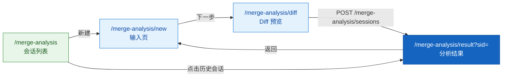
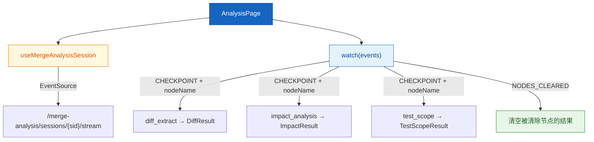
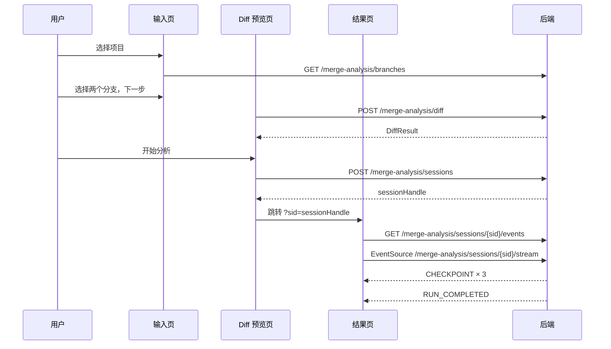

# 合入分析

> 自动生成于 2026-11-26，基于 `99d0037` 版本

| 属性 | 值 |
|------|-----|
| **所属层** | 表现层 + 应用层 |
| **目录** | `src/views/merge-analysis/`、`src/composables/useMergeAnalysisSession.ts`、`src/api/merge-analysis.ts`、`src/types/merge-analysis.ts` |
| **文件数** | 4 个页面 + 1 个 Composable + 1 个 API 模块 + 1 个类型文件 |
| **路由** | `/merge-analysis`、`/merge-analysis/new`、`/merge-analysis/diff`、`/merge-analysis/result` |
| **依赖模块** | [实时通信](./实时通信.md)、[项目管理](./项目管理.md)（项目与分支来源） |

---

## 1. 模块概述

### 1.1 职责定义

**核心职责**：比较同一仓库的两个分支，提取代码差异，再由后端分析差异影响到的入口与调用链，并圈定回归测试范围。

**职责边界**：

| 本模块负责 | 本模块不负责 | 由谁负责 |
|-----------|-------------|---------|
| 选择项目与两个分支、预览 Diff | 执行 Git 差异比较 | 后端 |
| 发起分析会话、展示节点进度 | 影响分析与测试范围判定 | 后端编排器 |
| 展示三类结果、导出 Markdown | 生成这些结果 | 后端三个节点 |
| 按节点重跑 | — | — |

### 1.2 核心文件清单

| 文件 | 类型 | 职责 | 行数 |
|------|------|------|------|
| `src/views/merge-analysis/SessionListPage.vue` | 页面 | 历史会话列表 | 185 |
| `src/views/merge-analysis/InputPage.vue` | 页面 | 选项目与分支、上传图片 | 299 |
| `src/views/merge-analysis/DiffPreviewPage.vue` | 页面 | Diff 预览并发起分析 | 209 |
| `src/views/merge-analysis/AnalysisPage.vue` | 页面 | 分析进度与三类结果 | 383 |
| `src/composables/useMergeAnalysisSession.ts` | Composable | 会话状态与 SSE | 163 |
| `src/api/merge-analysis.ts` | API | 9 个函数 + 类型 | 88 |
| `src/types/merge-analysis.ts` | 类型 | Diff、影响、测试范围 | 69 |

---

## 2. 模块架构

### 2.1 四步向导

页与页之间不经过 Store，参数全部通过地址栏查询串传递：`projectPath`、`sourceBranch`、`targetBranch`、`hasImages`、`sid`。

### 2.2 结果页的数据流

---

## 3. 对外接口

### 3.1 路由

| 路由 | 名称 | 组件 | 标题 |
|------|------|------|------|
| `/merge-analysis` | `MergeAnalysisSessions` | `SessionListPage` | 合入分析 |
| `/merge-analysis/new` | `MergeAnalysisInput` | `InputPage` | 新建合入分析 |
| `/merge-analysis/diff` | `MergeAnalysisDiff` | `DiffPreviewPage` | Diff 预览 |
| `/merge-analysis/result` | `MergeAnalysisResult` | `AnalysisPage` | 影响分析结果 |

侧边栏"合入分析"始终可用（页面自带项目选择器）。

### 3.2 API（`api/merge-analysis.ts`）

| 函数 | 请求 | 前端调用方 |
|------|------|-----------|
| `listBranches(projectPath)` | `GET /merge-analysis/branches` | 输入页 |
| `getDiff(data)` | `POST /merge-analysis/diff` | Diff 预览页 |
| `startMergeAnalysis(data)` | `POST /merge-analysis/sessions` | 结果页经 Composable、Diff 预览页 |
| `getMergeAnalysisSession(sessionId)` | `GET /merge-analysis/sessions/{sessionId}` | 无调用方 |
| `mergeAnalysisStreamUrl(sessionId, afterSeq?)` | SSE 地址 `/api/merge-analysis/sessions/{sessionId}/stream` | Composable |
| `listMergeAnalysisSessions(limit = 50)` | `GET /merge-analysis/sessions` | 会话列表页 |
| `getMergeAnalysisSessionEvents(sessionId)` | `GET /merge-analysis/sessions/{sessionId}/events` | Composable（`rejoin` 时） |
| `rerunMergeAnalysisNode(sessionId, nodeName)` | `POST /merge-analysis/sessions/{sessionId}/rerun-from/{nodeName}` | 结果页 |
| `exportMergeAnalysisMd(sessionId)` | `GET /merge-analysis/sessions/{sessionId}/export/md`（Blob） | 结果页 |

---

## 4. 内部实现

### 4.1 输入页

- 项目来源与其它页面一致：本地扫描的仓库 + 已克隆的远程项目。
- 选中项目后调用 `listBranches` 拉取分支，用户选择源分支与目标分支。
- 支持上传图片（类型 `ImageContent`，多模态输入）。为避免地址栏过长，图片数据写入 `sessionStorage`，键为 `mergeAnalysisImages`，地址栏只留 `hasImages=true`。

### 4.2 Diff 预览页

- 从查询串取 `projectPath` / `sourceBranch` / `targetBranch`，调 `getDiff`。
- 用户确认后调 `startMergeAnalysis`（如有图片则一并提交），随后清理 `sessionStorage` 并跳到结果页。
- 返回时把三个参数带回输入页，方便修改。

### 4.3 结果页

- 地址栏带 `sid` 时 `rejoin(sid, 0)` 恢复会话；否则用三个参数直接 `start`。
- 三个节点的名称：`diff_extract`、`impact_analysis`、`test_scope`。处理 `CHECKPOINT` 时兼容两种结构：`nodeName + output`（新）与 `node + data`（旧）。
- `NODES_CLEARED` 事件里列出的节点，其结果会被清空。
- 按节点重跑：调用 `rerunMergeAnalysisNode`，清空该节点及其后续节点的结果，再用响应里的 `nextSeq` 重新 `rejoin`。
- 导出：把会话导出为 Markdown 文件。

### 4.4 三类结果类型

| 类型 | 关键字段 |
|------|---------|
| `DiffResult` | `sourceBranch`、`targetBranch`、`totalFiles`、`totalAdditions`、`totalDeletions`、`files: FileDiff[]` |
| `FileDiff` | `filePath`、`changeType`（`ADD` / `MODIFY` / `DELETE` / `RENAME`）、`additions`、`deletions`、`patch` |
| `ImpactResult` | `affectedEntryPoints[]`、`callChainEdges[]`、`businessImpactSummary`、`riskLevel`（`HIGH` / `MEDIUM` / `LOW`） |
| `TestScopeResult` | `groups: TestCaseGroup[]`、`regressionSuggestions[]` |

---

## 5. 交互流程

### 5.1 新建一次分析

### 5.2 异常流程

| 场景 | 处理 | 用户感知 |
|------|------|---------|
| 发起分析失败 | 状态置 `error` 并抛出 | 由调用方提示 |
| SSE 连接被关闭且仍在运行 | 状态置 `error` | 错误态 |
| 加载历史会话失败 | `ElMessage.warning` | 黄色提示 |
| 加载历史事件失败 | 忽略，仍尝试开流 | 无 |

---

## 6. 依赖关系

| 方向 | 依赖 | 说明 |
|------|------|------|
| 上游 | `api/merge-analysis.ts` | 本模块专属 |
| 上游 | `api/project.ts`、`api/remote-project.ts` | 输入页的项目列表 |
| 上游 | `utils/download.ts` | 导出 |
| 下游 | 路由、侧边栏"合入分析" | `menuKey: 'merge-analysis'` |

---

## 7. 配置项

| 常量 | 值 | 位置 |
|------|----|------|
| 会话列表条数 | 50 | `SessionListPage.vue` |
| `sessionStorage` 键 | `mergeAnalysisImages` | 输入页、Diff 预览页 |

---

## 8. 错误处理

| 场景 | 处理 |
|------|------|
| HTTP 层错误 | 由拦截器统一提示 |
| 历史会话加载失败 | 警告提示 |
| 流连接异常关闭 | 置错误态并关流 |

---

## 9. 性能考量

| 关注点 | 策略 | 实现 |
|--------|------|------|
| 地址栏长度 | 图片放 `sessionStorage`，用完即删 | 输入页、Diff 预览页 |
| 断线恢复 | `afterSeq` 续传 + `seq` 去重 | `useMergeAnalysisSession` |
| 页面切换 | 事件去重后再入数组，不重复渲染 | 同上 |

---

## 10. 已知问题与扩展点

| 类型 | 说明 |
|------|------|
| 已知问题 | `getMergeAnalysisSession` 没有调用方 |
| 已知问题 | 页面间参数全靠查询串，缺少校验；直接打开 Diff 预览页或结果页而无参数时行为未在代码中做专门处理 |
| 扩展点 | 新增分析节点：在 `AnalysisPage` 的事件处理中按 `nodeName` 增加分支，并补一个结果 `ref` |

---

> **相关文档**：
> - 架构总览 → [02-架构设计](../02-架构设计/index.md)
> - SSE 会话封装 → [实时通信](./实时通信.md)
> - 接口清单 → [05-接口文档](../05-接口文档/index.md)
