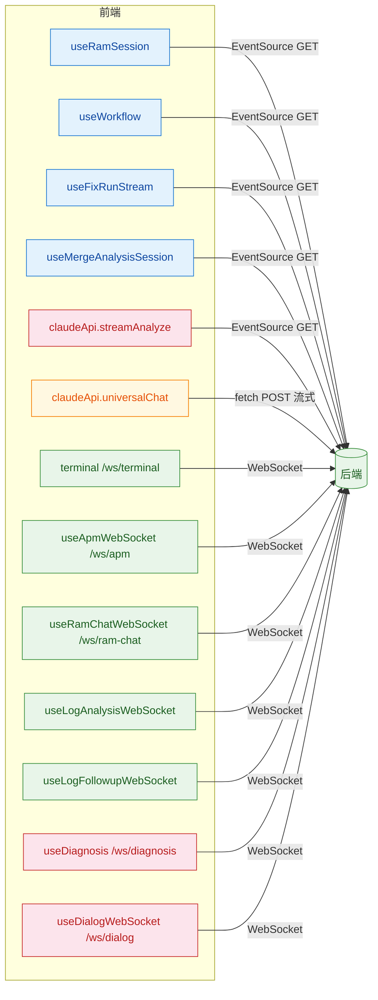
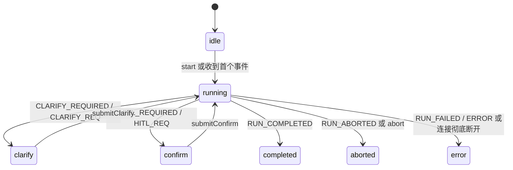
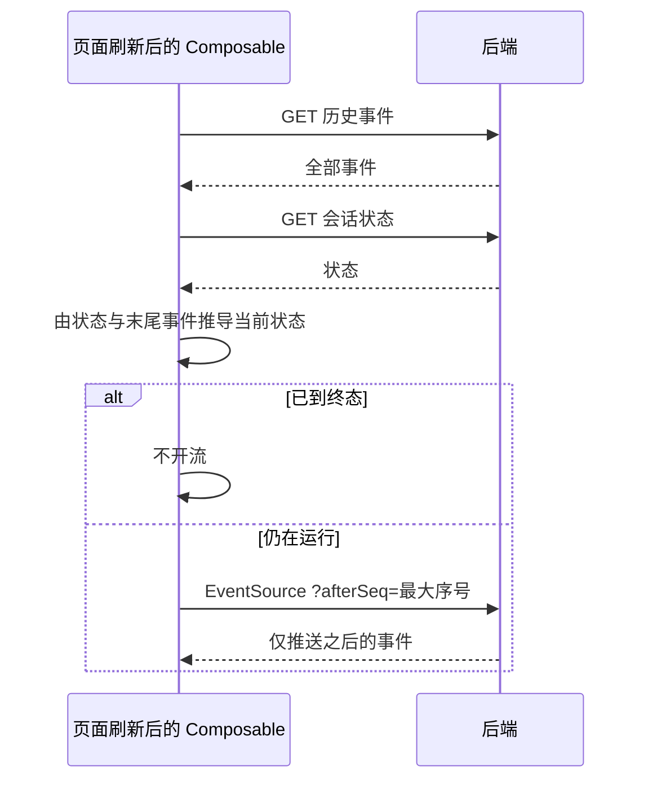

# 实时通信

> 自动生成于 2026-11-26，基于 `99d0037` 版本

| 属性 | 值 |
|------|-----|
| **所属层** | 应用层（Composable）+ 服务层（连接封装） |
| **目录** | `src/composables/`、`src/api/terminal.ts`、`src/api/claude.ts` |
| **文件数** | 11 个 Composable（另有 2 个测试文件） |
| **通道数** | SSE 5 处、`fetch` 流式 2 处、WebSocket 7 处 |
| **依赖模块** | [API服务层](./API服务层.md)、[状态管理](./状态管理.md) |

---

## 1. 模块概述

### 1.1 职责定义

**核心职责**：承载前端所有"服务端持续推送"的通道——分析进度、智能体输出、终端输出、追踪数据——并把原始消息整理成响应式状态。

**职责边界**：

| 本模块负责 | 本模块不负责 | 由谁负责 |
|-----------|-------------|---------|
| 建连、心跳、重连、清理 | 推送内容的生产 | 后端 |
| 事件去重与状态机推导 | 把状态渲染成页面 | 各功能页面 |
| `fetch` 流式响应的 SSE 文本解析 | 普通 REST 请求 | [API服务层](./API服务层.md) |

### 1.2 核心文件清单

| 文件 | 类型 | 通道 | 职责 | 行数 |
|------|------|------|------|------|
| `src/composables/useRamSession.ts` | Composable | SSE | RAM 需求分析会话全生命周期 | 434 |
| `src/composables/useDagEventHandler.ts` | Composable | — | 把 RAM 事件折叠成各节点的输出（不建连） | 608 |
| `src/composables/useWorkflow.ts` | Composable | SSE | 通用工作流会话 | 295 |
| `src/composables/useFixRunStream.ts` | Composable | SSE | 工作台修复运行的事件流 | 98 |
| `src/composables/useMergeAnalysisSession.ts` | Composable | SSE | 合入分析会话 | 163 |
| `src/composables/useRamChatWebSocket.ts` | Composable | WebSocket | RAM 对话 | 100 |
| `src/composables/useApmWebSocket.ts` | Composable | WebSocket | APM 追踪与进程日志 | 113 |
| `src/composables/useLogAnalysisWebSocket.ts` | Composable | WebSocket | 日志分析节点进度 | 77 |
| `src/composables/useLogFollowupWebSocket.ts` | Composable | WebSocket | 日志追问 | 81 |
| `src/composables/useDiagnosis.ts` | Composable | WebSocket | 多智能体诊断（未接线） | 307 |
| `src/composables/useDialogWebSocket.ts` | Composable | WebSocket | 自然语言对话（未接线） | 499 |
| `src/api/terminal.ts` | 服务 | WebSocket | PTY 终端连接 | 144 |
| `src/api/claude.ts` | 服务 | SSE / `fetch` | 日志流式分析、通用对话 | 278 |

---

## 2. 模块架构

### 2.1 通道全景



> 粉色节点在代码中存在，但从路由或入口出发不可达，详见 6.3。

### 2.2 选型分工

| 场景 | 通道 | 原因（来自代码形态） |
|------|------|--------------------|
| 服务端单向推送、GET 可发起 | `EventSource` | 浏览器自动重连，代码量最小 |
| 需要 `POST` 请求体又要流式返回 | `fetch` + `ReadableStream` | `EventSource` 只能发 GET |
| 双向交互（终端输入、动态订阅） | `WebSocket` | 客户端需要随时发消息 |

---

## 3. SSE 通道

### 3.1 地址构造

| 函数 | 位置 | 地址 |
|------|------|------|
| `ramStreamUrl(sid, afterSeq?)` | `api/ram.ts` | `/api/ram/sessions/{sid}/stream`，可带 `?afterSeq=` |
| `mergeAnalysisStreamUrl(sid, afterSeq?)` | `api/merge-analysis.ts` | `/api/merge-analysis/sessions/{sid}/stream`，可带 `?afterSeq=` |
| `workflowStreamUrl(sid, afterSeq?)` | `api/workflow.ts` | `/api/v2/workflow/sessions/{sid}/stream?afterSeq=&token=` |

前两个函数返回以 `/api` 开头的相对路径，**不带**令牌；第三个由 `request.defaults.baseURL` 拼出地址，并从 `localStorage` 读 `hisi-token` 放进查询参数——注释说明这是因为 `EventSource` 无法携带 `Authorization` 头。

### 3.2 通用工作流：`useWorkflow`

```typescript
export function useWorkflow(options: { workflowType: string; onEvent?: (evt) => void }): {
  sessionId, events, status, report, cost, clarifyQuestions, hitlSchema,
  start(input), rejoin(sid, afterSeq?), submitClarify(answers),
  submitConfirm(action, feedback?), rerunFrom(nodeName), abort(), disconnect()
}
```

文件头注释写明设计原则是"REST 为准 + SSE 增量"。

| 动作 | 行为 |
|------|------|
| `start(input)` | 清空全部状态与 `lastSeq`，`POST /v2/workflow/start` 后开流。注释解释清零的原因：新会话事件从 `seq = 1` 起，沿用旧的 `lastSeq` 会被去重逻辑全部丢弃 |
| `rejoin(sid, afterSeq)` | 并行请求状态、报告、历史事件；由状态得出终态；把历史事件回放给 `onEvent`；仍在运行才开流 |
| `submitClarify` / `submitConfirm` / `rerunFrom` | 提交后把状态置回 `running` 并重新开流 |
| `abort` | 提交后置 `aborted` 并关流 |

事件到状态：

| 事件 | 状态 | 副作用 |
|------|------|--------|
| `CLARIFY_REQUIRED` | `clarify` | 记录 `clarifyQuestions`，关流 |
| `HITL_REQUIRED` | `confirm` | 记录 `hitlSchema`，关流 |
| `RUN_COMPLETED` | `completed` | 拉取最终报告，关流 |
| `RUN_FAILED` / `ERROR` | `error` | 关流 |
| `RUN_ABORTED` | `aborted` | 关流 |
| `COST` | 不变 | 按 `input_tokens + output_tokens` 累计，只增不减 |

### 3.3 RAM 会话：`useRamSession`

与 `useWorkflow` 同构，但为 RAM 定制了几处：

- **两套事件名**：同时识别 `CLARIFY_REQUIRED` 与 `CLARIFY_REQ`、`HITL_REQUIRED` 与 `HITL_REQ`。
- **确认动作多一种**：`submitConfirm(action)` 的 `action` 可以是 `approve` / `reject` / `edit`。
- **用量累计**：`payload.usage` 带 `cumulative: true` 时替换累计值，否则相加。
- **错误退让**：`onerror` 时若连接已 `CLOSED` 且状态为 `running` 则判为失败；连续错误超过 10 次也判为失败。
- **`rejoin` 的状态来源**：以 `getRamSession` 返回的 `status`（`DONE` / `FAILED` / `ABORTED`）为准，其次才看最后一条事件。



### 3.4 合入分析：`useMergeAnalysisSession`

状态只有 `idle` / `running` / `completed` / `error`。`CHECKPOINT` 事件的 `payload.nodeName`（或 `node`）写入 `currentNode`；`RUN_COMPLETED` 置完成并关流；`RUN_FAILED` 或 `ERROR` 置错误并关流。`rejoin` 先用 REST 拉历史事件，并以最后一条事件推导状态。

### 3.5 工作台修复运行：`useFixRunStream`

复用工作流的 SSE 地址，只订阅消息而不处理状态机。详见 [工作台](./工作台.md)。

### 3.6 `fetch` 流式：`claudeApi.universalChat`

请求 `POST /api/chat/{agentType}`，用 `ReadableStream` 逐块读取并按行解析。场景到路径段的映射：

| `scene` | `agentType` |
|---------|------------|
| `APM_DIAGNOSIS` | `apm-diagnose` |
| `call-chain-analysis` | `call-chain-analysis` |
| `log-analysis` | `log-analysis` |
| `code-analysis` | `code-analysis` |
| 其它 | `dialog` |

解析规则：`event:` 行记录事件类型；`data:` 行按类型分派——`session` 事件回调会话编号，`error` 事件回调错误，内容为 `[DONE]` 时结束，否则先尝试按 `{"choices":[{"delta":{"content":"…"}}]}` 取增量，失败则当作纯文本输出。

---

## 4. WebSocket 通道

### 4.1 连接方式

七处连接的写法一致：协议取 `window.location.protocol === 'https:' ? 'wss:' : 'ws:'`，主机取 `window.location.host`。

| 通道 | 地址 | 客户端消息 | 服务端消息类型 | 心跳 | 重连 |
|------|------|-----------|---------------|------|------|
| 终端 | `/ws/terminal` | `action`: `start` / `resume` / `continue` / `input` / `resize` / `ping` | `output` / `session_info` / `error` / `ready` / `claude_ready` / `pong` | 30 秒 `ping` | 无 |
| APM | `/ws/apm` | 连接成功后发 `{ action: 'connect', sessionId }` | `SPAN_BATCH` / `PROCESS_LOG` / 其它 `PROCESS_*` | 无 | 无 |
| RAM 对话 | `/ws/ram-chat?sessionId=` | `{ action: 'ping' }` | 任意，整体转存为对话事件 | 30 秒 `ping` | 最多 5 次，指数退避 |
| 日志分析 | `/ws/log-analysis?reportId=` | 无 | `NODE_START` / `NODE_COMPLETE` / `NODE_ERROR` / `DAG_COMPLETE` | 无 | 最多 5 次，指数退避 |
| 日志追问 | `/ws/log-followup?sessionId=` | 无（发送走 REST） | `connected` / `user_msg` / `assistant_delta` / `tool_use` / `tool_result` / `turn_complete` / `error` | 无 | 无 |
| 多智能体诊断 | `/ws/diagnosis` | `action`: `start` / `cancel` / `ping` | `agent_event` / `result` / `final_result` / `error` / `pong` | 30 秒 `ping` | 无 |
| 自然语言对话 | `/ws/dialog` | `action`: `start_session` / `send_message` / `intervene` / `cancel` / `ping` / `close_session` | 见 `DialogEventType` 常量 | 30 秒 `ping` | 最多 5 次，固定 3 秒 |

指数退避公式（三处相同）：`min(1000 × 2^已试次数, 30000)` 毫秒。

### 4.2 鉴权

当前七处 WebSocket 连接在代码中都**没有**附带令牌。`api/workflow.ts` 的注释提到"镜像 WebSocket 的 `?token=` 握手"，但各连接实现里没有对应的拼接逻辑；后端是否校验握手令牌未在前端代码中确认。

### 4.3 `createTerminalConnection`

`api/terminal.ts` 导出的工厂函数，返回 `{ send, close, getStatus }`，创建即连接。要点：

- 二进制帧（`ArrayBuffer`）用 `TextDecoder` 按 UTF-8 解码后再 `JSON.parse`。
- `JSON.parse` 失败且数据是字符串时，把原始文本当作终端输出——兼容非 JSON 的输出帧。
- 主动 `close()` 会清掉心跳定时器并把状态置为 `disconnected`。

### 4.4 `useApmWebSocket` 的缓冲上限

`PROCESS_LOG` 消息逐条追加；累计超过 2000 行时裁剪为最近 1500 行，防止长时间运行的会话耗尽内存。

---

## 5. 交互流程

### 5.1 "REST 为准 + SSE 增量"的恢复流程



三个 SSE Composable（`useWorkflow`、`useRamSession`、`useMergeAnalysisSession`）都遵循这个流程。`afterSeq` 与本地的序号去重构成两道防线。

### 5.2 异常流程

| 场景 | 处理 | 位置 |
|------|------|------|
| SSE 连接被浏览器永久关闭且仍在运行 | 状态置 `error` 并关流 | `useRamSession` |
| SSE 连续错误超过 10 次 | 状态置 `error` 并关流 | `useRamSession` |
| SSE `onerror` 但连接未关闭 | 不处理，交给浏览器自动重连 | `useWorkflow` |
| WebSocket 以非 1000 码关闭 | 重新连接，最多 5 次 | `useDialogWebSocket` |
| WebSocket 连续 5 次重连失败 | 放弃并打 `console.error` | `useRamChatWebSocket` |
| 收到无法解析的消息 | 忽略该帧 | 各 WebSocket Composable |

---

## 6. 依赖关系

### 6.1 上游依赖

| Composable | 依赖 |
|-----------|------|
| `useRamSession` | `api/ram.ts`、`types/ram.ts` |
| `useWorkflow` | `api/workflow.ts`、`types/workflow.ts` |
| `useFixRunStream` | `api/workflow.ts`（仅地址）、`api/workbench.ts` |
| `useMergeAnalysisSession` | `api/merge-analysis.ts` |
| `useDagEventHandler` | `components/ram/dagModel.ts`、`stores/ram.ts`、`useRamSession` 的返回类型 |
| `useRamChatWebSocket` | `stores/ramChatStore.ts` |
| `useApmWebSocket` | `types/apm.ts` |

### 6.2 下游消费者

| Composable | 消费方 |
|-----------|--------|
| `useRamSession` | [RAM需求分析](./RAM需求分析.md)（草稿页、现状分析页）、`useDagEventHandler` |
| `useDagEventHandler` | RAM 草稿页 |
| `useWorkflow` | [架构诊断](./架构诊断.md) |
| `useFixRunStream` | [工作台](./工作台.md) |
| `useMergeAnalysisSession` | [合入分析](./合入分析.md) |
| `useRamChatWebSocket` | [RAM对话与异常修复](./RAM对话与异常修复.md) |
| `useApmWebSocket` | [APM调试](./APM调试.md)（经 `apmStore`） |
| `useLogAnalysisWebSocket`、`useLogFollowupWebSocket` | [日志分析](./日志分析.md) |
| `createTerminalConnection` | [Claude终端与会话](./Claude终端与会话.md) |
| `claudeApi.universalChat` | APM 调试、知识图谱的方法引用页签、Claude 会话页 |

### 6.3 存在于代码但未接线的部分

| 文件 | 状态 |
|------|------|
| `useDiagnosis.ts`（`/ws/diagnosis`） | 仅被 `components/diagnosis/AgentDiagnosisPanel.vue` 导入，而该组件没有任何父组件或路由引用 |
| `useDialogWebSocket.ts`（`/ws/dialog`） | 仅被 `DialogProgressPanel.vue`、`InterventionPanel.vue` 导入，这两个组件只经 `components/dialog/index.ts` 汇出，而该入口文件无人导入；后端也没有注册 `/ws/dialog`（已注册的是 `/ws/terminal`、`/ws/apm`、`/ws/ram-chat`、`/ws/log-analysis`、`/ws/log-followup`、`/ws/diagnosis`、`/ws/agent`） |
| `claudeApi.streamAnalyze`、`claudeApi.streamChat` | 没有调用方 |

---

## 7. 配置项

没有环境变量。常量如下：

| 常量 | 值 | 位置 |
|------|----|------|
| `HEARTBEAT_INTERVAL` | 30000 ms | `api/terminal.ts`、`useDiagnosis.ts`、`useDialogWebSocket.ts` |
| 心跳间隔 | 30 秒（字面量 `30_000`） | `useRamChatWebSocket.ts` |
| 最大重连次数 | 5 | `useLogAnalysisWebSocket.ts`、`useRamChatWebSocket.ts`、`useDialogWebSocket.ts` |
| `RECONNECT_DELAY` | 3000 ms（固定） | `useDialogWebSocket.ts` |
| `useFixRunStream` 重连间隔 | 3000 ms | `useFixRunStream.ts` |
| APM 日志缓冲上限 | 2000 行裁到 1500 行 | `useApmWebSocket.ts` |

开发环境下 `/api` 与 `/ws` 都由 Vite 代理转发，配置见 [07-部署运维](../07-部署运维/index.md)。

---

## 8. 错误处理

| 层 | 策略 |
|----|------|
| 建连 | 统一维护 `disconnected` / `connecting` / `connected` / `error` 四态 |
| 序号 | `seq` 可能是字符串也可能是数字（后端把 `Long` 序列化成字符串），各处都做了双向兼容 |
| 去重 | `seq <= lastSeq` 的事件直接丢弃 |
| 生命周期 | 在组件上下文中使用时于 `onUnmounted` 自动清理；`useRamSession` 与 `useMergeAnalysisSession` 用 `getCurrentInstance()` 判断，不在组件内也可调用 |

---

## 9. 性能考量

| 关注点 | 策略 | 实现 |
|--------|------|------|
| 断线后不重放全部事件 | `afterSeq` 续传 | 三个 SSE Composable |
| 心跳保活 | 定时发 `ping` | 四处 WebSocket |
| 日志内存上限 | 环形裁剪 | `useApmWebSocket` |
| 事件日志上限 | 超过 100 条裁到 50 条 | `useDialogWebSocket`（未接线） |

---

## 10. 已知问题与扩展点

| 类型 | 说明 |
|------|------|
| 已知问题 | `useRamSession`、`useWorkflow`、`useMergeAnalysisSession` 三者结构高度相似但各自实现，没有共用基类 |
| 已知问题 | 同样的指数退避与心跳逻辑在多个 Composable 中重复 |
| 已知问题 | `useDialogWebSocket` 的重连条件依赖关闭码 `1000`，注释未说明服务端约定 |
| 扩展点 | 新增工作流类功能：直接用 `useWorkflow` 并传 `workflowType` 与 `onEvent`，架构诊断的深度分析即由此接入 |

---

> **相关文档**：
> - 架构总览 → [02-架构设计](../02-架构设计/index.md)
> - 各通道的完整地址 → [05-接口文档](../05-接口文档/index.md)
> - SSE 与 WebSocket 的取舍 → [08-技术决策](../08-技术决策/index.md)
