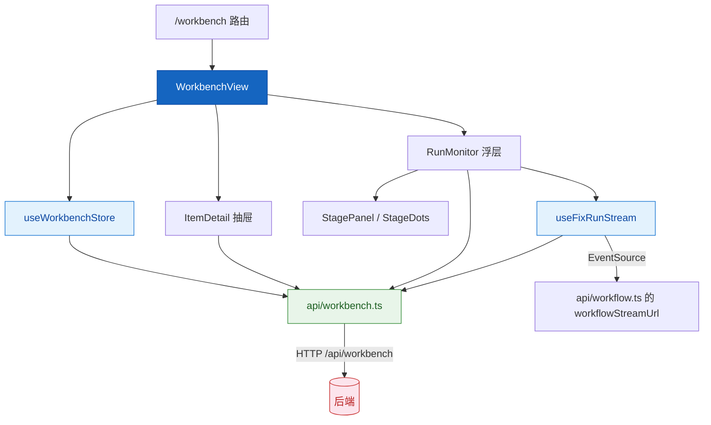
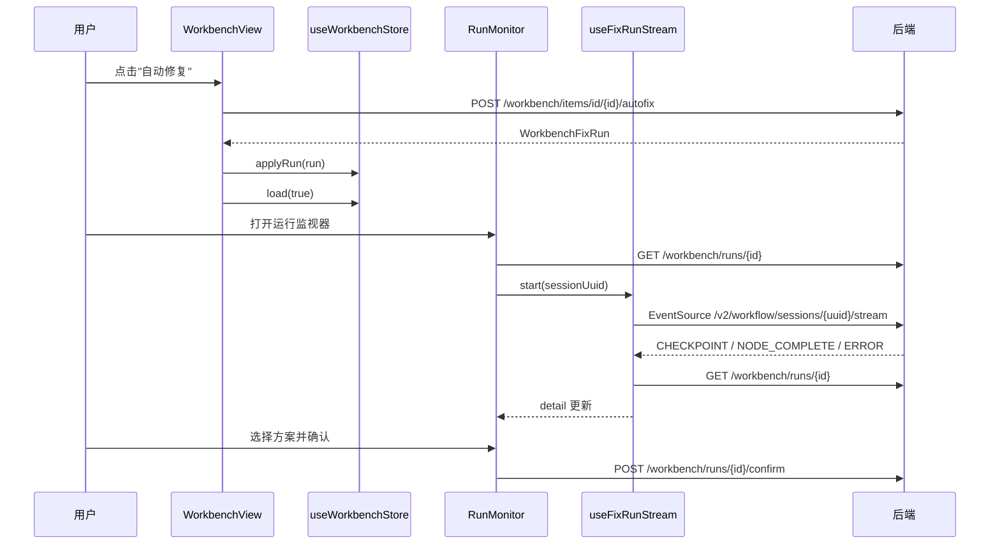
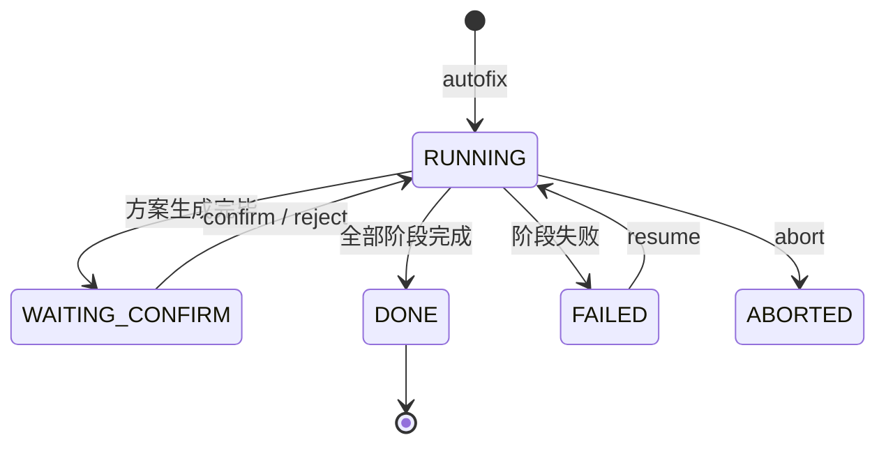

# 工作台

> 自动生成于 2026-11-26，基于 `99d0037` 版本

| 属性 | 值 |
|------|-----|
| **所属层** | 表现层 + 应用层（视图 / Store / Composable / API 四件套齐全） |
| **目录** | `src/views/workbench/`、`src/stores/workbench.ts`、`src/composables/useFixRunStream.ts`、`src/api/workbench.ts` |
| **文件数** | 6 个 Vue 文件 + 3 个 TS 文件 |
| **路由** | `/workbench`（名称 `Workbench`，根路径 `/` 重定向到此） |
| **依赖模块** | [API服务层](./API服务层.md)、[实时通信](./实时通信.md)（复用工作流 SSE 地址） |

---

## 1. 模块概述

### 1.1 职责定义

**核心职责**：把多个项目里由日志分析与架构分析产出的"技术债待办"聚合成一张可操作的清单，并在待办上发起、监视、确认 SDD 自动修复运行。

**职责边界**：

| 本模块负责 | 本模块不负责 | 由谁负责 |
|-----------|-------------|---------|
| 拉取待办、总览与修复运行列表 | 待办的生成与打分（后端聚合） | 后端 |
| 触发"立即聚合"重新拉取待办 | 日志报告 / 架构报告本身的展示 | [日志分析](./日志分析.md)、[架构诊断](./架构诊断.md) |
| 发起单个 / 批量自动修复 | 修复过程的智能体执行 | 后端 |
| 运行监视器：阶段、产物、日志、方案确认 | 工作流事件通道的实现 | [实时通信](./实时通信.md) |

### 1.2 核心文件清单

| 文件 | 类型 | 职责 | 行数 |
|------|------|------|------|
| `src/views/workbench/WorkbenchView.vue` | 页面 | 总览卡片、待办表格、修复流水线条、详情抽屉与监视器的挂载 | 417 |
| `src/views/workbench/components/ItemDetail.vue` | 组件 | 待办详情抽屉：为什么重要 / 证据 / 建议 / 自动修复 | 133 |
| `src/views/workbench/components/RunMonitor.vue` | 组件 | 全屏运行监视器：阶段时间线、阶段产物、实时日志、方案确认 | 274 |
| `src/views/workbench/components/StagePanel.vue` | 组件 | 按阶段键渲染 checkpoint 产物 | 169 |
| `src/views/workbench/components/StageDots.vue` | 组件 | 阶段圆点进度 | 45 |
| `src/views/workbench/components/SparkLine.vue` | 组件 | 近 7 日趋势迷你图 | 25 |
| `src/stores/workbench.ts` | Store | `useWorkbenchStore`：总览 / 待办 / 运行列表的共享状态 | 45 |
| `src/composables/useFixRunStream.ts` | Composable | 订阅单次修复运行的事件流并刷新运行详情 | 98 |
| `src/api/workbench.ts` | API | `/workbench` 下的 13 个接口 | 53 |

---

## 2. 模块架构

### 2.1 内部结构图



### 2.2 页面分区

页面按"总览 → 待办表格 → 修复流水线"自上而下排布，单条待办的决策上下文放在右侧抽屉里。

| 分区 | 实现 | 内容 |
|------|------|------|
| 页头 | `WorkbenchView` | 标题、"立即聚合"、"刷新" |
| 总览卡片 | `WorkbenchView` `.mission` | 技术债余额、清零进度、近 7 天清零、在途修复、按项目进度条 |
| 待办表格 | `WorkbenchView` `.tbl` | 勾选、严重度、待办、项目、来源、证据、近 7 日、状态/进度、操作 |
| 修复流水线 | `WorkbenchView` `.pipe` | 仅在存在在途运行时显示，吸在视口底部 |
| 详情抽屉 | `ItemDetail` | `el-drawer`，宽 520px |
| 运行监视器 | `RunMonitor` | 固定定位浮层，左 / 中 / 右三栏，Esc 关闭 |

---

## 3. 对外接口

### 3.1 Store：`useWorkbenchStore`

仓库里唯一采用"选项式"写法的 Pinia Store（`state` + `actions` 对象），其余 Store 均为组合式写法。

```typescript
export const useWorkbenchStore = defineStore('workbench', {
  state: () => ({
    summary: null as WorkbenchSummary | null,
    items: [] as WorkbenchItem[],
    runs: [] as WorkbenchFixRun[],
    loaded: false,
    loading: false,
  }),
  actions: { load(force?), refresh(), applyRun(run) },
})
```

| 成员 | 类型 | 说明 |
|------|------|------|
| `summary` | `WorkbenchSummary \| null` | 总览统计 |
| `items` | `WorkbenchItem[]` | 全部待办 |
| `runs` | `WorkbenchFixRun[]` | 修复运行列表 |
| `loaded` / `loading` | `boolean` | 是否已加载过 / 是否正在加载 |
| `load(force = false)` | 动作 | 并行请求 `summary` / `items` / `runs`；正在加载时直接返回；已加载且非强制时跳过 |
| `refresh()` | 动作 | 等价于 `load(true)` |
| `applyRun(run)` | 动作 | 按 `id` 合并到 `runs`，不存在则插到队首 |

### 3.2 Composable：`useFixRunStream`

```typescript
export function useFixRunStream(onEvent?: (event: RunEvent) => void): {
  detail: Ref<FixRunDetail | null>
  connected: Ref<boolean>
  start: (uuid: string) => void
  stop: () => void
  refreshDetail: () => Promise<void>
}
```

| 成员 | 说明 |
|------|------|
| `start(uuid)` | 订阅某次运行：先停掉旧连接，`lastSeq` 清零后建立 `EventSource` |
| `stop()` | 置 `closed = true`，清理重连定时器并关闭连接 |
| `refreshDetail()` | 用 `detail.id`（或按 `sessionUuid` 在运行列表中反查 `id`）拉取 `runDetail`；到达终态后自动 `stop()` |
| `onEvent` 回调 | 每条通过去重的事件都会回调一次 |

**调用约束**：组件卸载时自动 `stop()`；重复调用 `start` 会替换而不是叠加订阅。

---

## 4. 内部实现

### 4.1 待办表格的筛选与排序

`WorkbenchView` 中的 `rows` 计算属性按以下顺序处理：

1. 剔除 `status === 'IGNORED'` 的待办。
2. 按项目过滤（点击总览里的项目条即可切换）。
3. "只看 P0"开关。
4. 关键词匹配标题或位置（不区分大小写）。
5. 排序：严重度（P0 → P1 → P2）→ `WAITING` 优先 → `lastSeenAt` 降序。

只有 `status === 'NEW'` 的行可以勾选，批量修复按钮仅在已选数量大于 0 时出现。

### 4.2 状态与文案映射

| 取值 | 前端文案 | 出处 |
|------|---------|------|
| 待办状态 `NEW` / `RUNNING` / `WAITING` / `DONE` / `FAILED` / `IGNORED` | 待处理 / 修复中 / 待你确认 / 已清零 / 失败 / 已忽略 | `STATUS_LABEL` |
| 来源 `log` / `arch_ai` / `arch_rule` | 日志 / 架构·AI / 架构·规则 | 模板三元表达式 |
| 运行 `WAITING_CONFIRM` / `FAILED` / `ABORTED` / `INTERRUPTED` | 等你确认方案 / 失败 / 已中止 / 已中断（可继续） | `stageLabelOf` |
| `chainStatus` `verified` / `stack_verified` / `at_throw_site` / `unverified` / `confirmed` / `detected` | 因果链已验证 / 调用链与堆栈一致 / 根因落在抛出点 / 尚未证实 / 智能体判定属实 / 规则检出 | `chainText` |
| `confidence` `high` / `medium` / `low` | 高 / 中 / 低 | `confText` |

### 4.3 修复运行的八个阶段

`WorkbenchView` 中有一份静态阶段名，注释说明它与后端 `WorkbenchStages` 一致：

```typescript
const STAGE_NAMES = ['代码实证', '方案确认', 'Spec 生成', '任务拆分', '迭代开发', '用例回归', '全链路 E2E', '提交推送']
```

`StagePanel` 则按运行详情里的阶段键（`stages[].key`）分派渲染：

| 阶段键（`StagePanel`） | 渲染的 checkpoint 字段 |
|----------------------|----------------------|
| `evidence` | `anchors[]`、`graphStatus`、`confidence` |
| `proposal` | `options[]`（含 `recommendation` 标记）、`output.recommendation` |
| `spec` | `goal`、`acceptanceCriteria`、`testCases`、`nonGoals` |
| `tasks` | `tasks[]`（`title` / `file` / `verify`） |
| `develop` | `branch`、`worktree`、`changedFiles[]` |
| `tests` | `surefire.tests / failures / errors / failed[]`、`reason` |
| `e2e` | `steps[]`、`apiResults[]`、`frontendE2e.summary`、`reason` |
| `ship` | `branch`、`commit`、`pushed` |

> 阶段键与中文阶段名分别定义在两个文件里，按下标对应；两者的对应关系未在后端代码中确认。

### 4.4 轮询与事件流

| 位置 | 机制 | 间隔 | 条件 |
|------|------|------|------|
| `WorkbenchView` | `setInterval` 调 `store.load(true)` | 5000 ms | 仅当存在 `RUNNING` 或 `WAITING_CONFIRM` 的运行 |
| `RunMonitor` | `setInterval` 调 `stream.refreshDetail()` | 3000 ms | 仅当运行未到终态；注释说明阶段切换本身不产生事件，定时拉取用于兜底 |
| `useFixRunStream` | `EventSource` 收到 `CHECKPOINT` / `NODE_COMPLETE` / `ERROR` 时拉详情 | 事件驱动 | — |
| `useFixRunStream` | `onerror` 后重连 | 3000 ms | 未 `stop()` 时一直重试，带 `afterSeq=lastSeq` 续传 |

### 4.5 副作用与生命周期

| 副作用 | 触发 | 清理 |
|--------|------|------|
| 页面轮询定时器 | `onMounted` | `onUnmounted` 中 `clearInterval` |
| 监视器轮询定时器 | `RunMonitor` 挂载 | `onBeforeUnmount` 中清除 |
| 事件流 `EventSource` | `RunMonitor.load()` 对未结束的运行调用 `stream.start` | `useFixRunStream` 在 `onBeforeUnmount` 中 `stop` |
| Esc 关闭监听 | `runId` 变化时挂到 `window` | watch 回调返回的清理函数 |

---

## 5. 交互流程

### 5.1 自动修复到方案确认



### 5.2 运行状态与可用操作



状态取值来自 `types/workbench.ts` 的 `RunStatus`；`INTERRUPTED` 也是合法取值，监视器对 `INTERRUPTED` 与 `FAILED` 都显示"继续"按钮。上图中的迁移条件按前端按钮与文案整理，后端实际迁移未在代码中确认。

---

## 6. 依赖关系

### 6.1 上游依赖

| 依赖 | 使用的接口 | 说明 |
|------|-----------|------|
| `api/workbench.ts` | `workbenchApi.*` | 本模块专属 |
| `api/workflow.ts` | `workflowStreamUrl` | 只借用 SSE 地址构造函数 |
| `types/workbench.ts` | 全部类型 | 本模块专属 |

### 6.2 下游消费者

| 消费者 | 使用方式 |
|--------|---------|
| 路由 `Workbench` | 懒加载 `WorkbenchView.vue` |
| 侧边栏"工作台"菜单 | `menuKey: 'workbench'`，在 `availableMenus` 中恒为 `true` |

### 6.3 与其它模块的跳转

`ItemDetail` 的"打开原始报告"会解析待办的 `sourceRefJson`，若含 `reportId` 则新开窗口到 `/log-analysis/report/{reportId}`，否则提示到架构诊断页查看。

---

## 7. 配置项

本模块没有专属环境变量或配置项。轮询间隔（5000 / 3000 ms）与重连间隔（3000 ms）为代码常量。

---

## 8. 错误处理

| 场景 | 处理 | 用户感知 |
|------|------|---------|
| 启动自动修复失败 | `ElMessage.error(e.message)` | 红色提示 |
| 批量启动部分失败 | 提示成功数与失败数 | 黄色 / 绿色提示 |
| 监视器找不到待办 | `openMonitor` 直接返回，不打开 | 无 |
| `refreshDetail` 请求失败 | 静默，等待下一次事件再刷新 | 无 |
| 未选方案就确认 | `ElMessage.warning` | "请选择一个方案" |
| 驳回原因为空 | `ElMessage.warning` | "请说明驳回原因" |
| HTTP 层错误 | 由 `utils/request.ts` 拦截器统一提示 | 见 [API服务层](./API服务层.md) |

---

## 9. 性能考量

| 关注点 | 策略 | 实现 |
|--------|------|------|
| 无在途运行时不轮询 | 轮询回调内先判断 `activeRuns.length` | `WorkbenchView` 定时器 |
| 详情抽屉按需渲染 | `v-if="detailItem"` | `el-drawer` 内容 |
| 监视器按需挂载 | `v-if="monitor"` | `RunMonitor` |
| 流水线条吸底 | `position: sticky` | `.pipe` 样式 |

---

## 10. 已知问题与扩展点

| 类型 | 说明 |
|------|------|
| 待改进 | `workbenchApi.restore` 在代码中有定义，但没有找到调用方（已忽略的待办没有前端恢复入口） |
| 待改进 | 进度百分比按 `stageIndex / 8` 估算，阶段数量在前端硬编码 |
| 扩展点 | 新增阶段时需同时更新 `STAGE_NAMES` 与 `StagePanel` 的 `stageKey` 分支 |

---

> **相关文档**：
> - 架构总览 → [02-架构设计](../02-架构设计/index.md)
> - 工作流事件通道 → [实时通信](./实时通信.md)
> - 接口清单 → [05-接口文档](../05-接口文档/index.md)
> - 类型与 Store 字段 → [06-数据模型](../06-数据模型/index.md)
