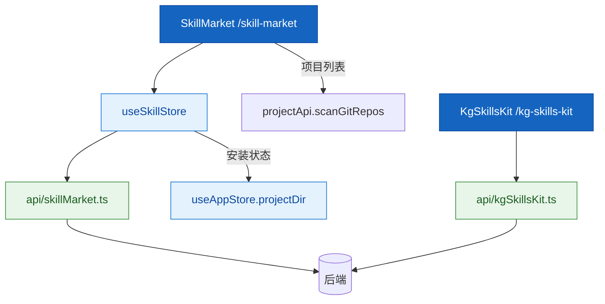
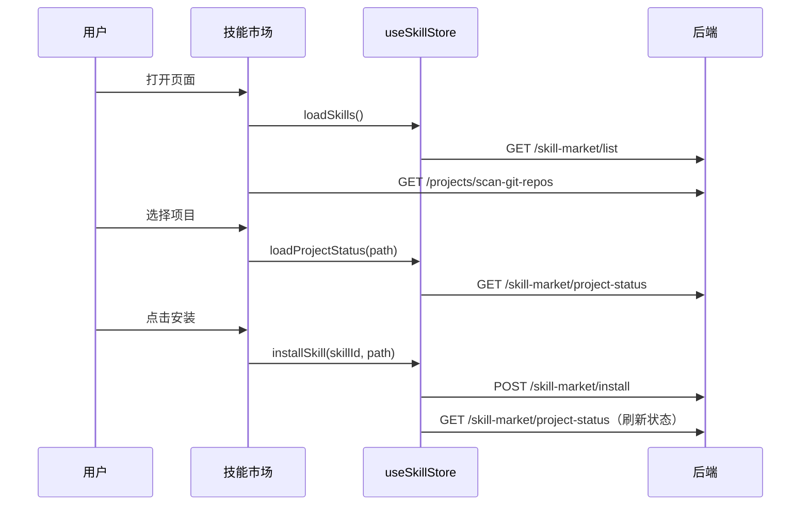

# 技能与KG套件

> 自动生成于 2026-11-26，基于 `99d0037` 版本

| 属性 | 值 |
|------|-----|
| **所属层** | 表现层 + 应用层 |
| **目录** | `src/views/skill-market/`、`src/views/kg-skills-kit/`、`src/stores/skillStore.ts`、`src/api/skillMarket.ts`、`src/api/kgSkillsKit.ts`、`src/types/skill.ts` |
| **文件数** | 2 个页面 + 1 个 Store + 2 个 API 模块 + 1 个类型文件 |
| **路由** | `/skill-market`（名称 `SkillMarket`）、`/kg-skills-kit`（名称 `KgSkillsKit`） |
| **依赖模块** | [状态管理](./状态管理.md)、[项目管理](./项目管理.md)（技能市场的项目列表来源） |

---

## 1. 模块概述

### 1.1 职责定义

**核心职责**：两个与"技能"相关的独立页面。技能市场按**项目**安装 / 卸载技能；KG Skills 套件把一组与知识图谱配套的技能**整体**安装到本机。

**职责边界**：

| 本模块负责 | 本模块不负责 | 由谁负责 |
|-----------|-------------|---------|
| 展示技能、安装状态、分类统计 | 技能内容的来源与版本管理 | 后端 |
| 发起安装 / 卸载 | 文件写入 | 后端 |
| 使用指南的展示 | 指南内容 | 后端（套件指南）；页面内静态文案（上手指南） |

### 1.2 两个页面的差异

| | 技能市场 | KG Skills 套件 |
|---|---------|---------------|
| 路由 | `/skill-market` | `/kg-skills-kit` |
| 安装粒度 | 单个技能 → 某个项目目录 | 单个技能或整套 → 本机，不区分项目 |
| 是否依赖 Store | 是（`useSkillStore`） | 否，页面内 `ref` |
| 侧边栏分组 | 工具 & 市场 | 工具 & 市场 |
| 菜单可用性 | 始终可用（`skill-market`） | 始终可用（`kg-skills-kit`，注释标明是独立工具） |

### 1.3 核心文件清单

| 文件 | 类型 | 职责 | 行数 |
|------|------|------|------|
| `src/views/skill-market/SkillMarket.vue` | 页面 | 技能市场 | 684 |
| `src/views/kg-skills-kit/KgSkillsKit.vue` | 页面 | KG Skills 套件 | 326 |
| `src/stores/skillStore.ts` | Store | 技能列表、项目安装状态、筛选 | 280 |
| `src/api/skillMarket.ts` | API | 7 个函数 | 87 |
| `src/api/kgSkillsKit.ts` | API | 6 个函数 + 类型 | 74 |
| `src/types/skill.ts` | 类型 | 技能定义、安装状态、分类 | 120 |

---

## 2. 模块架构

---

## 3. 对外接口

### 3.1 API（`api/skillMarket.ts`）

| 函数 | 请求 | 前端调用方 |
|------|------|-----------|
| `getSkillList(category?, search?)` | `GET /skill-market/list` | `skillStore.loadSkills` |
| `getProjectStatus(projectDir)` | `GET /skill-market/project-status` | `skillStore.loadProjectStatus` |
| `getSkillDetail(id)` | `GET /skill-market/detail/{id}` | 无调用方 |
| `installSkill(data)` | `POST /skill-market/install`，体 `{ skillId, projectDir }` | `skillStore.installSkill` |
| `uninstallSkill(data)` | `POST /skill-market/uninstall` | `skillStore.uninstallSkill` |
| `checkUpdates(projectDir)` | `GET /skill-market/check-updates` | 无调用方 |
| `updateSkill(data)` | `POST /skill-market/update` | 无调用方 |

### 3.2 API（`api/kgSkillsKit.ts`）

| 函数 | 请求 | 说明 |
|------|------|------|
| `getKitList()` | `GET /kg-skills-kit/list` | 返回 `skills`、`total`、`installedCount`、`skillsDir`、`kitVersion`、`kitName` |
| `installSkill(skillId)` | `POST /kg-skills-kit/install/{skillId}` | 单个安装 |
| `uninstallSkill(skillId)` | `POST /kg-skills-kit/uninstall/{skillId}` | 单个卸载 |
| `installAll()` | `POST /kg-skills-kit/install-all` | 整套安装，返回逐项结果 |
| `uninstallAll()` | `POST /kg-skills-kit/uninstall-all` | 整套卸载 |
| `getGuide()` | `GET /kg-skills-kit/guide` | 指南：`features`、`usage`、`prerequisites`、`mcpTools` |

该模块从 `./index` 导入 `request`，是仓库里唯一不直接写 `@/utils/request` 的 API 模块。

---

## 4. 内部实现

### 4.1 技能分类

`SkillCategory`：`diagnosis` 诊断、`analysis` 分析、`generation` 生成、`operation` 操作、`other` 其他。`types/skill.ts` 的 `SkillCategoryInfo` 给出每类的中文名与主色，`skillStore.categoryStats` 保存每类数量，页面据此渲染带计数的分类页签。

### 4.2 技能市场的筛选与安装

- **筛选**：分类与关键词都放在 Store 里，`filteredSkills` 负责过滤；关键词匹配名称、描述、标签。
- **项目选择**：页面先用 `projectApi.scanGitRepos()` 列出本地仓库；`appStore.projectDir` 变化时重新加载。未配置项目根目录时不加载项目列表。
- **安装状态**：选定项目后 `loadProjectStatus(path)`；`installedSkillIds` 是一个 `Set`，供页面判断"已安装"。
- **安装 / 卸载**：卸载前有二次确认；操作期间对应技能记入 `operatingSkillIds`，按钮显示加载态。成功后重新拉取项目状态。

### 4.3 KG Skills 套件

- 页面挂载时并行拉取套件列表与指南。
- 单个安装 / 卸载直接改本地对应技能的 `installed` 与 `installPath`，并增减 `installedCount`。
- "一键安装"成功后弹出"上手指南"对话框，内容是页面里写死的一段文案：

| 项 | 内容 |
|----|------|
| 三个核心技能 | `kg-search` 知识图谱混合检索、`kg-trace` 调用链追踪、`kg-diagnose` 日志诊断 |
| 前置条件 | MCP `hisi-mcp-server` 已配置并连接；项目已执行知识图谱生成；Neo4j 与后端服务正常 |

- "详细使用指南"对话框的内容来自 `getGuide()`。
- 命令示例旁有"复制"按钮，写入系统剪贴板。

---

## 5. 交互流程

---

## 6. 异常流程

| 场景 | 处理 | 用户感知 |
|------|------|---------|
| 未选项目就安装 / 卸载 | 不发请求 | "请先选择项目目录" |
| 技能在列表里找不到 | 不发请求 | "技能不存在" |
| 后端返回 `success: false` | 提示后端 `message` | 红色提示 |
| 加载技能列表失败 | `ElMessage.error` | "加载技能列表失败" |
| 套件加载失败 | `ElMessage.error` | "加载套件列表失败" |
| 指南加载失败 | 仅 `console.error` | 无 |

---

## 7. 依赖关系

| 方向 | 依赖 | 说明 |
|------|------|------|
| 上游 | `stores/skillStore.ts`、`stores/app.ts` | 技能市场 |
| 上游 | `api/project.ts` | 技能市场的项目列表 |
| 下游 | 路由、侧边栏 | 两个独立菜单项 |

---

## 8. 配置项

两个页面都没有可配置项。

---

## 9. 性能考量

| 关注点 | 策略 | 实现 |
|--------|------|------|
| 避免重复加载 | `appStore.projectDir` 变化时才重载项目状态 | `SkillMarket.vue` 的 `watch` |
| 已安装判断 | 用 `Set` 做 O(1) 查找 | `skillStore.installedSkillIds` |

---

## 10. 已知问题与扩展点

| 类型 | 说明 |
|------|------|
| 已知问题 | `getSkillDetail`、`checkUpdates`、`updateSkill` 没有调用方（技能市场没有详情页、更新检查与更新操作） |
| 已知问题 | 上手指南的文案写死在组件里，与 `getGuide()` 返回的内容是两份来源 |
| 扩展点 | 新增技能分类：扩展 `SkillCategory` 与 `SkillCategoryInfo`，并同步 `skillStore.categoryStats` 的初始值 |

---

> **相关文档**：
> - 架构总览 → [02-架构设计](../02-架构设计/index.md)
> - `useSkillStore` 的字段 → [状态管理](./状态管理.md)
> - 接口清单 → [05-接口文档](../05-接口文档/index.md)
