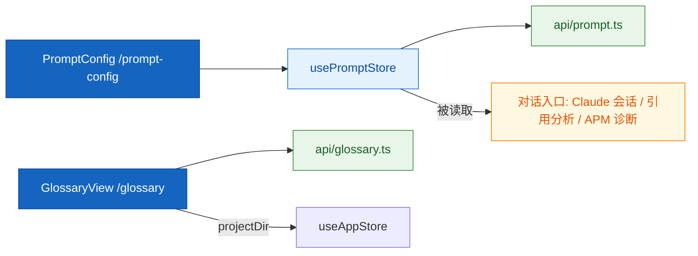
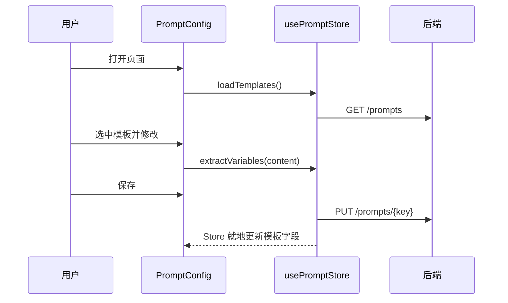

# 提示词与术语

> 自动生成于 2026-11-26，基于 `99d0037` 版本

| 属性 | 值 |
|------|-----|
| **所属层** | 表现层 + 应用层 |
| **目录** | `src/views/prompt-config/`、`src/views/glossary/`、`src/stores/promptStore.ts`、`src/api/prompt.ts`、`src/api/glossary.ts`、`src/types/session.ts`、`src/types/glossary.ts` |
| **文件数** | 2 个页面 + 1 个 Store + 2 个 API 模块 + 2 个类型文件 |
| **路由** | `/prompt-config`（名称 `PromptConfig`）、`/glossary`（名称 `Glossary`） |
| **依赖模块** | [状态管理](./状态管理.md)、[Claude终端与会话](./Claude终端与会话.md)、[知识图谱](./知识图谱.md) |

---

## 1. 模块概述

### 1.1 职责定义

**核心职责**：两个轻量的配置页面。提示词配置用于编辑各个对话场景使用的提示词模板；术语管理用于维护当前项目的术语与同义词。

**职责边界**：

| 本模块负责 | 本模块不负责 | 由谁负责 |
|-----------|-------------|---------|
| 模板列表、编辑、预览、保存 | 模板的实际使用方 | 各对话入口（见 4.2） |
| 术语的增删改查 | 术语在分析中的作用 | 后端 |
| 前端渲染模板变量 | — | `promptStore.render` |

### 1.2 核心文件清单

| 文件 | 类型 | 职责 | 行数 |
|------|------|------|------|
| `src/views/prompt-config/PromptConfig.vue` | 页面 | 模板列表 + 编辑器 + 预览 | 339 |
| `src/views/glossary/GlossaryView.vue` | 页面 | 术语表格 + 编辑弹窗 | 211 |
| `src/stores/promptStore.ts` | Store | 模板缓存与本地渲染 | 97 |
| `src/api/prompt.ts` | API | 5 个函数 | 39 |
| `src/api/glossary.ts` | API | 4 个函数 | 22 |
| `src/types/session.ts` | 类型 | `PromptTemplate`、`SceneType` 等 | 99 |
| `src/types/glossary.ts` | 类型 | `GlossaryTerm` | 9 |

---

## 2. 模块架构



两个页面在侧边栏里都是"知识图谱"菜单组的子项。

---

## 3. 对外接口

### 3.1 API（`api/prompt.ts`）

| 函数 | 请求 | 前端调用方 |
|------|------|-----------|
| `promptApi.list()` | `GET /prompts` | `promptStore.loadTemplates` |
| `promptApi.get(key)` | `GET /prompts/{key}` | 无调用方 |
| `promptApi.update(key, data)` | `PUT /prompts/{key}`，体 `{ content, variables? }` | `promptStore.updateTemplate` |
| `promptApi.render(key, variables)` | `POST /prompts/{key}/render` | 无调用方 |
| `promptApi.extractVariables(content)` | `POST /prompts/extract-variables` | 无调用方 |

后两个接口没有调用方，因为 Store 在前端实现了同样功能的 `render` 与 `extractVariables`。

### 3.2 API（`api/glossary.ts`）

| 函数 | 请求 |
|------|------|
| `glossaryApi.list(projectPath)` | `GET /glossary`，参数 `projectPath` |
| `glossaryApi.create(term)` | `POST /glossary` |
| `glossaryApi.update(id, term)` | `PUT /glossary/{id}` |
| `glossaryApi.delete(id)` | `DELETE /glossary/{id}` |

这四个函数除术语管理页外，还被 [知识图谱](./知识图谱.md) 和 [项目管理](./项目管理.md) 的术语弹窗调用。

---

## 4. 内部实现

### 4.1 模板的数据结构

```typescript
export type SceneType = 'log-analysis' | 'code-analysis' | 'trace-analysis' | 'impact-analysis' | 'free-chat' | 'APM_DIAGNOSIS'

export interface PromptTemplate {
  templateKey: string
  name: string
  content: string
  variables: string
  description: string
  createdAt: string
  updatedAt: string
}
```

### 4.2 模板的使用方

页面本身只负责编辑。真正调用 `promptStore.render` 的是：

| 场景键 | 调用方 |
|--------|--------|
| `free-chat` | [Claude终端与会话](./Claude终端与会话.md) 的会话页（新建会话） |
| `impact-analysis` | [知识图谱](./知识图谱.md) 的引用分析页签（AI 解读） |

`SceneType` 共六个取值，其余四个在前端代码中没有找到 `render` 调用。

### 4.3 变量语法

| 函数 | 规则 |
|------|------|
| `extractVariables(content)` | 用正则 `#\{([a-zA-Z_][a-zA-Z0-9_]*)\}` 找出全部占位符并去重 |
| `render(key, variables)` | 逐个变量把 `#{变量名}` 替换成传入值；模板不存在时返回空串并 `console.warn` |

### 4.4 提示词配置页

| 区域 | 说明 |
|------|------|
| 左侧 | 模板列表，选中项即 `selectedKey` |
| 中间 | 编辑器，绑定 `editContent` |
| 右侧 | 预览：页面自己用一组示例变量值替换占位符，再经 `renderMarkdown` 显示（不经过 `promptStore.render`） |

保存时把编辑内容与 `extractVariables(editContent)` 的结果（序列化成 JSON 字符串）一并提交；Store 就地更新对应模板的两个字段，页面不再重新拉取列表。

### 4.5 术语管理页

- 列表按 `appStore.projectDir` 作为 `projectPath` 加载——即术语挂在"项目根目录"这一层，而不是某个具体项目；根目录未配置时提示"请先选择项目"。
- 字段：`term`（术语）、`synonym`（同义词）、`context`（上下文，可选）；术语与同义词都必填。
- 删除前二次确认。

---

## 5. 交互流程



---

## 6. 异常流程

| 场景 | 处理 | 用户感知 |
|------|------|---------|
| 模板加载失败 | Store 捕获后仅 `console.error` | 无页面提示 |
| 模板保存失败 | Store 捕获后仅 `console.error`，不向外抛出；页面在 `await` 之后无条件执行成功提示 | **仍然提示"保存成功"** |
| 术语或同义词为空 | 不提交 | "术语和同义词不能为空" |
| 术语加载 / 提交失败 | `ElMessage.error` | "加载术语列表失败" / "创建失败" / "更新失败" |
| 删除术语 | 二次确认 | 确认框 |

---

## 7. 依赖关系

| 方向 | 依赖 | 说明 |
|------|------|------|
| 上游 | `stores/app.ts` | 术语页的项目根目录 |
| 上游 | `utils/markdown.ts` | 预览渲染 |
| 下游 | Claude 会话页、知识图谱引用分析页签 | 读取 `render` 的结果 |

---

## 8. 配置项

两个页面都没有可配置项。

---

## 9. 已知问题与扩展点

| 类型 | 说明 |
|------|------|
| 已知问题 | 模板保存失败时页面仍提示"保存成功"：`updateTemplate` 在 Store 内吞掉异常，页面的 `catch` 分支永远不会执行 |
| 已知问题 | `render` 与页面的预览都用字符串拼接构造正则，自身不校验变量名 |
| 已知问题 | 术语弹窗在三个页面各有一份实现 |
| 扩展点 | 新增场景：后端增加模板后，页面列表自动出现；若需在对话中使用，在调用方加一次 `render` |

---

> **相关文档**：
> - 架构总览 → [02-架构设计](../02-架构设计/index.md)
> - `usePromptStore` 的字段 → [状态管理](./状态管理.md)
> - 模板的使用方 → [Claude终端与会话](./Claude终端与会话.md)
> - 接口清单 → [05-接口文档](../05-接口文档/index.md)
