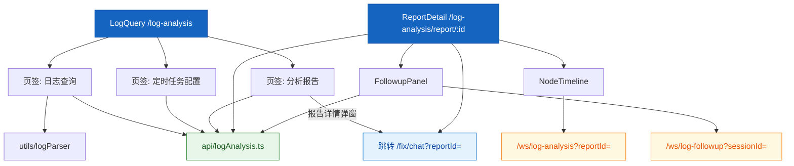
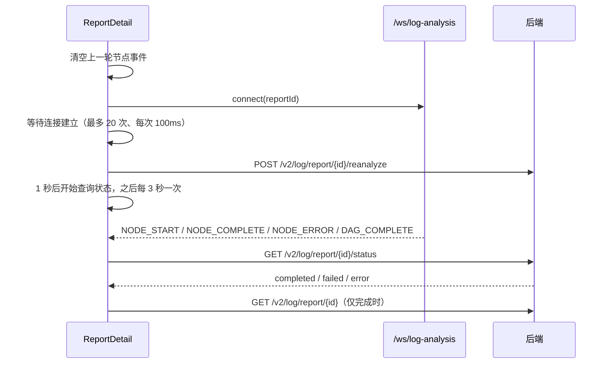

# 日志分析

> 自动生成于 2026-11-26，基于 `99d0037` 版本

| 属性 | 值 |
|------|-----|
| **所属层** | 表现层 + 服务层 |
| **目录** | `src/views/log-analysis/`、`src/components/log-analysis/`、`src/composables/useLogAnalysisWebSocket.ts`、`src/composables/useLogFollowupWebSocket.ts`、`src/api/logAnalysis.ts`、`src/types/log.ts`、`src/utils/logParser.ts` |
| **文件数** | 2 个页面 + 2 个组件 + 2 个 Composable + 1 个 API 模块 + 1 个类型文件 + 1 个解析工具 |
| **路由** | `/log-analysis`（名称 `LogAnalysis`）、`/log-analysis/report/:id`（名称 `ReportDetail`） |
| **依赖模块** | [实时通信](./实时通信.md)、[RAM对话与异常修复](./RAM对话与异常修复.md)、[工作台](./工作台.md)（从待办抽屉打开报告） |

---

## 1. 模块概述

### 1.1 职责定义

**核心职责**：按条件查询日志、管理定时拉取配置、查看由后端生成的错误分析报告，并围绕报告做重新分析、追问和异常修复。

**职责边界**：

| 本模块负责 | 本模块不负责 | 由谁负责 |
|-----------|-------------|---------|
| 构造 DSL 查询并展示日志 | 日志的采集与存储 | 后端 |
| 拉取配置的增删改与启停 | 定时拉取的执行 | 后端 |
| 报告列表、进度、详情 | 生成分析报告的智能体流程 | 后端 |
| 解析 Java 错误日志以便展示与提交分析 | — | — |

### 1.2 核心文件清单

| 文件 | 类型 | 职责 | 行数 |
|------|------|------|------|
| `src/views/log-analysis/LogQuery.vue` | 页面 | 路由 `/log-analysis`：三个页签 | 2127 |
| `src/views/log-analysis/ReportDetail.vue` | 页面 | 路由 `/log-analysis/report/:id`：报告详情 | 695 |
| `src/components/log-analysis/NodeTimeline.vue` | 组件 | 分析节点进度条 | 236 |
| `src/components/log-analysis/FollowupPanel.vue` | 组件 | 报告追问面板 | 275 |
| `src/composables/useLogAnalysisWebSocket.ts` | Composable | `/ws/log-analysis` | 77 |
| `src/composables/useLogFollowupWebSocket.ts` | Composable | `/ws/log-followup` | 81 |
| `src/api/logAnalysis.ts` | API | 19 个函数 | 127 |
| `src/types/log.ts` | 类型 | 日志、报告、追问相关类型 | 206 |
| `src/utils/logParser.ts` | 工具 | Java 错误日志解析 | 297 |

---

## 2. 模块架构

---

## 3. 对外接口

### 3.1 两个入口页面

| 页面 | 进入方式 |
|------|---------|
| 日志分析主页 | 侧边栏"日志分析"（始终可用，不依赖项目选择） |
| 报告详情页 | [工作台](./工作台.md) 待办抽屉的"打开原始报告"（新开窗口）；应用内没有其它跳转 |

主页"分析报告"页签里的报告详情是以弹窗形式展示的，不走详情页路由。

### 3.2 API（`api/logAnalysis.ts`）

分析流走 `/v2/log` 前缀，其余走 `/log`。文件注释说明 v2 换成了"取证 → 假设 → 验证 → 综合"的新流程，请求与响应结构不变。

| 函数 | 请求 | 前端调用方 |
|------|------|-----------|
| `queryLogs(data)` | `POST /log/query` | 日志查询页签 |
| `analyze(data)` | `POST /v2/log/analyze` | 无调用方 |
| `getReports(params)` | `GET /log/reports` | 分析报告页签 |
| `getReportsByAppId(appId)` | `GET /log/reports/by-app/{appId}` | 配置页签的"查看报告" |
| `getReportsByConfigId(configId)` | `GET /log/reports/by-config/{configId}` | 无调用方 |
| `getReport(id)` | `GET /v2/log/report/{id}` | 分析报告页签、报告详情页 |
| `getStatus(id)` | `GET /v2/log/report/{id}/status` | 两处轮询 |
| `reanalyze(id)` | `POST /v2/log/report/{id}/reanalyze` | 分析报告页签、报告详情页 |
| `deleteReport(id)` | `DELETE /log/report/{id}` | 分析报告页签 |
| `getGraphedProjects()` | `GET /log/config/graphed-projects` | 配置页签 |
| `getConfigs()` | `GET /log/config` | 配置页签 |
| `getConfig(appId)` | `GET /log/config/{appId}` | 无调用方 |
| `saveConfig(config)` | `POST /log/config` | 配置页签 |
| `deleteConfig(appId)` | `DELETE /log/config/{appId}` | 配置页签 |
| `toggleConfig(appId)` | `POST /log/config/{appId}/toggle` | 配置页签 |
| `exportReportMd(id)` | `GET /log/report/{id}/export/md`（Blob） | 报告详情页 |
| `exportReportsZip(startTime?, endTime?)` | `GET /log/reports/export/zip`（Blob） | 分析报告页签 |
| `startFollowup(reportId, message)` | `POST /log/report/{reportId}/followup` | `FollowupPanel` |
| `continueFollowup(sessionId, message)` | `POST /log/followup/{sessionId}/message` | `FollowupPanel` |

---

## 4. 内部实现

### 4.1 日志查询页签

- **两种查询方式**：手动粘贴 DSL JSON，或用可视化条件构造器（`must` / `should` 两组条件，支持预置条件）。两者并存时手动 DSL 优先。
- **请求体**：`{ dslQuery }`，值为 DSL 的 JSON 字符串。
- **应用分组**：页首按 `appId` 分组筛选，分组数据来自 `GET /project-group`。
- **解析**：日志详情用 `parseJavaErrorLog` 拆出异常类型、消息、堆栈帧与 `Caused by` 链；页面另有 `isFrameworkFrame` 区分框架帧与业务帧。`logParser.ts` 导出 `parseJavaErrorLog`、`formatForAnalysis`、`getCompactStackTrace`。

### 4.2 定时任务配置页签

配置对象 `AppLogConfig`：`appId`、`projectPath`、`dslQuery`、`pullIntervalMinutes`、`enabled`、`lastPullAt`。可选项目来自"已图谱化项目"列表。启停通过 `toggleConfig` 完成。

### 4.3 分析报告页签的进度轮询

- 只对状态为 `pending` / `processing` 的报告轮询，**同时最多轮询 3 个**。
- 间隔 3 秒，调用 `getStatus`，把 `progress`、`stage`、`etaSeconds` 写入进度表。
- 状态变为 `completed` 或 `failed` 时停止，并在 1 秒后刷新列表。
- 单次轮询失败只打 `console.warn`，不影响其它轮询。

### 4.4 报告详情页

页面分区：错误摘要、根因分析、修复建议、关键堆栈帧、修复历史。

**数据兼容**：`DetailedAnalysisReport` 的四个内容字段（`errorSummary`、`rootCause`、`fixSuggestions`、`codeSnippets`）类型都是"结构化对象或字符串"的联合，因为旧报告可能存成字符串，页面用 `isRecord` 判断后再渲染。

**v2 特有字段**：`RootCauseSection` 带 `evidenceAnchors`（证据锚点）与 `verification.hypotheses`（对每条根因假设的验证结果）。验证状态文案：

| `chainStatus` | 文案 |
|---------------|------|
| `verified` | 已由调用图证实 |
| `stack_verified` | 堆栈已证实 |
| `at_throw_site` | 根因落在抛出点 |
| `unverified` | 未证实 |

### 4.5 重新分析

先连通道再触发分析的用意写在注释里：这样页面上能看到节点逐个执行。

### 4.6 节点进度条（`NodeTimeline`）

节点不写死，按 WebSocket 事件里出现的先后顺序显示。组件注释说明 v1 的 5 个节点与 v2 的 6 个节点都能展示。节点状态：`pending` / `running` / `done` / `error`，完成时带 `durationMs`，出错时带 `error`。

### 4.7 追问面板（`FollowupPanel`）

- 第一条消息调用 `startFollowup`，得到 `sessionId`；之后调用 `continueFollowup`。
- 回答经 `/ws/log-followup?sessionId=` 实时到达；`assistant_delta` 逐段累加，`turn_complete` 时用完整文本覆盖；`tool_use` / `tool_result` 用于展示工具调用。

### 4.8 与异常修复的衔接

报告详情页加载时会用 `fixApi.listByReport(reportId)` 列出该报告已有的修复会话，点击进入 `/fix/chat/{sid}`；"自动修复"则进入 `/fix/chat?reportId=`。

---

## 5. 异常流程

| 场景 | 处理 | 用户感知 |
|------|------|---------|
| 手动 DSL 不是合法 JSON | 不发请求 | "DSL JSON 格式错误" |
| 报告仍在处理中时打开详情 | 识别 400 或消息含"尚未完成" | "报告正在处理中，请稍后再试" |
| 重新分析失败 | 停止轮询 | "触发重新分析失败" / "重新分析失败" |
| 单次状态查询失败 | 忽略，下一轮重试 | 无 |
| WebSocket 连接超时 | 最多等 2 秒后继续 | 无 |

---

## 6. 依赖关系

| 方向 | 依赖 | 说明 |
|------|------|------|
| 上游 | `api/logAnalysis.ts`、`api/fix.ts`、`api/projectGroup.ts` | 见第 3 节 |
| 上游 | `utils/logParser.ts`、`utils/markdown.ts`、`utils/download.ts` | 解析、渲染、下载 |
| 上游 | 两个 WebSocket Composable | 见 [实时通信](./实时通信.md) |
| 下游 | 侧边栏"日志分析" | `menuKey: 'log-analysis'` |
| 下游 | [RAM对话与异常修复](./RAM对话与异常修复.md)、[工作台](./工作台.md) | 异常修复入口、原始报告入口 |

---

## 7. 配置项

| 常量 | 值 | 位置 |
|------|----|------|
| 列表进度轮询间隔 | 3000 ms，最多 3 个报告 | `LogQuery.vue` |
| 详情页状态轮询间隔 | 3000 ms（首次延迟 1000 ms） | `ReportDetail.vue` |
| 等待 WebSocket 建连 | 20 × 100 ms | `ReportDetail.vue` |
| WebSocket 重连 | 最多 5 次，指数退避 | `useLogAnalysisWebSocket.ts` |
| 紧凑堆栈默认帧数 | 10 | `logParser.ts` |

---

## 8. 错误处理

| 场景 | 处理 |
|------|------|
| 加载报告列表 / 详情失败 | `ElMessage.error` 带错误信息 |
| 删除报告 | 二次确认后调用接口 |
| 导出 | Blob 下载 |
| HTTP 层错误 | 由拦截器统一提示 |

---

## 9. 性能考量

| 关注点 | 策略 | 实现 |
|--------|------|------|
| 轮询数量 | 同时最多 3 个报告 | `LogQuery.vue` |
| 避免频繁刷新 | 完成后延迟 1 秒再刷新列表 | 同上 |
| 离开页面 | `onUnmounted` 清理全部定时器与 WebSocket | 两个页面 |

---

## 10. 已知问题与扩展点

| 类型 | 说明 |
|------|------|
| 已知问题 | `LogQuery.vue` 有 2127 行，是仓库里最大的文件 |
| 已知问题 | `logAnalysisApi.analyze`、`getConfig`、`getReportsByConfigId` 没有调用方 |
| 已知问题 | 报告详情有两个入口（页签内弹窗、独立路由页），渲染逻辑各自实现 |
| 扩展点 | 分析节点数量变化时无需改前端，`NodeTimeline` 按事件动态生成 |

---

> **相关文档**：
> - 架构总览 → [02-架构设计](../02-架构设计/index.md)
> - WebSocket 连接细节 → [实时通信](./实时通信.md)
> - 异常修复会话 → [RAM对话与异常修复](./RAM对话与异常修复.md)
> - 接口清单 → [05-接口文档](../05-接口文档/index.md)
