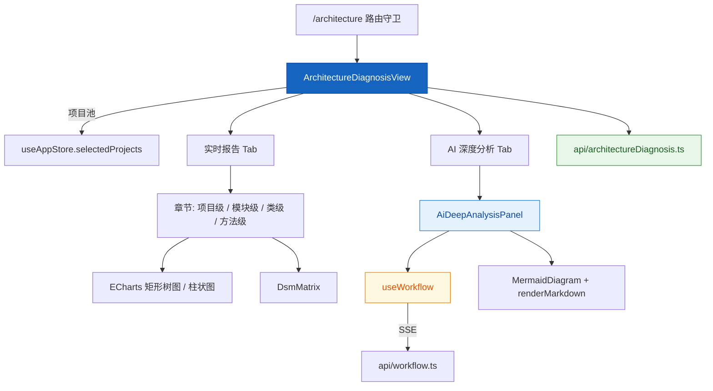
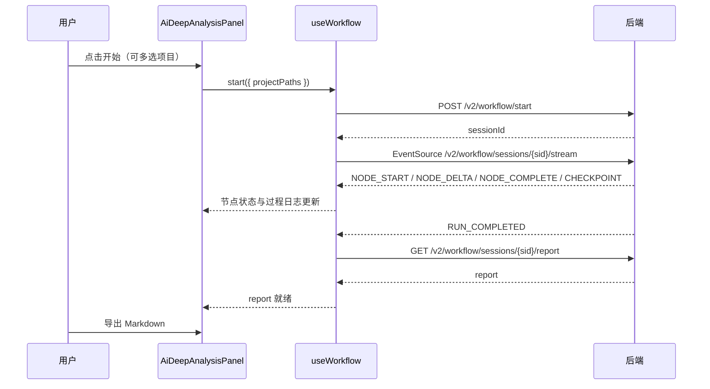

# 架构诊断

> 自动生成于 2026-11-26，基于 `99d0037` 版本

| 属性 | 值 |
|------|-----|
| **所属层** | 表现层（页面）+ 服务层（1 个 API 模块） |
| **目录** | `src/views/architecture-diagnosis/`、`src/api/architectureDiagnosis.ts`、`src/types/architectureDiagnosis.ts` |
| **文件数** | 2 个 Vue 文件 + 1 个测试文件 + 2 个 TS 文件 |
| **路由** | `/architecture`（名称 `ArchitectureDiagnosis`） |
| **依赖模块** | [状态管理](./状态管理.md)（`useAppStore`）、[实时通信](./实时通信.md)（`useWorkflow`）、[API服务层](./API服务层.md)、[知识图谱](./知识图谱.md)（复用 `DsmMatrix`） |

---

## 1. 模块概述

### 1.1 职责定义

**核心职责**：对一个项目做架构健康度诊断——用"实时报告 / 快照历史"查看规则打分结果，或发起"AI 深度分析"工作流得到结构化的架构报告。

**职责边界**：

| 本模块负责 | 本模块不负责 | 由谁负责 |
|-----------|-------------|---------|
| 选择项目、生成 / 保存 / 导出诊断报告 | 评分、扣分与坏味道检测规则 | 后端 |
| 查看历史快照 | 快照存储 | 后端 |
| 发起 AI 深度分析并展示结果 | 智能体推理 | 后端工作流引擎 |
| DSM 矩阵展示 | DSM 数据的实时查询 | [知识图谱](./知识图谱.md) 的 `DsmMatrix` 组件 |

### 1.2 核心文件清单

| 文件 | 类型 | 职责 | 行数 |
|------|------|------|------|
| `src/views/architecture-diagnosis/ArchitectureDiagnosisView.vue` | 页面 | 项目单选、实时报告四个章节、快照历史、导出 | 898 |
| `src/views/architecture-diagnosis/AiDeepAnalysisPanel.vue` | 组件 | AI 深度分析：两节点进度、结构化报告、4+1 视图、路线图 | 647 |
| `src/views/architecture-diagnosis/__tests__/ArchitectureDiagnosisView.spec.ts` | 测试 | 页面单元测试 | 198 |
| `src/api/architectureDiagnosis.ts` | API | 报告、快照、导出共 4 个函数 | 49 |
| `src/types/architectureDiagnosis.ts` | 类型 | 报告与快照类型 | 96 |

---

## 2. 模块架构

### 2.1 内部结构图

### 2.2 两个顶层页签

| 页签 | `activeTopTab` | 内容 |
|------|---------------|------|
| 实时报告 | `realtime` | 四个章节（`project` / `module` / `class` / `method`），可切到历史快照 |
| AI 深度分析 | `deep` | `AiDeepAnalysisPanel` |

页头的"AI 深度分析"按钮会把页签切到 `deep`，并把页头当前选中的项目作为默认项目传给面板。

---

## 3. 对外接口

### 3.1 API 函数（`api/architectureDiagnosis.ts`）

| 函数 | 签名 | 说明 |
|------|------|------|
| `getReport` | `(projectPaths: string[], language?: string, persist = false) => Promise<DiagnosisReport>` | 生成诊断报告；`persist` 为 true 时落快照 |
| `getSnapshots` | `(scope: string, limit = 20) => Promise<SnapshotHistoryResponse>` | 查询快照历史 |
| `getSnapshotReport` | `(snapshotId: number) => Promise<DiagnosisReport>` | 取某条快照的完整报告体 |
| `exportReport` | `(params: { projectPaths; language? } \| { snapshotId }) => Promise<Blob>` | 导出 Markdown |

**调用约束**：`exportReport` 是本仓库里少数不经过 `utils/request.ts` 的调用——它直接用 `fetch`，并自行从 `localStorage` 读取 `hisi-token` 拼 `Authorization` 头。因此它不经过响应拦截器，失败时只抛出 `Export failed: {status}`。

### 3.2 组件 `AiDeepAnalysisPanel`

| 接口 | 类型 | 说明 |
|------|------|------|
| `availableProjects` | prop | `{ name, path }[]`，由父页面的项目池提供 |
| `start(defaultProject?)` | 暴露方法 | 启动一次深度分析 |
| `isRunning` | 暴露属性 | 工作流是否运行中，供父页面按钮防重复点击 |

---

## 4. 内部实现

### 4.1 实时报告的数据流

1. 项目池来自 `useAppStore().selectedProjects`，页面只做单选（`realtimeProjectName`）。
2. 选中项目变化时：清空报告与快照列表 → `loadSnapshots(path)` → 若有快照则 `viewSnapshot(snapshots[0].id)`。
3. 也就是说进入页面默认展示该项目**最新一条快照**，不会自动触发实时生成。
4. 点击生成才调用 `getReport(paths, undefined, persist)`；"保存快照"即 `generateReport(true)`。

**竞态防护**：`reportRequestSeq` 自增序号，返回结果的序号与当前序号不一致时直接丢弃。

### 4.2 四个章节展示的内容

| 章节 | 取值位置 | 展示项（计算属性名） |
|------|---------|---------------------|
| 项目级 `project` | `chapters.project` | `kpis`、`bigBallOfMud`、`globalCycles` |
| 模块级 `module` | `chapters.module` | `moduleHubs`、`reverseDependencies`、`bloatedPackages`、`implementationLeaks`、`cycles` |
| 类级 `class` | `chapters.class` | `metrics.godClasses`、`metrics.hubClasses`、`ghostClasses`、`anemicDataClasses` |
| 方法级 `method` | `chapters.method` | `hotspots`、`longMethods`、`tooManyParams`、`deepCallChains` |

其中 `bloatedPackages`、`implementationLeaks`、`ghostClasses`、`anemicDataClasses`、`longMethods`、`tooManyParams`、`deepCallChains` 通过 `envelopeItems()` 从 `{ items, thresholds }` 结构中取 `items`。

### 4.3 图表

| 函数 | 图型 | 数据 | 视觉编码 |
|------|------|------|---------|
| `renderMethodTreemap` | ECharts `treemap` | 方法级热点 | 面积 = `complexity`，颜色按 `riskScore` 在绿红之间插值 |
| `renderGodClassChart` | ECharts 横向 `bar` | 上帝类 | 按 `wmc` 降序 |
| `renderHubClassChart` | ECharts 双系列 `bar` | 枢纽类 | 扇入 / 扇出，按入度出度之和降序 |

图表在章节、页签切换或报告数据变化后由 `renderCharts()` 重绘，已存在的实例先 `dispose`。

### 4.4 评分与标签映射

| 条件 | 结果 |
|------|------|
| `healthScore >= 90` / `>= 75` / `>= 60` / 其它 | 绿 / 蓝 / 橙 / 红 |
| `grade` A / B / C / D | success / primary / warning / danger |
| `severity` HIGH / MEDIUM / LOW | danger / warning / info |
| 循环 `level` CROSS_LAYER / SAME_LAYER | danger / warning |

### 4.5 AI 深度分析

工作流类型为 `arch-deep-analysis`，前端识别两个节点：

| 节点名 | 中文标签 |
|--------|---------|
| `arch_evidence_collect` | 证据收集 |
| `arch_react_agent` | ReAct 分析 |

事件处理（`handleEvent`）：

| 事件 | 效果 |
|------|------|
| `NODE_START` | 节点状态 → `running` |
| `NODE_COMPLETE` | 节点状态 → `done` |
| `NODE_DELTA` | 把 `payload.message` 追加到过程日志 |
| `ERROR` | 节点状态 → `error` |
| `CHECKPOINT`（节点为 `arch_react_agent`） | 若 `output.rootCauseResult.degraded` 为真则标记降级 |

结果来自 `wf.report`，字段：`markdownReport`、`diagrams[]`（`id` / `name` / `mermaid`）、`rootCauseResult`（`issues[]` / `report` / `degraded`）。结构化报告 `report` 包含 `executive_summary`、五个视图（`logical` / `process` / `development` / `physical` / `scenario`，即 4+1 视图）、`roadmap.p0 / p1 / p2`、`evidence_appendix`。

问题项的 `verdict` 映射：`confirmed` 属实、`false_positive` 误报、`downgraded` 降级。

### 4.6 副作用与生命周期

| 副作用 | 触发 | 清理 / 说明 |
|--------|------|------------|
| 会话 ID 持久化 | `start` 成功后写 `localStorage`，键为 `arch-deep-analysis-session:{路径用竖线拼接}` | 挂载时若存在则 `wf.rejoin(sid)` |
| SSE 连接 | `wf.start` / `wf.rejoin` | `useWorkflow` 在 `onUnmounted` 中关闭 |
| ECharts 实例 | `renderCharts` | 重绘前 `dispose` |

---

## 5. 交互流程

### 5.1 AI 深度分析

`start` 实际发给后端的请求体是 `{ workflowType: 'arch-deep-analysis', input: { projectPaths } }`；报告在收到 `RUN_COMPLETED` 后才拉取。

### 5.2 异常流程

| 场景 | 处理 | 用户感知 |
|------|------|---------|
| 未选项目就开始深度分析 | 直接返回 | "请先选择项目" |
| 实时报告生成失败 | `ElMessage.error` 带错误信息 | 红色提示 |
| 快照加载失败 | 快照列表置空 | 无额外提示 |
| 导出失败 | `ElMessage.error('导出失败: ...')` | 红色提示 |
| 请求返回时已有更新的请求 | 丢弃过期结果 | 无 |
| 报告被标记降级 | `degraded` 计算属性为真 | 页面显示降级状态 |

---

## 6. 依赖关系

| 方向 | 依赖 | 使用的接口 |
|------|------|-----------|
| 上游 | `stores/app.ts` | `selectedProjects` |
| 上游 | `composables/useWorkflow.ts` | `useWorkflow` |
| 上游 | `views/knowledge-graph/components/DsmMatrix.vue` | 组件本体；快照模式下传入 `dsmExternal` / `callGraphExternal` |
| 上游 | `components/ram/MermaidDiagram.vue`、`utils/markdown.ts`、`utils/exportMarkdown.ts` | 图渲染、Markdown 渲染、导出拼接 |
| 下游 | 路由、侧边栏菜单"架构诊断" | `menuKey: 'architecture-diagnosis'` |

---

## 7. 配置项

本模块没有专属环境变量。`getSnapshots` 的默认 `limit` 为 20。

---

## 8. 错误处理

| 错误场景 | 处理策略 | 用户感知 |
|---------|---------|---------|
| 报告 / 快照接口 HTTP 错误 | 由 `utils/request.ts` 拦截器统一提示 | 见 [API服务层](./API服务层.md) |
| 导出接口非 2xx | 抛 `Error('Export failed: 状态码')` | 红色提示 |
| 深度分析启动失败 | `ElMessage.error` | 红色提示 |
| 恢复历史会话失败 | `.catch(() => {})` 静默 | 无 |

---

## 9. 性能考量

| 关注点 | 策略 | 实现 |
|--------|------|------|
| 切换项目时的旧请求 | 请求序号比对 | `reportRequestSeq` |
| 图表重复创建 | 重绘前 `dispose` | `echarts.getInstanceByDom(el)?.dispose()` |
| 尺寸过小的容器 | 宽或高小于 50px 时跳过渲染 | 三个渲染函数开头判断 |

---

## 10. 已知问题与扩展点

| 类型 | 说明 |
|------|------|
| 已知问题 | `exportReport` 绕过了统一的 axios 实例，token 键名 `hisi-token` 在代码中多处重复硬编码 |
| 已知问题 | 坏味道明细的 `chapters.*` 在前端按 `any` 读取，没有对应类型约束 |
| 扩展点 | 新增章节项时在 `ArchitectureDiagnosisView` 增加计算属性即可，数据仍从 `chapters` 取 |

---

> **相关文档**：
> - 架构总览 → [02-架构设计](../02-架构设计/index.md)
> - 工作流通用封装 → [实时通信](./实时通信.md)
> - DSM 组件所属模块 → [知识图谱](./知识图谱.md)
> - 接口清单 → [05-接口文档](../05-接口文档/index.md)
