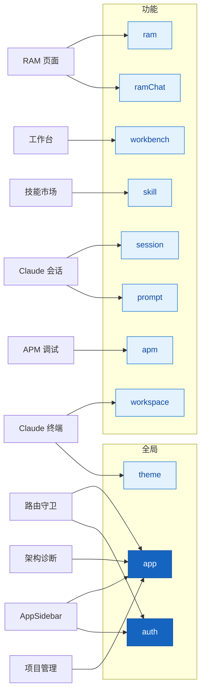

# 状态管理

> 自动生成于 2026-11-26，基于 `99d0037` 版本

| 属性 | 值 |
|------|-----|
| **所属层** | 应用层 |
| **目录** | `src/stores/` |
| **文件数** | 11 个 Store 文件 + 1 个入口文件 + 4 个测试文件 |
| **Store 数** | 11 个 |
| **依赖模块** | [API服务层](./API服务层.md)、[实时通信](./实时通信.md)（`apmStore` 内部组合 WebSocket） |

---

## 1. 模块概述

### 1.1 职责定义

**核心职责**：用 Pinia 保存跨组件共享的应用状态——项目选择、登录身份、各功能的会话与运行态、主题。

**职责边界**：

| 本模块负责 | 本模块不负责 | 由谁负责 |
|-----------|-------------|---------|
| 跨页面共享的状态 | 只在单个页面内使用的状态 | 各页面组件的局部 `ref` |
| 调用 API 并回填状态 | 请求拦截与错误提示 | [API服务层](./API服务层.md) |
| 少量配置的浏览器持久化 | 服务端持久化 | 后端 |

### 1.2 核心文件清单

| 文件 | 行数 | 职责 |
|------|------|------|
| `src/stores/index.ts` | 4 | `createPinia()` 并默认导出，供 `main.ts` 安装 |
| `src/stores/app.ts` | 141 | 项目选择、项目目录、菜单可用性 |
| `src/stores/auth.ts` | 72 | 登录身份 |
| `src/stores/promptStore.ts` | 97 | 提示词模板 |
| `src/stores/ram.ts` | 63 | RAM 影响数据与图谱联动状态 |
| `src/stores/ramChatStore.ts` | 102 | RAM 对话会话与事件 |
| `src/stores/workbench.ts` | 45 | 工作台总览 / 待办 / 运行 |
| `src/stores/workspaceStore.ts` | 132 | Claude 工作空间会话 |
| `src/stores/sessionStore.ts` | 406 | Claude 对话会话与消息 |
| `src/stores/skillStore.ts` | 280 | 技能市场数据 |
| `src/stores/themeStore.ts` | 206 | 终端主题与 CSS 变量注入 |
| `src/stores/apmStore.ts` | 701 | APM 调试全流程状态 |

---

## 2. 模块架构

### 2.1 写法约定

11 个 Store 中有 10 个采用**组合式写法**（`defineStore(id, () => { ... })`，内部用 `ref` / `computed` 表示状态与派生值），只有 `workbench` 采用**选项式写法**（`state` + `actions` 对象）。

每个组合式 Store 都以一个显式的 `return { ... }` 对象结尾，并按"State / Computed / Actions"分段注释，这就是该 Store 的对外接口清单。

### 2.2 Store 与消费方

### 2.3 Store 之间的依赖

Store 彼此之间不直接互相引用，唯一的例外是 `utils/request.ts` 在收到 401 时动态导入 `auth` Store 弹出登录框。跨 Store 的"联动"都发生在组件层，例如 `useDagEventHandler` 在处理影响分析结果时调用 `useRamStore().setImpact`。

`apmStore` 是唯一在内部组合了 Composable 的 Store：它在 setup 函数里调用 `useApmWebSocket()`，把 WebSocket 的六个状态直接作为自己的状态导出。

---

## 3. Store 清单

### 3.1 总览

| Store | id | 持久化 | 主要消费方 |
|-------|----|--------|-----------|
| `useAppStore` | `app` | `localStorage`：`hisi-selected-projects` | 路由守卫、侧边栏、架构诊断、项目管理、知识图谱、RAM 输入页、术语管理、技能市场 |
| `useAuthStore` | `auth` | `localStorage`：`hisi-token` | 布局、侧边栏、顶栏、请求拦截器、路由守卫 |
| `usePromptStore` | `prompt` | 无 | Claude 会话、方法引用图、提示词配置页 |
| `useRamStore` | `ram` | 无 | RAM 草稿页、图谱预览页、`useDagEventHandler`、`DagGraph`、`FileBrowserPanel` |
| `useRamChatStore` | `ramChat` | 无 | RAM 对话页及其子组件、异常修复页、`useRamChatWebSocket` |
| `useWorkbenchStore` | `workbench` | 无 | 工作台页面与监视器 |
| `useWorkspaceStore` | `workspace` | 无 | Claude 终端页及其侧栏、项目管理页 |
| `useSessionStore` | `session` | 无 | Claude 会话页 |
| `useSkillStore` | `skill` | 无 | 技能市场页 |
| `useThemeStore` | `theme` | `localStorage`：`claude-terminal-theme` | Claude 终端页、主题选择器 |
| `useApmStore` | `apm` | 无 | APM 调试页及其 9 个子组件 |

### 3.2 `useAppStore`

| 分类 | 成员 |
|------|------|
| 状态 | `projectDir`、`selectedProjects`（`{ name, path }[]`）、`configLoading`、`configError` |
| 派生 | `projectDirConfigured`、`projectSelected`、`selectedProject`（首个选中项目名，向后兼容）、`selectedProjectNames`、`availableMenus` |
| 动作 | `loadProjectDir`、`updateProjectDir`、`selectProjects`、`selectProject`、`clearSelectedProject`、`getSelectedProjectPaths` |

`selectedProjects` 上挂了一个深度 `watch`，任何变更都会写回 `localStorage`，Store 创建时再从那里恢复。

`availableMenus` 是一个对象，键为菜单标识，值为布尔。注释明确说明：`projectDirConfigured` **不**参与判定（远程项目可以没有本地扫描根目录），只有 `projectSelected` 会影响 `search`、`knowledge-graph`、`architecture-diagnosis` 三个键；其余键恒为 `true`。

### 3.3 `useAuthStore`

详见 [认证与系统管理](./认证与系统管理.md)。

### 3.4 `usePromptStore`

| 分类 | 成员 |
|------|------|
| 状态 | `templates`（`PromptTemplate[]`）、`loading` |
| 动作 | `loadTemplates`、`getTemplate(key)`、`updateTemplate(key, content, variables?)`、`render(key, variables)`、`extractVariables(content)` |

`render` 在前端完成变量替换，占位符语法是 `#{变量名}`；变量名需匹配 `[a-zA-Z_][a-zA-Z0-9_]*`。模板不存在时返回空字符串并打 `console.warn`。`api/prompt.ts` 里另有服务端渲染与变量提取接口，但 Store 没有调用它们。

### 3.5 `useRamStore`

| 分类 | 成员 |
|------|------|
| 状态 | `impact`（`ImpactPayload \| null`）、`lastSessionId`、`selectedFile`、`hoveredFile`、`highlightPath`（`Set<string>`） |
| 动作 | `setImpact(sessionId, payload)`、`clear`、`selectFile`、`hoverFile`、`setHighlightPath(files)`、`clearHighlight` |

文件头注释说明它刻意保持很小：`impact` 只用于在草稿页与图谱预览页之间传递影响数据，长期会话状态归 `useRamSession` 所有。后四个成员服务于图谱与文件列表的双向联动，图谱页卸载时会主动清空以免泄漏到其它页面。

### 3.6 `useRamChatStore`

| 分类 | 成员 |
|------|------|
| 状态 | `sessions`（`SessionSummary[]`）、`currentSessionId`、`events`（`ChatEvent[]`）、`loading`、`error`、`isStreaming` |
| 动作 | `fetchSessions`、`createSession(projectPaths, projectName)`、`selectSession`、`sendMessage(text)`、`appendEvent(event)`、`interrupt`、`renameSession`、`deleteSession` |

`sendMessage` 根据当前是否在流式输出选择接口：流式中调用 `injectMessage`（插话），否则调用 `sendMessage`。`appendEvent` 是 WebSocket 事件的唯一入口，它按事件类型维护 `isStreaming`：收到 `ASSISTANT_DELTA` 置真，收到 `CHECKPOINT` 或 `TURN_INTERRUPTED` 置假。

### 3.7 `useWorkbenchStore`

详见 [工作台](./工作台.md)。

### 3.8 `useWorkspaceStore`

| 分类 | 成员 |
|------|------|
| 状态 | `sessions`（`ClaudeWorkspaceSession[]`）、`currentSessionId`、`loading` |
| 派生 | `currentSession`、`activeSessions`、`archivedSessions` |
| 动作 | `loadSessions(status?)`、`createSession(scene?, initialPrompt?, workingDirectory?)`、`updateSession`、`deleteSession`、`archiveSession`、`bindClaudeSession`、`selectSession` |

`loadSessions` 在重新拉取后会检查原先选中的会话是否仍存在，不存在则把 `currentSessionId` 置空。各写操作失败时弹出"创建会话失败"等提示，`createSession` 失败还会把异常继续抛出。

### 3.9 `useSessionStore`

| 分类 | 成员 |
|------|------|
| 状态 | `sessions`（`Session[]`）、`currentSessionId`、`messages`（`Message[]`）、`loading`、`total`、`streamingSessionId`、`isStreaming` |
| 未导出的内部状态 | `messagesCache`、`streamingContentCache`、`streamingStatusCache`（均以 `sessionId` 为键） |
| 派生 | `currentSession`、`activeSessions`、`archivedSessions` |
| 动作 | 会话：`loadSessions(status?, page = 1, pageSize = 20)`、`loadSessionDetail`、`setCurrentSession`、`switchSession`、`updateSessionTitle`、`archiveSession`、`deleteSession`、`clearSessionMessages`、`exportSession`、`closeSession`、`resumeSession` |
| 动作 | 流式：`setStreamingSession`、`appendStreamingContent`、`appendStreamingContentLegacy`、`clearStreamingContent`、`clearCurrentStreamingContent`、`getStreamingContent`、`isSessionStreaming` |
| 动作 | 消息：`addMessageToSession`、`addMessage`、`clearCurrentMessages` |

这是状态最多、动作最多的 Store。要点：

- 消息与流式内容都按会话隔离缓存，切换会话时优先用缓存，避免重复请求。
- `switchSession` 只清前端的流式显示状态，**不关闭后端会话**，进行中的会话在后台继续；若新会话带 `claudeSessionCode`，会非阻塞地调用恢复接口。
- 带 `Legacy` 后缀的两个动作作用于"当前会话"，注释标明是兼容旧接口。
- `exportSession` 下载文件名固定为 `session-{id}.{format}`。

### 3.10 `useSkillStore`

| 分类 | 成员 |
|------|------|
| 状态 | `skills`（`SkillDefinition[]`）、`projectStatus`（`ProjectSkillStatus[]`）、`loading`、`statusLoading`、`selectedCategory`、`searchKeyword`、`categoryStats`、`totalSkills` |
| 派生 | `filteredSkills`（按分类与关键词过滤）、`installedSkillIds`（`Set`） |
| 动作 | `loadSkills`、`loadProjectStatus(projectDir)`、`installSkill(skillId, projectDir)`、`uninstallSkill(skillId, projectDir)`、`isSkillInstalled`、`isSkillOperating`、`getSkillInstallStatus`、`setCategory`、`setSearchKeyword`、`clearFilters` |

安装 / 卸载返回布尔值表示是否成功，成功后会重新拉取项目技能状态。关键词匹配范围是名称、描述与标签。

### 3.11 `useThemeStore`

| 分类 | 成员 |
|------|------|
| 状态 | `themeId`（默认 `dark-tech`）、`customAccent`（`string \| null`） |
| 派生 | `presets`、`currentTheme`、`isDark` |
| 动作 | `setTheme(id)`、`setCustomAccent(color)`、`resetToDefault`、`getTerminalTheme`、`init` |

- 预设主题 6 套：`dark-tech` 深色科技（默认）、`dark-monokai` Monokai 经典、`dark-dracula` Dracula、`light-minimal` 浅色简约、`light-sepia` 护眼暖色、`eye-care` 护眼绿色。
- 每次切换都会把主题里的 16 个颜色值写入 `document.documentElement` 的 CSS 变量，因此主题对整个应用生效，不只是终端。
- 自定义主色调通过复制一份主题并覆盖 `accentPrimary` 与终端光标色实现，不修改预设本身。
- `getTerminalTheme()` 返回给 xterm.js 用的颜色对象。

### 3.12 `useApmStore`

| 分类 | 成员 |
|------|------|
| WebSocket 状态 | `wsConnected`、`wsSpans`、`wsEvents`、`wsProcessStatus`、`wsProcessLogs`、`wsProcessError` |
| 状态 | `projects`、`selectedProject`、`sessionId`、`serviceName`、`targetPort`、`status`、`errorMessage`、`projectsLoading`、`activeSessions`、`entryPoints`、`selectedEntry`、`entryPointsLoading`、`instrumentationMode`、`bodySchema`、`bodySchemaLoading`、`requestConfig`、`lastResponse`、`report`、`selectedSpan` |
| 派生 | `traceTree`、`isActive`、`canExecute`、`showTracePanel` |
| 动作：项目与入口 | `loadProjects`、`loadActiveSessions`、`forceStopSession`、`selectProject`、`loadEntryPoints`、`selectEntry` |
| 动作：请求编辑 | `addQueryParam`、`removeQueryParam`、`updateQueryParam`、`setHeaders`、`setBody`、`setMethod`、`setUrl` |
| 动作：会话生命周期 | `launchSession`、`executeRequest`、`stopSession`、`fetchReport`、`handleWsEvent` |
| 动作：界面 | `selectSpan`、`resetRequest`、`resetAll`、`cleanup`、`clearProcessConsole` |

状态取值 `ApmSessionStatus`：`IDLE` → `LAUNCHING` → `READY` → `EXECUTING` → `STREAMING` → `COMPLETE`，任一步失败进入 `ERROR`。Store 内部 `watch(wsEvents)`，在 `STREAMING` 状态下收到 `EXECUTION_COMPLETE` 时自动拉取报告。详见 [APM调试](./APM调试.md)。

---

## 4. 依赖关系

| 方向 | 依赖 | 说明 |
|------|------|------|
| 上游 | `src/api/*` | 除 `theme`、`ram` 外，每个 Store 都对应 1–2 个 API 模块 |
| 上游 | `src/composables/useApmWebSocket.ts` | 仅 `apmStore` |
| 上游 | `src/themes/` | 仅 `themeStore` |
| 上游 | `src/types/*` | 各 Store 的数据类型 |
| 下游 | 路由、布局、各页面 | 见 3.1 |

---

## 5. 配置项

| `localStorage` 键 | 所属 Store | 内容 |
|-------------------|-----------|------|
| `hisi-selected-projects` | `app` | `SelectedProjectInfo[]` |
| `hisi-token` | `auth` | JWT 字符串 |
| `claude-terminal-theme` | `theme` | `{ themeId, customAccent }` |

所有持久化都在客户端完成，没有使用 Pinia 持久化插件（`package.json` 中也无此依赖）。

---

## 6. 错误处理

| Store | 策略 |
|-------|------|
| `app` | `loadProjectDir` 失败把异常消息写入 `configError`；`updateProjectDir` 返回 `false` |
| `auth` | `init` 失败即清空身份；`login` / `register` 不捕获，交由调用方提示 |
| `prompt` | 加载与更新失败仅 `console.error`，不改变状态 |
| `ramChat` | `fetchSessions` 失败把消息写入 `error`；`interrupt` 失败仅打日志；其余抛出 |
| `workbench` | `load` 用 `try / finally` 保证 `loading` 复位，异常向上抛 |
| `workspace` | 写操作失败弹出 Element Plus 错误提示；`createSession` 额外抛出 |
| `session` | 全部动作自行捕获并 `console.error`，调用方不会收到异常 |
| `skill` | 加载技能列表失败弹错误提示，不改状态；加载项目状态失败弹提示并把状态置空；安装 / 卸载返回 `false` |
| `apm` | 依赖请求拦截器提示；启动与执行失败把 `status` 置 `ERROR` 并写 `errorMessage` |

---

## 7. 性能考量

| 关注点 | 策略 | 实现 |
|--------|------|------|
| 避免重复加载 | `loaded` 标志与 `loading` 互斥 | `workbench.load` |
| 消息缓存 | 按 `sessionId` 缓存，切换会话先查缓存 | `sessionStore.messagesCache` |
| 日志缓冲上限 | 超过 2000 行裁到 1500 行 | `useApmWebSocket`（经 `apmStore` 导出） |
| 路径归一化 | 统一把反斜杠换成正斜杠 | `appStore.getSelectedProjectPaths` |

---

## 8. 已知问题与扩展点

| 类型 | 说明 |
|------|------|
| 已知问题 | `useApmWebSocket` 内部注册了 `onUnmounted`；据 `ApmDebugView` 中的注释，它在 Pinia Store 的上下文中不会触发，因此该视图在卸载时显式调用 `store.cleanup()` |
| 已知问题 | `sessionStore` 的 `appendStreamingContentLegacy`、`clearCurrentStreamingContent`、`addMessage`、`clearCurrentMessages` 四个动作在代码中没有找到调用方（`ClaudeSession.vue` 用的是按会话编号传参的版本） |
| 已知问题 | `promptStore.render` 用字符串拼接构造正则，自身不校验变量名（变量名语法只在 `extractVariables` 中约束） |
| 扩展点 | 新增 Store：在 `src/stores/` 下建文件并沿用"组合式写法 + 末尾显式 return"的约定即可，无需在 `index.ts` 注册 |

---

> **相关文档**：
> - 架构总览 → [02-架构设计](../02-架构设计/index.md)
> - 各 Store 的完整字段表 → [06-数据模型](../06-数据模型/index.md)
> - 菜单可用性的使用方 → [路由与导航](./路由与导航.md)
