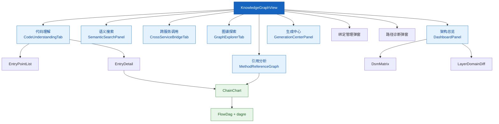
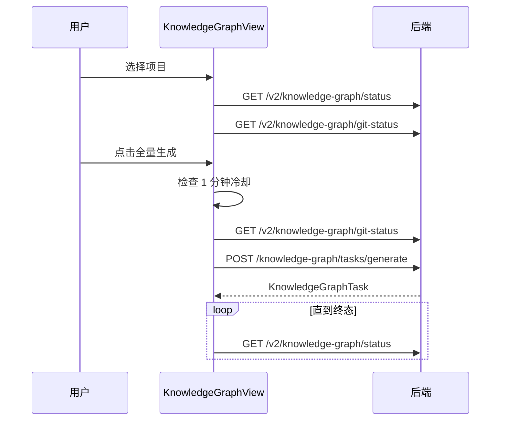

# 知识图谱

> 自动生成于 2026-11-26，基于 `99d0037` 版本

| 属性 | 值 |
|------|-----|
| **所属层** | 表现层 + 服务层 |
| **目录** | `src/views/knowledge-graph/`、`src/views/call-chain/`（部分）、`src/api/knowledgeGraph.ts`、`src/api/vectorSearch.ts`、`src/api/vectorGeneration.ts`、`src/api/binding.ts`、`src/api/projectNameGroup.ts`、`src/api/frontendBackend.ts` |
| **文件数** | 1 个主页面 + 本目录 17 个组件（其中 6 个未被引用）+ `views/call-chain/` 下 7 个在用文件 + 1 个入口类型工具 + 5 个 API 模块 |
| **路由** | `/knowledge-graph`（名称 `KnowledgeGraph`）；`/call-chain/*` 四条旧地址重定向到本页的引用分析页签 |
| **依赖模块** | [状态管理](./状态管理.md)、[API服务层](./API服务层.md)、[项目管理](./项目管理.md)（项目列表来源） |

---

## 1. 模块概述

### 1.1 职责定义

**核心职责**：围绕后端生成的代码知识图谱提供七类浏览与分析入口——代码理解、语义搜索、引用分析、跨服务调用、图谱探索、架构总览、生成中心——并负责图谱的生成与向量补齐。

**职责边界**：

| 本模块负责 | 本模块不负责 | 由谁负责 |
|-----------|-------------|---------|
| 选项目、选页签、发请求、画图 | 图谱的抽取与存储 | 后端 |
| 触发全量 / 增量生成并轮询状态 | 解析源码 | 后端 |
| 术语表与前后端绑定的界面 | 绑定后的跨层链接构建 | 后端 |
| 调用链的可视化布局 | 调用关系数据 | 后端 |

### 1.2 核心文件清单

| 文件 | 类型 | 职责 | 行数 |
|------|------|------|------|
| `src/views/knowledge-graph/KnowledgeGraphView.vue` | 页面 | 项目选择、页签、生成与向量操作、若干弹窗 | 1606 |
| `src/views/knowledge-graph/components/CodeUnderstandingTab.vue` | 组件 | 页签"代码理解" | 350 |
| `src/views/knowledge-graph/components/EntryPointList.vue`、`EntryDetail.vue` | 组件 | 入口列表与入口详情 | 305 + 391 |
| `src/views/knowledge-graph/components/SemanticSearchPanel.vue` | 组件 | 页签"语义搜索" | 590 |
| `src/views/call-chain/MethodReferenceGraph.vue` | 组件 | 页签"引用分析" | 553 |
| `src/views/call-chain/components/ChainChart.vue` | 组件 | 调用树与流程图（被 `EntryDetail` 复用） | 1654 |
| `src/views/call-chain/components/FlowDag.vue`、`flowDagLayout.ts` | 组件 | dagre 布局的 SVG 流程图 | 407 + 146 |
| `src/views/call-chain/components/TreeNode.vue`、`ContextMenu.vue`、`mergeGraphs.ts` | 组件 | 递归树节点、右键菜单、多入口图合并 | 248 + 102 + 59 |
| `src/views/knowledge-graph/components/CrossServiceBridgeTab.vue` | 组件 | 页签"跨服务调用" | 378 |
| `src/views/knowledge-graph/components/GraphExplorerTab.vue` | 组件 | 页签"图谱探索" | 721 |
| `src/views/knowledge-graph/components/DashboardPanel.vue` | 组件 | 页签"架构总览" | 484 |
| `src/views/knowledge-graph/components/DsmMatrix.vue`、`LayerDomainDiff.vue` | 组件 | DSM 矩阵（含下钻）、层 × 域矩阵 | 227 + 249 |
| `src/views/knowledge-graph/components/GenerationCenterPanel.vue` | 组件 | 页签"生成中心" | 154 |
| `src/views/knowledge-graph/components/BindingManagerDialog.vue` | 组件 | 前后端项目绑定管理 | 146 |
| `src/views/knowledge-graph/utils/entryTypeUtils.ts` | 工具 | 入口类型的图标、标签、配色 | 113 |
| `src/api/knowledgeGraph.ts` | API | 图谱相关 70 余个函数与全部类型 | 875 |

---

## 2. 模块架构

### 2.1 页签与组件

### 2.2 七个页签

| 页签名 | `activeTab` | 组件 | 调用的接口函数 |
|--------|------------|------|---------------|
| 代码理解 | `understand` | `CodeUnderstandingTab` | `getStatus`、`getEntryPoints`、`getEntryPointsGrouped` |
| 语义搜索 | `semanticSearch` | `SemanticSearchPanel` | `vectorSearchApi.searchV2` |
| 引用分析 | `methodRef` | `MethodReferenceGraph` | `getRootEntries`、`getCalleesTree`；`claudeApi.universalChat` |
| 跨服务调用 | `crossService` | `CrossServiceBridgeTab` | `getBridgeStats`、`getBridgesByType` |
| 图谱探索 | `explorer` | `GraphExplorerTab` | `getClasses`、`getMethodsByClass`、`searchMethods`、`getRootEntries`、`getCalleesTree`、`getEntryTypes`、`getEntryPoints`、`getMethodDetail` |
| 架构总览 | `dashboard` | `DashboardPanel` | `getDashboard`、`getPackageCycles`、`getPackageDependencies`、`getClassLayerViolations`、`getClassEgoNet`；`DsmMatrix` 用 `getDsm`、`getDsmDrillDown`；`LayerDomainDiff` 用 `getLayerDomainMatrix` |
| 生成中心 | `generationCenter` | `GenerationCenterPanel` | `searchMethods`、`generateTestSuggestions`、`generateRefactorSuggestions` |

初始页签取自地址栏 `?tab=`，默认 `understand`。`EntryDetail` 另外调用 `getCallChainByKey` 与 `getCallChainGraph`。除特别注明外，上表函数均指 `knowledgeGraphApi` 的成员。

---

## 3. 对外接口

### 3.1 地址参数

| 参数 | 作用 |
|------|------|
| `?tab=` | 初始页签 |
| `?project=` | 初始选中的项目；项目选择变化时页面会用 `router.replace` 把当前选择写回该参数 |

选择项目的优先级：`useAppStore` 已选项目 → 地址栏 `project` → 空。

### 3.2 可复用组件

| 组件 | 复用方 |
|------|--------|
| `DsmMatrix` | 本页"架构总览"、[架构诊断](./架构诊断.md) |
| `ChainChart` | 本页"引用分析"、`EntryDetail` |
| `BindingManagerDialog` | 仅本页 |

---

## 4. 内部实现

### 4.1 项目选择：扁平与分组

页头有两种视图。"扁平视图"是一个多选下拉；"分组视图"按项目名称分组（`projectNameGroupApi`）展示树，分组标题行有"全选"。另有"管理分组"弹窗，对分组做增删改。

项目列表来自 `projectApi.scanGitRepos()` 与 `listRemoteProjects()`。

### 4.2 生成与状态

| 操作 | 接口 | 说明 |
|------|------|------|
| 全量生成 | `startGenerateTask(path, …, generateVector = true, generateArchitecture = true, buildMode)` | 构建模式下拉提供"全量-复用"（`reuse`，默认）与"全量-全删"（`wipe`） |
| 增量生成 | `incrementalGenerate(path)` | — |
| 刷新图谱状态 | `getStatus(projectPaths)` | 状态取值：`not_generated` / `generated` / `pending` / `running` / `completed` / `failed` |
| Git 状态 | `getGitStatus([path])` | 生成前先取一次，用于展示基线 |

**防重复点击**：页面在内存里记录每个项目上次点击生成的时间，1 分钟内不允许再次点击（`isInCooldown`）；刷新页面后重置。路径在比较前统一成斜杠格式。

### 4.3 向量相关

| 操作 | 函数 |
|------|------|
| 查询向量生成状态 | `getVectorGenerationStatus(path)` |
| 启动向量生成 | `startVectorGeneration(path)` |
| 查询缺失向量的方法 | `getMissingEmbeddings(path)` |
| 只补缺失的向量 | `refreshMissing(path)` |

后两项配合一个抽屉展示"哪些方法缺描述向量"。

### 4.4 路径诊断与迁移

| 操作 | 接口 | 说明 |
|------|------|------|
| 诊断 | `diagnosePaths()` | 比对图谱中记录的项目路径与当前配置，列出不一致项 |
| 迁移 | `migratePaths(oldBaseDir, dryRun)` | 默认 `dryRun = true`，先预演再执行 |

### 4.5 语义搜索

`SemanticSearchPanel` 调 `POST /vector-search/v2`。注释说明 v2 是"多路召回 + RRF 融合"，响应里带有 `subQueries`（分词后的子查询）与 `rrfScores`（节点到融合得分的映射），条目可带 `matchedSubQueries`。组件向外抛两个事件：`viewDetail` 与 `viewCallChain`，后者由主页面切换到"引用分析"页签处理。

### 4.6 引用分析

`MethodReferenceGraph` 支持同时选择多个根入口，用 `mergeGraphs.ts` 把各自的被调树合并成一张图，不同来源的入口用不同颜色区分。展示有两种形态：树形的 `ChainChart` 与流程图 `FlowDag`。`FlowDag` 的布局由 `flowDagLayout.ts` 基于 dagre 计算，边可标记是否成环，节点可带桥接类型。

桥接类型（`BridgeType`）：`MAPPER` / `JPA` / `MQ` / `FEIGN` / `HTTP` / `ASPECT` / `DIRECT`。

该页签还接入了 AI 解读：先用 `promptStore` 渲染 `impact-analysis` 场景的提示词模板，再调 `claudeApi.universalChat`（场景同为 `impact-analysis`），拿到会话编号后跳转到 [Claude终端与会话](./Claude终端与会话.md) 的会话页。

### 4.7 架构总览

`DashboardPanel` 用 ECharts 展示：KPI（方法总数、域总数、循环依赖数、分层违规数、平均耦合度）、包依赖与包循环、类级分层违规、类的自我中心网（`ClassEgoNet`）。`DsmMatrix` 支持点击下钻；`LayerDomainDiff` 展示层 × 域矩阵。

---

## 5. 交互流程

### 5.1 全量生成

轮询间隔 2 秒；超过 `POLLING_MAX_MS`（2 小时）仍未结束则停止自动刷新并提示手动刷新。向量生成另有一套同样的轮询（上限 `VECTOR_POLLING_MAX_MS`，同为 2 小时），完成或失败后顺带刷新缺失信息。

### 5.2 异常流程

| 场景 | 处理 |
|------|------|
| 未选项目进入本页 | 路由守卫重定向到 `/project` |
| 冷却期内再次点击生成 | 生成与向量相关按钮被禁用 |
| 增量生成失败 | `console.error` 并复位加载状态 |
| 生成耗时超出上限 | 停止轮询，警告"知识图谱生成时间过长，已停止自动刷新，请手动刷新查看状态" |
| 路径诊断发现不一致 | 接口返回 `inconsistentPaths`，每项含 `reason` 与 `expectedPath` |

---

## 6. 依赖关系

| 方向 | 依赖 | 说明 |
|------|------|------|
| 上游 | `api/knowledgeGraph.ts` | 本模块的主体 |
| 上游 | `api/vectorSearch.ts`、`api/vectorGeneration.ts` | 语义搜索与向量操作 |
| 上游 | `api/binding.ts`、`api/projectNameGroup.ts`、`api/glossary.ts` | 弹窗 |
| 上游 | `api/project.ts`、`api/remote-project.ts`、`api/claude.ts` | 项目列表、AI 解读 |
| 上游 | `@dagrejs/dagre`、`echarts` | 布局与图表 |
| 上游 | `constants/layerOrder.ts` | 分层顺序 `CONTROLLER → SERVICE → REPOSITORY → MODEL → UTILITY`，注释说明与后端 `ClassLayerRoleDetector` 保持一致 |
| 下游 | 路由守卫、侧边栏"知识图谱" | `menuKey: 'knowledge-graph'`，需先选项目 |

### 6.1 存在于代码但未被引用的文件

| 文件 | 说明 |
|------|------|
| `components/BlastRadiusView.vue` | 爆炸半径，调用 `getBlastRadius`、`searchMethods` |
| `components/BuildModuleAnalysis.vue` | 构建模块分析，调用 `getBuildModules` 等三个函数 |
| `components/CrossServiceTopology.vue` | 服务拓扑，调用 `getServiceTopology` |
| `components/DomainBoundaryView.vue` | 域边界，调用 `getDomains`、`getDomainClasses`、`getMethodsByClass` |
| `components/FrontendBackendTab.vue` | 前后端跨层视图，唯一的 `api/frontendBackend.ts` 使用方 |
| `components/HotspotTreemap.vue` | 热点矩形树图，调用 `getHotspots` |
| `views/call-chain/CallChainGraph.vue`、`ProjectList.vue`、`UriList.vue`、`components/ClassMethodSelector.vue`、`components/UriSelector.vue` | 旧调用链页面残留 |

这些组件功能完整但没有父组件引用，因此它们独占的那部分图谱接口目前没有可达的调用路径（清单见 [05-接口文档](../05-接口文档/index.md)）。

---

## 7. 配置项

| 常量 | 值 | 位置 |
|------|----|------|
| 生成冷却时间 | 1 分钟 | `KnowledgeGraphView` 的 `ONE_MINUTE_MS` |
| 默认构建模式 | `reuse` | 同上 |
| 路径迁移默认模式 | 预演（`dryRun = true`） | 同上 |

---

## 8. 错误处理

| 场景 | 处理 |
|------|------|
| HTTP 层错误 | 由拦截器统一提示 |
| 增量生成失败 | `console.error` 并复位加载状态 |
| 图表容器尺寸不足 | 跳过渲染 |
| 搜索无结果 | 显示空状态 |

---

## 9. 性能考量

| 关注点 | 策略 | 实现 |
|--------|------|------|
| 页签按需渲染 | 多数面板带 `v-if`（已选项目或页签为当前页） | 主页面模板；"引用分析"面板始终渲染 |
| 布局计算与渲染分离 | 布局是纯函数，输出扁平的节点 / 边列表 | `flowDagLayout.ts`、`mergeGraphs.ts` |
| HTML 转义 | `ChainChart` 引入 `escapeHtml` / `escapeRegExp` | `utils/markdown.ts` |

---

## 10. 已知问题与扩展点

| 类型 | 说明 |
|------|------|
| 已知问题 | `KnowledgeGraphView.vue` 有 1606 行，`ChainChart.vue` 有 1654 行，都远超仓库其它组件 |
| 已知问题 | 调用链相关组件放在 `views/call-chain/` 下，但该目录的路由已全部重定向 |
| 已知问题 | `knowledgeGraphApi` 有 19 个函数没有任何调用方，另有 9 个只被未引用的组件调用 |
| 扩展点 | 新增分析页签：在主页面加 `el-tab-pane` 并新建面板组件，数据从 `knowledgeGraphApi` 取 |

---

> **相关文档**：
> - 架构总览 → [02-架构设计](../02-架构设计/index.md)
> - 复用 DSM 组件的页面 → [架构诊断](./架构诊断.md)
> - 复用图谱入口与结构的页面 → [APM调试](./APM调试.md)
> - 接口清单 → [05-接口文档](../05-接口文档/index.md)
