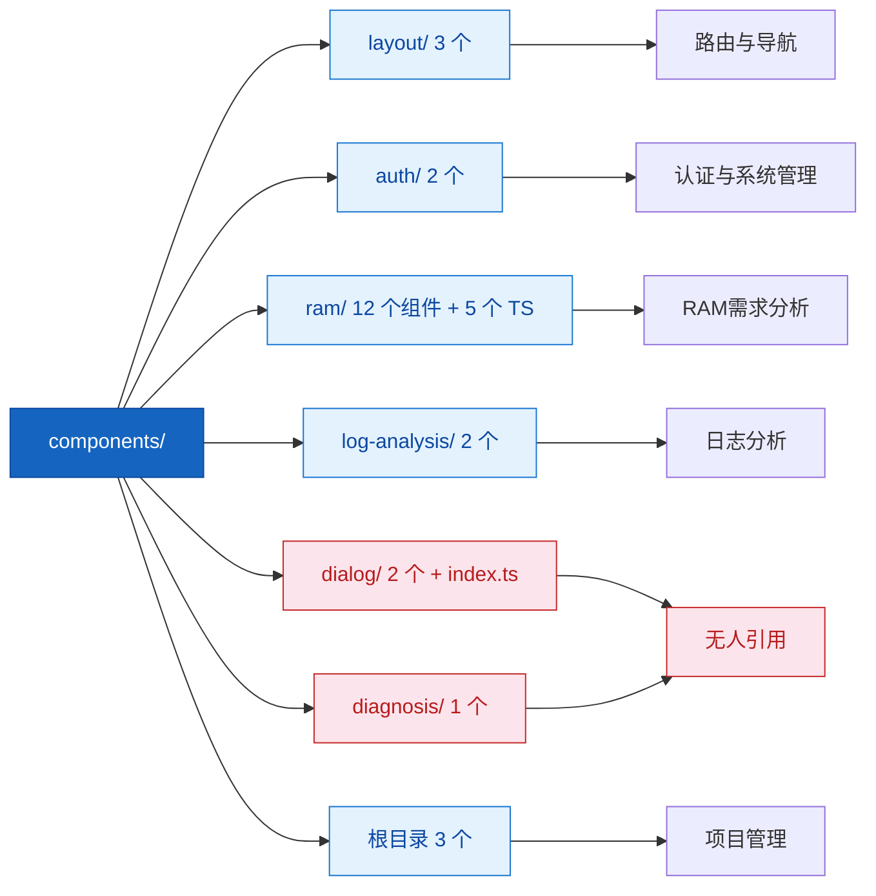

# 组件层

> 自动生成于 2026-11-26，基于 `99d0037` 版本

| 属性 | 值 |
|------|-----|
| **所属层** | 表现层 |
| **目录** | `src/components/`（41 个文件）以及各 `src/views/<模块>/components/` |
| **文件数** | 公共组件目录 31 个非测试文件；视图内嵌组件约 50 个 |
| **依赖模块** | [状态管理](./状态管理.md)、[API服务层](./API服务层.md)、[路由与导航](./路由与导航.md) |

---

## 1. 模块概述

### 1.1 职责定义

**核心职责**：本文是前端全部 Vue 组件的横向索引——说明组件放在哪里、遵守哪些写法约定、哪些组件被多个模块复用、哪些组件虽然还在仓库里但已经没人引用。各组件的业务细节在对应模块的文档里。

**职责边界**：

| 本文负责 | 本文不负责 | 见谁 |
|---------|-----------|------|
| 组件目录的分类与归属 | 单个组件的逻辑 | 各模块文档 |
| 跨模块复用关系 | 复用方各自的业务 | 各模块文档 |
| 未引用组件清单 | — | — |

### 1.2 两种存放位置

| 位置 | 数量 | 含义 |
|------|------|------|
| `src/components/` | 41 个文件 | 名义上的"公共"组件目录，实际多数只服务一个模块 |
| `src/views/<模块>/components/` | 约 50 个 | 只被同一模块的页面使用 |

---

## 2. 模块架构

### 2.1 `src/components/` 的分组

### 2.2 各分组明细

| 分组 | 组件 | 行数 | 归属模块 |
|------|------|------|---------|
| `layout/` | `AppLayout`、`AppHeader`、`AppSidebar` | 44 + 47 + 393 | [路由与导航](./路由与导航.md) |
| `auth/` | `LoginDialog`、`UserDropdown` | 92 + 75 | [认证与系统管理](./认证与系统管理.md) |
| `ram/` | `ClarifyModal`、`ConfirmModal`、`DagFlow`、`DagGraph`、`FileBrowserPanel`、`ImpactOutputView`、`MermaidDiagram`、`Minimap`、`TechPlanOutputView`、`ThreeRingGraph` | 合计约 3000 | [RAM需求分析](./RAM需求分析.md) |
| `ram/`（TS） | `clarify.ts`、`dagLayout.ts`、`dagModel.ts`、`threeRingLayout.ts` | 41 + 139 + 269 + 264 | 同上 |
| `log-analysis/` | `FollowupPanel`、`NodeTimeline` | 275 + 236 | [日志分析](./日志分析.md) |
| 根目录 | `ProjectDirConfig`、`GitOperations` | 102 + 132 | [项目管理](./项目管理.md) |

`ram/` 另有 10 个单元测试文件，见 [RAM需求分析](./RAM需求分析.md)。

---

## 3. 写法约定

以下约定来自对现有组件的通读：

| 约定 | 说明 |
|------|------|
| 脚本形式 | 一律 `<script setup lang="ts">` |
| 属性 | 用 `interface Props` 声明后传给 `defineProps`，可选属性用 `withDefaults` 给默认值 |
| 事件 | `defineEmits<{ (e: 'name', payload: 类型): void }>()` 具名元组写法 |
| 对外暴露 | 需要被父组件或测试直接调用的方法用 `defineExpose` |
| 样式 | `<style scoped>`；布局骨架（`AppLayout`）用非 scoped 的全局重置 |
| 图标 | `main.ts` 把 `@element-plus/icons-vue` 的全部图标注册为全局组件，模板里可直接写 `<el-icon><Plus /></el-icon>` |
| Markdown | 统一用 `utils/markdown.ts` 的 `renderMarkdown`（marked + DOMPurify 净化）后 `v-html` |
| 图 | ECharts 与 Mermaid 按需在各组件内 `import`，初始化前先 `dispose` 旧实例 |
| 布局计算 | 把布局算法写成不依赖 DOM 的纯函数（`dagLayout.ts`、`threeRingLayout.ts`、`flowDagLayout.ts`），模板只负责渲染 |

---

## 4. 跨模块复用的组件

| 组件 | 定义位置 | 使用方 |
|------|---------|--------|
| `MermaidDiagram.vue` | `components/ram/` | [RAM需求分析](./RAM需求分析.md) 的技术方案、[架构诊断](./架构诊断.md) 的深度分析 |
| `DsmMatrix.vue` | `views/knowledge-graph/components/` | [知识图谱](./知识图谱.md) 的架构总览、[架构诊断](./架构诊断.md) 的实时报告 |
| `ChainChart.vue` | `views/call-chain/components/` | [知识图谱](./知识图谱.md) 的引用分析、入口详情 |
| `ChatMessageList.vue`、`ChatInputBox.vue` | `views/ram/chat/` | [RAM对话与异常修复](./RAM对话与异常修复.md) 的两个页面 |

注意复用方向：[架构诊断](./架构诊断.md) 页面引用了知识图谱与 RAM 目录下的组件，所以这两个目录里的部分文件实际上是跨模块共享的。

---

## 5. 视图内嵌组件分布

| 目录 | 文件数 | 模块文档 |
|------|--------|---------|
| `views/apm-debug/components/` | 14 | [APM调试](./APM调试.md) |
| `views/architecture-diagnosis/` | 1（`AiDeepAnalysisPanel`） | [架构诊断](./架构诊断.md) |
| `views/call-chain/components/` | 8（6 个在用） | [知识图谱](./知识图谱.md) |
| `views/claude-terminal/components/` | 2（另有 1 个测试） | [Claude终端与会话](./Claude终端与会话.md) |
| `views/knowledge-graph/components/` | 17（11 个在用） | [知识图谱](./知识图谱.md) |
| `views/ram/chat/` | 6 | [RAM对话与异常修复](./RAM对话与异常修复.md) |
| `views/workbench/components/` | 4 | [工作台](./工作台.md) |

---

## 6. 未被引用的文件

以下结论来自对全仓库 `import` 语句的解析：从 `main.ts`、`App.vue`、`router/index.ts` 出发不可达。

### 6.1 `src/components/` 下

| 文件 | 行数 | 状态 |
|------|------|------|
| `ApiList.vue` | 29 | 没有任何导入 |
| `diagnosis/AgentDiagnosisPanel.vue` | 582 | 没有任何导入；它是 `composables/useDiagnosis.ts` 的唯一使用方 |
| `dialog/index.ts` | 2 | 没有任何导入 |
| `dialog/DialogProgressPanel.vue` | 698 | 只被 `dialog/index.ts` 导入 |
| `dialog/InterventionPanel.vue` | 541 | 只被 `dialog/index.ts` 导入 |
| `ram/CostMeter.vue` | 113 | 只有测试导入 |
| `ram/ImpactSankeyGraph.vue` | 181 | 没有任何导入 |
| `ram/impactSankeyTransform.ts` | 371 | 只被 `ImpactSankeyGraph.vue` 导入 |

### 6.2 视图目录下

| 文件 | 状态 |
|------|------|
| `views/call-chain/CallChainGraph.vue`、`ProjectList.vue`、`UriList.vue`、`components/ClassMethodSelector.vue`、`components/UriSelector.vue` | 旧调用链页面的残留 |
| `views/knowledge-graph/components/` 下的 `BlastRadiusView`、`BuildModuleAnalysis`、`CrossServiceTopology`、`DomainBoundaryView`、`FrontendBackendTab`、`HotspotTreemap` | 没有父组件引用 |

### 6.3 连带的孤立模块

| 模块 | 被谁牵连 |
|------|---------|
| `api/ops.ts` | 无导入 |
| `api/callChain.ts` | 只被 `views/call-chain/ProjectList.vue` 与 `UriList.vue` 导入 |
| `api/frontendBackend.ts` | 只被 `FrontendBackendTab.vue` 导入 |
| `composables/useDiagnosis.ts` | 只被 `AgentDiagnosisPanel.vue` 导入 |
| `composables/useDialogWebSocket.ts` | 只被 `dialog/` 下两个面板导入 |
| `types/index.ts`、`types/intent.ts` | 无生产代码导入 |
| `utils/pathUtils.ts`、`utils/polar.ts` | 无导入 |

---

## 7. 依赖关系

| 方向 | 依赖 | 说明 |
|------|------|------|
| 上游 | `stores/*` | 多数业务组件直接读 Store，不经过逐层传参 |
| 上游 | `utils/markdown.ts` | 所有 Markdown 展示 |
| 上游 | `element-plus`、`@element-plus/icons-vue` | UI 基础 |
| 下游 | 各页面 | 见 2.2 与第 5 节 |

---

## 8. 性能考量

| 关注点 | 策略 | 实现 |
|--------|------|------|
| 重计算可测 | 布局与折叠逻辑写成纯函数 | `dagModel.ts`、`dagLayout.ts`、`threeRingLayout.ts`、`flowDagLayout.ts` |
| 避免每次渲染重建正则 | 把正则提到模块顶层 | `DagGraph.vue` |
| XSS 防护 | 所有 `v-html` 之前先净化 | `utils/markdown.ts` |

---

## 9. 已知问题与扩展点

| 类型 | 说明 |
|------|------|
| 已知问题 | `src/components/` 里约四分之一的非测试文件已不可达，合计约 2500 行 |
| 已知问题 | "公共组件"目录里除了 `layout/` 与 `auth/`，其余都只服务单一模块 |
| 已知问题 | 跨模块复用的组件仍留在最初所属模块的目录下 |
| 扩展点 | 新增确实被多个模块使用的组件时，放到 `src/components/<领域>/`，并沿用第 3 节的写法约定 |

---

> **相关文档**：
> - 架构总览 → [02-架构设计](../02-架构设计/index.md)
> - 全部模块文档的索引见 README 的模块列表
