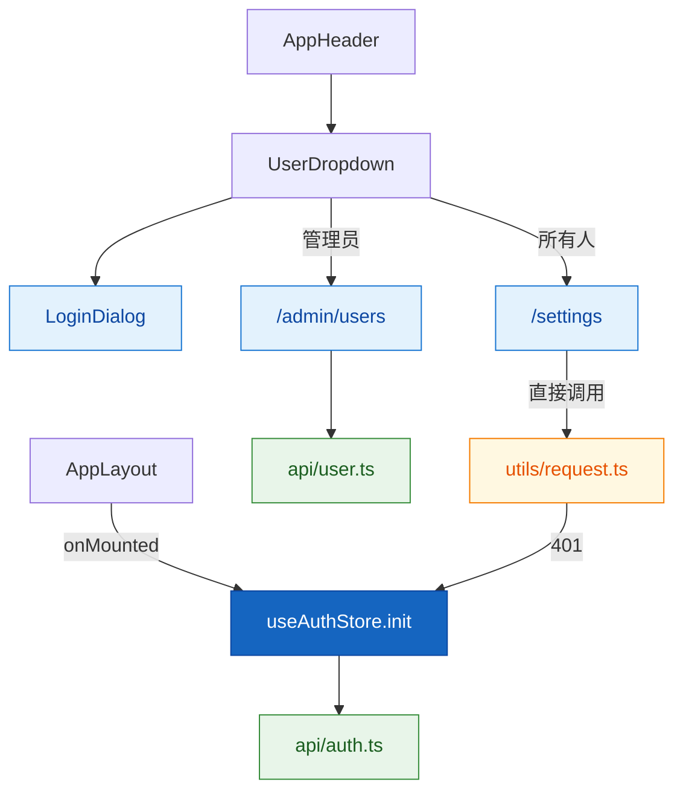
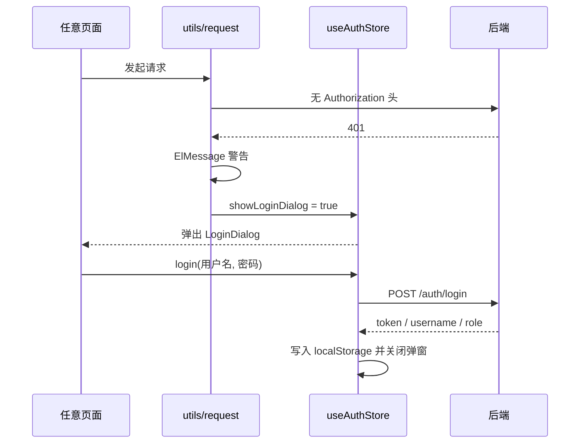
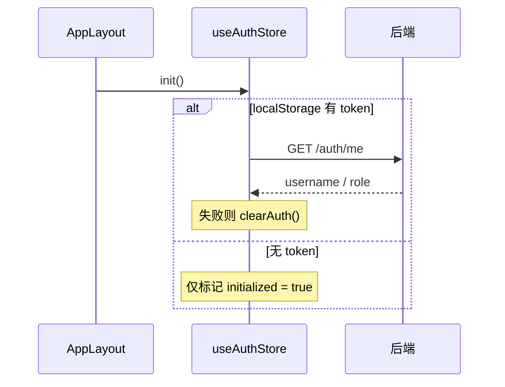

# 认证与系统管理

> 自动生成于 2026-11-26，基于 `99d0037` 版本

| 属性 | 值 |
|------|-----|
| **所属层** | 应用层（认证 Store）+ 表现层（登录 / 用户管理 / 系统设置） |
| **目录** | `src/stores/auth.ts`、`src/components/auth/`、`src/views/admin/`、`src/views/settings/`、`src/api/auth.ts`、`src/api/user.ts` |
| **文件数** | 4 个 Vue 文件 + 3 个 TS 文件 |
| **路由** | `/settings`（`Settings`）、`/admin/users`（`UserManagement`，需管理员） |
| **依赖模块** | [路由与导航](./路由与导航.md)、[API服务层](./API服务层.md)、[状态管理](./状态管理.md) |

---

## 1. 模块概述

### 1.1 职责定义

**核心职责**：提供登录 / 注册 / 退出与管理员判定，并承载两个后台页面——用户角色管理和后端运行配置编辑。

**职责边界**：

| 本模块负责 | 本模块不负责 | 由谁负责 |
|-----------|-------------|---------|
| 保存 token 与当前用户信息 | 签发与校验 JWT | 后端 |
| 登录弹窗的展示与触发 | 密码找回 | 代码中无此功能 |
| 管理员路由守卫 | 接口级权限校验 | 后端 |
| 编辑并提交后端配置 | 配置的实际生效 | 后端（主配置需重启，代理配置即时生效） |

### 1.2 核心文件清单

| 文件 | 类型 | 职责 | 行数 |
|------|------|------|------|
| `src/stores/auth.ts` | Store | `useAuthStore`：token、用户名、角色、登录弹窗开关 | 72 |
| `src/components/auth/LoginDialog.vue` | 组件 | "登录 / 注册"双页签弹窗 | 92 |
| `src/components/auth/UserDropdown.vue` | 组件 | 顶栏用户菜单 | 75 |
| `src/views/admin/UserManagement.vue` | 页面 | 用户列表与角色切换 | 84 |
| `src/views/settings/SettingsView.vue` | 页面 | 后端配置与代理配置表单 | 649 |
| `src/api/auth.ts` | API | 登录、注册、当前用户 | 16 |
| `src/api/user.ts` | API | 用户列表、改角色 | 12 |

---

## 2. 模块架构

---

## 3. 对外接口

### 3.1 Store：`useAuthStore`

| 成员 | 类型 | 说明 |
|------|------|------|
| `token` | `Ref<string \| null>` | 初始值取自 `localStorage` 的 `hisi-token` |
| `username` | `Ref<string \| null>` | 登录或 `init()` 后填充 |
| `role` | `Ref<string \| null>` | 取值 `ADMIN` 或 `MEMBER`（类型见 `UserInfo.role`） |
| `showLoginDialog` | `Ref<boolean>` | 401 时由请求拦截器置为 `true` |
| `initialized` | `Ref<boolean>` | 是否已尝试用 token 换取用户信息 |
| `isLoggedIn` | 计算属性 | token 与用户名都存在 |
| `isAdmin` | 计算属性 | `role === 'ADMIN'` |
| `init()` | 动作 | 无 token 直接标记已初始化；有 token 调 `authApi.me()`，失败则 `clearAuth()` |
| `login(user, password)` | 动作 | `authApi.login` 成功后写入 token 并关闭弹窗 |
| `register(user, password)` | 动作 | `authApi.register` 成功后行为同登录 |
| `logout()` | 动作 | 清空 token / 用户名 / 角色并移除 `localStorage` 项 |

### 3.2 API 函数

| 模块 | 函数 | 请求 |
|------|------|------|
| `api/auth.ts` | `authApi.login(username, password)` | `POST /auth/login`，体 `{ username, password }` |
| `api/auth.ts` | `authApi.register(username, password)` | `POST /auth/register` |
| `api/auth.ts` | `authApi.me()` | `GET /auth/me` |
| `api/user.ts` | `userApi.list()` | `GET /users` |
| `api/user.ts` | `userApi.changeRole(id, role)` | `PUT /users/{id}/role`，体 `{ role }` |

设置页没有独立的 `api/` 模块，四个接口在 `SettingsView.vue` 中直接通过 `request` 实例调用：

| 请求 | 用途 |
|------|------|
| `GET /settings/config` | 读取整份后端配置（扁平键值对象） |
| `POST /settings/config` | 保存配置 |
| `GET /settings/proxy` | 读取代理配置 |
| `POST /settings/proxy` | 保存代理配置 |

---

## 4. 内部实现

### 4.1 Token 的注入与失效

- **注入**：`utils/request.ts` 的请求拦截器每次从 `localStorage` 读取 `hisi-token`，存在则加 `Authorization: Bearer {token}`。
- **失效**：响应拦截器遇到 HTTP 401 时提示并动态导入 `@/stores/auth`，把 `showLoginDialog` 置为 `true`。动态导入是为了避免 `request.ts` 与 Store 的循环依赖。
- **403**：默认文案"仅管理员可执行此操作"，若后端返回了 `message` 则优先用后端文案。

### 4.2 管理员守卫

`router/index.ts` 的 `beforeEach` 对带 `meta.requiresAdmin` 的路由做三步：

1. `authStore` 未初始化时先 `await authStore.init()`。
2. 不是管理员则 `ElMessage.warning('仅管理员可访问此页面')`。
3. 重定向到 `/`（根路径再重定向到 `/workbench`）。

目前只有 `/admin/users` 带这个 meta。

### 4.3 侧边栏中的入口

`AppSidebar` 在管理员登录时把"用户管理"插到"系统设置"之前；"系统设置"同时也是侧边栏底部的固定入口。

### 4.4 用户管理页

| 项 | 说明 |
|----|------|
| 加载 | 挂载时 `userApi.list()` |
| 改角色 | 表格内下拉选择，变化即调用 `userApi.changeRole(user.id, user.role)` |
| 失败回滚 | 修改失败时重新 `loadUsers()` |
| 时间显示 | `createdAt` 按秒级时间戳乘 1000 后本地化显示 |

### 4.5 系统设置页

设置页把后端配置当作一棵嵌套对象，用 `deepGet` / `deepSet` 在"表单字段"与"配置路径"之间双向映射，保存时只覆盖表单管理的那些键，其余原样回传。

| 分组 | 配置路径 |
|------|---------|
| 服务 | `server.port` |
| 图数据库 | `neo4j.uri`、`neo4j.username`、`neo4j.password` |
| Embedding 模型 | `embedding.api-key`、`base-url`、`model`、`dimension`、`timeout`、`max-retries`、`retry-base-delay-ms`、`headers` |
| 文本模型 | `text-model.api-key`、`base-url`、`model`、`temperature`、`max-tokens`、`timeout`、`max-retries`、`retry-base-delay-ms` |
| 其它 | `app.project_dir`、`logging.level.root`（debug / info / warn / error）、`cors.allowed-origins` |

**供应商预置**：Embedding 预置四项——硅基流动 `Qwen/Qwen3-VL-Embedding-8B`（4096 维）、智谱 `embedding-3`（2048 维）、科大讯飞 `xop3qwen8bembedding`（768 维）、华为云 `Qwen3-Embedding-8B`（4096 维）；文本模型预置一项——智谱 `glm-4-flash`。选中预置会回填 `baseUrl` / `model` / `dimension`；加载配置时则通过比对 `baseUrl` 与 `model` 反推当前命中的预置。

**代理配置**是独立表单，字段：`enabled`、`host`、`port`、`type`（`HTTP` / `SOCKS`）、`username`、`password`、`nonProxyHosts`、`disableSslVerification`。加载失败时静默处理。

**Electron 分支**：若 `window.electronAPI` 存在，读写配置与重启后端都走该对象；浏览器环境下保存主配置后提示"请重启后端服务生效"，保存代理后提示"已生效（无需重启）"。

---

## 5. 交互流程

### 5.1 未登录用户访问受保护接口

### 5.2 应用启动时的身份恢复

---

## 6. 依赖关系

| 方向 | 依赖 | 说明 |
|------|------|------|
| 上游 | `utils/request.ts` | 设置页直接使用；所有 API 经其发出 |
| 上游 | `types/api.ts` | `AuthResponse`、`UserInfo`、`parseValidationErrors` |
| 下游 | `AppLayout`、`AppHeader`、`AppSidebar`、路由守卫 | 见 [路由与导航](./路由与导航.md) |

---

## 7. 配置项

本模块没有前端环境变量，涉及的 `localStorage` 键只有 `hisi-token`（登录令牌）。设置页表单的默认值（如 `server.port = 8080`）只是加载失败或字段缺失时的兜底显示，不代表后端实际值。

---

## 8. 错误处理

| 场景 | 处理 | 用户感知 |
|------|------|---------|
| 登录 / 注册字段为空 | 不发请求 | "请输入用户名和密码" |
| 登录或注册失败 | `ElMessage.error(err.message)` | 红色提示 |
| token 过期 | 拦截器提示并弹登录框 | "登录已过期，请重新登录" |
| 非管理员访问后台页 | 守卫重定向 | "仅管理员可访问此页面" |
| 改角色失败 | 重新拉取列表 | "修改角色失败" |
| 配置加载 / 保存失败 | `ElMessage.error` | "加载配置失败" / "保存配置失败" |
| 400 参数校验错误 | 拦截器解析 `字段: 消息` 列表 | "参数验证失败: …" |

---

## 9. 性能与安全

| 关注点 | 策略 | 实现位置 |
|--------|------|---------|
| 减少重复的身份请求 | `initialized` 标志 | `useAuthStore.init` |
| 密码不落盘 | 登录成功后清空表单，不写 `localStorage` | `LoginDialog` |
| token 存放位置 | `localStorage` | `stores/auth.ts`、`utils/request.ts` |
| 循环依赖 | 拦截器内动态导入 Store | `utils/request.ts` |

---

## 10. 已知问题与扩展点

| 类型 | 说明 |
|------|------|
| 已知问题 | token 键名 `hisi-token` 在 `stores/auth.ts`、`utils/request.ts`、`api/workflow.ts`、`api/architectureDiagnosis.ts` 各写了一遍 |
| 已知问题 | 设置页未走统一的 `api/` 模块，接口路径散落在视图里 |
| 扩展点 | 新增仅管理员可见的页面：路由加 `meta.requiresAdmin`，并在 `AppSidebar` 的 `menuItems` 中追加 |

---

> **相关文档**：
> - 架构总览 → [02-架构设计](../02-架构设计/index.md)
> - 守卫所在位置 → [路由与导航](./路由与导航.md)
> - 请求拦截器 → [API服务层](./API服务层.md)
> - 接口清单 → [05-接口文档](../05-接口文档/index.md)
