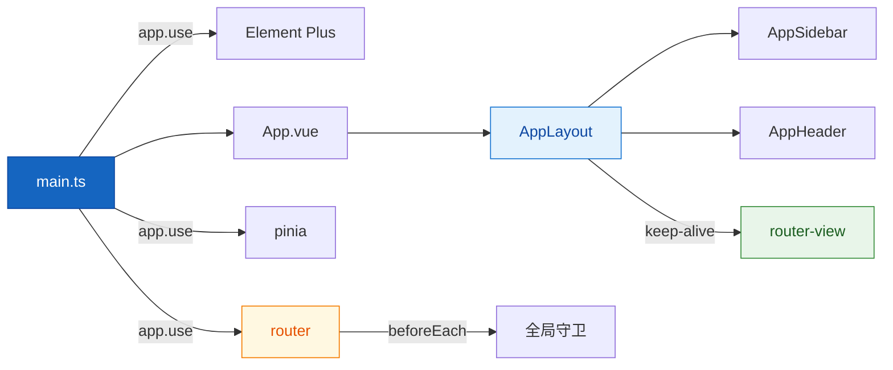
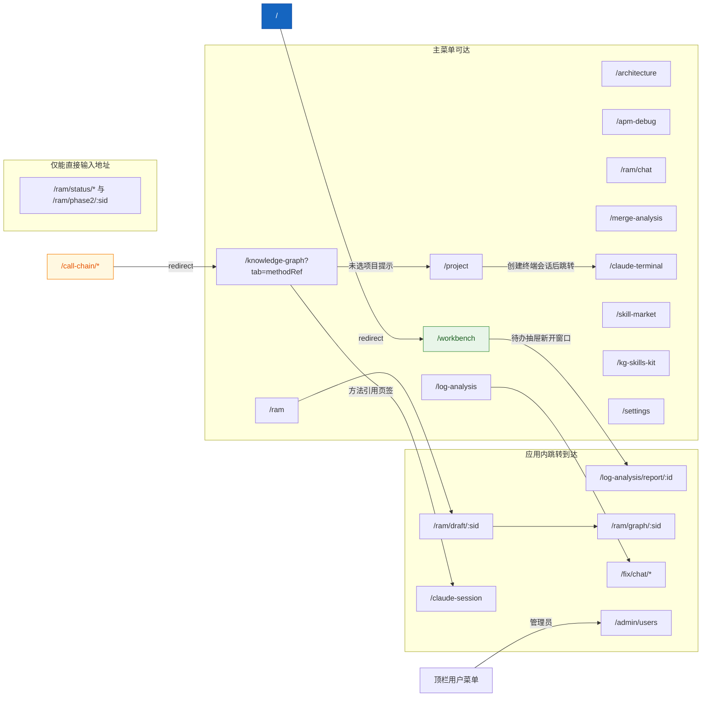

# 路由与导航

> 自动生成于 2026-11-26，基于 `99d0037` 版本

| 属性 | 值 |
|------|-----|
| **所属层** | 基础设施层（路由表 + 全局守卫）+ 表现层（布局壳与侧边栏） |
| **目录** | `src/router/index.ts`、`src/components/layout/`、`src/App.vue`、`src/main.ts` |
| **文件数** | 4 个 Vue 文件 + 2 个 TS 文件 |
| **路由记录** | 36 条（31 条带组件，5 条纯重定向） |
| **依赖模块** | [状态管理](./状态管理.md)（`useAppStore`、`useAuthStore`）、[认证与系统管理](./认证与系统管理.md) |

---

## 1. 模块概述

### 1.1 职责定义

**核心职责**：定义 URL 到页面组件的映射，提供应用外壳（侧边栏 + 顶栏 + 内容区），并在导航前完成标题设置、管理员校验和项目选择校验。

**职责边界**：

| 本模块负责 | 本模块不负责 | 由谁负责 |
|-----------|-------------|---------|
| 路由表与懒加载 | 页面内部的状态与请求 | 各功能模块 |
| 全局前置守卫 | 按钮级权限控制 | 各页面自行判断 |
| 侧边栏菜单与可用性置灰 | 菜单可用性的判定规则 | [状态管理](./状态管理.md) 的 `availableMenus` |
| 布局骨架 | 登录弹窗本身 | [认证与系统管理](./认证与系统管理.md) |

### 1.2 核心文件清单

| 文件 | 类型 | 职责 | 行数 |
|------|------|------|------|
| `src/main.ts` | 入口 | 创建应用、全量注册 Element Plus 与图标、挂载路由和 Pinia | 27 |
| `src/App.vue` | 根组件 | 仅渲染 `AppLayout` | 19 |
| `src/router/index.ts` | 路由 | 路由表与 `beforeEach` 守卫 | 293 |
| `src/components/layout/AppLayout.vue` | 布局 | 侧边栏 + 顶栏 + `router-view` | 44 |
| `src/components/layout/AppHeader.vue` | 布局 | 顶栏：产品名 + 用户菜单 | 47 |
| `src/components/layout/AppSidebar.vue` | 布局 | 侧边栏菜单、分组标签、子菜单 | 393 |

---

## 2. 模块架构

### 2.1 应用启动链路

### 2.2 布局结构

`AppLayout` 使用 `el-container`：左侧 `AppSidebar`，右侧纵向排列 `AppHeader`（高 48px）与 `el-main`。内容区的 `router-view` 外包了一层 `keep-alive`，组件以 `route.fullPath` 为 key——同一路由的不同参数会被视为不同实例分别缓存。

`AppLayout` 在挂载时调用 `authStore.init()`，这是应用启动后恢复登录身份的唯一起点。

---

## 3. 路由表

### 3.1 带组件的路由（31 条）

所有页面组件都通过 `() => import(...)` 懒加载。

| 路径 | 名称 | 页面组件 | 标题 |
|------|------|---------|------|
| `/workbench` | `Workbench` | `views/workbench/WorkbenchView.vue` | 工作台 |
| `/project` | `Project` | `views/project/ProjectList.vue` | 项目管理 |
| `/knowledge-graph` | `KnowledgeGraph` | `views/knowledge-graph/KnowledgeGraphView.vue` | 知识图谱分析 |
| `/architecture` | `ArchitectureDiagnosis` | `views/architecture-diagnosis/ArchitectureDiagnosisView.vue` | 架构诊断 |
| `/log-analysis` | `LogAnalysis` | `views/log-analysis/LogQuery.vue` | 日志分析 |
| `/log-analysis/report/:id` | `ReportDetail` | `views/log-analysis/ReportDetail.vue` | 报告详情 |
| `/apm-debug` | `ApmDebug` | `views/apm-debug/ApmDebugView.vue` | APM 调试 |
| `/ram` | `RamSessions` | `views/ram/SessionListPage.vue` | 需求分析大师 |
| `/ram/new` | `RamInput` | `views/ram/InputPage.vue` | 新建需求分析 |
| `/ram/draft/:sid` | `RamDraft` | `views/ram/DraftPage.vue` | RAM 草稿 |
| `/ram/graph/:sid` | `RamGraph` | `views/ram/GraphPreviewPage.vue` | RAM 影响图谱 |
| `/ram/status` | `StatusSessions` | `views/ram/StatusSessionListPage.vue` | 项目现状分析 |
| `/ram/status/new` | `RamStatusInput` | `views/ram/StatusInputPage.vue` | 新建项目现状分析 |
| `/ram/status/:sid` | `RamStatus` | `views/ram/StatusPage.vue` | 项目现状分析 |
| `/ram/phase2/:sid` | `RamPhase2` | `views/ram/Phase2Page.vue` | 精确位置分析 |
| `/ram/chat` | `RamChat` | `views/ram/RamChatView.vue` | RAM 对话 |
| `/ram/chat/:sid` | `RamChatSession` | `views/ram/RamChatView.vue` | RAM 对话 |
| `/merge-analysis` | `MergeAnalysisSessions` | `views/merge-analysis/SessionListPage.vue` | 合入分析 |
| `/merge-analysis/new` | `MergeAnalysisInput` | `views/merge-analysis/InputPage.vue` | 新建合入分析 |
| `/merge-analysis/diff` | `MergeAnalysisDiff` | `views/merge-analysis/DiffPreviewPage.vue` | Diff 预览 |
| `/merge-analysis/result` | `MergeAnalysisResult` | `views/merge-analysis/AnalysisPage.vue` | 影响分析结果 |
| `/fix/chat` | `FixChat` | `views/fix/FixChatView.vue` | 异常修复 |
| `/fix/chat/:sid` | `FixChatSession` | `views/fix/FixChatView.vue` | 异常修复 |
| `/claude-terminal` | `ClaudeTerminal` | `views/claude-terminal/ClaudeTerminal.vue` | Claude 终端 |
| `/claude-session` | `ClaudeSession` | `views/claude-session/ClaudeSession.vue` | Claude 会话 |
| `/prompt-config` | `PromptConfig` | `views/prompt-config/PromptConfig.vue` | 提示词配置 |
| `/glossary` | `Glossary` | `views/glossary/GlossaryView.vue` | 术语管理 |
| `/skill-market` | `SkillMarket` | `views/skill-market/SkillMarket.vue` | 技能市场 |
| `/kg-skills-kit` | `KgSkillsKit` | `views/kg-skills-kit/KgSkillsKit.vue` | KG Skills 套件 |
| `/settings` | `Settings` | `views/settings/SettingsView.vue` | 系统设置 |
| `/admin/users` | `UserManagement` | `views/admin/UserManagement.vue` | 用户管理（`requiresAdmin`） |

### 3.2 纯重定向路由（5 条）

| 路径 | 目标 |
|------|------|
| `/` | `/workbench` |
| `/call-chain` | `/knowledge-graph?tab=methodRef` |
| `/call-chain/uri-chain` | `/knowledge-graph?tab=methodRef` |
| `/call-chain/method-reference` | `/knowledge-graph?tab=methodRef` |
| `/call-chain/chain` | `/knowledge-graph?tab=methodRef` |

旧的调用链页面地址全部并入知识图谱页的"方法引用"页签。

### 3.3 路由关系图

> 分组依据：对全仓库 `router.push` / `router.replace` / `window.open` / `router-link` 的检索结果。"项目现状分析"相关页面之间的跳转只在这组页面内部互相指向，代码中没有从其它页面进入 `/ram/status` 的入口。

---

## 4. 全局守卫

`router.beforeEach` 依次执行四步：

| 步骤 | 条件 | 动作 |
|------|------|------|
| 1. 标题 | `to.meta.title` 存在 | `document.title = "{title} - HiSi Dev Tool"` |
| 2. 管理员校验 | `to.meta.requiresAdmin` | 未初始化则 `await authStore.init()`；非管理员提示后 `next('/')` |
| 3. 加载项目目录 | `appStore.projectDir` 为空且 `configLoading` 为假 | `await appStore.loadProjectDir()`；失败只打 `console.error`，不阻断 |
| 4. 菜单可用性 | 见下表 | 不可用则提示"请先在项目管理页面选择项目"并 `next('/project')` |

第 4 步的检查项：

| 路径前缀 | 检查的 `availableMenus` 键 | 当前是否可能拦截 |
|---------|--------------------------|----------------|
| `/knowledge-graph` | `knowledge-graph` | 是——未选中项目时为 `false` |
| `/architecture` | `architecture-diagnosis` | 是（同上） |
| `/ram` | `ram` | 否——代码中恒为 `true` |

---

## 5. 侧边栏菜单

### 5.1 菜单项（`AppSidebar` 的 `baseMenuItems`，按显示顺序）

| 顺序 | 标题 | 路由 | `menuKey` | 分组标签 |
|------|------|------|-----------|---------|
| 1 | 工作台 | `/workbench` | `workbench` | 分析工具 |
| 2 | 项目管理 | `/project` | `project-management` | |
| 3 | 知识图谱 | `/knowledge-graph` | `knowledge-graph` | |
| 3.1 | 图谱总览 | `/knowledge-graph` | — | 子菜单 |
| 3.2 | 提示词配置 | `/prompt-config` | — | 子菜单 |
| 3.3 | 术语管理 | `/glossary` | — | 子菜单 |
| 4 | 架构诊断 | `/architecture` | `architecture-diagnosis` | |
| 5 | 日志分析 | `/log-analysis` | `log-analysis` | |
| 6 | APM 调试 | `/apm-debug` | `apm-debug` | |
| 7 | 需求分析大师 | `/ram` | `ram-demand` | AI Agent |
| 8 | RAM 对话 | `/ram/chat` | `ram-chat` | |
| 9 | 合入分析 | `/merge-analysis` | `merge-analysis` | |
| 10 | Claude 终端 | `/claude-terminal` | `claude-terminal` | 工具 & 市场 |
| 11 | 技能市场 | `/skill-market` | `skill-market` | |
| 12 | KG Skills 套件 | `/kg-skills-kit` | `kg-skills-kit` | |
| 13 | 用户管理（仅管理员） | `/admin/users` | — | 插在"系统设置"之前 |
| 14 | 系统设置 | `/settings` | `settings` | |

### 5.2 可用性规则

- 每一项的 `disabled` 取 `!appStore.availableMenus[menuKey]`。
- 禁用项加 `disabled` 样式（`pointer-events: none`）并移出 Tab 顺序。
- 带子菜单的项在禁用时不再渲染可展开的分组，而是落到普通菜单项分支，显示为一条禁用项。

### 5.3 子菜单状态

`openedSubmenus` 是一个响应式 `Set`，初始化时按当前路径展开匹配的分组，路由变化时由 `watch(route.path)` 同步；点击分组标题切换展开。

---

## 6. 依赖关系

| 方向 | 依赖 | 使用的接口 |
|------|------|-----------|
| 上游 | `stores/app.ts` | `projectDir`、`configLoading`、`configError`、`availableMenus`、`loadProjectDir` |
| 上游 | `stores/auth.ts` | `init`、`isAdmin` |
| 上游 | `components/auth/UserDropdown.vue` | 顶栏右侧挂载 |
| 下游 | 全部 31 个页面组件 | 路由表引用 |

---

## 7. 配置项

| 项 | 值 | 位置 |
|----|----|------|
| history 模式 | `createWebHistory(import.meta.env.BASE_URL)` | `router/index.ts` |
| 标题后缀 | `- HiSi Dev Tool` | `beforeEach` |
| 侧边栏宽度 | 220px | `AppSidebar` 样式 |

---

## 8. 错误处理

| 场景 | 处理 | 用户感知 |
|------|------|---------|
| 非管理员访问后台页 | 重定向 `/` | 警告"仅管理员可访问此页面" |
| 未选项目访问图谱 / 架构页 | 重定向 `/project` | 警告"请先在项目管理页面选择项目" |
| 项目目录配置加载失败 | 放行导航 | 无提示，仅控制台错误 |

---

## 9. 性能考量

| 关注点 | 策略 | 实现 |
|--------|------|------|
| 首屏体积 | 路由级代码分割 | 全部页面组件动态 `import` |
| 页面状态保留 | `keep-alive`，按 `fullPath` 区分实例 | `AppLayout` |
| 管理员 Store 按需加载 | 守卫内动态导入 `@/stores/auth` | `router/index.ts` |

---

## 10. 已知问题与扩展点

| 类型 | 说明 |
|------|------|
| 已知问题 | `availableMenus` 里的 `search`、`ram-status` 两个键没有任何菜单项或守卫引用 |
| 已知问题 | `keep-alive` 未设置 `include` / `max`，访问过的页面实例会一直缓存 |
| 扩展点 | 新增页面：在 `routes` 中追加记录，并在 `AppSidebar` 的 `baseMenuItems` 中追加菜单项与 `menuKey` |

---

> **相关文档**：
> - 架构总览 → [02-架构设计](../02-架构设计/index.md)
> - `availableMenus` 的定义 → [状态管理](./状态管理.md)
> - 管理员守卫依赖的 Store → [认证与系统管理](./认证与系统管理.md)
