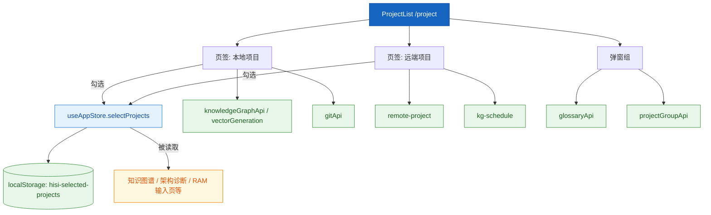
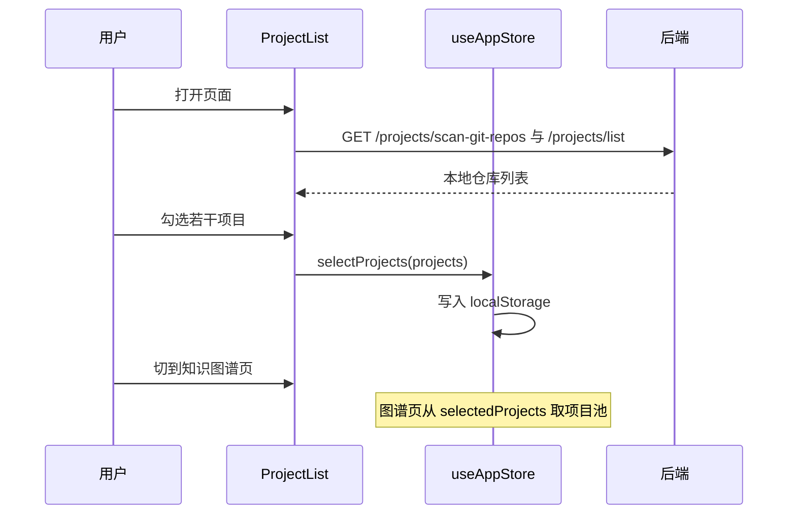

# 项目管理

> 自动生成于 2026-11-26，基于 `99d0037` 版本

| 属性 | 值 |
|------|-----|
| **所属层** | 表现层 |
| **目录** | `src/views/project/ProjectList.vue`、`src/components/ProjectDirConfig.vue`、`src/components/GitOperations.vue`、`src/api/project.ts`、`src/api/remote-project.ts`、`src/api/projectGroup.ts`、`src/api/kg-schedule.ts`、`src/api/git.ts` |
| **文件数** | 1 个页面 + 2 个组件 + 5 个 API 模块 |
| **路由** | `/project`（名称 `Project`） |
| **依赖模块** | [状态管理](./状态管理.md)、[知识图谱](./知识图谱.md)、[提示词与术语](./提示词与术语.md)、[Claude终端与会话](./Claude终端与会话.md) |

---

## 1. 模块概述

### 1.1 职责定义

**核心职责**：管理参与分析的项目——本地扫描到的仓库与远端克隆的仓库——并把它们标记为"当前选中的项目"，供知识图谱、架构诊断等页面使用。页面同时聚合了围绕项目的一批运维操作。

**职责边界**：

| 本模块负责 | 本模块不负责 | 由谁负责 |
|-----------|-------------|---------|
| 扫描 / 克隆 / 拉取 / 删除项目 | 实际的 Git 操作 | 后端 |
| 维护"已选项目"并持久化 | — | `useAppStore` |
| 触发图谱生成、向量生成、架构分析 | 这些任务的执行 | 后端 |
| 远端项目与定时任务的配置 | 按计划执行 | 后端 |

### 1.2 核心文件清单

| 文件 | 类型 | 职责 | 行数 |
|------|------|------|------|
| `src/views/project/ProjectList.vue` | 页面 | 两个页签 + 9 个弹窗 | 3075 |
| `src/components/ProjectDirConfig.vue` | 组件 | 项目根目录配置 | 102 |
| `src/components/GitOperations.vue` | 组件 | Git 状态 / 拉取 / 日志 | 132 |
| `src/api/project.ts` | API | 6 个函数 | 33 |
| `src/api/remote-project.ts` | API | 6 个函数 | 26 |
| `src/api/projectGroup.ts` | API | 5 个函数 + `ProjectGroup` 类型 | 37 |
| `src/api/kg-schedule.ts` | API | 4 个函数 | 18 |
| `src/api/git.ts` | API | 7 个函数 + 类型 | 91 |

---

## 2. 模块架构

---

## 3. 对外接口

### 3.1 页面结构

| 区域 | 名称 | 内容 |
|------|------|------|
| 页签 | 本地项目（`local`，默认） | 扫描到的 Git 仓库表；图谱状态、向量状态、Git 信息；多选 |
| 页签 | 远端项目（`remote`） | 远端仓库表；克隆状态、分支、同步时间；多选 |
| 弹窗 | 克隆项目 | 填仓库地址、分支、目录 |
| 弹窗 | 提交代码分析 | 选一条提交，发起代码分析或影响分析 |
| 弹窗 | 一键更新结果 | 全部仓库拉取的结果汇总 |
| 弹窗 | 知识图谱生成屏蔽目录配置 | 配置生成时要排除的目录 |
| 弹窗 | 生成知识图谱 / 批量生成知识图谱 | 单个或多个项目的生成选项 |
| 弹窗 | 添加 / 编辑远端项目 | 地址、认证方式、分支、分组 |
| 弹窗 | 定时任务配置 | 图谱定时重建计划 |
| 弹窗 | 术语配置 | 项目的术语表（增删改） |
| 弹窗 | 项目分组管理 | 按 `appId` 把多个项目路径归为一组 |

### 3.2 API

| 模块 | 函数与请求 |
|------|-----------|
| `api/project.ts` | `getProjects` → `GET /projects/list`；`clone` → `POST /projects/clone`；`pull(name)` → `POST /projects/pull/{name}`；`delete(name)` → `DELETE /projects/{name}`；`getStatus` → `GET /projects/status`；`scanGitRepos` → `GET /projects/scan-git-repos` |
| `api/remote-project.ts` | `listRemoteProjects` → `GET /remote-projects`；`createRemoteProject` → `POST /remote-projects`；`updateRemoteProject` → `PUT /remote-projects/{id}`；`deleteRemoteProject` → `DELETE /remote-projects/{id}`；`cloneRemoteProject` → `POST /remote-projects/{id}/clone`；`pullRemoteProject` → `POST /remote-projects/{id}/pull` |
| `api/projectGroup.ts` | `getGroups` → `GET /project-group`；`getGroup` → `GET /project-group/{appId}`；`saveGroup` → `POST /project-group`；`deleteGroup` → `DELETE /project-group/{appId}`；`getGroupByPath` → `GET /project-group/by-path` |
| `api/kg-schedule.ts` | `listKgSchedules` → `GET /kg-schedules`；`createKgSchedule` → `POST /kg-schedules`；`updateKgSchedule` → `PUT /kg-schedules/{id}`；`deleteKgSchedule` → `DELETE /kg-schedules/{id}` |
| `api/git.ts` | `getStatus` → `GET /git/status`；`checkout` → `POST /git/checkout`；`pull` → `POST /git/pull`；`getLogs` → `GET /git/logs`；`getCommits` → `GET /git/commits`；`getCommitDiff` → `GET /git/commit-diff`；`updateAll` → `POST /git/update-all` |
| `api/knowledgeGraph.ts`（本页用到的） | `getProjects`、`startGenerateTask`、`startGenerateTaskBatch`、`getTaskStatus`、`getBatchStatus`、`refresh`、`crossServiceBuild`、`runArchitectureAnalysis`、`getArchAnalysisStatus` |
| `api/vectorGeneration.ts`（本页用到的） | `getVectorGenerationStatusBatch`、`startVectorGeneration`、`regenerateAll` |
| `api/glossary.ts` | `list` / `create` / `update` / `delete` |

本页没有调用、全仓库也无调用的函数：`projectGroupApi.getGroup`、`projectGroupApi.getGroupByPath`、`deleteKgSchedule`、`gitApi.getCommitDiff`。

---

## 4. 内部实现

### 4.1 已选项目的传递

- 勾选行后调用 `appStore.selectProjects(projects)`；删除项目时把它从已选列表里剔除。
- 已选项目由 `useAppStore` 写入 `localStorage`（`hisi-selected-projects`），跨页面、跨刷新生效。
- 页头有提示条显示"已选择 N 个项目"。
- 判断菜单是否可用只看"是否有已选项目"，不看项目根目录是否已配置——注释说明远程项目可以没有本地扫描根目录。

### 4.2 项目列表的来源

`loadProjects` 并行请求 `scanGitRepos()` 与 `getProjects()`，后者失败时按空数组处理。路径在比较前统一为斜杠格式（`normalizePath`）。

### 4.3 表格里的状态列

每个项目行显示两类状态并用提示框给出细节：

| 状态 | 数据来源 | 轮询 |
|------|---------|------|
| 知识图谱生成状态 | `getTaskStatus`、`getBatchStatus` | `startKgPolling` |
| 向量生成状态 | `getVectorGenerationStatusBatch` | `startVectorPolling` |
| 架构分析任务 | `getArchAnalysisStatus` | `startArchAnalysisPolling` |

### 4.4 生成操作

| 操作 | 接口 | 说明 |
|------|------|------|
| 生成知识图谱 | `startGenerateTask(path, excludePaths, generateVector, generateArchitecture, buildMode)` | 可先在弹窗里配置屏蔽目录 |
| 批量生成 | `startGenerateTaskBatch(projectPaths, …)` | 代码注释：多项目排队生成，完成一个再做下一个 |
| 重新生成全部向量 | `regenerateAll(path)` | 先清空描述和向量再重做 |
| 刷新图谱 | `refresh(path)` | 按提交差异增量重建 |
| 跨服务构建 | `crossServiceBuild(paths)` | — |
| 架构分析 | `runArchitectureAnalysis([path])` | 之后轮询任务状态 |

### 4.5 提交代码分析

"提交代码分析"弹窗先用 `gitApi.getCommits(path, 50)` 列出提交；选定后：

1. `workspaceStore.createSession(scene, prompt, workingDirectory)`，`scene` 为 `code-analysis` 或 `impact-analysis`。
2. 跳转到 `/claude-terminal?sessionId=…`，由 [Claude终端与会话](./Claude终端与会话.md) 接管。

这是项目管理页与终端页之间唯一的跳转。

### 4.6 一键更新

`gitApi.updateAll(appStore.projectDir)` 对根目录下的全部仓库执行拉取，结果在弹窗里按成功 / 失败列出（`UpdateAllResponse`：`totalRepos`、`successCount`、`failCount`、`results[]`）。

### 4.7 远端项目的克隆状态

`RemoteProject.cloneStatus` 取值：`PENDING` / `CLONING` / `CLONED` / `FAILED`。发起克隆后页面按间隔轮询直到状态变化。认证方式 `authType`：`PASSWORD` / `SSH_KEY` / `TOKEN`。

### 4.8 定时任务

`KgSchedule` 字段：`projectPath`、`cronExpression`、`buildMode`（`INCREMENTAL` / `REUSE` / `WIPE`）、`enabled`、`gitPullEnabled`、`branch`、`refreshDescription`、`refreshArchitecture`、`lastRunAt`、`nextRunAt`。

---

## 5. 交互流程

---

## 6. 异常流程

| 场景 | 处理 |
|------|------|
| 项目列表接口之一失败 | 该来源按空列表处理 |
| 删除项目 | 二次确认；成功后从已选项目中剔除 |
| 根目录未配置 | 页面内提供 `ProjectDirConfig` 组件直接修改 |
| 克隆远端项目失败 | 状态列显示 `FAILED` 与错误信息 |

---

## 7. 依赖关系

| 方向 | 依赖 | 说明 |
|------|------|------|
| 上游 | `stores/app.ts` | 已选项目、项目根目录 |
| 上游 | `stores/workspaceStore.ts` | 创建终端会话 |
| 上游 | 7 个 API 模块 | 见 3.2 |
| 下游 | 路由守卫 | 未选项目时把图谱页、架构页重定向到本页 |

---

## 8. 配置项

| 常量 | 值 | 位置 |
|------|----|------|
| 提交列表条数 | 50 | `loadCommits` |
| 已选项目持久化键 | `hisi-selected-projects` | `stores/app.ts` |

轮询间隔的取值在页面内部，本手册未逐个确认。

---

## 9. 性能考量

| 关注点 | 策略 | 实现 |
|--------|------|------|
| 批量状态查询 | 用批量接口一次取多个项目的状态 | `getBatchStatus`、`getVectorGenerationStatusBatch`、`getTaskStatus` |
| 离开页面 | `onUnmounted` 清理三类轮询定时器 | `ProjectList.vue` |

---

## 10. 已知问题与扩展点

| 类型 | 说明 |
|------|------|
| 已知问题 | `ProjectList.vue` 有 3075 行，把本地项目、远端项目、定时任务、术语、分组九个弹窗放在同一个文件里 |
| 已知问题 | 术语配置在 [提示词与术语](./提示词与术语.md)、[知识图谱](./知识图谱.md) 和本页各有一份实现 |
| 已知问题 | `deleteKgSchedule` 有定义但页面没有删除定时任务的调用 |
| 扩展点 | 新增项目级操作：在表格操作列加入口，业务请求放到对应的 `api/` 模块 |

---

> **相关文档**：
> - 架构总览 → [02-架构设计](../02-架构设计/index.md)
> - `selectedProjects` 的定义 → [状态管理](./状态管理.md)
> - 图谱生成的另一入口 → [知识图谱](./知识图谱.md)
> - 接口清单 → [05-接口文档](../05-接口文档/index.md)
