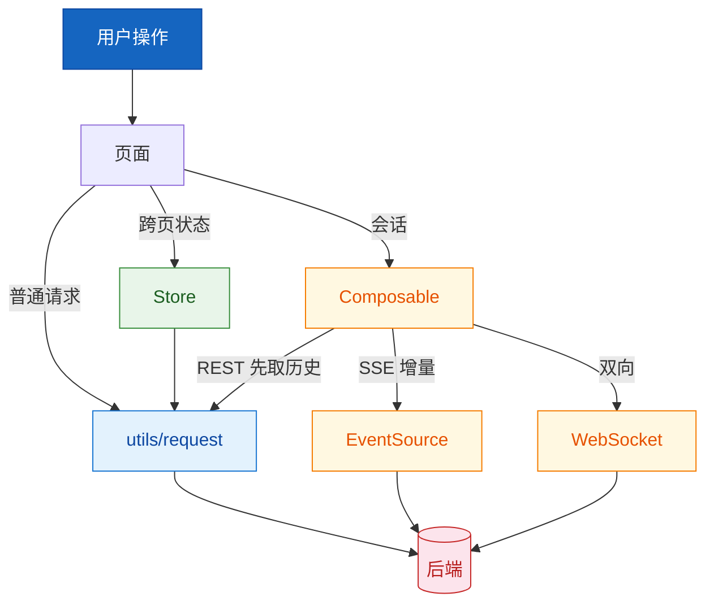
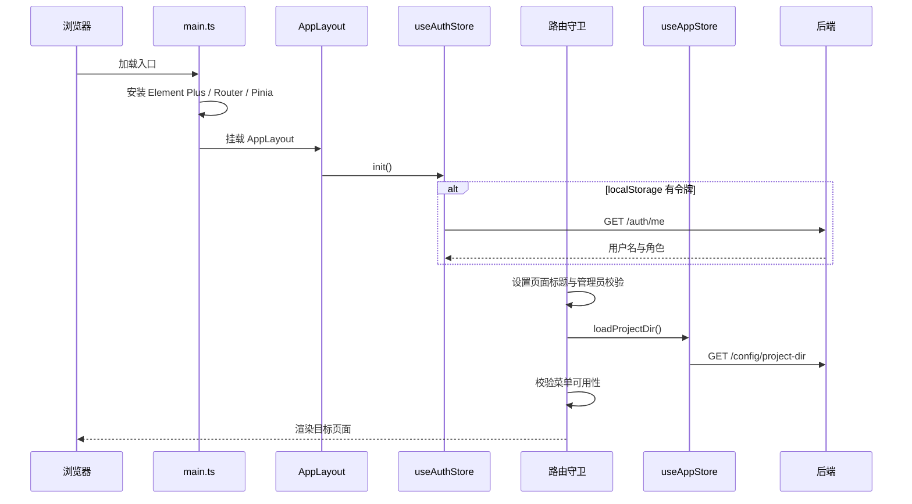
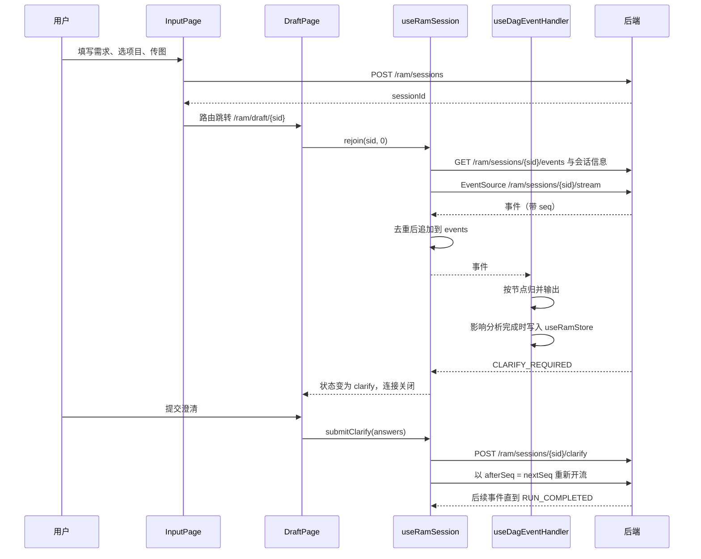
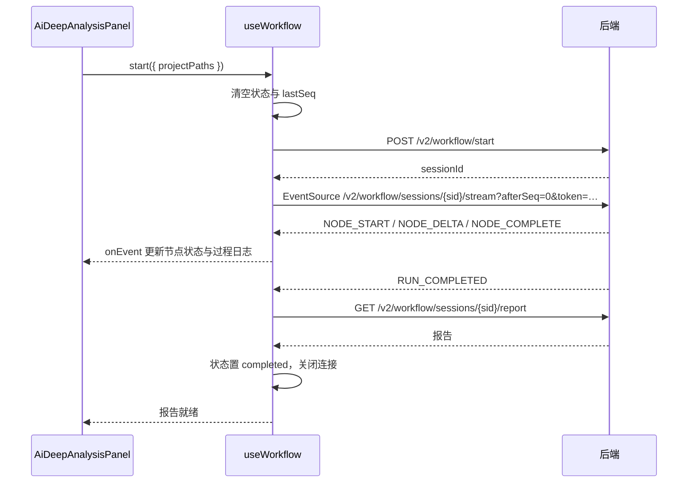
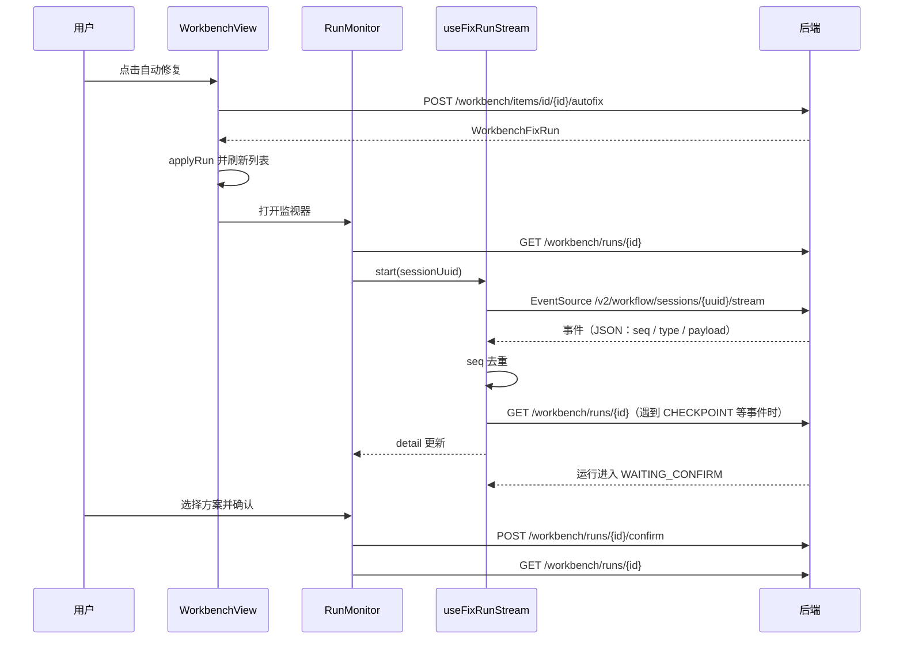
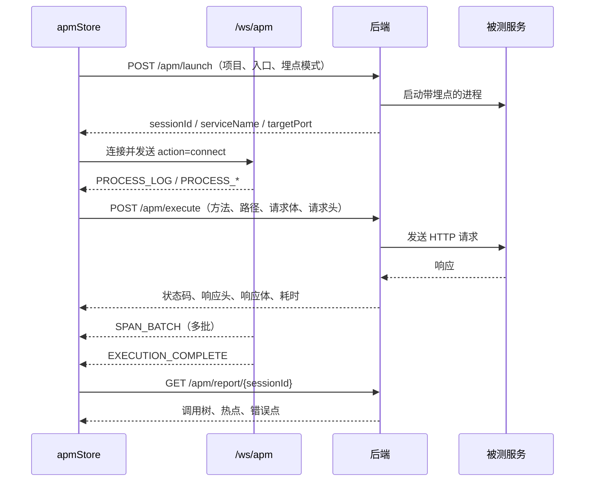
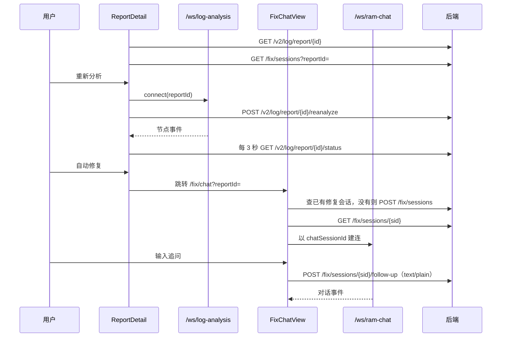
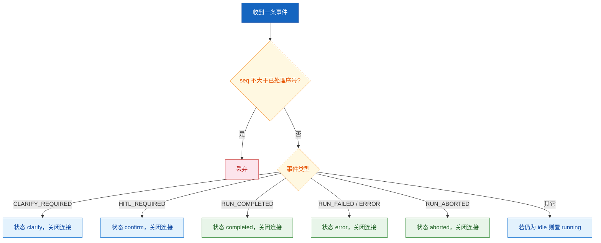

> 自动生成于 2026-11-26，基于 `99d0037` 版本

# 核心数据流

---

## 1. 数据流概览

### 1.1 核心数据流清单

| # | 流程名 | 触发方 | 关键路径 | 通道 | 重要性 |
|---|--------|--------|---------|------|--------|
| 1 | 应用启动与身份恢复 | 用户打开页面 | 入口 → 布局 → 认证初始化 → 路由守卫 | HTTP | 核心 |
| 2 | RAM 需求分析 | 用户提交需求 | 输入页 → 草稿页 → 澄清 / 确认 → 图谱页 | HTTP + SSE | 核心 |
| 3 | AI 深度分析 | 用户点击开始 | 架构诊断页 → 工作流接口 → 事件流 → 报告 | HTTP + SSE | 核心 |
| 4 | 工作台自动修复 | 用户点击自动修复 | 待办 → 修复运行 → 监视器 → 方案确认 | HTTP + SSE | 核心 |
| 5 | APM 调试 | 用户启动并发请求 | 启动 → WebSocket → 执行 → 报告 | HTTP + WebSocket | 核心 |
| 6 | 日志分析与异常修复 | 用户查看报告 | 报告详情 → 重新分析 → 修复会话 | HTTP + WebSocket | 核心 |
| 7 | 知识图谱生成 | 用户点击生成 | 生成任务 → 状态轮询 | HTTP | 辅助 |
| 8 | 合入分析 | 用户提交分支 | Diff 预览 → 分析会话 → 三类结果 | HTTP + SSE | 辅助 |
| 9 | Claude 终端 | 用户进入终端页 | 握手 → 输入 / 输出 | WebSocket | 辅助 |

### 1.2 数据流全景图

---

## 2. 流程 1：应用启动与身份恢复

### 2.1 流程概述

| 属性 | 值 |
|------|-----|
| **触发方式** | 用户打开任意地址 |
| **涉及模块** | [路由与导航](../03-模块说明/路由与导航.md)、[认证与系统管理](../03-模块说明/认证与系统管理.md)、[状态管理](../03-模块说明/状态管理.md) |
| **数据流向** | `localStorage` → Store → 页面 |

### 2.2 流程时序

### 2.3 步骤详解

| 步骤 | 参与者 | 操作 | 数据 |
|------|--------|------|------|
| 1 | `main.ts` | 创建应用并安装插件，全量注册图标 | — |
| 2 | `AppLayout` | 挂载后初始化认证 | `hisi-token` |
| 3 | `useAuthStore` | 有令牌则换取用户信息，失败即清空 | `username`、`role` |
| 4 | `useAppStore` | 构造时从 `localStorage` 恢复已选项目 | `selectedProjects` |
| 5 | 路由守卫 | 首次导航加载项目根目录；校验目标页是否需要项目 | `projectDir`、`availableMenus` |

---

## 3. 流程 2：RAM 需求分析

### 3.1 流程概述

| 属性 | 值 |
|------|-----|
| **触发方式** | 用户在输入页提交 |
| **涉及模块** | [RAM需求分析](../03-模块说明/RAM需求分析.md)、[实时通信](../03-模块说明/实时通信.md) |
| **数据流向** | 需求文本 → 会话 → 各节点输出 → 影响数据 → 图谱 |

### 3.2 流程时序

### 3.3 数据转换节点

| 节点 | 输入 | 输出 | 转换规则 | 实现位置 |
|------|------|------|---------|---------|
| 事件解析 | `MessageEvent.data` | `RamEvent` | `seq` 兼容字符串与数字；无 `seq` / `type` 的丢弃 | `useRamSession.handleEvent` |
| 节点归属 | `RamEvent` | `DagNodeKey` | `payload.nodeName` 或 `payload.phase`，兼容旧事件名 | `dagModel.classifyEvent` |
| 节点快照 | 事件数组 + 会话状态 | `DagNodeSnapshot[]` | 折叠规则见 [RAM需求分析](../03-模块说明/RAM需求分析.md) | `dagModel.deriveDagSnapshot` |
| 输出格式化 | `CHECKPOINT.payload.output` | Markdown 文本 | 按节点类型套用四种格式化函数 | `useDagEventHandler.formatNodeOutput` |
| 影响数据 | 影响节点输出 | `ImpactPayload` | 新结构取 `methods_to_modify` / `affected_entries`，旧结构取 `involved` / `modified` / `impacted` | `extractImpactFromCheckpoint` |
| 图片 | 上传文件 | `ImageContent` | `FileReader` 读成 Data URL | `InputPage.handleImageUpload` |

---

## 4. 流程 3：AI 深度分析

页面把会话编号写进 `localStorage`；下次进入时 `rejoin`：并行取状态、报告与历史事件，已结束就不再开流。

---

## 5. 流程 4：工作台自动修复

---

## 6. 流程 5：APM 调试

被测服务由后端启动，前端只与后端通信。

---

## 7. 流程 6：日志分析与异常修复

注意修复页的**发送走 REST、接收走 WebSocket**，而且两条通道用的是不同的编号：发送用修复会话的 `id`，接收用它会话里的 `chatSessionId`。

---

## 8. 流程 7：知识图谱生成

| 步骤 | 参与者 | 操作 | 数据 |
|------|--------|------|------|
| 1 | 知识图谱页 | 检查 1 分钟冷却、取 Git 基线 | `GitStatus` |
| 2 | 知识图谱页 | `POST /knowledge-graph/tasks/generate` | `KnowledgeGraphTask` |
| 3 | 知识图谱页 | 每 2 秒 `GET /v2/knowledge-graph/status` | `status`、`methodNodeCount` 等 |
| 4 | 知识图谱页 | 状态到 `completed` / `failed` / `generated` 即停止；超过 2 小时也停止 | — |

---

## 9. 状态流转

### 9.1 四个前端状态机

| 状态机 | 取值 | 所在位置 |
|--------|------|---------|
| RAM / 工作流会话 | `idle` → `running` → `clarify` / `confirm` → `completed` / `error` / `aborted` | `RamStatus`、`WorkflowStatus` |
| APM 会话 | `IDLE` → `LAUNCHING` → `READY` → `EXECUTING` → `STREAMING` → `COMPLETE`，或 `ERROR` | `ApmSessionStatus` |
| 合入分析 | `idle` → `running` → `completed` / `error` | `MergeAnalysisStatus` |
| 修复运行 | `RUNNING` → `WAITING_CONFIRM` → `DONE` / `FAILED` / `ABORTED` / `INTERRUPTED` | `RunStatus` |

### 9.2 会话状态的推导规则

三个 SSE 会话 Composable 推导状态的规则一致：

### 9.3 状态不变量

| 不变量 | 保障方式 |
|--------|---------|
| 同一时刻一个 Composable 只有一条 `EventSource` | 每次开流前先 `tearDown` |
| 已处理的事件不会再次生效 | `seq <= lastSeq` 丢弃 |
| 终态之后不再接收事件 | 进入终态即关闭连接 |

---

## 10. 数据校验规则

### 10.1 输入校验

| 数据 | 校验规则 | 校验位置 | 失败行为 |
|------|---------|---------|---------|
| 登录 / 注册 | 用户名与密码非空 | `LoginDialog` | 警告提示 |
| RAM 需求 | 需求非空、至少选一个项目 | `InputPage` | 警告提示 |
| RAM 图片 | 最多 5 张、单张 ≤ 500 KB、限 JPEG / PNG / GIF / WebP | `InputPage` | 警告提示 |
| 手动 DSL | 必须是合法 JSON | `LogQuery` | 错误提示 |
| 术语 | 术语与同义词非空 | `GlossaryView` | 警告提示 |
| 工作台方案确认 | 必须选中一个方案 | `RunMonitor` | 警告提示 |
| 后端 400 | 拦截器解析"字段: 消息"列表 | `utils/request.ts` | 警告条 |

### 10.2 数据一致性保障

| 一致性约束 | 保障方式 | 实现位置 |
|-----------|---------|---------|
| 事件不重复、不遗漏 | `afterSeq` 续传 + 本地序号去重 | 各 SSE Composable |
| 过期的响应不覆盖新结果 | 请求序号比对 | `ArchitectureDiagnosisView` |
| 同一会话的事件不重复处理 | `processedSeq` | `useDagEventHandler` |
| 重跑后不重放历史 | 用响应里的 `nextSeq` 拨动已处理序号 | `DraftPage`、`AnalysisPage` |
| 会话切换不泄漏状态 | `rejoin` 开头重置全部字段 | `useRamSession`、`useMergeAnalysisSession` |

---

## 11. 性能关键路径

| 路径 | 关注点 | 当前策略 |
|------|--------|---------|
| 高频事件流入 | 每条事件都触发数组重建 | 数组以展开语法追加；代码未做批处理 |
| 轮询 | 多个定时器并存 | 每类轮询都设上限或条件：日志报告最多 3 个、图谱生成最长 2 小时、工作台仅在有在途运行时轮询 |
| 长时间运行 | 进程日志持续增长 | 超过 2000 行裁到 1500 行 |
| 图布局 | 节点数增大 | 布局为纯函数，结果由 `computed` 缓存；影响图谱的边按两环全连接生成，规模上百时需评估 |

耗时数值未在前端代码中度量，本手册不给出。

---

## 12. 数据安全与脱敏

| 数据类型 | 敏感级别 | 存储方式 | 传输 | 说明 |
|---------|---------|---------|------|------|
| 登录令牌 | 高 | `localStorage` | `Authorization` 头；工作流 SSE 走查询参数 | 前端不解析令牌内容 |
| 密码 | 高 | 不存储 | 仅登录 / 注册请求体 | 提交后清空表单 |
| 后端配置里的密钥字段 | 高 | 不存储 | 设置页表单提交 | 设置页会把后端返回的配置原样读入表单，包括其中的密钥字段 |
| 已选项目路径 | 低 | `localStorage` | 请求参数 | 可能包含本机路径 |
| 代码片段、日志内容 | 中 | 不持久化 | 响应体 | 展示时经 Markdown 净化 |

---

> **延伸阅读**：
> - 模块详细实现 → 见 README 的模块列表
> - 接口定义 → [05-接口文档](../05-接口文档/index.md)
> - 数据模型 → [06-数据模型](../06-数据模型/index.md)
