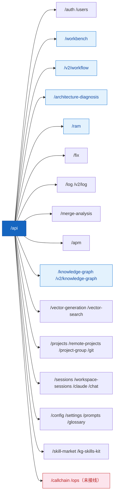
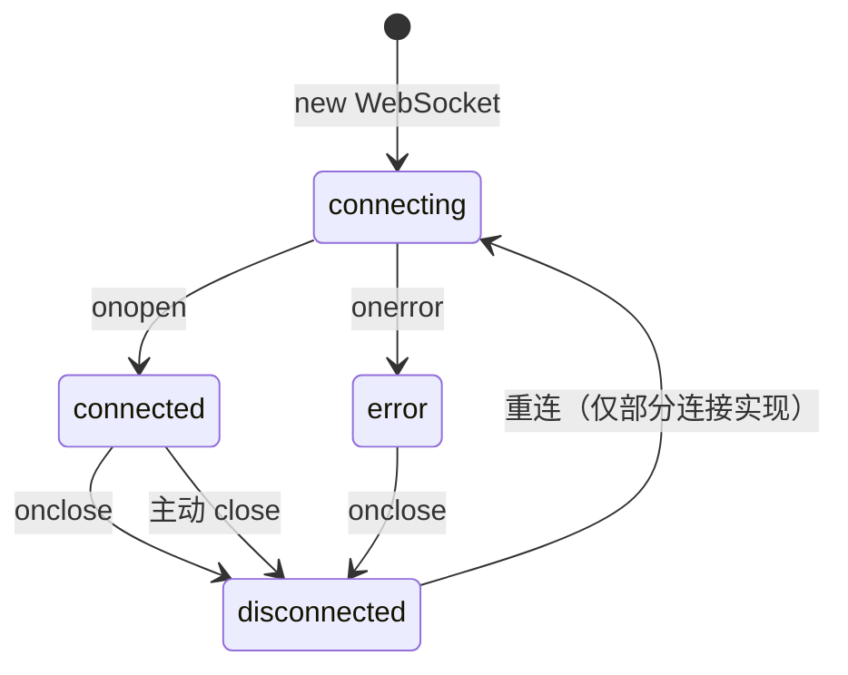

> 自动生成于 2026-11-26，基于 `99d0037` 版本

# 接口文档

---

## 1. 接口概览

本章列出**前端代码实际调用的**后端接口。后端的完整接口集以其自身的手册为准。

### 1.1 接口总览

| 类型 | 数量 | 基础路径 | 协议 | 调用方式 |
|------|------|---------|------|---------|
| HTTP（REST） | 285 个去重后的"方法 + 路径" | `/api` | HTTP | `utils/request.ts` 的 axios 实例；3 处用 `fetch` |
| SSE 流 | 4 个 | `/api` | `text/event-stream` | 4 个 Composable 用 `EventSource`；1 处 `EventSource` 无调用方 |
| WebSocket | 7 个 | `/ws` | WebSocket | 6 个 Composable + 1 个连接工厂 |

数量由脚本从 `src/api/*.ts` 与 `SettingsView.vue` 的调用语句中抽取并去重得到。唯一的跨模块重复是 `GET /callchain/projects`（两个未接线模块各定义了一次）。

### 1.2 状态标记

每行接口带一个状态。状态依据是对全仓库导入关系的解析，而不是人工阅读。

| 标记 | 含义 | 数量 |
|------|------|------|
| （无标记） | 在用：从路由或入口可达的代码会调用 | 200 |
| 仅地址栏 | 调用方页面存在且可达，但没有任何导航入口，只能手输地址 | 5 |
| 无调用 | 函数有定义，但没有任何文件调用 | 68 |
| 仅未引用组件 | 只被"存在但无人引用"的组件调用 | 12 |

> 四类合计 285。数量由脚本对全仓库导入关系解析后按行归类得到。

### 1.3 接口分组关系图



### 1.4 通用约定

**基础路径与鉴权**

| 项 | 值 |
|----|----|
| 基础路径 | `/api`（axios `baseURL`）；`fetch` 调用自行写全 `/api/...` |
| 请求头 | `Content-Type: application/json`；有令牌时 `Authorization: Bearer {token}` |
| 数组参数 | `k=a&k=b`，不带下标与方括号 |
| 超时 | 120 秒 |

**参数记法**：`q` 查询串，`b` 请求体，`{x}` 路径参数，`?` 表示可选。

**响应格式**（由拦截器处理，调用方拿到的已是内层数据）：

```json
// 结构一：{ "code": 200, "message": "success", "data": { } }  → 返回 data
// 结构二：直接返回数据对象或数组                  → 原样返回
```

**错误处理**：HTTP 错误与 `code !== 200` 都由拦截器转成提示；前端没有自定义错误码表。前端识别的状态码：400（参数校验）、401（未登录）、403（无权限）、404、405、408、409、422、429、500、501、502、503、504。

**分页**：各接口分页参数名不统一。`GET /sessions` 与 `GET /log/reports` 用 `page` / `pageSize`；知识图谱的列表接口用 `page` / `pageSize` 并返回 `{ items, total, page, pageSize }`；`GET /merge-analysis/sessions`、`GET /ram/sessions`、`GET /architecture-diagnosis/snapshots` 用 `limit`。

---

## 2. REST 接口

### 2.1 认证与用户（`auth.ts`、`user.ts`）

| 方法 | 路径 | 前端函数 | 参数 |
|------|------|---------|------|
| POST | `/auth/login` | `authApi.login` | `b {username, password}` |
| POST | `/auth/register` | `authApi.register` | `b {username, password}` |
| GET | `/auth/me` | `authApi.me` | — |
| GET | `/users` | `userApi.list` | — |
| PUT | `/users/{id}/role` | `userApi.changeRole` | `b {role}` |

### 2.2 工作台（`workbench.ts`）

| 方法 | 路径 | 前端函数 | 参数 | 状态 |
|------|------|---------|------|------|
| GET | `/workbench/summary` | `summary` | — | |
| GET | `/workbench/items` | `items` | — | |
| POST | `/workbench/items/sync` | `sync` | — | |
| POST | `/workbench/items/id/{id}/ignore` | `ignore` | — | |
| POST | `/workbench/items/id/{id}/restore` | `restore` | — | 无调用 |
| POST | `/workbench/items/id/{id}/autofix` | `autofix` | `b {pushRequested}` | |
| POST | `/workbench/items/autofix` | `autofixBatch` | `b {itemIds, pushRequested}` | |
| GET | `/workbench/runs` | `runs` | — | |
| GET | `/workbench/runs/{id}` | `runDetail` | — | |
| POST | `/workbench/runs/{id}/confirm` | `confirm` | `b {optionId, pushRequested}` | |
| POST | `/workbench/runs/{id}/reject` | `reject` | `b {feedback}` | |
| POST | `/workbench/runs/{id}/abort` | `abort` | — | |
| POST | `/workbench/runs/{id}/resume` | `resume` | — | |

> 代码注释说明：读接口需要登录，写接口需要管理员。

### 2.3 工作流（`workflow.ts`）

| 方法 | 路径 | 前端函数 | 参数 | 状态 |
|------|------|---------|------|------|
| POST | `/v2/workflow/start` | `startWorkflow` | `b {workflowType, input}` | |
| GET | `/v2/workflow/sessions/{sessionId}/status` | `getWorkflowStatus` | — | |
| GET | `/v2/workflow/sessions/{sessionId}/report` | `getWorkflowReport` | `q nodeName?` | |
| GET | `/v2/workflow/sessions/{sessionId}/events` | `getWorkflowEvents` | — | |
| POST | `/v2/workflow/sessions/{sessionId}/clarify` | `submitWorkflowClarify` | `b {answers}` | |
| POST | `/v2/workflow/sessions/{sessionId}/confirm` | `submitWorkflowConfirm` | `b {action, feedback?}` | |
| POST | `/v2/workflow/sessions/{sessionId}/rerun-from/{nodeName}` | `rerunWorkflowFromNode` | — | |
| POST | `/v2/workflow/sessions/{sessionId}/abort` | `abortWorkflow` | — | |
| GET | `/v2/workflow/definitions` | `listWorkflowDefinitions` | — | 无调用 |
| GET | `/v2/workflow/nodes` | `listWorkflowNodes` | — | 无调用 |

前端使用的工作流类型：`arch-deep-analysis`（架构诊断）。

### 2.4 架构诊断（`architectureDiagnosis.ts`）

| 方法 | 路径 | 前端函数 | 参数 |
|------|------|---------|------|
| GET | `/architecture-diagnosis/report` | `getReport` | `q projectPaths, language?, persist` |
| GET | `/architecture-diagnosis/snapshots` | `getSnapshots` | `q scope, limit` |
| GET | `/architecture-diagnosis/report/snapshot` | `getSnapshotReport` | `q snapshotId` |
| GET | `/architecture-diagnosis/report/export` | `exportReport` | `q snapshotId` 或 `q projectPaths, language?`；`fetch`，返回 Blob |

### 2.5 RAM 需求分析（`ram.ts`）

| 方法 | 路径 | 前端函数 | 参数 | 状态 |
|------|------|---------|------|------|
| POST | `/ram/sessions` | `startRamSession` | `b {rawInput, projectPath?, projectPaths?, userId?, images?}` | |
| GET | `/ram/sessions` | `listRamSessions` | `q limit, sessionType?` | |
| GET | `/ram/sessions/{sessionId}` | `getRamSession` | — | |
| GET | `/ram/sessions/{sessionId}/events` | `getRamSessionEvents` | — | |
| GET | `/ram/sessions/{sessionId}/clarify-rounds` | `listClarifyRounds` | — | |
| GET | `/ram/sessions/{sessionId}/export/md` | `exportRamSessionMd` | 返回 Blob | |
| POST | `/ram/sessions/{sessionId}/clarify` | `submitRamClarify` | `b {answers}` | |
| POST | `/ram/sessions/{sessionId}/confirm` | `confirmRamNode` | `b {nodeName, action, feedback?, editedOutput?}` | |
| POST | `/ram/sessions/{sessionId}/resume` | `resumeRamSession` | — | |
| POST | `/ram/sessions/{sessionId}/abort` | `abortRamSession` | — | |
| POST | `/ram/sessions/{sessionId}/rerun-from/{nodeName}` | `rerunFromNode` | — | |
| POST | `/ram/sessions/{sessionId}/rerun-from-round/{roundNo}` | `rerunFromRound` | — | |
| POST | `/ram/sessions/{sessionId}/nodes/tech-plan` | `executeTechPlan` | — | |
| GET | `/ram/health` | `getRamHealth` | — | |
| POST | `/ram/status/start` | `startStatusAnalysis` | `b {projectPath, mode?, question?}` | 仅地址栏 |
| GET | `/ram/status/{sessionId}/report` | `getStatusReport` | — | 仅地址栏 |
| POST | `/ram/status/phase2/start` | `startPhase2Analysis` | `b {sessionId, question, focusAreas?}` | 无调用 |
| GET | `/ram/status/phase2/{sessionId}/report` | `getPhase2Report` | — | 无调用 |
| POST | `/ram/status/phase2/v2/start` | `startPhase2V2Analysis` | `b {sessionId, question, focusAreas?}` | 仅地址栏 |
| GET | `/ram/status/phase2/v2/{sessionId}/status` | `getPhase2V2Status` | — | 仅地址栏 |
| GET | `/ram/status/phase2/v2/{sessionId}/report` | `getPhase2V2Report` | — | 仅地址栏 |

`confirm` 的 `action` 取 `approve` / `reject` / `edit`。

### 2.6 RAM 对话（`ramChat.ts`）

| 方法 | 路径 | 前端函数 | 参数 |
|------|------|---------|------|
| POST | `/ram/chat/sessions` | `createSession` | `b {projectPaths, projectName?, initialQuestion?}` |
| GET | `/ram/chat/sessions` | `listSessions` | — |
| POST | `/ram/chat/{sid}/messages` | `sendMessage` | `b {text}` |
| POST | `/ram/chat/{sid}/inject` | `injectMessage` | `b {content}` |
| GET | `/ram/chat/{sid}/events` | `getEvents` | — |
| PATCH | `/ram/chat/{sid}/title` | `renameSession` | `b {title}` |
| DELETE | `/ram/chat/{sid}` | `deleteSession` | — |
| POST | `/ram/chat/{sid}/interrupt` | `interruptTurn` | — |

### 2.7 异常修复（`fix.ts`）

| 方法 | 路径 | 前端函数 | 参数 | 状态 |
|------|------|---------|------|------|
| POST | `/fix/sessions` | `startSession` | `q reportId` | |
| GET | `/fix/sessions` | `listByReport` | `q reportId` | |
| GET | `/fix/sessions/{sessionId}` | `getSession` | — | |
| POST | `/fix/sessions/{sessionId}/follow-up` | `followUp` | 请求体为纯文本 | |
| GET | `/fix/sessions/{sessionId}/history` | `getHistory` | — | 无调用 |

### 2.8 日志分析（`logAnalysis.ts`）

| 方法 | 路径 | 前端函数 | 参数 | 状态 |
|------|------|---------|------|------|
| POST | `/log/query` | `queryLogs` | `b {dslQuery}`（DSL 的 JSON 字符串） | |
| GET | `/log/reports` | `getReports` | `q status?, startTime?, endTime?, page, pageSize` | |
| GET | `/log/reports/by-app/{appId}` | `getReportsByAppId` | — | |
| GET | `/log/reports/by-config/{configId}` | `getReportsByConfigId` | — | 无调用 |
| GET | `/log/reports/export/zip` | `exportReportsZip` | `q startTime?, endTime?`；返回 Blob | |
| DELETE | `/log/report/{id}` | `deleteReport` | — | |
| GET | `/log/report/{id}/export/md` | `exportReportMd` | 返回 Blob | |
| POST | `/log/report/{reportId}/followup` | `startFollowup` | `b {message}` | |
| POST | `/log/followup/{sessionId}/message` | `continueFollowup` | `b {message}` | |
| GET | `/log/config` | `getConfigs` | — | |
| GET | `/log/config/{appId}` | `getConfig` | — | 无调用 |
| POST | `/log/config` | `saveConfig` | `b AppLogConfig` | |
| DELETE | `/log/config/{appId}` | `deleteConfig` | — | |
| POST | `/log/config/{appId}/toggle` | `toggleConfig` | — | |
| GET | `/log/config/graphed-projects` | `getGraphedProjects` | — | |
| POST | `/v2/log/analyze` | `analyze` | `b LogAnalyzeRequest` | 无调用 |
| GET | `/v2/log/report/{id}` | `getReport` | — | |
| GET | `/v2/log/report/{id}/status` | `getStatus` | — | |
| POST | `/v2/log/report/{id}/reanalyze` | `reanalyze` | — | |

### 2.9 合入分析（`merge-analysis.ts`）

| 方法 | 路径 | 前端函数 | 参数 | 状态 |
|------|------|---------|------|------|
| GET | `/merge-analysis/branches` | `listBranches` | `q projectPath` | |
| POST | `/merge-analysis/diff` | `getDiff` | `b {projectPath, sourceBranch, targetBranch}` | |
| POST | `/merge-analysis/sessions` | `startMergeAnalysis` | `b {projectPath, sourceBranch, targetBranch, images?}` | |
| GET | `/merge-analysis/sessions` | `listMergeAnalysisSessions` | `q limit` | |
| GET | `/merge-analysis/sessions/{sessionId}` | `getMergeAnalysisSession` | — | 无调用 |
| GET | `/merge-analysis/sessions/{sessionId}/events` | `getMergeAnalysisSessionEvents` | — | |
| POST | `/merge-analysis/sessions/{sessionId}/rerun-from/{nodeName}` | `rerunMergeAnalysisNode` | — | |
| GET | `/merge-analysis/sessions/{sessionId}/export/md` | `exportMergeAnalysisMd` | 返回 Blob | |

### 2.10 APM 调试（`apmDebug.ts`、`testCase.ts`）

| 方法 | 路径 | 前端函数 | 参数 | 状态 |
|------|------|---------|------|------|
| POST | `/apm/launch` | `apmApi.launch` | `b {projectPath, targetPort?, serviceName?, entryNodeId?, instrumentationMode?}` | |
| POST | `/apm/execute` | `apmApi.execute` | `b {sessionId, method, path, body?, headers?}` | |
| POST | `/apm/stop` | `apmApi.stop` | `b {sessionId}` | |
| GET | `/apm/sessions` | `apmApi.getSessions` | `q limit` | |
| GET | `/apm/report/{sessionId}` | `apmApi.getReport` | — | |
| GET | `/apm/session/{id}` | `apmApi.getSession` | — | 无调用 |
| GET | `/apm/spans/{sessionId}` | `apmApi.getSpans` | — | 无调用 |
| GET | `/apm/trace/{traceId}` | `apmApi.getTrace` | — | 无调用 |
| GET | `/apm/process-output/{sessionId}` | `apmApi.getProcessOutput` | `q maxLines` | 无调用 |
| GET | `/apm/test-cases` | `testCaseApi.list` | `q projectPath` | |
| POST | `/apm/test-cases` | `testCaseApi.create` | `b ApmTestCase` | |
| PUT | `/apm/test-cases/{id}` | `testCaseApi.update` | `b ApmTestCase` | |
| DELETE | `/apm/test-cases/{id}` | `testCaseApi.delete` | — | |
| GET | `/apm/test-cases/{id}` | `testCaseApi.getById` | — | 无调用 |

span 与进程日志在运行期经 WebSocket 获得，所以对应的 REST 查询没有调用方。

### 2.11 知识图谱：在用的接口（`knowledgeGraph.ts`、`binding.ts`、`vectorGeneration.ts`、`vectorSearch.ts`、`projectNameGroup.ts`）

`projectPaths` 在多数接口里是必填的数组参数。

| 方法 | 路径 | 前端函数 | 参数 |
|------|------|---------|------|
| GET | `/knowledge-graph/type/schema` | `getTypeSchema` | `q className, projectPath` |
| POST | `/knowledge-graph/tasks/generate` | `startGenerateTask` | `q projectPath, excludePaths?, generateVector, generateArchitecture, buildMode` |
| POST | `/knowledge-graph/tasks/generate-batch` | `startGenerateTaskBatch` | `b {projectPaths, excludePaths?, generateVector, generateArchitecture, buildMode}` |
| GET | `/knowledge-graph/tasks/status` | `getTaskStatus` | `q projectPaths`（逗号分隔） |
| POST | `/knowledge-graph/incremental` | `incrementalGenerate` | `b {projectPath}` |
| POST | `/knowledge-graph/refresh` | `refresh` | `b {projectPath}` |
| POST | `/knowledge-graph/cross-service/build` | `crossServiceBuild` | `b {projectPaths}` |
| GET | `/knowledge-graph/admin/paths/diagnosis` | `diagnosePaths` | — |
| POST | `/knowledge-graph/admin/paths/migrate` | `migratePaths` | `q oldBaseDir, dryRun` |
| GET | `/knowledge-graph/binding` | `bindingApi.list` | — |
| DELETE | `/knowledge-graph/binding/{id}` | `bindingApi.delete` | — |
| POST | `/knowledge-graph/binding/build` | `bindingApi.build` | `b {backendPath, frontendPath}` |
| GET | `/v2/knowledge-graph/projects` | `getProjects` | — |
| GET | `/v2/knowledge-graph/status` | `getStatus` | `q projectPaths` |
| GET | `/v2/knowledge-graph/status/batch` | `getBatchStatus` | `q projectPaths` |
| GET | `/v2/knowledge-graph/git-status` | `getGitStatus` | `q projectPaths` |
| GET | `/v2/knowledge-graph/classes` | `getClasses` | `q projectPaths, page, pageSize, keyword?` |
| GET | `/v2/knowledge-graph/entry-types` | `getEntryTypes` | `q projectPaths` |
| GET | `/v2/knowledge-graph/entry-points` | `getEntryPoints` | `q projectPaths, entryType?, page, pageSize` |
| GET | `/v2/knowledge-graph/entry-points/grouped` | `getEntryPointsGrouped` | `q projectPaths, page, pageSize` |
| GET | `/v2/knowledge-graph/root-entries` | `getRootEntries` | `q className, methodName, projectPaths` |
| GET | `/v2/knowledge-graph/callees-tree` | `getCalleesTree` | `q className, methodName, projectPaths, maxDepth?` |
| GET | `/v2/knowledge-graph/method/search` | `searchMethods` | `q keyword, projectPaths, limit` |
| GET | `/v2/knowledge-graph/method/by-class` | `getMethodsByClass` | `q className, projectPaths` |
| GET | `/v2/knowledge-graph/method/detail` | `getMethodDetail` | `q nodeId, projectPaths` |
| GET | `/v2/knowledge-graph/call-chain/by-key` | `getCallChainByKey` | `q entryKey, projectPaths` |
| GET | `/v2/knowledge-graph/call-chain/graph` | `getCallChainGraph` | `q entryKey, projectPaths, includeCycles?, maxDepth?` |
| GET | `/v2/knowledge-graph/bridge-stats` | `getBridgeStats` | `q projectPaths` |
| GET | `/v2/knowledge-graph/bridges/by-type` | `getBridgesByType` | `q bridgeType, projectPaths` |
| GET | `/v2/knowledge-graph/dashboard` | `getDashboard` | `q projectPaths, language?` |
| GET | `/v2/knowledge-graph/dsm` | `getDsm` | `q projectPaths, language?, level?` |
| GET | `/v2/knowledge-graph/dsm/drill-down` | `getDsmDrillDown` | `q projectPaths, modules` |
| GET | `/v2/knowledge-graph/package-cycles` | `getPackageCycles` | `q projectPaths` |
| GET | `/v2/knowledge-graph/package-dependencies` | `getPackageDependencies` | `q projectPaths` |
| GET | `/v2/knowledge-graph/class-layer-violations` | `getClassLayerViolations` | `q projectPaths` |
| GET | `/v2/knowledge-graph/class-ego-net` | `getClassEgoNet` | `q projectPaths, packages` |
| GET | `/v2/knowledge-graph/layer-domain-matrix` | `getLayerDomainMatrix` | `q projectPaths` |
| POST | `/v2/knowledge-graph/test-suggestions` | `generateTestSuggestions` | `q nodeId, projectPaths` |
| POST | `/v2/knowledge-graph/refactor-suggestions` | `generateRefactorSuggestions` | `q moduleName, projectPaths` |
| POST | `/v2/knowledge-graph/architecture-analysis` | `runArchitectureAnalysis` | `q projectPaths` |
| GET | `/v2/knowledge-graph/architecture-analysis/status` | `getArchAnalysisStatus` | `q projectPaths` |
| GET | `/vector-generation/status` | `getVectorGenerationStatus` | `q projectPath` |
| GET | `/vector-generation/status/batch` | `getVectorGenerationStatusBatch` | `q projectPaths`（逗号分隔） |
| POST | `/vector-generation/start` | `startVectorGeneration` | `q projectPath` |
| GET | `/vector-generation/missing` | `getMissingEmbeddings` | `q projectPath, limit` |
| POST | `/vector-generation/refresh-missing` | `refreshMissing` | `q projectPath` |
| POST | `/vector-generation/regenerate` | `regenerateAll` | `q projectPath` |
| POST | `/vector-search/v2` | `vectorSearchApi.searchV2` | `b {query, projectPath?, projectPaths?, limit?, graphDepth?, language?}` |
| GET | `/project-name-group` | `projectNameGroupApi.getGroups` | — |
| POST | `/project-name-group` | `projectNameGroupApi.saveGroup` | `b ProjectNameGroup` |
| DELETE | `/project-name-group/{groupName}` | `projectNameGroupApi.deleteGroup` | — |

### 2.12 知识图谱：已定义但当前不可达的接口

| 方法 | 路径 | 前端函数 | 状态 |
|------|------|---------|------|
| POST | `/knowledge-graph/binding` | `bindingApi.create` | 无调用 |
| POST | `/knowledge-graph/mybatis/scan` | `scanMyBatis` | 无调用 |
| GET | `/knowledge-graph/tasks/latest` | `getLatestTask` | 无调用 |
| GET | `/knowledge-graph/tasks/queue` | `getQueueStatus` | 无调用 |
| GET | `/v2/knowledge-graph/call-chain/downstream` | `getDownstreamChain`、`getDownstreamGraph` | 仅未引用组件 |
| GET | `/v2/knowledge-graph/call-chain/by-type` | `getCallChainsByType` | 无调用 |
| GET | `/v2/knowledge-graph/call-chain/affecting` | `getCallChainsAffecting` | 无调用 |
| GET | `/v2/knowledge-graph/call-chain/{nodeId}/bridges` | `getMethodBridges` | 无调用 |
| GET | `/v2/knowledge-graph/implementations` | `getImplementations` | 无调用 |
| GET | `/v2/knowledge-graph/interfaces` | `getInterfaces` | 无调用 |
| GET | `/v2/knowledge-graph/cycles/detect` | `detectCycles` | 无调用 |
| GET | `/v2/knowledge-graph/mybatis/mappers` | `getMyBatisMappers` | 无调用 |
| GET | `/v2/knowledge-graph/mybatis/sql` | `getMyBatisSqlStatements` | 无调用 |
| GET | `/v2/knowledge-graph/mapper/{mapperInterface}/sql` | `getMapperSql` | 无调用 |
| GET | `/v2/knowledge-graph/feign/{serviceName}/call-chain` | `getFeignCallChain` | 无调用 |
| GET | `/v2/knowledge-graph/mq/{topic}/call-chain` | `getMQCallChain` | 无调用 |
| GET | `/v2/knowledge-graph/module-cycles` | `getModuleCycles` | 无调用 |
| GET | `/v2/knowledge-graph/module-dependency-graph` | `getModuleDependencyGraph` | 无调用 |
| GET | `/v2/knowledge-graph/domain-dependency-graph` | `getDomainDependencyGraph` | 无调用 |
| GET | `/v2/knowledge-graph/class-dependencies` | `getClassDependencies` | 无调用 |
| GET | `/v2/knowledge-graph/hotspots` | `getHotspots` | 仅未引用组件 |
| GET | `/v2/knowledge-graph/domains` | `getDomains` | 仅未引用组件 |
| GET | `/v2/knowledge-graph/domains/{domainId}/classes` | `getDomainClasses` | 仅未引用组件 |
| GET | `/v2/knowledge-graph/service-topology` | `getServiceTopology` | 仅未引用组件 |
| GET | `/v2/knowledge-graph/blast-radius/{nodeId}` | `getBlastRadius` | 仅未引用组件 |
| GET | `/v2/knowledge-graph/build-modules` | `getBuildModules` | 仅未引用组件 |
| GET | `/v2/knowledge-graph/build-module-cycles` | `getBuildModuleCycles` | 仅未引用组件 |
| GET | `/v2/knowledge-graph/build-module-layer-violations` | `getBuildModuleLayerViolations` | 仅未引用组件 |
| GET | `/v2/knowledge-graph/api-consumers` | `frontendBackendApi.getApiConsumers` | 无调用 |
| GET | `/v2/knowledge-graph/backend-deps` | `frontendBackendApi.getBackendDeps` | 无调用 |
| GET | `/v2/knowledge-graph/frontend-backend/graph` | `frontendBackendApi.getFrontendBackendGraph` | 仅未引用组件 |
| GET | `/project-name-group/{groupName}` | `projectNameGroupApi.getGroup` | 无调用 |

### 2.13 项目与 Git（`project.ts`、`remote-project.ts`、`projectGroup.ts`、`kg-schedule.ts`、`git.ts`）

| 方法 | 路径 | 前端函数 | 参数 | 状态 |
|------|------|---------|------|------|
| GET | `/projects/list` | `projectApi.getProjects` | — | |
| GET | `/projects/scan-git-repos` | `projectApi.scanGitRepos` | — | |
| GET | `/projects/status` | `projectApi.getStatus` | `q name` | |
| POST | `/projects/clone` | `projectApi.clone` | `b {url, branch?, directory?}` | |
| POST | `/projects/pull/{name}` | `projectApi.pull` | — | |
| DELETE | `/projects/{name}` | `projectApi.delete` | — | |
| GET | `/remote-projects` | `listRemoteProjects` | — | |
| POST | `/remote-projects` | `createRemoteProject` | `b CreateRemoteProjectRequest` | |
| PUT | `/remote-projects/{id}` | `updateRemoteProject` | `b UpdateRemoteProjectRequest` | |
| DELETE | `/remote-projects/{id}` | `deleteRemoteProject` | — | |
| POST | `/remote-projects/{id}/clone` | `cloneRemoteProject` | — | |
| POST | `/remote-projects/{id}/pull` | `pullRemoteProject` | — | |
| GET | `/project-group` | `projectGroupApi.getGroups` | — | |
| POST | `/project-group` | `projectGroupApi.saveGroup` | `b ProjectGroup` | |
| DELETE | `/project-group/{appId}` | `projectGroupApi.deleteGroup` | — | |
| GET | `/project-group/{appId}` | `projectGroupApi.getGroup` | — | 无调用 |
| GET | `/project-group/by-path` | `projectGroupApi.getGroupByPath` | `q path` | 无调用 |
| GET | `/kg-schedules` | `listKgSchedules` | — | |
| POST | `/kg-schedules` | `createKgSchedule` | `b CreateKgScheduleRequest` | |
| PUT | `/kg-schedules/{id}` | `updateKgSchedule` | `b UpdateKgScheduleRequest` | |
| DELETE | `/kg-schedules/{id}` | `deleteKgSchedule` | — | 无调用 |
| GET | `/git/status` | `gitApi.getStatus` | `q path` | |
| POST | `/git/checkout` | `gitApi.checkout` | `b {path, branch}` | |
| POST | `/git/pull` | `gitApi.pull` | `b {path}` | |
| GET | `/git/logs` | `gitApi.getLogs` | `q path, limit` | |
| GET | `/git/commits` | `gitApi.getCommits` | `q path, limit` | |
| GET | `/git/commit-diff` | `gitApi.getCommitDiff` | `q path, commitId` | 无调用 |
| POST | `/git/update-all` | `gitApi.updateAll` | `b {projectDir}` | |

### 2.14 会话与对话（`session.ts`、`claude.ts`、`workspaceSession.ts`）

| 方法 | 路径 | 前端函数 | 参数 | 状态 |
|------|------|---------|------|------|
| GET | `/sessions` | `sessionApi.list` | `q status?, page?, pageSize?` | |
| GET | `/sessions/{sessionId}` | `sessionApi.get` | — | |
| PATCH | `/sessions/{sessionId}` | `sessionApi.update` | `b {title?}` | |
| DELETE | `/sessions/{sessionId}` | `sessionApi.delete` | — | |
| POST | `/sessions/{sessionId}/archive` | `sessionApi.archive` | — | |
| GET | `/sessions/{sessionId}/export` | `sessionApi.export` | `q format`；返回 Blob | |
| DELETE | `/sessions/{sessionId}/messages` | `sessionApi.clearMessages` | — | |
| DELETE | `/claude/session/{sessionId}` | `claudeApi.endSession` | — | |
| POST | `/claude/session/{sessionId}/resume` | `claudeApi.resumeSession` | — | |
| GET | `/claude/session/{sessionId}/code` | `claudeApi.getSessionCode` | — | 无调用 |
| POST | `/chat/{agentType}` | `claudeApi.universalChat` | `b {message, sessionId, context}`；`fetch` 流式 | |
| POST | `/claude/chat` | `claudeApi.streamChat` | `b {sessionId, message}`；`fetch` 流式 | 无调用 |
| GET | `/workspace-sessions` | `workspaceSessionApi.list` | `q status?` | |
| POST | `/workspace-sessions` | `workspaceSessionApi.create` | `b {scene?, initialPrompt?, workingDirectory?}` | |
| PUT | `/workspace-sessions/{id}` | `workspaceSessionApi.update` | `b {title?, status?}` | |
| DELETE | `/workspace-sessions/{id}` | `workspaceSessionApi.delete` | — | |
| POST | `/workspace-sessions/{id}/archive` | `workspaceSessionApi.archive` | — | |
| POST | `/workspace-sessions/{id}/bind-claude-session` | `workspaceSessionApi.bindClaudeSession` | `b {claudeSessionId}` | |
| GET | `/workspace-sessions/{id}` | `workspaceSessionApi.get` | — | 无调用 |

`/chat/{agentType}` 的 `agentType` 由场景映射而来：`apm-diagnose`、`call-chain-analysis`、`log-analysis`、`code-analysis`、`dialog`。

### 2.15 配置、提示词与术语（`config.ts`、`SettingsView.vue`、`prompt.ts`、`glossary.ts`）

| 方法 | 路径 | 前端函数 | 参数 | 状态 |
|------|------|---------|------|------|
| GET | `/config/project-dir` | `configApi.getProjectDir` | — | |
| GET | `/config` | `configApi.getConfig` | `q key` | 无调用 |
| PUT | `/config` | `configApi.updateConfig` | `b {key, value, updatedBy?}` | 经 `updateProjectDir` 调用 |
| GET | `/config/selected-project` | `configApi.getSelectedProject` | — | 无调用 |
| GET | `/settings/config` | `SettingsView.loadConfig` | — | |
| POST | `/settings/config` | `SettingsView.saveConfig` | `b` 整份配置对象 | |
| GET | `/settings/proxy` | `SettingsView.loadProxy` | — | |
| POST | `/settings/proxy` | `SettingsView.saveProxy` | `b {enabled, host, port, type, username, password, nonProxyHosts, disableSslVerification}` | |
| GET | `/prompts` | `promptApi.list` | — | |
| PUT | `/prompts/{key}` | `promptApi.update` | `b {content, variables?}` | |
| GET | `/prompts/{key}` | `promptApi.get` | — | 无调用 |
| POST | `/prompts/{key}/render` | `promptApi.render` | `b` 变量表 | 无调用 |
| POST | `/prompts/extract-variables` | `promptApi.extractVariables` | `b {content}` | 无调用 |
| GET | `/glossary` | `glossaryApi.list` | `q projectPath` | |
| POST | `/glossary` | `glossaryApi.create` | `b GlossaryTerm` | |
| PUT | `/glossary/{id}` | `glossaryApi.update` | `b GlossaryTerm` | |
| DELETE | `/glossary/{id}` | `glossaryApi.delete` | — | |

### 2.16 技能（`skillMarket.ts`、`kgSkillsKit.ts`）

| 方法 | 路径 | 前端函数 | 参数 | 状态 |
|------|------|---------|------|------|
| GET | `/skill-market/list` | `getSkillList` | `q category?, search?` | |
| GET | `/skill-market/project-status` | `getProjectStatus` | `q projectDir` | |
| POST | `/skill-market/install` | `installSkill` | `b {skillId, projectDir}` | |
| POST | `/skill-market/uninstall` | `uninstallSkill` | `b {skillId, projectDir}` | |
| GET | `/skill-market/detail/{id}` | `getSkillDetail` | — | 无调用 |
| GET | `/skill-market/check-updates` | `checkUpdates` | `q projectDir` | 无调用 |
| POST | `/skill-market/update` | `updateSkill` | `b {skillId, projectDir}` | 无调用 |
| GET | `/kg-skills-kit/list` | `getKitList` | — | |
| POST | `/kg-skills-kit/install/{skillId}` | `installSkill` | — | |
| POST | `/kg-skills-kit/uninstall/{skillId}` | `uninstallSkill` | — | |
| POST | `/kg-skills-kit/install-all` | `installAll` | — | |
| POST | `/kg-skills-kit/uninstall-all` | `uninstallAll` | — | |
| GET | `/kg-skills-kit/guide` | `getGuide` | — | |

### 2.17 整模块未接线（`callChain.ts`、`ops.ts`）

这两个模块在代码中有定义，但从入口不可达，列在这里仅作登记。

| 模块 | 方法与路径 |
|------|-----------|
| `callChain.ts` | `GET /callchain/projects`、`GET /callchain/uris`、`GET /callchain/calls`、`GET /callchain/search`、`GET /callchain/classes`、`GET /callchain/methods`、`GET /callchain/upstream`、`GET /callchain/downstream`、`GET /callchain/callers`、`GET /callchain/callees`、`POST /callchain/method-graph`、`POST /callchain/analyze`、`GET /callchain/analysis`、`DELETE /callchain/analysis/project/{projectName}` |
| `ops.ts` | `GET /ops/health`、`POST /ops/analysis/impact`、`GET /callchain/projects`、`GET /ops/docs/interface`、`POST /ops/logs/download` |

`callChain.ts` 的前两个只被两个旧页面组件调用，其余 12 个没有任何调用方。

---

## 3. SSE 与流式接口

### 3.1 `EventSource` 流（4 个）

| 流地址 | 用途 | 使用方 | 状态 |
|--------|------|--------|------|
| `GET /api/ram/sessions/{sessionId}/stream?afterSeq=` | RAM 需求分析事件 | `useRamSession` | 在用 |
| `GET /api/merge-analysis/sessions/{sessionId}/stream?afterSeq=` | 合入分析事件 | `useMergeAnalysisSession` | 在用 |
| `GET /api/v2/workflow/sessions/{sessionId}/stream?afterSeq=&token=` | 通用工作流事件 | `useWorkflow`、`useFixRunStream` | 在用 |
| `GET /api/claude/stream?errorMessage=&errorType=&…` | 日志流式分析 | `claudeApi.streamAnalyze` | 无调用 |

**消息格式**：每条消息是一个 `MessageEvent`，`data` 为 JSON 字符串 `{ seq, type, payload }`。三个在用的流都只用 `onmessage`，不监听具名事件。`seq` 可能是数字也可能是字符串。

**续传与令牌**：

| 流 | 续传 | 令牌 |
|----|------|------|
| RAM、合入分析 | `afterSeq` | 不带令牌 |
| 工作流 | `afterSeq` | `token` 查询参数，取自 `localStorage` |

**前端识别的事件类型**

| 流 | 事件类型 |
|----|---------|
| RAM | `CLARIFY_REQUIRED` / `CLARIFY_REQ`、`HITL_REQUIRED` / `HITL_REQ`、`CHECKPOINT`、`CIRCUIT_OPEN`、`NODES_CLEARED`、`RUN_COMPLETED`、`RUN_FAILED`、`ERROR`、`RUN_ABORTED` |
| 工作流 | `NODE_START`、`NODE_DELTA`、`NODE_COMPLETE`、`CLARIFY_REQUIRED`、`HITL_REQUIRED`、`COST`、`CHECKPOINT`、`RUN_COMPLETED`、`RUN_FAILED`、`ERROR`、`RUN_ABORTED` |
| 合入分析 | `CHECKPOINT`、`NODES_CLEARED`、`RUN_COMPLETED`、`RUN_FAILED`、`ERROR` |

### 3.2 `fetch` 流式（1 个在用）

`POST /api/chat/{agentType}`：用 `fetch` 发 POST，再按行解析响应体。`event:` 行给出事件类型（`session` / `error`），`data:` 行是 `{"choices":[{"delta":{"content":"…"}}]}` 形式的增量、纯文本或 `[DONE]`。

### 3.3 取舍说明

| 场景 | 用法 | 原因 |
|------|------|------|
| 服务端单向推送，GET 可发起 | `EventSource` | 浏览器自动重连 |
| 需要 POST 请求体 | `fetch` + `ReadableStream` | `EventSource` 只能 GET |
| 双向交互 | WebSocket | 见第 4 节 |

---

## 4. WebSocket 接口（7 个）

地址为 `{ws或wss}://{当前主机}{路径}`，开发环境经 Vite 的 `/ws` 代理转发。

| 路径 | 用途 | 使用方 | 状态 |
|------|------|--------|------|
| `/ws/terminal` | PTY 终端 | `createTerminalConnection` | 在用 |
| `/ws/apm` | APM span 与进程日志 | `useApmWebSocket` | 在用 |
| `/ws/ram-chat?sessionId=` | RAM 对话事件 | `useRamChatWebSocket` | 在用 |
| `/ws/log-analysis?reportId=` | 日志分析节点进度 | `useLogAnalysisWebSocket` | 在用 |
| `/ws/log-followup?sessionId=` | 日志追问 | `useLogFollowupWebSocket` | 在用 |
| `/ws/diagnosis` | 多智能体诊断 | `useDiagnosis` | 仅未引用组件 |
| `/ws/dialog` | 自然语言对话 | `useDialogWebSocket` | 仅未引用组件 |

当前七处连接在代码中都未附带令牌。

### 4.1 `/ws/terminal`

| 方向 | 消息 |
|------|------|
| 发 | `{ action: 'start' \| 'resume', cols, rows, initialPrompt?, claudeSessionId? }` |
| 发 | `{ action: 'input', data }`、`{ action: 'resize', cols, rows }`、`{ action: 'ping' }` |
| 收 | `{ type: 'output', data }`、`{ type: 'session_info', claudeSessionId }`、`{ type: 'ready' }`、`{ type: 'claude_ready' }`、`{ type: 'pong' }`、`{ type: 'error', data }` |

客户端每 30 秒发一次 `ping`。类型定义里客户端动作还有 `continue`，页面代码中没有发送它。

### 4.2 `/ws/apm`

| 方向 | 消息 |
|------|------|
| 发 | 连接成功后 `{ action: 'connect', sessionId }` |
| 收 | `{ type: 'SPAN_BATCH', spans: ApmSpan[] }` |
| 收 | `{ type: 'PROCESS_LOG', line, timestamp }` |
| 收 | 其它 `PROCESS_*`：`{ type, status, exitCode?, tailLines? }` |
| 收 | `{ type: 'EXECUTION_COMPLETE' }` 等控制消息 |

### 4.3 `/ws/ram-chat`

只收不发（除心跳）。服务端消息整体转存为对话事件，`payload` 字段是原始消息的 JSON 字符串。`ChatMessageList` 识别的事件类型：`user_msg`、`assistant_delta`、`tool_use` / `tool_use_start`、`tool_result`、`checkpoint`、`turn_interrupted`、`error`；没有 `turnId` 的消息被跳过。心跳 30 秒；断线后指数退避重连，最多 5 次。

### 4.4 `/ws/log-analysis` 与 `/ws/log-followup`

| 路径 | 事件类型 | 重连 |
|------|---------|------|
| `/ws/log-analysis` | `NODE_START`、`NODE_COMPLETE`、`NODE_ERROR`、`DAG_COMPLETE`（载荷含 `reportId`、`nodeName`、`timestamp`） | 最多 5 次，指数退避 |
| `/ws/log-followup` | `connected`、`user_msg`、`assistant_delta`、`tool_use`、`tool_result`、`turn_complete`、`error` | 无 |

### 4.5 连接生命周期



---

## 5. 认证与安全

| 关注点 | 现状 |
|--------|------|
| 认证 | JWT 放 `Authorization: Bearer`；工作流 SSE 用查询参数；WebSocket 不带令牌 |
| 绕过 axios 的调用 | `exportReport` 自行拼 `Authorization`；`claude.ts` 的两个 `fetch` 与一个 `EventSource` 不带令牌 |
| 限流 | 前端没有限流逻辑，只识别 429 的文案 |
| CORS | 前端不配置；开发环境同源（经 Vite 代理），不涉及跨域 |

---

> **延伸阅读**：
> - 请求封装与拦截器 → [API服务层](../03-模块说明/API服务层.md)
> - 连接管理细节 → [实时通信](../03-模块说明/实时通信.md)
> - 接口的输入输出类型 → [06-数据模型](../06-数据模型/index.md)
