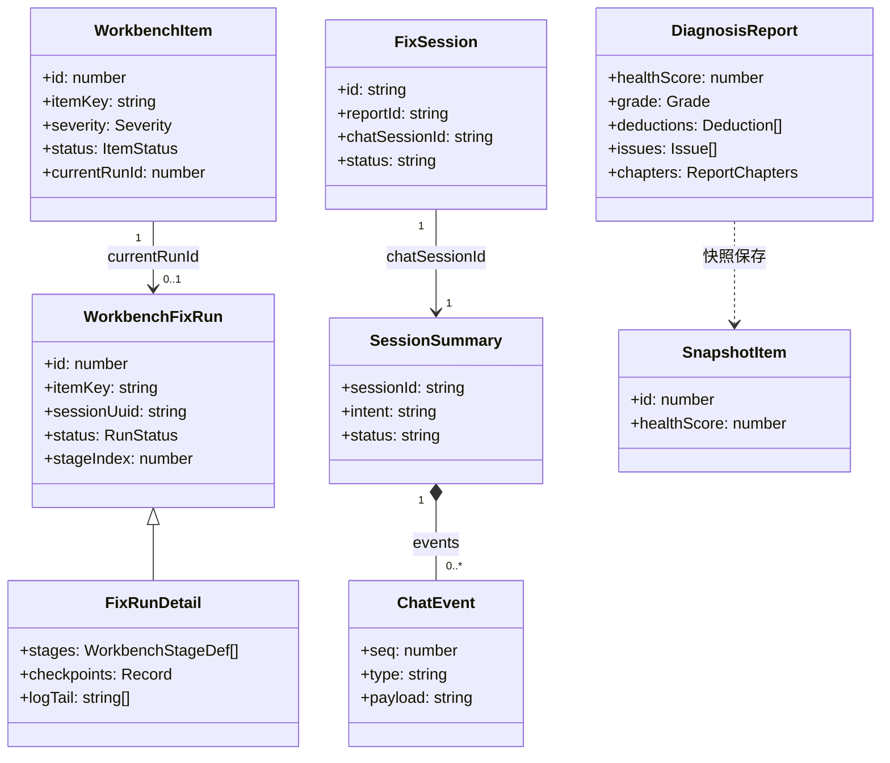

> 自动生成于 2026-11-26，基于 `99d0037` 版本

# 数据模型

---

## 1. 模型概览

前端没有数据库。本章的"数据模型"由三部分组成：描述后端载荷的 TypeScript 类型、Pinia Store 里的客户端状态、浏览器本地存储里的少量持久化数据。

### 1.1 核心实体

| 实体 | 说明 | 来源类型 | 使用模块 |
|------|------|---------|---------|
| 项目 | 参与分析的代码仓库或应用分组 | `SelectedProjectInfo`、`GitRepositoryInfo`、`RemoteProject`、`ProjectGroup` | [项目管理](../03-模块说明/项目管理.md) |
| 知识图谱任务 | 一次图谱生成的任务记录 | `KnowledgeGraphTask`、`KnowledgeGraphStatus` | [知识图谱](../03-模块说明/知识图谱.md) |
| 入口点 | 系统对外的调用入口 | `EntryPoint`、`KgEntryPoint` | 知识图谱、[APM调试](../03-模块说明/APM调试.md) |
| 调用链 | 入口出发的方法调用路径 | `CallChainGraphData`、`CallChainView` | 知识图谱 |
| 桥接 | 跨边界的调用关系 | `BridgeRelation`、`BridgeType` | 知识图谱 |
| 分析会话 | 一次智能体分析的实例 | `RamEvent`、`WorkflowEvent`、`MergeAnalysisEvent` | RAM、架构诊断、合入分析 |
| 诊断报告 | 架构健康度报告 | `DiagnosisReport` | [架构诊断](../03-模块说明/架构诊断.md) |
| APM 会话 | 一次被测服务的启动与调试 | `ApmSession`、`ApmSpan`、`DebugReport` | APM 调试 |
| 日志报告 | 一次错误日志分析的结果 | `DetailedAnalysisReport` | [日志分析](../03-模块说明/日志分析.md) |
| 修复会话 | 针对日志报告的异常修复 | `FixSession` | [RAM对话与异常修复](../03-模块说明/RAM对话与异常修复.md) |
| 技术债待办 | 日志或架构分析产出的待处理项 | `WorkbenchItem` | [工作台](../03-模块说明/工作台.md) |
| 修复运行 | 针对待办发起的自动修复 | `WorkbenchFixRun`、`FixRunDetail` | 工作台 |
| 对话会话 | 网页对话或 RAM 对话的会话 | `Session`、`Message`、`SessionSummary`、`ChatEvent` | Claude 会话、RAM 对话 |
| 工作空间会话 | 终端会话 | `ClaudeWorkspaceSession` | [Claude终端与会话](../03-模块说明/Claude终端与会话.md) |
| 技能 | 可安装的技能 | `SkillDefinition`、`KgSkill` | [技能与KG套件](../03-模块说明/技能与KG套件.md) |
| 提示词模板 / 术语 | 配置数据 | `PromptTemplate`、`GlossaryTerm` | [提示词与术语](../03-模块说明/提示词与术语.md) |

### 1.2 数据存储分布

| 存储 | 技术 | 内容 | 生命周期 |
|------|------|------|---------|
| 浏览器 | `localStorage` | 登录令牌、已选项目、主题、深度分析会话编号、步骤卡折叠偏好 | 持久，直到清除 |
| 浏览器 | `sessionStorage` | 合入分析上传的图片 | 标签页级，用完即删 |
| 内存 | Pinia Store | 11 个 Store 的状态 | 页面刷新即失 |
| 内存 | 组件与 Composable 的 `ref` | 页面私有状态、会话事件数组 | 随组件销毁 |

`localStorage` 键一览：

| 键 | 内容 | 写入方 |
|----|------|--------|
| `hisi-token` | JWT 字符串 | `useAuthStore` |
| `hisi-selected-projects` | `SelectedProjectInfo[]` | `useAppStore` |
| `claude-terminal-theme` | `{ themeId, customAccent }` | `useThemeStore` |
| `arch-deep-analysis-session:{路径用竖线拼接}` | 工作流会话编号 | `AiDeepAnalysisPanel` |
| `ram-chat-step-collapse-{turnId}` | `{ value, ts }`，7 天过期 | `StepCard` |

---

## 2. 类型文件清单（`src/types/`）

| 文件 | 行数 | 主要导出 | 状态 |
|------|------|---------|------|
| `api.ts` | 90 | `ApiResponse`、`UserInfo`、`AuthResponse`、`ValidationError`、`parseValidationErrors` | 在用 |
| `workbench.ts` | 85 | `Severity`、`ItemStatus`、`ItemSource`、`RunStatus`、`WorkbenchSummary`、`WorkbenchItem`、`WorkbenchFixRun`、`FixRunDetail`、`ProposalOption` | 在用 |
| `architectureDiagnosis.ts` | 96 | `Severity`、`Grade`、`Deduction`、`Issue`、`DiagnosisReport`、`SnapshotItem` | 在用 |
| `ram.ts` | 83 | `RamStatus`、`RamEvent`、`ClarifySchema`、`HitlSchema`、各类响应 | 在用 |
| `workflow.ts` | 88 | `WorkflowStatus`、`WorkflowEvent`、`WorkflowDefinition`、`NodeInfo` | 在用 |
| `apm.ts` | 288 | APM 全部类型 + 4 个工具函数 | 在用 |
| `log.ts` | 206 | 日志查询、报告、追问相关类型 | 在用 |
| `session.ts` | 99 | `Session`、`Message`、`PromptTemplate`、`SceneType`、`SCENE_NAMES`、`StreamCallbacks` | 在用 |
| `terminal.ts` | 75 | `TerminalClientMessage`、`TerminalServerMessage`、`ClaudeWorkspaceSession` | 在用 |
| `merge-analysis.ts` | 69 | `FileDiff`、`DiffResult`、`ImpactResult`、`TestScopeResult` | 在用 |
| `skill.ts` | 120 | `SkillCategory`、`SkillCategoryInfo`、`SkillDefinition`、`ProjectSkillStatus` | 在用 |
| `remote-project.ts` | 75 | `RemoteProject`、`KgSchedule` 及请求类型 | 在用 |
| `callchain.ts` | 126 | `GitRepositoryInfo`、`CallChainNode`、`CallChainTask` | 在用 |
| `glossary.ts` | 9 | `GlossaryTerm` | 在用 |
| `agent.ts` | 112 | `AgentEvent`、`AgentEventType`、`FinalDiagnosticResult` | 仅未引用组件 |
| `dialog.ts` | 197 | `DialogEventType`、对话消息类型 | 仅未引用组件 |
| `intent.ts` | 121 | `IntentType`、`IntentResult`、`INTENT_NAMES` | 无引用 |
| `index.ts` | 60 | 汇总出口 | 无引用 |

> 两个同名类型并存且互不冲突：`Severity` 在 `workbench.ts` 里是 `P0 / P1 / P2`，在 `architectureDiagnosis.ts` 里是 `HIGH / MEDIUM / LOW`；`ImpactResult` 在 `merge-analysis.ts` 与 `callchain.ts` 里各有一个。

---

## 3. 核心类型

### 3.1 工作台（`types/workbench.ts`）

```typescript
export type Severity = 'P0' | 'P1' | 'P2'
export type ItemStatus = 'NEW' | 'RUNNING' | 'WAITING' | 'DONE' | 'FAILED' | 'IGNORED'
export type ItemSource = 'log' | 'arch_rule' | 'arch_ai'
export type RunStatus = 'RUNNING' | 'WAITING_CONFIRM' | 'DONE' | 'FAILED' | 'ABORTED' | 'INTERRUPTED'
```

| 类型 | 字段 |
|------|------|
| `WorkbenchSummary` | `total`、`open`、`running`、`waiting`、`done`、`failed`、`ignored`、`p0`、`p1`、`p2`、`cleared7d`、`byProject` |
| `WorkbenchItem` | `id`、`itemKey`、`source`、`projectPath`、`title`、`location`、`severity`、`status`、`confidence`、`chainStatus`、`why`、`suggestion`、`evidenceJson`、`sourceRefJson`、`occurrenceCount`、`firstSeenAt`、`lastSeenAt`、`currentRunId`、`trend?` |
| `WorkbenchFixRun` | `id`、`itemKey`、`sessionUuid`、`projectPath`、`status`、`currentStage`、`stageIndex`、`iteration`、`chosenOption`、`pushRequested`、`worktreePath`、`branchName`、`commitHash`、`pushed`、`errorMessage`、`createdAt`、`updatedAt` |
| `FixRunDetail` | 继承 `WorkbenchFixRun`，另加 `stages: WorkbenchStageDef[]`、`checkpoints`、`logTail: string[]` |
| `WorkbenchStageDef` | `index`、`key`、`label`、`hint` |
| `ProposalOption` | `id`、`title`、`summary`、`risk`、`effort`、`touchedFiles` |

`evidenceJson` 与 `sourceRefJson` 是 JSON 字符串：前者是字符串数组，后者是对象，`ItemDetail` 会就地解析。

### 3.2 架构诊断（`types/architectureDiagnosis.ts`）

```typescript
export interface DiagnosisReport {
  healthScore: number
  grade: Grade                     // 'A' | 'B' | 'C' | 'D'
  deductions: Deduction[]
  issues: Issue[]
  chapters: ReportChapters         // project / module / class / method
  layerOrder: string[]
  projectPaths: string[]
  generatedAt: string
}
```

| 类型 | 字段 |
|------|------|
| `Deduction` | `source`、`sourceLevel`、`severity`、`points`、`reason` |
| `Issue` | `source`、`sourceLevel`、`severity`、`message` |
| `MethodHotspot` | `nodeId`、`className`、`methodName`、`filePath`、`complexity`、`commitCount90d`、`inDegree`、`riskScore` |
| `ClassMetric` | `className`、`methodCount`、`wmc`、`avgComplexity`、`inDegree`、`outDegree` |
| `SnapshotItem` | `id`、`scope`、`healthScore`、`grade`、`highCount`、`mediumCount`、`lowCount`、`createdAt` |

`ReportChapters` 的四个成员类型都是 `Record<string, unknown>`，章节内部结构没有类型约束，页面按 `any` 读取。

### 3.3 RAM（`types/ram.ts`）

```typescript
export type RamStatus = 'idle' | 'running' | 'clarify' | 'confirm' | 'completed' | 'error' | 'aborted'

export interface RamEvent {
  readonly seq: number
  readonly type: string
  readonly payload: Readonly<Record<string, unknown>>
}

export interface ClarifySchema { readonly nodeName?: string; readonly questions: readonly string[] }
export interface HitlSchema    { readonly nodeName: string;      readonly output: Readonly<Record<string, unknown>> }
export interface RamCostSnapshot { readonly tokens: number; readonly usd: number }
```

| 响应类型 | 字段 |
|---------|------|
| `StartSessionResponse` | `sessionId` |
| `ClarifyResponse` | `accepted`、`nextSeq`、`status?`、`hitlPayload?` |
| `ConfirmResponse` | `accepted`、`nextSeq` |
| `ResumeResponse` | `resumed` |
| `AbortResponse` | `aborted` |

前后端状态对应：`running` ↔ `RUNNING`，`clarify` ↔ `WAITING_CLARIFY`，`confirm` ↔ `WAITING_HITL`，`completed` ↔ `DONE`，`error` ↔ `FAILED`，`aborted` ↔ `ABORTED`；`idle` 为前端独有。

### 3.4 工作流（`types/workflow.ts`）

```typescript
export interface WorkflowEvent {
  seq: number
  type: string
  payload: Record<string, unknown>
  clarifyRoundNo?: number
}

export interface WorkflowStartRequest  { workflowType: string; input: Record<string, unknown> }
export interface WorkflowStartResponse { sessionId: string }
export interface WorkflowStatusResponse { status: string; currentNode?: string }
export interface WorkflowReportResponse { status: string; report: Record<string, unknown> | null }
export interface WorkflowClarifyRequest  { answers: Record<string, unknown> }
export interface WorkflowConfirmRequest  { action: 'approve' | 'reject'; feedback?: string }
```

`WorkflowStatus` 与 `RamStatus` 取值相同。

### 3.5 APM（`types/apm.ts`）

```typescript
export type ApmSessionStatus = 'IDLE' | 'LAUNCHING' | 'READY' | 'EXECUTING' | 'STREAMING' | 'COMPLETE' | 'ERROR'
export type InstrumentationMode = 'PRECISE' | 'FULL_PROJECT' | 'NONE'
```

| 类型 | 字段 |
|------|------|
| `ApmSpan` | `spanId`、`parentSpanId`、`traceId`、`operationName`、`serviceName`、`spanKind`、`startTimeNs`、`endTimeNs`、`durationMs`、`statusCode`、`statusMessage`、`className`、`methodName`、`kgNodeId`、`kgMatchLevel`、`attributes?` |
| `DebugReport` | `sessionId`、`traceId`、`entryPoint`、`success`、`totalDurationMs`、`spanTree: SpanNode[]`、`hotspots: Hotspot[]`、`errors: ErrorPoint[]`、`totalSpanCount`、`matchedSpanCount` |
| `ApmSession` | `id`、`projectPath`、`serviceName`、`targetPort`、`status`、`createdAt`、`finishedAt` |
| `ExecuteResult` | `sessionId`、`httpStatus`、`responseHeaders`、`responseBody`、`durationMs` |
| `RequestConfig`（前端自用） | `method`、`url`、`headers`、`body`、`queryParams: { key, value, enabled }[]` |
| `KgEntryPoint` | `nodeId`、`entryType`、`entryKey`、`entryInfo`、`methodNodeId?`、`projectPath`、`httpMethod?`、`httpPath?`、`parsedInfo?` |
| `WsMessage` | `type`、`timestamp`，其余字段任意 |

文件里还有四个工具函数：`parseEntryKey`（拆 `GET /path`）、`parseEntryInfo`（解析入口信息 JSON）、`extractProjectLabel`（取路径末段）、`buildTraceTree`（扁平 span 组装成树）。

### 3.6 日志（`types/log.ts`）

| 类型 | 用途 | 关键字段 |
|------|------|---------|
| `LogEntry` | 一条日志 | `timestamp`、`level`、`message`、`stackTrace`、`traceId`、`serviceName`、`errorType`、`rawFields` |
| `LogQueryDto` | 查询条件 | `appId`、`logLevel`、`keyword`、`startTime`、`endTime`、`dslQuery`、`errorOnly`、`traceId` |
| `DetailedAnalysisReport` | 报告详情 | `reportId`、`status`、`errorSummary`、`rootCause`、`fixSuggestions`、`codeSnippets`、`occurrenceCount`、`patternType`、`analysisVersion` |
| `RootCauseSection` | 根因 | `rootCauseType`、`markdown`、`confidence`、`evidenceAnchors?`、`verification?` |
| `HypothesisVerification` | 假设验证 | `title`、`confidence`、`chainStatus`、`rootCauseInKg`、`kept`、`citedIds` |
| `ReportStatus` | 进度 | `status`、`progress`、`stage`、`etaSeconds` |
| `LogNodeEvent` | WebSocket 节点事件 | `reportId`、`type`、`nodeName`、`timestamp`、`payload?` |

`DetailedAnalysisReport` 的四个内容字段都是"结构化类型或字符串"的联合，因为旧报告可能存成字符串。

### 3.7 会话（`types/session.ts`）

```typescript
export type SceneType = 'log-analysis' | 'code-analysis' | 'trace-analysis' | 'impact-analysis' | 'free-chat' | 'APM_DIAGNOSIS'

export interface Session {
  id: string; title: string | null; scene: SceneType; status: SessionStatus
  metadata: string | null; workingDirectory: string | null; claudeSessionCode: string | null
  createdAt: string; updatedAt: string
}
export interface Message { id: number; sessionId: string; role: 'user' | 'assistant'; content: string; createdAt: string }
export interface PromptTemplate { templateKey: string; name: string; content: string; variables: string; description: string; createdAt: string; updatedAt: string }
```

`SessionStatus`：`active` / `archived`。

### 3.8 终端（`types/terminal.ts`）

```typescript
export interface TerminalClientMessage {
  action: 'start' | 'resume' | 'continue' | 'input' | 'resize' | 'ping'
  data?: string; claudeSessionId?: string; cols?: number; rows?: number
  workingDirectory?: string; initialPrompt?: string
}
export interface TerminalServerMessage {
  type: 'output' | 'session_info' | 'error' | 'ready' | 'claude_ready' | 'pong'
  data?: string; claudeSessionId?: string
}
export interface ClaudeWorkspaceSession {
  id: string; claudeSessionId: string; title: string; scene: string
  status: 'active' | 'archived'; createdAt: Date; updatedAt: Date
  workingDirectory?: string; initialPrompt?: string
}
export type TerminalConnectionStatus = 'disconnected' | 'connecting' | 'connected' | 'error'
```

### 3.9 合入分析（`types/merge-analysis.ts`）

| 类型 | 字段 |
|------|------|
| `FileDiff` | `filePath`、`changeType`（`ADD` / `MODIFY` / `DELETE` / `RENAME`）、`additions`、`deletions`、`patch` |
| `DiffResult` | `sourceBranch`、`targetBranch`、`totalFiles`、`totalAdditions`、`totalDeletions`、`files` |
| `AffectedEntryPoint` | `nodeId`、`entryType`、`httpMethod?`、`urlPattern?`、`className`、`methodName` |
| `ImpactResult` | `affectedEntryPoints`、`callChainEdges`、`businessImpactSummary`、`riskLevel` |
| `TestCaseGroup` / `TestCase` | 按入口分组的回归用例 |
| `TestScopeResult` | `groups`、`regressionSuggestions` |
| `MergeAnalysisEvent` | `seq`、`type`、`payload` |
| `MergeAnalysisStatus` | `idle` / `running` / `completed` / `error` |

### 3.10 技能、项目与配置

| 类型 | 文件 | 关键字段 |
|------|------|---------|
| `SkillDefinition` | `skill.ts` | `id`、`name`、`description`、`category`、`version`、`tags?`、`files: SkillFile[]` |
| `ProjectSkillStatus` | `skill.ts` | `skillId`、`skillName`、`status`（`installed` / `not_installed` / `updating` / `error`）、`installedVersion?`、`installPath?` |
| `RemoteProject` | `remote-project.ts` | `id`、`name`、`gitUrl`、`branch`、`localPath`、`fullPath`、`cloneStatus`、`authType`、`groupId?` |
| `KgSchedule` | `remote-project.ts` | `id`、`projectPath`、`cronExpression`、`buildMode`、`enabled`、`gitPullEnabled`、`branch`、`lastRunAt`、`nextRunAt` |
| `GitRepositoryInfo` | `callchain.ts` | `name`、`path`、`branch`、`remoteUrl?`、`clean`、`source`（`scanned` / `cloned`）、`lastCommitMessage?` |
| `GlossaryTerm` | `glossary.ts` | `id?`、`projectPath`、`term`、`synonym`、`context?` |
| `UserInfo` | `api.ts` | `id`、`username`、`role`（`ADMIN` / `MEMBER`）、`createdAt` |
| `ApiResponse<T>` | `api.ts` | `code`、`message`、`data` |

### 3.11 定义在 API 模块内部的类型

知识图谱的类型没有放进 `types/`，而是与请求函数写在同一个文件里：

| 文件 | 代表类型 |
|------|---------|
| `api/knowledgeGraph.ts` | `EntryPoint`、`MethodNode`、`CallChainGraphData`、`GraphNode`、`GraphEdge`、`BridgeRelation`、`DtoSchema`、`DtoField`、`DashboardData`、`DsmData`、`KnowledgeGraphTask`、`KnowledgeGraphStatus` 以及十余个聚合结果类型 |
| `api/fix.ts` | `FixSession`：`id`、`reportId`、`chatSessionId`、`sessionType`、`status`、`worktreePath`、`branchName`、`commitHash`、`throwPointSig`、`errorMsg` |
| `api/ramChat.ts` | `ChatEvent`：`id`、`sessionId`、`seq`、`type`、`payload`、`createdAt`；`SessionSummary` |
| `api/vectorSearch.ts` | `VectorSearchRequest`、`VectorSearchResultItem`、`VectorSearchResponse` |
| `api/kgSkillsKit.ts` | `KgSkill`、`KgSkillsKitListResponse`、`InstallResult`、`BatchInstallResult`、`SkillGuide` |
| `api/projectGroup.ts` / `projectNameGroup.ts` | `ProjectGroup`（`appId`、`appName`、`projectPaths`）、`ProjectNameGroup`（`groupName`、`groupPattern`、`projectNames`） |
| `api/git.ts` | `GitStatus`、`GitCommit`、`CommitDiff`、`UpdateAllResponse` |
| `api/logAnalysis.ts` | `AppLogConfig`：`appId`、`projectPath`、`dslQuery`、`pullIntervalMinutes`、`enabled`、`lastPullAt?` |
| `api/terminal.ts` | `TerminalCallbacks`、`TerminalConnection` |

---

## 4. 状态定义（Pinia Store）

字段类型与初始值取自各 Store 的定义。

### 4.1 Store 总览

| Store | id | 写法 | 持久化 |
|-------|----|------|--------|
| `useAppStore` | `app` | 组合式 | `hisi-selected-projects` |
| `useAuthStore` | `auth` | 组合式 | `hisi-token` |
| `usePromptStore` | `prompt` | 组合式 | 无 |
| `useRamStore` | `ram` | 组合式 | 无 |
| `useRamChatStore` | `ramChat` | 组合式 | 无 |
| `useWorkbenchStore` | `workbench` | 选项式 | 无 |
| `useWorkspaceStore` | `workspace` | 组合式 | 无 |
| `useSessionStore` | `session` | 组合式 | 无 |
| `useSkillStore` | `skill` | 组合式 | 无 |
| `useThemeStore` | `theme` | 组合式 | `claude-terminal-theme` |
| `useApmStore` | `apm` | 组合式 | 无 |

### 4.2 `useAppStore`

| 字段 | 类型 | 初始值 | 说明 |
|------|------|--------|------|
| `projectDir` | `string` | `''` | 项目根目录 |
| `selectedProjects` | `SelectedProjectInfo[]` | 从 `localStorage` 恢复，失败为 `[]` | 已选项目 |
| `configLoading` | `boolean` | `false` | 正在加载配置 |
| `configError` | `string` | `''` | 加载失败的异常消息 |
| `projectDirConfigured` | 计算属性 | — | `projectDir` 非空 |
| `projectSelected` | 计算属性 | — | 已选项目非空 |
| `selectedProject` / `selectedProjectNames` | 计算属性 | — | 首个已选项目名 / 全部名称 |
| `availableMenus` | 计算属性 | — | 菜单键到布尔的映射 |

### 4.3 `useAuthStore`

| 字段 | 类型 | 初始值 |
|------|------|--------|
| `token` | `string \| null` | `localStorage` 中的 `hisi-token` |
| `username` | `string \| null` | `null` |
| `role` | `string \| null` | `null` |
| `showLoginDialog` | `boolean` | `false` |
| `initialized` | `boolean` | `false` |
| `isLoggedIn` | 计算属性 | token 与用户名都存在 |
| `isAdmin` | 计算属性 | `role === 'ADMIN'` |

### 4.4 `usePromptStore`

| 字段 | 类型 | 初始值 |
|------|------|--------|
| `templates` | `PromptTemplate[]` | `[]` |
| `loading` | `boolean` | `false` |

### 4.5 `useRamStore`

| 字段 | 类型 | 初始值 | 说明 |
|------|------|--------|------|
| `impact` | `ImpactPayload \| null` | `null` | `{ involved, modified, impacted: string[]; riskScores?: Record<string, number> }` |
| `lastSessionId` | `string \| null` | `null` | 最近一次写入影响数据的会话 |
| `selectedFile` | `string \| null` | `null` | 图谱页当前选中的文件 |
| `hoveredFile` | `string \| null` | `null` | 悬停的文件 |
| `highlightPath` | `Set<string>` | 空 `Set` | 上游高亮路径 |

### 4.6 `useRamChatStore`

| 字段 | 类型 | 初始值 |
|------|------|--------|
| `sessions` | `SessionSummary[]` | `[]` |
| `currentSessionId` | `string \| null` | `null` |
| `events` | `ChatEvent[]` | `[]` |
| `loading` | `boolean` | `false` |
| `error` | `string \| null` | `null` |
| `isStreaming` | `boolean` | `false` |

### 4.7 `useWorkbenchStore`

| 字段 | 类型 | 初始值 |
|------|------|--------|
| `summary` | `WorkbenchSummary \| null` | `null` |
| `items` | `WorkbenchItem[]` | `[]` |
| `runs` | `WorkbenchFixRun[]` | `[]` |
| `loaded` | `boolean` | `false` |
| `loading` | `boolean` | `false` |

### 4.8 `useWorkspaceStore`

| 字段 | 类型 | 初始值 |
|------|------|--------|
| `sessions` | `ClaudeWorkspaceSession[]` | `[]` |
| `currentSessionId` | `string \| null` | `null` |
| `loading` | `boolean` | `false` |
| `currentSession` | 计算属性 | — |
| `activeSessions` / `archivedSessions` | 计算属性 | 按 `status` 过滤 |

### 4.9 `useSessionStore`

| 字段 | 类型 | 初始值 | 是否导出 |
|------|------|--------|---------|
| `sessions` | `Session[]` | `[]` | 是 |
| `currentSessionId` | `string \| null` | `null` | 是 |
| `messages` | `Message[]` | `[]` | 是 |
| `loading` | `boolean` | `false` | 是 |
| `total` | `number` | `0` | 是 |
| `streamingSessionId` | `string \| null` | `null` | 是 |
| `isStreaming` | `boolean` | `false` | 是 |
| `messagesCache` | `Record<string, Message[]>` | `{}` | 否 |
| `streamingContentCache` | `Record<string, string>` | `{}` | 是 |
| `streamingStatusCache` | `Record<string, boolean>` | `{}` | 是 |

### 4.10 `useSkillStore`

| 字段 | 类型 | 初始值 |
|------|------|--------|
| `skills` | `SkillDefinition[]` | `[]` |
| `projectStatus` | `ProjectSkillStatus[]` | `[]` |
| `loading` / `statusLoading` | `boolean` | `false` |
| `selectedCategory` | `SkillCategory \| ''` | `''` |
| `searchKeyword` | `string` | `''` |
| `categoryStats` | `Record<SkillCategory, number>` | 五个分类均为 `0` |
| `totalSkills` | `number` | `0` |

### 4.11 `useThemeStore`

| 字段 | 类型 | 初始值 |
|------|------|--------|
| `themeId` | `string` | `dark-tech` |
| `customAccent` | `string \| null` | `null` |

### 4.12 `useApmStore`

| 字段 | 类型 | 初始值 |
|------|------|--------|
| `projects` | `KgProject[]` | `[]` |
| `selectedProject` | `KgProject \| null` | `null` |
| `sessionId` / `serviceName` | `string` | `''` |
| `targetPort` | `number` | `0` |
| `status` | `ApmSessionStatus` | `IDLE` |
| `errorMessage` | `string` | `''` |
| `projectsLoading` / `entryPointsLoading` / `bodySchemaLoading` | `boolean` | `false` |
| `activeSessions` | `Map<string, ApmSession>` | 空 `Map` |
| `entryPoints` | `KgEntryPoint[]` | `[]` |
| `selectedEntry` | `KgEntryPoint \| null` | `null` |
| `instrumentationMode` | `InstrumentationMode` | `FULL_PROJECT` |
| `bodySchema` | `DtoSchema \| null` | `null` |
| `requestConfig` | `RequestConfig` | `{ method: 'GET', url: '', headers: {}, body: '', queryParams: [] }` |
| `lastResponse` | `ExecuteResult \| null` | `null` |
| `report` | `DebugReport \| null` | `null` |
| `selectedSpan` | `ApmSpan \| null` | `null` |
| `wsConnected` | `boolean` | `false` |
| `wsSpans` / `wsEvents` / `wsProcessLogs` | 数组 | `[]` |
| `wsProcessStatus` | `string` | `IDLE` |
| `wsProcessError` | `{ exitCode?, tailLines? } \| null` | `null` |

后六项来自内部组合的 `useApmWebSocket`。

---

## 5. 枚举与常量

前端大量使用字符串字面量联合类型，少数用 `as const` 对象。

| 名称 | 取值 | 位置 |
|------|------|------|
| `SceneType` 与 `SCENE_NAMES` | `log-analysis` 日志分析、`code-analysis` 代码分析、`trace-analysis` 调用链分析、`impact-analysis` 影响分析、`free-chat` 自由对话、`APM_DIAGNOSIS` APM 诊断 | `types/session.ts` |
| `SkillCategory` 与 `SkillCategoryInfo` | `diagnosis` 诊断、`analysis` 分析、`generation` 生成、`operation` 操作、`other` 其他 | `types/skill.ts` |
| `BridgeType` | `MAPPER`、`JPA`、`MQ`、`FEIGN`、`HTTP`、`ASPECT`、`DIRECT` | `api/knowledgeGraph.ts` |
| `DagNodeKey` | `clarify`、`impact`、`implement`、`verify`、`tech_plan` | `components/ram/dagModel.ts` |
| `DagNodeStatus` | `pending`、`running`、`awaiting-hitl`、`done`、`failed`、`circuit-open` | 同上 |
| `DialogEventType` | 20 个对话事件常量 | `types/dialog.ts`（未接线） |
| `AgentEventType` | 9 个智能体事件常量 | `types/agent.ts`（未接线） |
| `INTENT_NAMES` / `INTENT_COLORS` | 六种意图的中文名与颜色 | `types/intent.ts`（无引用） |
| `LAYER_ORDER` | `CONTROLLER`、`SERVICE`、`REPOSITORY`、`MODEL`、`UTILITY` | `constants/layerOrder.ts` |
| `THEME_PRESETS` / `DEFAULT_THEME` | 6 套主题，默认 `dark-tech` | `themes/presets.ts` |

---

## 6. 类型关系图



---

## 7. 数据生命周期

| 数据 | 创建 | 更新 | 删除 / 过期 |
|------|------|------|------------|
| 登录令牌 | 登录或注册成功 | 重新登录 | 退出登录；`init()` 换取用户信息失败 |
| 已选项目 | 勾选项目 | 增减项目；删除项目时自动剔除 | 取消勾选；清除浏览器存储 |
| 主题 | 首次切换 | 切换主题或主色调 | 重置为默认 |
| 对话会话（`Session`） | 新建对话 | 改标题 | 归档或删除 |
| 工作空间会话 | 新建终端会话 | 绑定 Claude 会话码、归档 | 删除 |
| RAM / 工作流事件 | 发起分析 | SSE 追加 | 离开页面后仅存于后端 |
| 工作流会话编号（深度分析） | 启动分析 | 再次启动 | 未设过期，长期保留 |
| 步骤卡偏好 | 用户展开 / 折叠 | 每次切换 | 7 天后忽略 |
| 合入分析图片 | 上传 | — | 发起分析后立即删除 |
| APM 追踪数据 | 启动会话 | WebSocket 追加 | 停止会话或离开页面 |

---

## 8. 数据安全分类

| 数据 | 敏感级别 | 存储位置 | 说明 |
|------|---------|---------|------|
| 登录令牌 | 高 | `localStorage` | 明文存放 |
| 密码 | 高 | 不存储 | 仅出现在登录 / 注册请求中 |
| 后端配置中的密钥字段 | 高 | 不存储 | 设置页会读入表单再原样提交 |
| 本机项目路径 | 中 | `localStorage`、后端 | 随已选项目持久化 |
| 日志内容、代码片段 | 中 | 不持久化 | 展示前净化 |

---

> **延伸阅读**：
> - 数据流转路径 → [04-数据流程](../04-数据流程/index.md)
> - 接口的输入输出 → [05-接口文档](../05-接口文档/index.md)
> - Store 的动作与消费方 → [状态管理](../03-模块说明/状态管理.md)
