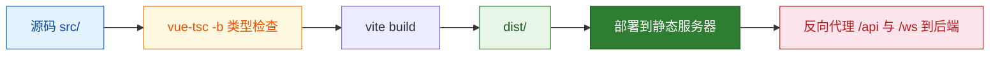
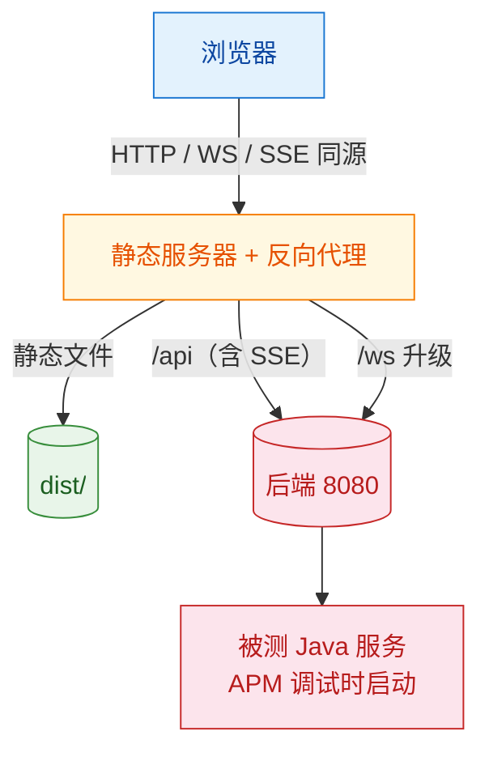

> 自动生成于 2026-11-26，基于 `99d0037` 版本

# 部署指南

---

## 1. 环境要求

### 1.1 运行时与工具

| 依赖 | 版本要求 | 说明 |
|------|---------|------|
| Node.js | 未在 `package.json` 中声明（没有 `engines` 字段） | 需要满足 Vite 8 的要求；编写本手册时的开发机使用 Node 24 |
| 包管理器 | `npm` 或 `pnpm` | 脚本与 Playwright 配置里写的是 `npm run …`；目录下只有 `pnpm-lock.yaml`，没有 `package-lock.json` |
| 后端 | `hisi-dev-tool` | 默认监听 `localhost:8080` |
| 浏览器 | 支持 WebSocket、EventSource、`ReadableStream` 的现代浏览器 | 终端功能在 Windows 上使用 `conpty` 后端 |

### 1.2 操作系统

| 系统 | 说明 |
|------|------|
| Windows | 当前开发环境；代码里多处把路径中的反斜杠归一化为斜杠（如 `appStore.getSelectedProjectPaths`） |
| macOS / Linux | 代码未做限制，未在仓库中找到验证记录 |

### 1.3 硬件

代码与配置中没有硬件要求。终端组件把回滚行数限制在 5000 行，APM 日志缓冲限制在 2000 行，可视为内存占用的上界参考。

---

## 2. 环境变量

**本仓库没有 `.env*` 文件**，代码里也不读取任何自定义环境变量。

| 变量 | 来源 | 用途 |
|------|------|------|
| `import.meta.env.BASE_URL` | Vite 内置 | 路由 history 的基路径，唯一的 `import.meta.env` 使用点 |
| `CI` | Playwright 读取 | 影响 E2E 的重试次数、并发与 `forbidOnly` |

`.gitignore` 忽略 `*.local`，所以本地覆盖文件应命名为 `.env.local` 之类；但当前没有任何代码读取 `VITE_*` 变量，建了也不会生效。

**可调但写死在代码里的项**

| 项 | 值 | 位置 |
|----|----|------|
| 开发服务器端口 | `5173` | `vite.config.ts` |
| 开发服务器监听地址 | `0.0.0.0` | 同上 |
| 后端代理目标 | `http://localhost:8080` | 同上（`/api` 与 `/ws` 两处） |
| 请求超时 | 120 秒 | `utils/request.ts` |
| 接口基础路径 | `/api` | 同上 |

换后端地址需要改 `vite.config.ts` 里的两个 `target`。

---

## 3. 构建与启动

### 3.1 安装

```bash
cd hisi-dev-tool-frontend
npm install        # 或 pnpm install（仓库里是 pnpm 的锁文件）
```

### 3.2 开发环境

```bash
npm run dev
```

启动后访问 `http://localhost:5173`，会自动跳到 `/workbench`。端口被占用时 Vite 会自动换下一个端口（配置里没有 `strictPort`）。

### 3.3 生产构建

```bash
npm run build      # 等价于 vue-tsc -b && vite build
npm run preview    # 本地预览构建产物
```

`build` 先做类型检查（`vue-tsc -b` 按 `tsconfig.json` 的两个引用工程分别检查应用代码与 `vite.config.ts`），通过后才打包。类型检查是严格的：`strict`、`noUnusedLocals`、`noUnusedParameters`，以及 `erasableSyntaxOnly`（不允许枚举、命名空间等需要生成代码的语法）。

### 3.4 构建流程图



### 3.5 构建产物

仓库里现存一份 `dist/`（不是本次生成的，可能落后于代码）：

| 内容 | 说明 |
|------|------|
| `index.html` | 入口页 |
| `favicon.svg`、`icons.svg` | 来自 `public/` 的静态文件 |
| `assets/*.js`、`assets/*.css` | 按路由页面拆分的代码块，如 `AnalysisPage-<哈希>.js`、`ApmDebugView-<哈希>.css`；现存 164 个文件，合计约 7 MB |

代码分割来自路由级的动态 `import`，没有额外的手动分包配置。

### 3.6 测试

```bash
npm run test:unit             # Vitest 单文件运行
npm run test:unit:watch       # 监听模式
npm run test:unit:coverage    # 覆盖率（v8）
npm run test:e2e              # Playwright，用例在 e2e/
npx playwright test -c playwright.real.config.ts   # 真实后端 + 真实模型，用例在 e2e-real/
```

| 配置 | 要点 |
|------|------|
| `vitest.config.ts` | 环境 `happy-dom`；匹配 `src/**/*.{test,spec}.{ts,tsx}`；覆盖率只统计 `.ts` / `.tsx`，**不含 `.vue`**；排除 `types/` |
| `playwright.config.ts` | `baseURL` 为 `localhost:5173`；启动前执行 `npm run dev`（已有服务则复用）；5 个浏览器项目；CI 上单 worker、失败重试 2 次 |
| `playwright.real.config.ts` | 单 worker 串行，整体超时 1 小时，只跑 Chromium |

`package.json` 里还有一个 `test:e2e:codegen` 脚本，其地址写的是 `localhost:5176`，与其它配置的 5173 不一致。

---

## 4. 部署方式

### 4.1 仓库中有什么、没有什么

| 项 | 现状 |
|----|------|
| 容器化（Dockerfile、Compose） | 没有 |
| 反向代理配置、Kubernetes 清单 | 没有 |
| CI 工作流 | 没有 |
| 部署脚本 | 前端目录下没有 |

因此**生产环境的具体部署方式无法从代码确认**。下面 4.2 列出的是从前端代码推导出的部署约束，不是仓库里已有的配置。

### 4.2 部署约束（由代码推导）

| # | 约束 | 依据 |
|---|------|------|
| 1 | 静态服务器需把未知路径回退到 `index.html` | 路由使用 `createWebHistory`，页面地址形如 `/ram/draft/123` |
| 2 | `/api/*` 需转发到后端 | axios `baseURL` 与所有 `fetch` / `EventSource` 地址都以 `/api` 开头 |
| 3 | `/api/*` 的转发不能缓冲响应 | 多个接口返回 `text/event-stream` |
| 4 | `/ws/*` 需支持 WebSocket 升级 | 7 个 WebSocket 地址都以 `/ws` 开头 |
| 5 | 页面与接口必须同源，或后端配置跨域 | 前端没有任何跨域配置 |

开发环境下这五条由 Vite 的代理满足：`/api` 代理对 `text/event-stream` 响应直接透传，其余响应先收集再转发；后端不可达时返回 `502` 与 `{ code: 502, message: "[Proxy] …" }`。

### 4.3 部署拓扑



---

## 5. 端口

| 端口 | 服务 | 协议 | 说明 |
|------|------|------|------|
| 5173 | Vite 开发服务器 | HTTP | 可自动递增 |
| 8080 | 后端 | HTTP、WebSocket | 代理目标，写死在配置里 |
| 动态 | 被测 Java 服务 | HTTP | APM 启动后由后端返回 `targetPort` |

---

## 6. 健康检查与可观测性

前端自身没有健康检查端点、监控埋点或远程日志上报。

| 检查 | 方式 |
|------|------|
| 前端是否启动 | 访问 `http://localhost:5173` 能看到登录按钮与侧边栏 |
| 后端是否可达 | 页面不再出现"网络连接失败"提示；或直接请求后端 |
| 后端是否重启过 | RAM 草稿页用 `GET /api/ram/health` 的 `startedAt` 判断 |
| 问题定位 | 浏览器控制台：`[RAM]`、`[RamChatWS]` 等带前缀的日志 |

`api/ops.ts` 里定义了 `GET /ops/health`，但该模块没有被任何页面引用。

---

## 7. 常见问题

| 问题 | 原因 | 解决 |
|------|------|------|
| 请求报 `502`，消息以 `[Proxy]` 开头 | 后端未启动或不在 8080 端口 | 启动后端，或修改 `vite.config.ts` 的 `target` |
| 所有请求提示网络连接失败 | 同上，或网络不通 | 同上 |
| 提示"登录已过期"并弹出登录框 | 令牌失效（HTTP 401） | 重新登录 |
| 提示"仅管理员可执行此操作" | HTTP 403 | 换管理员账号 |
| 知识图谱页进不去 | 没有选中项目 | 到项目管理页勾选项目 |
| 图谱生成按钮不可用 | 1 分钟冷却期内 | 稍后再点 |
| 终端无输出 | WebSocket 未连通 | `Ctrl + R` 重连；检查 `/ws` 代理是否支持升级 |
| `npm run build` 失败 | 多为类型检查不通过（未使用的变量、参数也会报错） | 按提示修正后重试 |
| 单元测试里挂载的组件行为异常 | `happy-dom` 不是真实浏览器 | 把逻辑抽成纯函数测试，或改用 E2E |
| 改了 `.env` 不生效 | 代码不读取自定义环境变量 | 改对应的源码配置 |

---

## 8. 安全清单

| # | 检查项 | 现状 |
|---|--------|------|
| 1 | 令牌传输走 HTTPS | 取决于部署，代码未强制 |
| 2 | 令牌不硬编码 | 满足；令牌来自登录响应，存 `localStorage` |
| 3 | 敏感配置不入库 | 满足；仓库中没有 `.env` 文件 |
| 4 | 渲染不可信内容前净化 | Markdown 满足（DOMPurify）；Mermaid 的 `securityLevel` 为 `loose` |
| 5 | WebSocket 鉴权 | 代码中未附带令牌 |
| 6 | 页面权限 | 仅管理员页面有路由守卫 |
| 7 | 错误信息不泄露内部细节 | 拦截器优先展示后端返回的 `message`，内容取决于后端 |
| 8 | 依赖漏洞扫描 | 仓库中没有相关配置 |

---

> **延伸阅读**：
> - 系统架构 → [02-架构设计](../02-架构设计/index.md)
> - 技术决策（部署相关） → [08-技术决策](../08-技术决策/index.md)
> - 请求封装 → [API服务层](../03-模块说明/API服务层.md)
