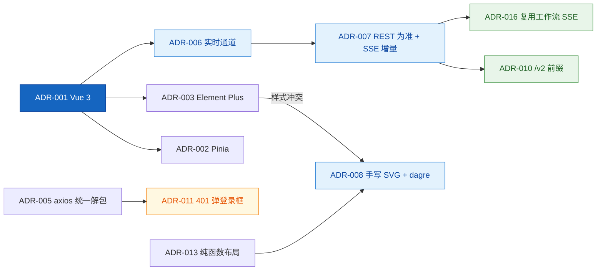

> 自动生成于 2026-11-26，基于 `99d0037` 版本

# 技术决策记录

> 本章只收录**代码或 git 历史能支撑**的决策。每条决策后面都列出依据；凡是没有代码注释或提交说明作为出处的"理由"，一律标注为"未说明"或"推断"，不作补写。日期取自相关文件的首次提交，提交号为本仓库的短哈希。

---

## 1. 决策概览

| ADR | 标题 | 状态 | 日期 | 依据类型 |
|-----|------|------|------|---------|
| ADR-001 | Vue 3 + `<script setup>` + TypeScript 严格模式 | 已采纳 | 2026-05-08 之前 | 代码 |
| ADR-002 | Pinia，组合式 Store 为主 | 已采纳 | 2026-05-08 之前 | 代码 |
| ADR-003 | Element Plus，图标全量全局注册 | 已采纳 | 2026-05-08 之前 | 代码 |
| ADR-004 | Vite 开发代理自行处理响应以支持 SSE | 已采纳 | 未在代码中确认 | 代码 |
| ADR-005 | 单一 axios 实例，拦截器统一解包 | 已采纳 | 2026-05-08 之前 | 代码 |
| ADR-006 | 实时通道按需选型：SSE / `fetch` 流式 / WebSocket | 已采纳 | 2026-05-08 之前 | 代码 + 注释 |
| ADR-007 | 会话恢复采用"REST 为准 + SSE 增量" | 已采纳 | 未在代码中确认 | 注释 |
| ADR-008 | 图渲染放弃 vue-flow 与 cytoscape，改为手写 SVG + dagre | 已采纳 | 2026-08-31 | 代码 + 注释 + 提交 |
| ADR-009 | Markdown 统一经 marked + DOMPurify 渲染 | 已采纳 | 2026-06-23 | 代码 + 提交 |
| ADR-010 | 分析类接口切换到 `/v2` 前缀并保留回滚说明 | 已采纳 | 2026-11-26 | 注释 + 提交 |
| ADR-011 | JWT 存 `localStorage`，401 时动态导入 Store 弹登录框 | 已采纳 | 2026-06-11 | 代码 + 注释 + 提交 |
| ADR-012 | 不用 `enum`，用 `as const` 对象表达枚举 | 已采纳 | 未在代码中确认 | 配置 + 代码 |
| ADR-013 | 布局与折叠逻辑写成纯函数以便单测 | 已采纳 | 未在代码中确认 | 注释 + 代码 |
| ADR-014 | E2E 拆成"默认"与"真实环境"两套配置 | 已采纳 | 未在代码中确认 | 配置 + 注释 |
| ADR-015 | 旧调用链页面并入知识图谱页 | 已采纳 | 2026-05-09 | 路由 + 提交 |
| ADR-016 | 修复运行的事件流复用工作流 SSE | 已采纳 | 2026-11-26 | 注释 + 提交 |

---

## 2. ADR-001：Vue 3 + `<script setup>` + TypeScript 严格模式

| 属性 | 值 |
|------|-----|
| **状态** | 已采纳 |
| **日期** | 2026-05-08 之前（monorepo 初始化提交已采用） |
| **影响范围** | 全部组件 |

### 背景

初始化时前端已是 Vue 3 工程；此前的选型过程不在本仓库的历史里。

### 决策

- 全部 SFC 使用 `<script setup lang="ts">`。
- 类型检查开启 `strict`、`noUnusedLocals`、`noUnusedParameters`。
- 样式一律 `<style scoped>`，仅布局骨架使用非 scoped 的全局重置。

### 依据

`package.json`（`vue ^3.5.30`、`typescript ~5.9.3`、`vue-tsc ^3.3.0`）；`tsconfig.app.json`；对 `src/` 下全部 `.vue` 文件的通读。

### 影响

- `npm run build` 先类型检查再打包，未使用的变量或局部量都会导致构建失败。
- **理由未在代码或提交记录中说明。**

---

## 3. ADR-002：Pinia，组合式 Store 为主

| 属性 | 值 |
|------|-----|
| **状态** | 已采纳 |
| **日期** | 2026-05-08 之前 |
| **影响范围** | 11 个 Store |

### 决策

- 10 个 Store 用组合式写法，只有 `workbench`（2026-11-26 新增）用选项式写法。
- 不使用持久化插件；需要持久化的三个值各自手写 `localStorage` 读写。
- Store 之间互不引用。

### 依据

`src/stores/*.ts`；`package.json` 中没有任何 Pinia 插件依赖。

### 影响

- 约定靠"末尾显式 `return`"维持，没有统一的类型推导辅助。
- 两种写法并存是新代码与既有约定不一致造成的，**是否刻意为之未说明**。

---

## 4. ADR-003：Element Plus，图标全量全局注册

### 决策

`main.ts` 把 `@element-plus/icons-vue` 的全部图标逐个注册为全局组件，并全量引入组件库与样式。

### 依据

`src/main.ts`。

### 影响

- 模板里可以直接写图标组件，不必逐个导入。
- **没有做按需引入**；对首屏体积的影响未在代码中度量。

---

## 5. ADR-004：Vite 开发代理自行处理响应以支持 SSE

### 背景

开发环境下浏览器只与 Vite（5173）通信，后端在 8080。

### 决策

`/api` 代理开启 `selfHandleResponse`，自己接管响应：

| 响应类型 | 处理 |
|---------|------|
| `content-type` 含 `text/event-stream` | 直接透传（`pipe`），不缓冲 |
| 其它 | 收集完整响应体后重新写回，并把 `transfer-encoding` 换成等长的 `content-length` |

代理出错时统一返回 `502` 与 JSON 消息。`/ws` 代理开启 `ws: true`。

### 依据

`vite.config.ts`；代码注释 "SSE streams: pipe directly without buffering"。

### 影响

- 开发环境不需要单独配置 SSE 直通。
- **该代理配置首次引入的日期未在代码中确认。**

---

## 6. ADR-005：单一 axios 实例，拦截器统一解包

### 背景

后端同时存在两种返回结构：带 `code / message / data` 外壳的，以及直接返回数据的。

### 决策

- 全仓库共用 `utils/request.ts` 创建的一个实例。
- 响应拦截器识别外壳结构并返回内层 `data`；`code !== 200` 转成 `Error` 抛出。
- 数组参数序列化为 `k=a&k=b`。注释给出的理由：Spring 的 `@RequestParam List<String>` 无法识别 Axios 默认的 `k[]=a&k[]=b`。

### 依据

`src/utils/request.ts`；`src/types/api.ts`。

### 影响

- 调用方拿到的直接是数据，类型通过 `UnwrappedAxios` 表达为 `Promise<T>`。
- 绕过该实例的调用（`fetch`、`EventSource`）没有自动解包与统一提示。

---

## 7. ADR-006：实时通道按需选型

### 决策

| 通道 | 用于 | 触发条件 |
|------|------|---------|
| `EventSource`（SSE） | 服务端单向推送，GET 即可发起 | RAM、合入分析、工作流 |
| `fetch` + `ReadableStream` | 需要 POST 请求体的流式回答 | `/api/chat/{agentType}` |
| `WebSocket` | 需要客户端随时发消息或有动态订阅 | 终端、APM、对话、日志进度与追问 |

### 依据

- `api/workflow.ts` 的注释："EventSource 无法携带 Authorization 头，token 经查询参数传给后端"。
- `api/claude.ts` 的 `universalChat` 用 `fetch` 发 POST 再读流。
- 各 WebSocket Composable。

### 影响

- 三种通道的鉴权方式不一致：SSE（工作流）走查询参数，`fetch` 对话不带令牌，WebSocket 不带令牌。
- **各类通道的取舍理由，除上面引用的两条注释外未说明。**

---

## 8. ADR-007：会话恢复采用"REST 为准 + SSE 增量"

### 背景

分析会话可能持续很久，用户会刷新页面或从列表重新进入。

### 决策

三个 SSE Composable（`useWorkflow`、`useRamSession`、`useMergeAnalysisSession`）的 `rejoin` 都遵循：

1. 先用 REST 拉取历史事件与会话状态。
2. 由状态与末尾事件推导当前状态；已到终态则不再开流。
3. 仍在运行才开流，并用 `afterSeq` 从断点续传。
4. 本地再做一次 `seq` 去重。

### 依据

`useWorkflow.ts` 文件头注释："REST authoritative + SSE incremental (proven by StatusPage fix)"。

### 影响

- 刷新页面不丢进度。
- 三个 Composable 结构相似却各自实现。

---

## 9. ADR-008：图渲染放弃 vue-flow 与 cytoscape，改为手写 SVG + dagre

| 属性 | 值 |
|------|-----|
| **状态** | 已采纳 |
| **日期** | 2026-08-31 移除依赖 |
| **影响范围** | RAM 的 DAG 与影响图谱、调用链流程图 |

### 背景

2026-05-23 的提交在依赖里加入了 `@vue-flow/background`、`@vue-flow/controls`、`@vue-flow/core`、`cytoscape`、`cytoscape-fcose`；次日加入 `@dagrejs/dagre`。

### 考虑过的方案

| 方案 | 现状 |
|------|------|
| vue-flow / cytoscape | 已移除 |
| ECharts | 保留，用于架构总览、DSM、架构诊断等统计图 |
| Mermaid | 保留（2026-05-30 加入），用于模型生成的图 |
| 手写 SVG + dagre 布局 | 现行方案 |

### 决策

节点固定的 DAG 用手写 SVG，节点位置由 `@dagrejs/dagre` 计算。

### 依据

`DagFlow.vue` 的注释：不使用 vue-flow，因为它自带的 CSS 重置会与 Element Plus 冲突；而对一个拓扑固定的五节点 DAG，纯 SVG 在 happy-dom 下可测、任意缩放下清晰。

### 影响

- 少了两个较重的依赖。
- 布局算法需要自己维护（`dagLayout.ts`、`flowDagLayout.ts`、`threeRingLayout.ts`）。
- 部分文件头注释仍提到 vue-flow，已过时。

---

## 10. ADR-009：Markdown 统一经 marked + DOMPurify 渲染

### 决策

所有 Markdown 展示都调用 `utils/markdown.ts` 的 `renderMarkdown`，内部用 `marked` 解析后经 `DOMPurify` 净化。

### 依据

`utils/markdown.ts`；DOMPurify 于 2026-06-23（提交 `92faf76`）加入。

### 影响

- 模型输出、代码片段、日志内容在 `v-html` 之前都经过净化。
- 同一文件还导出 `escapeHtml`、`escapeRegExp`，供非 Markdown 的文本渲染使用。
- **加入净化的直接触发原因未说明。**

---

## 11. ADR-010：分析类接口切换到 `/v2` 前缀并保留回滚说明

| 属性 | 值 |
|------|-----|
| **状态** | 已采纳 |
| **日期** | 2026-11-26（提交 `080974c`） |
| **影响范围** | `api/workflow.ts`、`api/logAnalysis.ts` |

### 决策

- 工作流接口整体走 `/v2/workflow`。
- 日志分析的"分析 / 报告 / 状态 / 重新分析"走 `/v2/log`，列表、导出、追问仍走 `/log`。
- 两处都用一个常量保存前缀。

### 依据

- `api/workflow.ts` 注释：v2 的请求、响应、事件里的 `nodeName` 都与 v1 一致，区别是后端的 ReAct 节点换成了带历史压缩、可真正中止的实现；回滚时把常量改回 `/workflow`。
- `api/logAnalysis.ts` 注释：v2 走"取证 → 假设 → 验证 → 综合"的新流程，请求与响应结构与 v1 完全一样；回滚时改回 `/log`。

### 影响

- 前端代码结构不变，切换成本只是一个常量。

---

## 12. ADR-011：JWT 存 `localStorage`，401 时动态导入 Store 弹登录框

| 属性 | 值 |
|------|-----|
| **状态** | 已采纳 |
| **日期** | 2026-06-11（`stores/auth.ts` 首次提交，提交 `5d130a3`） |
| **影响范围** | 请求层、路由、布局 |

### 决策

- 令牌键名 `hisi-token`，请求拦截器直接读 `localStorage` 注入请求头。
- 响应拦截器遇 401 时动态 `import('@/stores/auth')` 并打开登录弹窗。
- 路由用 `meta.requiresAdmin` + 前置守卫做页面级权限。

### 依据

`utils/request.ts` 的注释："延迟导入避免循环依赖"。

### 影响

- 页面刷新后、Store 尚未恢复时请求也能带上令牌。
- 令牌键名在四个文件里各写了一遍。
- **选择 `localStorage` 而非其它存储方式的理由未说明。**

---

## 13. ADR-012：不用 `enum`，用 `as const` 对象表达枚举

### 决策

类型目录里的"枚举"都是 `as const` 对象加同名的字面量联合类型，例如 `AgentEventType`、`DialogEventType`、`IntentType`。

### 依据

`tsconfig.app.json` 开启了 `erasableSyntaxOnly`，该选项不允许枚举、命名空间等需要生成额外代码的语法；`src/types/agent.ts` 等文件。

### 影响

- 类型与运行时值由同一个对象提供。
- **引入该选项的日期未在代码中确认。**

---

## 14. ADR-013：布局与折叠逻辑写成纯函数以便单测

### 决策

图的布局、事件的折叠都写成不依赖 DOM 的纯函数，模板只负责渲染：`dagModel.ts`、`dagLayout.ts`、`threeRingLayout.ts`、`flowDagLayout.ts`、`mergeGraphs.ts`。

### 依据

`dagModel.ts` 注释："keeps the rendering layer dumb and the state transitions covered by unit tests under happy-dom (no canvas / SVG quirks)"。

### 影响

- 单元测试集中在 `components/ram/__tests__/`，直接断言纯函数的输出。
- `.vue` 文件不在覆盖率统计范围内。

---

## 15. ADR-014：E2E 拆成"默认"与"真实环境"两套配置

### 决策

| 配置 | 用例目录 | 特点 |
|------|---------|------|
| `playwright.config.ts` | `e2e/` | 5 个浏览器项目，完全并行 |
| `playwright.real.config.ts` | `e2e-real/` | 单 worker 串行，整体超时 1 小时，只跑 Chromium |

### 依据

`playwright.real.config.ts` 的注释：真实环境 E2E 不打桩，前端开发服务器 + 真实后端 + 真实模型调用；因为模型调用慢且共用同一个后端状态，所以串行。

### 影响

- 日常 E2E 与需要真实模型的验证互不干扰。

---

## 16. ADR-015：旧调用链页面并入知识图谱页

| 属性 | 值 |
|------|-----|
| **状态** | 已采纳 |
| **日期** | 2026-05-09（提交 `6c30c1f`、`b899164`） |
| **影响范围** | 路由、`views/call-chain/` |

### 决策

- `/call-chain` 及其三个子路径全部重定向到 `/knowledge-graph?tab=methodRef`。
- 2026-05-09 的两个提交分别移除了语义搜索页及其 `/search` 接线、清掉了孤立的调用链视图。

### 依据

`src/router/index.ts`；两个提交的说明。

### 影响

- `views/call-chain/` 下 12 个文件中仍有 7 个被知识图谱页复用，另 5 个成为无引用的残留。

---

## 17. ADR-016：修复运行的事件流复用工作流 SSE

| 属性 | 值 |
|------|-----|
| **状态** | 已采纳 |
| **日期** | 2026-11-26（提交 `080974c`） |
| **影响范围** | [工作台](../03-模块说明/工作台.md) |

### 决策

工作台不为修复运行新开通道，而是用修复运行的 `sessionUuid` 订阅工作流的事件流，并在收到事件后回查工作台自己的详情接口。

### 依据

`useFixRunStream.ts` 注释："复用工作流 SSE（?token= + afterSeq 续传），按 seq 去重；CHECKPOINT 到达时刷新运行详情；断线自动带 afterSeq 重连"。

### 影响

- 一处通道两处复用，工作台模块只有一个很小的 Composable。
- 阶段切换本身不产生事件，监视器需要另设定时拉取兜底。

---

## 18. 决策原则（归纳）

以下原则是从现有代码归纳的，不是成文规定。

| 原则 | 体现 |
|------|------|
| 先 REST 后增量 | 所有长会话都是"先拉历史，再续流" |
| 逻辑与渲染分离 | 布局、折叠、解析都是纯函数 |
| 单一入口 | 请求只走 `request.ts`，Markdown 只走 `renderMarkdown` |
| 通道够用就好 | 单向推送不引入 WebSocket |
| 版本前缀可回滚 | `/v2` 前缀集中在一个常量里 |
| 测试贴近真实 | 单测用纯函数，端到端另备真实环境配置 |

---

> **延伸阅读**：
> - 架构设计 → [02-架构设计](../02-架构设计/index.md)
> - 技术栈总览 → [01-项目概览](../01-项目概览/index.md)
> - 通道细节 → [实时通信](../03-模块说明/实时通信.md)
> - 部署指南 → [07-部署运维](../07-部署运维/index.md)
