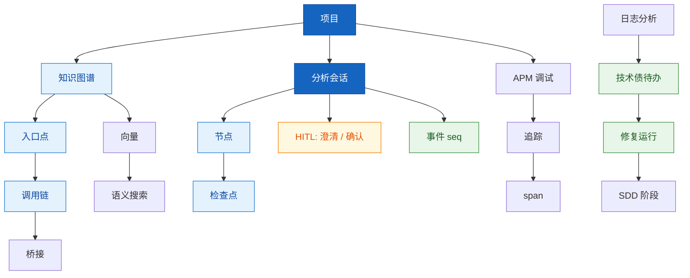

> 自动生成于 2026-11-26，基于 `99d0037` 版本

# 术语表

> 本表收录前端代码里出现的专有名词、缩写与领域概念，按类别组织。"代码对应"一列给出可以在仓库里直接检索的标识符。

---

## 1. 术语概览

| 类别 | 数量 |
|------|------|
| 业务与领域 | 25 |
| 分析会话与事件 | 12 |
| 实时通信 | 9 |
| 框架与工程 | 11 |
| 缩略语 | 19 |

---

## 2. 业务与领域

| 术语 | 英文 / 全称 | 定义 | 代码对应 |
|------|------------|------|---------|
| **项目** | Project | 参与分析的代码仓库；可以是本地扫描到的，也可以是从远端克隆的 | `GitRepositoryInfo`、`RemoteProject` |
| **已选项目** | Selected projects | 当前被勾选、供其它页面使用的一组项目，跨页面共享并持久化 | `useAppStore.selectedProjects` |
| **项目根目录** | PROJECT_DIR | 存放项目代码的上级目录，用于扫描仓库与"一键更新" | `appStore.projectDir` |
| **应用分组** | appId group | 把多个项目路径归为一个应用，供 RAM、日志等页面按应用选择 | `ProjectGroup` |
| **名称分组** | Project name group | 按名称模式把项目归类，用于知识图谱页的分组视图 | `ProjectNameGroup` |
| **知识图谱** | Knowledge Graph, KG | 后端从源码抽取的方法、调用关系、入口等构成的图 | `knowledgeGraphApi` |
| **图谱生成** | Generate | 触发一次图谱构建任务，有"全量-复用""全量-全删""增量"等模式 | `startGenerateTask`、`buildMode` |
| **向量** | Embedding | 方法的语义向量，供语义搜索使用 | `vectorGeneration.ts` |
| **入口点** | Entry point | 系统对外的调用入口，例如一个 HTTP 接口 | `EntryPoint`、`KgEntryPoint` |
| **调用链** | Call chain | 从入口点出发的方法调用路径 | `CallChainGraphData`、`ChainChart` |
| **引用分析** | Method reference | 以若干根入口为起点、合并它们的被调树后得到的图 | `MethodReferenceGraph` |
| **桥接** | Bridge | 跨越 MyBatis、JPA、MQ、Feign、HTTP、切面等边界的调用关系 | `BridgeType`、`BridgeRelation` |
| **领域** | Domain | 后端识别出的业务域 | `DomainItem` |
| **分层** | Layer role | 类在架构中的角色，自上而下为控制器、服务、仓储、模型、工具 | `LAYER_ORDER` |
| **DSM** | Dependency Structure Matrix | 依赖结构矩阵，行列是模块，格子是依赖强度 | `DsmMatrix`、`getDsm` |
| **坏味道** | Smell | 架构层面的反模式，如大泥球、上帝类、枢纽类、幽灵类 | `ArchitectureDiagnosisView` |
| **健康分** | Health score | 架构诊断给出的 0–100 分与 A–D 等级 | `DiagnosisReport` |
| **快照** | Snapshot | 某次诊断报告的持久化版本，可回看 | `SnapshotItem` |
| **伪终端** | PTY | 后端为每个终端会话维持的伪终端进程，浏览器里的终端通过它运行 Claude CLI | `createTerminalConnection` |
| **工作空间会话** | Workspace session | 终端页里的一次会话，记录工作目录与 Claude 会话码 | `ClaudeWorkspaceSession` |
| **技术债待办** | Workbench item | 由日志分析或架构分析产出、等待处理的条目 | `WorkbenchItem` |
| **技术债清零** | Clear | 待办被修复并验证通过后的状态 | `ItemStatus` 的 `DONE` |
| **修复运行** | Fix run | 针对一条待办发起的自动修复流程 | `WorkbenchFixRun` |
| **技能** | Skill | 可安装到项目或本机的提示词 / 脚本包 | `SkillDefinition`、`KgSkill` |
| **KG Skills 套件** | KG Skills Kit | 与知识图谱配套的一组技能 | `kgSkillsKitApi` |

---

## 3. 分析会话与事件

| 术语 | 英文 / 全称 | 定义 | 代码对应 |
|------|------------|------|---------|
| **会话** | Session | 后端一次智能体分析的实例，有唯一编号 | `sessionId` |
| **事件** | Event | 会话过程中产生的记录，含序号、类型与载荷 | `RamEvent`、`WorkflowEvent` |
| **序号** | seq | 事件的单调递增编号，用于去重与续传 | `lastSeq`、`afterSeq` |
| **节点** | Node | 会话里的一个处理步骤 | `nodeName` |
| **检查点** | CHECKPOINT | 某节点完成时推送的事件，载荷带该节点的输出 | `useDagEventHandler` |
| **HITL** | Human-in-the-Loop | 人工介入：分析中途停下来等用户澄清或确认 | `ClarifyModal`、`ConfirmModal` |
| **澄清** | Clarify | 后端向用户提出开放性问题并等待回答 | `ClarifySchema` |
| **确认** | Confirm | 用户对节点输出做出批准、驳回或编辑 | `ConfirmPayload` |
| **重跑** | Rerun | 从某个节点或某一轮澄清开始重新执行 | `rerunFromNode` |
| **工作流** | Workflow | 后端统一的节点编排；前端用 `workflowType` 区分种类 | `useWorkflow` |
| **SDD** | Spec-Driven Development（按阶段内容推断，代码里只写了缩写） | 工作台自动修复遵循的流程：代码实证 → 方案确认 → Spec → 任务 → 开发 → 回归 → 全链路 E2E → 提交 | `WorkbenchView` 的 `STAGE_NAMES` |
| **熔断** | Circuit open | 收到 `CIRCUIT_OPEN` 事件后，最近一个运行中的节点被标记的状态；触发条件由后端决定 | `DagNodeStatus` 的 `circuit-open` |

---

## 4. 实时通信

| 术语 | 英文 / 全称 | 定义 | 代码对应 |
|------|------------|------|---------|
| **SSE** | Server-Sent Events | 服务端向浏览器的单向推送，基于 HTTP 长连接 | `EventSource` |
| **续传** | Resume from seq | 重连时带上已处理的序号，只接收其后的事件 | `afterSeq` |
| **REST 为准 + SSE 增量** | REST authoritative + SSE incremental | 先用普通接口取历史，再用流接收增量 | `useRamSession.rejoin` |
| **WebSocket** | WS | 全双工长连接，用于终端与需要客户端发消息的场景 | `useApmWebSocket` 等 |
| **心跳** | Heartbeat | 定时发送的保活消息 | `{ action: 'ping' }` |
| **指数退避** | Exponential backoff | 重连间隔按 2 的幂增长、有上限的重试策略 | `Math.min(1000 * Math.pow(2, n), 30000)` |
| **span** | Span | 一次调用的一段追踪记录，含起止时间与父子关系 | `ApmSpan` |
| **追踪** | Trace | 由同一个 `traceId` 串起来的一组 span | `TraceView` |
| **追问** | Follow-up | 针对一份日志报告继续提问 | `FollowupPanel` |

---

## 5. 框架与工程

| 术语 | 英文 / 全称 | 定义 | 代码对应 |
|------|------------|------|---------|
| **组合式 API** | Composition API | Vue 3 以 `ref`、`computed`、函数组织逻辑的写法 | `<script setup>` |
| **组合式函数** | Composable | 可复用的响应式逻辑函数，约定以 `use` 开头 | `src/composables/` |
| **Store** | Pinia store | 跨组件共享的状态容器 | `src/stores/` |
| **拦截器** | Interceptor | axios 请求 / 响应的统一处理钩子 | `utils/request.ts` |
| **解包** | Unwrap | 把 `{ code, message, data }` 外壳剥掉只留数据 | `UnwrappedAxios` |
| **路由守卫** | Navigation guard | 导航前执行的校验函数 | `router.beforeEach` |
| **懒加载** | Lazy loading | 页面组件在首次访问时才下载 | `() => import(...)` |
| **DTO 结构** | DTO schema | 后端解析出的请求体字段定义，用于生成表单 | `DtoSchema`、`DtoField` |
| **埋点模式** | Instrumentation mode | APM 启动时的字节码插桩策略 | `InstrumentationMode` |
| **净化** | Sanitize | 渲染前清除不安全的 HTML | `DOMPurify.sanitize` |
| **纯函数布局** | Pure layout | 不依赖 DOM 的图形布局算法 | `dagLayout.ts` 等 |

---

## 6. 缩略语速查

展开式若未出现在代码注释里，采用的是业界通行含义。

| 缩略语 | 全称 | 说明 |
|--------|------|------|
| APM | Application Performance Monitoring | 应用性能监控；本项目中的"APM 调试"指启动被测服务并追踪一次请求 |
| API | Application Programming Interface | 接口 |
| CLI | Command Line Interface | 命令行；终端里运行的是 Claude CLI |
| DAG | Directed Acyclic Graph | 有向无环图；RAM 的节点流程与影响图谱 |
| DSM | Dependency Structure Matrix | 依赖结构矩阵 |
| DTO | Data Transfer Object | 数据传输对象 |
| E2E | End-to-End | 端到端测试 |
| HITL | Human-in-the-Loop | 人工介入 |
| HTTP | HyperText Transfer Protocol | — |
| JWT | JSON Web Token | 登录令牌的格式 |
| KG | Knowledge Graph | 知识图谱 |
| MQ | Message Queue | 消息队列，桥接类型之一 |
| PTY | Pseudo Terminal | 伪终端 |
| RAM | Requirement Analysis Master | 需求分析大师 |
| RRF | Reciprocal Rank Fusion | 语义搜索 v2 的多路召回融合；代码注释只写了缩写 |
| SDD | Spec-Driven Development | 规格驱动开发 |
| SSE | Server-Sent Events | 服务端推送事件 |
| WMC | Weighted Methods per Class | 类的加权方法数，用于识别上帝类；代码里只有字段名 `wmc` |
| WS | WebSocket | 全双工通信协议 |

---

## 7. 术语关系图

---

## 8. 易混淆术语辨析

| 术语 A | 术语 B | 区别 |
|--------|--------|------|
| 工作空间会话 `ClaudeWorkspaceSession` | 对话会话 `Session` | 前者属于终端页，存放在 `/workspace-sessions`；后者属于网页对话，存放在 `/sessions`。两者没有代码上的关联 |
| `claudeSessionId` | `claudeSessionCode` | 前者是工作空间会话绑定的终端会话编号；后者是对话会话保存的恢复凭据 |
| RAM 会话 `sessionId` | 修复会话 `id` | 异常修复页用修复会话的 `id` 调修复接口，用它的 `chatSessionId` 连对话通道 |
| RAM 需求分析 | RAM 对话 | 前者走固定的节点流程，后者是自由对话；二者共用 `/ram` 前缀但接口不同 |
| 项目分组 `ProjectGroup` | 名称分组 `ProjectNameGroup` | 前者按 `appId` 归集项目路径；后者按名称模式归类项目名 |
| 技能市场 | KG Skills 套件 | 前者把技能装到某个项目目录；后者把整套技能装到本机 |
| 提示词配置 | 术语管理 | 前者编辑各场景的提示词模板；后者维护当前项目根目录下的术语与同义词 |
| 报告详情弹窗 | 报告详情页 | 前者在日志分析页的"分析报告"页签内；后者是独立路由 `/log-analysis/report/:id` |
| `ram` Store | `useRamSession` | 前者只保存跨页传递的影响数据与联动状态；后者是 RAM 会话的状态机 |
| `theme` 的界面色 | `theme` 的终端色 | 界面色写入 CSS 变量作用于全站；终端色只交给 xterm.js |

---

## 9. 术语维护规则

1. 新增领域概念时同步更新本表，并给出可检索的代码标识符。
2. 术语含义变化时更新定义并注明原因。
3. 代码中已不可达的概念（如多智能体诊断、自然语言对话）保留在表中并标注现状，不删除。

---

> **延伸阅读**：
> - 核心概念 → [01-项目概览](../01-项目概览/index.md)
> - 类型的代码定义 → [06-数据模型](../06-数据模型/index.md)
> - 各模块文档索引见 README 的模块列表
