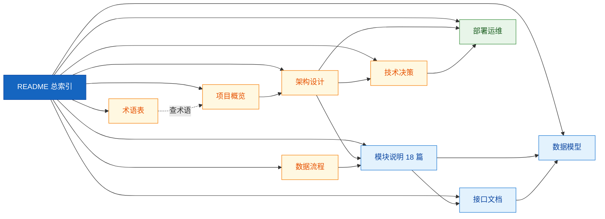

# HiSi DevTool Frontend CodeWiki

> 自动生成于 2026-11-26，基于 `99d0037` 版本

---

## 项目简介

`hisi-dev-tool-frontend` 是 HiSi DevTool 的 Web 前端（Vue 3 单页应用）。它把后端的代码知识图谱、智能体分析与调试能力组织成一个界面，覆盖项目管理、知识图谱、架构诊断、APM 调试、RAM 需求分析与对话、合入分析、日志分析、异常修复、工作台、Claude 终端等功能。

本手册只覆盖前端。后端与 MCP 服务各有自己的手册。

---

## 项目速览

| 维度 | 信息 |
|------|------|
| **项目类型** | 单页应用（SPA），history 路由 |
| **技术栈** | Vue 3 + TypeScript + Element Plus + Pinia + Vue Router + Axios + ECharts + Mermaid + dagre + xterm.js |
| **构建工具** | Vite 8 |
| **通信方式** | HTTP、SSE、`fetch` 流式、WebSocket 四种并用 |
| **代码规模** | 209 个非测试的 `.ts` / `.vue` 文件，约 5.4 万行；另有 24 个单元测试文件 |
| **路由** | 36 条记录（31 条带页面组件，5 条重定向） |
| **状态管理** | 11 个 Pinia Store |
| **后端接口** | 前端调用了 285 个 HTTP 接口、4 个 SSE 流、7 个 WebSocket 地址 |
| **部署方式** | 静态文件 + 反向代理；仓库中没有容器化或 CI 配置 |
| **许可证** | 未在仓库中确认 |

> 规模数字由脚本统计；其中一部分文件从入口不可达，清单见 [组件层](03-模块说明/组件层.md)。

---

## 目录

### 理解项目（入门）

| 章节 | 说明 | 适合谁 |
|------|------|--------|
| [项目概览](01-项目概览/index.md) | 使命、技术栈、目录结构、快速启动、核心概念、演进节点 | 新成员、首次接触 |
| [术语表](09-术语表/index.md) | 业务术语、会话与事件、通信术语、缩略语、易混淆术语辨析 | 所有读者 |

### 理解设计（深入）

| 章节 | 说明 | 适合谁 |
|------|------|--------|
| [架构设计](02-架构设计/index.md) | 上下文与容器、分层、模块依赖、质量属性、跨切面关注点、部署架构 | 架构师、技术负责人 |
| [数据流程](04-数据流程/index.md) | 九条核心流程的时序、状态机、校验与一致性规则 | 开发者、测试 |
| [技术决策](08-技术决策/index.md) | 16 条有代码或提交记录支撑的决策记录 | 架构师、想了解历史的人 |

### 开发参考（实操）

| 章节 | 说明 | 适合谁 |
|------|------|--------|
| 模块说明 | 18 篇模块文档，见下方模块列表 | 开发者 |
| [接口文档](05-接口文档/index.md) | 前端调用的全部接口，带调用状态；SSE 与 WebSocket 单列 | 前后端开发者 |
| [数据模型](06-数据模型/index.md) | 核心类型、11 个 Store 的状态字段、枚举常量、生命周期 | 开发者 |

### 运维部署（运营）

| 章节 | 说明 | 适合谁 |
|------|------|--------|
| [部署运维](07-部署运维/index.md) | 环境要求、构建与测试、部署约束、常见问题、安全清单 | 运维、开发环境搭建者 |

---

## 模块列表

| # | 模块 | 层 | 关键词 | 文档 |
|---|------|----|--------|------|
| 1 | 工作台 | 表现层 + 应用层 | 技术债待办、修复运行、SSE 续传 | [工作台.md](03-模块说明/工作台.md) |
| 2 | 架构诊断 | 表现层 + 服务层 | 健康分、快照、AI 深度分析 | [架构诊断.md](03-模块说明/架构诊断.md) |
| 3 | RAM 需求分析 | 表现层 + 应用层 | 五节点 DAG、澄清与确认、影响图谱 | [RAM需求分析.md](03-模块说明/RAM需求分析.md) |
| 4 | RAM 对话与异常修复 | 表现层 + 应用层 | 轮次、工具步骤、修复会话 | [RAM对话与异常修复.md](03-模块说明/RAM对话与异常修复.md) |
| 5 | APM 调试 | 表现层 + 应用层 | 启动、执行、span、DTO 结构 | [APM调试.md](03-模块说明/APM调试.md) |
| 6 | 知识图谱 | 表现层 + 服务层 | 七个页签、生成、语义搜索 | [知识图谱.md](03-模块说明/知识图谱.md) |
| 7 | 日志分析 | 表现层 + 服务层 | DSL 查询、拉取配置、报告、追问 | [日志分析.md](03-模块说明/日志分析.md) |
| 8 | 合入分析 | 表现层 + 应用层 | 分支 Diff、三个节点、测试范围 | [合入分析.md](03-模块说明/合入分析.md) |
| 9 | Claude 终端与会话 | 表现层 + 应用层 | PTY、工作空间会话、主题、对话会话 | [Claude终端与会话.md](03-模块说明/Claude终端与会话.md) |
| 10 | 项目管理 | 表现层 | 已选项目、远端项目、定时任务、分组 | [项目管理.md](03-模块说明/项目管理.md) |
| 11 | 技能与 KG 套件 | 表现层 + 应用层 | 技能市场、按项目安装、整套安装 | [技能与KG套件.md](03-模块说明/技能与KG套件.md) |
| 12 | 提示词与术语 | 表现层 + 应用层 | 模板变量、预览、术语表 | [提示词与术语.md](03-模块说明/提示词与术语.md) |
| 13 | 认证与系统管理 | 应用层 + 表现层 | JWT、管理员守卫、用户角色、后端配置 | [认证与系统管理.md](03-模块说明/认证与系统管理.md) |
| 14 | 路由与导航 | 基础设施层 | 路由表、全局守卫、侧边栏菜单 | [路由与导航.md](03-模块说明/路由与导航.md) |
| 15 | 状态管理 | 应用层 | 11 个 Store、持久化、消费方 | [状态管理.md](03-模块说明/状态管理.md) |
| 16 | API 服务层 | 服务层 | axios 实例、拦截器、34 个 API 模块 | [API服务层.md](03-模块说明/API服务层.md) |
| 17 | 实时通信 | 应用层 + 服务层 | SSE、`fetch` 流式、WebSocket、重连 | [实时通信.md](03-模块说明/实时通信.md) |
| 18 | 组件层 | 表现层 | 写法约定、跨模块复用、未引用文件 | [组件层.md](03-模块说明/组件层.md) |

---

## 手册结构图



---

## 推荐阅读路径

| 角色 | 路径 |
|------|------|
| 新成员入职 | 项目概览 → 术语表 → 架构设计 → 路由与导航 → 状态管理 → 按所属模块阅读 |
| 接手某个功能模块 | 对应模块文档 → 接口文档（查该模块的接口） → 数据模型（查类型与 Store） |
| 修 Bug | 数据流程（定位是哪条流程） → 对应模块文档（异常流程一节） → 部署运维（环境排查） |
| 对接后端接口 | 接口文档 → API 服务层 → 实时通信（涉及流或长连接时） |
| 排查"页面进不去 / 按钮灰了" | 路由与导航（守卫与菜单可用性） → 状态管理（`availableMenus`） |
| 技术选型 | 技术决策 → 架构设计 |
| 清理技术债 | 组件层（未引用文件清单） → 接口文档（未接线接口） |

---

## 技术栈标签云

```
Vue 3.5 · TypeScript 5.9 · Element Plus 2 · Pinia 3 · Vue Router 4 ·
Axios · ECharts 6 · Mermaid 11 · @dagrejs/dagre · @xterm/xterm 6 ·
marked · DOMPurify · lodash-es · Vite 8 · Vitest 4 · happy-dom · Playwright
```

---

## 阅读本手册的几点说明

- **事实以代码为准**：组件名、接口路径、路由、字段都来自 `99d0037` 版本的代码。无法从代码确认的内容标为"未在代码中确认"。
- **"存在"不等于"在用"**：仓库里有一部分文件从入口不可达。这类文件在各模块文档的"未被引用"小节和 [组件层](03-模块说明/组件层.md) 里集中列出。
- **数字多为脚本统计**：规模、接口数量、调用状态等由脚本解析源码得到，各章开头注明了统计方式。

---

## 变更记录

| 日期 | 版本 | 变更内容 |
|------|------|---------|
| 2026-05-31 | v1.0 | 初版生成 |
| 2026-11-26 | v2.0 | 基于 `99d0037` 全量重写：模块文档由 9 篇调整为 18 篇；新增工作台、架构诊断、认证与系统管理、实时通信、RAM 对话与异常修复、项目管理、技能与 KG 套件、提示词与术语；接口文档覆盖全部 285 个 HTTP 接口并标注调用状态；移除了旧版中代码里已不存在的组件、Store 与环境变量 |

---

> **延伸阅读**：
> - 快速了解项目 → [01-项目概览](01-项目概览/index.md)
> - 理解系统设计 → [02-架构设计](02-架构设计/index.md)
> - 查阅接口定义 → [05-接口文档](05-接口文档/index.md)
