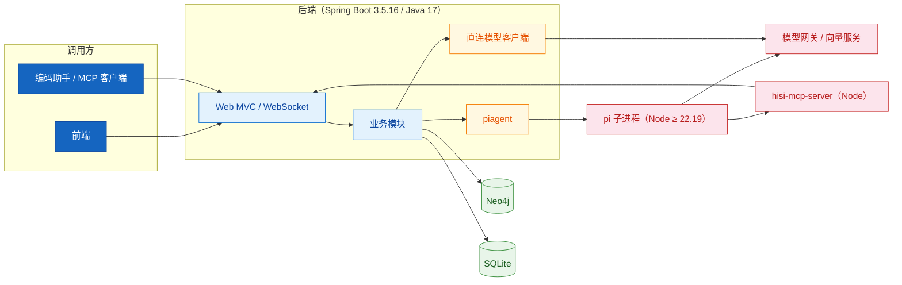
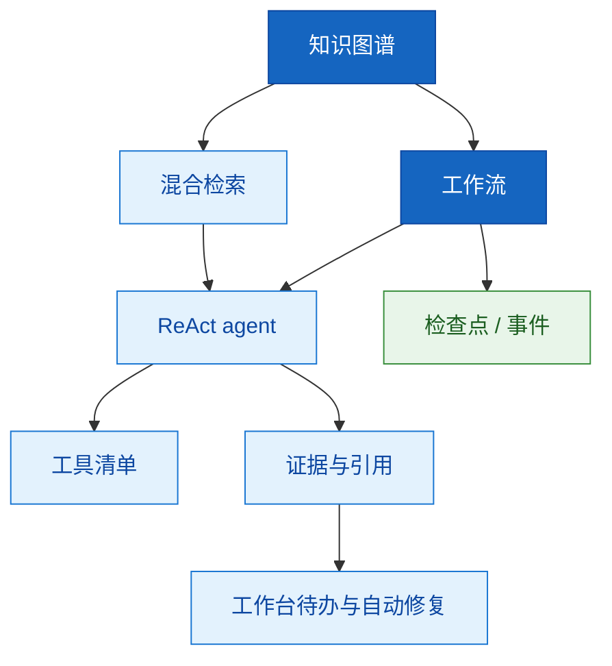

# 项目概览

> 自动生成于 2026-11-26，基于 `99d0037` 版本

---

## 1. 使命与定位

### 1.1 项目使命

**hisi-dev-tool 后端**是一个面向研发的代码理解与运维平台：

> 把仓库源码变成可查询的知识图谱，在此基础上做影响分析、架构诊断、需求评估、日志与 APM 故障诊断，并让 agent 在受控的工具清单内查证证据、给出结论，甚至在工作台里自动修复技术债。

本手册只覆盖后端（`hisi-dev-tool/`）。前端（`hisi-dev-tool-frontend`）与 MCP 服务（`hisi-mcp-server`）各自有独立的手册。

### 1.2 目标用户

| 用户角色 | 使用场景 | 核心诉求 |
|---------|---------|---------|
| 后端研发 | 接手新仓库、排查跨服务调用、评估改动影响 | 调用链可视、语义检索、影响面 |
| 测试 / 质量 | 评估变更的回归范围 | 影响分析、测试范围建议 |
| SRE / 运维 | 排查线上异常与 trace | 日志根因分析、APM 诊断 |
| 架构负责人 | 了解架构现状与治理方向 | 架构诊断报告、深度分析 |
| AI 工具集成方 | 在编码助手里查询图谱 | 稳定的 REST 接口与 MCP 工具 |

### 1.3 项目边界

| 范围 | 说明 |
|------|------|
| **做** | Java / Python / TS-JS-Vue 知识图谱；混合检索；调用链、桥接、DSM 查询；静态影响分析；需求评估工作流；架构诊断；日志根因分析；APM 调试与诊断；合并影响分析；工作台待办与 SDD 自动修复；浏览器终端；提示词与技能管理 |
| **不做** | 代码托管；IDE；独立的向量数据库（向量存在 Neo4j 里）；前端界面的实现（在另一个子项目） |
| **由同仓其他子项目承担** | MCP 工具服务（`hisi-mcp-server`）；请求采集（`hisi-capture-spring-boot-starter`） |

---

## 2. 技术栈

### 2.1 技术栈总览

版本号取自 `pom.xml`；未写版本的由 Spring Boot 管理。

| 层 | 技术 | 版本 | 用途 |
|----|------|------|------|
| 语言 | Java | 17 | — |
| 框架 | Spring Boot | 3.5.16 | Web、WebSocket、JDBC、Validation、Actuator、AOP |
| 图数据库 | Neo4j Java Driver、Spring Data Neo4j、`neo4j-harness` | harness 5.15.0 | 图存储、仓储、进程内嵌入式模式 |
| 本地数据库 | `sqlite-jdbc` | 3.45.1.0 | 会话、任务、报告、待办 |
| Git | JGit、`org.eclipse.jgit.ssh.jsch` | 4.5.4 / 7.2.0 | 克隆、拉取、分支、SSH |
| Java 解析 | `javaparser-symbol-solver-core` | 3.27.0 | 静态分析与图谱构建 |
| Python 解析 | ANTLR4 Runtime + Maven 插件 | 4.13.1 | 由 `Python3Lexer.g4` / `Python3Parser.g4` 生成解析器 |
| 终端 | PTY4J | 0.13.10 | 伪终端 |
| HTTP | OkHttp | 4.12.0 | 出站 HTTP（主代码 6 个文件引用） |
| JSON | Jackson、FastJSON2 | 2.0.53（FastJSON2） | 序列化（Jackson 由 Spring Boot 管理） |
| 缓存 | Caffeine | — | 本地缓存（带 Micrometer 指标） |
| 响应式 | Reactor Core | 3.6.10 | `Flux` 流式结果 |
| JSON Schema | `json-schema-validator` | 1.5.0 | 契约校验（draft-07） |
| 认证 | `jjwt`、`spring-security-crypto` | 0.12.6 | JWT、BCrypt |
| 可观测 | `opentelemetry-proto`、`protobuf-java-util` | 1.3.2-alpha / 3.25.5 | OTLP 接收 |
| 工具 | `maven-model` | 3.8.6 | 解析 `pom.xml` 依赖（`PomDependencyParser`） |
| 模型接口 | OpenAI 兼容协议、Anthropic Messages 协议 | — | 向量与文本走 `/embeddings`、`/chat/completions`；pi 的 `models.json` 用 `anthropic-messages` |
| agent 运行时 | `@earendil-works/pi-coding-agent` | `piagent.package-version`（1.6.0） | 全部 agent 流的 LLM 层 |
| 测试 | JUnit 5、Mockito、Testcontainers | Testcontainers 1.21.4 | 仅测试作用域 |
| 覆盖率 | JaCoCo | 0.8.11 | 行 80% / 分支 70% 的检查 |

`pom.xml` 里声明、但主代码没有任何引用的依赖：Playwright 1.46.0、Jsoup 1.18.1、Gson 2.10.1、Resilience4j 2.3.0、ONNX Runtime 1.18.0、DJL Tokenizers 0.29.0、`mysql-connector-j`、`commons-lang3` 3.12.0。Spring Boot Actuator 也只有依赖、没有代码引用或暴露配置。

### 2.2 技术栈关系图



---

## 3. 项目结构

### 3.1 目录树

```
hisi-dev-tool/
├── pom.xml                       # Maven 构建，产物 devTools-1.0.0.jar
├── src/main/java/com/huawei/hisi/
│   ├── DevToolApplication.java   # 启动类
│   ├── config/                   # 全局配置、鉴权、建表、Neo4j 装配
│   ├── agentbase/  piagent/      # agent 底座：声明、会话、安装、工具清单、预算
│   ├── workflow/  agentflow/     # 工作流引擎与 agent 流公共类型
│   ├── workbench/  fixengine/    # 工作台与 SDD 自动修复、修复引擎
│   ├── knowledgegraph/  neo4j/   # 图谱构建与图存储、检索
│   ├── archdiagnosis/  ram/      # 架构诊断、需求评估
│   ├── loganalysis/  apm/        # 日志分析、APM
│   ├── mergeanalysis/            # 合并影响分析
│   ├── agent/  controller/       # 多 Agent 诊断框架、通用控制器
│   ├── service/  repository/  model/   # 通用服务、SQLite 仓储、DTO
│   ├── project/  scheduler/  scanner/  glossary/   # 远程项目、定时、扫描、术语
│   ├── skill/                    # 技能市场
│   ├── handler/  websocket/  cache/  utils/         # 终端、统一网关、缓存、工具
├── src/main/antlr4/              # Python3 词法与语法定义
├── src/main/resources/
│   ├── application.yml           # 主配置
│   ├── logback-spring.xml        # 日志
│   ├── pi-skills/                # 13 个 agent skill
│   ├── schemas/                  # 契约 JSON Schema
│   └── prompt/  prompts/  ram/  codeai-skills/      # 提示词与技能资源
└── src/test/                     # 246 个测试文件
```

### 3.2 包职责与规模

文件数与行数为主代码 `src/main/java` 的统计（共 674 个文件、约 11.6 万行）。

| 包 | 文件数 | 行数（约） | 职责 | 文档 |
|----|-------|-----------|------|------|
| `knowledgegraph` | 121 | 26,900 | 图谱构建、聚合、多语言解析 | [知识图谱构建](../03-模块说明/知识图谱构建.md) |
| `ram` | 95 | 12,200 | 需求评估、会话与事件模型 | [RAM需求评估](../03-模块说明/RAM需求评估.md) |
| `service` | 65 | 14,300 | 通用服务：日志云、模型直连客户端、影响分析、会话、项目等 | 各模块文档 |
| `neo4j` | 60 | 12,000 | 图模型、仓储、检索 | [Neo4j图存储与检索](../03-模块说明/Neo4j图存储与检索.md) |
| `apm` | 45 | 6,800 | APM 调试与诊断 | [APM故障诊断](../03-模块说明/APM故障诊断.md) |
| `model` | 40 | 2,700 | 通用 DTO | [数据模型](../06-数据模型/index.md) |
| `loganalysis` | 27 | 5,100 | 日志分析 v1 / v2、追问 | [日志云与运维](../03-模块说明/日志云与运维.md) |
| `workbench` | 26 | 5,600 | 待办聚合与 SDD 修复 | [工作台与自动修复](../03-模块说明/工作台与自动修复.md) |
| `config` | 24 | 2,400 | 全局配置 | [应用启动与全局配置](../03-模块说明/应用启动与全局配置.md) |
| `workflow` | 20 | 2,500 | 工作流引擎与架构工作流节点 | [工作流引擎](../03-模块说明/工作流引擎.md) |
| `controller` | 18 | 4,600 | 通用控制器 | [REST接口层](../03-模块说明/REST接口层.md) |
| `fixengine` | 18 | 2,500 | 修复引擎 | [修复引擎fixengine](../03-模块说明/修复引擎fixengine.md) |
| `archdiagnosis` | 16 | 3,300 | 架构诊断 | [架构诊断](../03-模块说明/架构诊断.md) |
| `agent` | 13 | 2,400 | 多 Agent 诊断框架 | [智能诊断与对话](../03-模块说明/智能诊断与对话.md) |
| `mergeanalysis` | 12 | 1,500 | 合并影响分析 | [合并影响分析](../03-模块说明/合并影响分析.md) |
| `project` | 12 | 1,400 | 远程项目与分组 | [远程项目管理](../03-模块说明/远程项目管理.md) |
| `piagent` | 10 | 1,900 | pi 运行时 | [pi-agent底座](../03-模块说明/pi-agent底座.md) |
| `agentflow` | 9 | 360 | LLM 接口、取消登记、证据 | [pi-agent底座](../03-模块说明/pi-agent底座.md) |
| `skill` | 8 | 960 | 技能市场 | [技能市场与提示词](../03-模块说明/技能市场与提示词.md) |
| `repository` | 8 | 1,600 | SQLite 仓储 | [数据模型](../06-数据模型/index.md) |
| `utils` / `scheduler` / `scanner` | 5 / 5 / 5 | 840 / 560 / 1,450 | 工具、定时、桥接扫描 | [远程项目管理](../03-模块说明/远程项目管理.md) |
| `agentbase` / `glossary` | 3 / 3 | 360 / 200 | agent 声明、术语表 | [pi-agent底座](../03-模块说明/pi-agent底座.md) |
| `cache` / `websocket` / `handler` | 2 / 2 / 1 | 550 / 170 / 460 | 缓存、统一网关、终端 | [终端与WebSocket](../03-模块说明/终端与WebSocket.md) |

### 3.3 Monorepo 中的位置

仓库里与本后端并列的子项目：

| 子项目 | 关系 | 交互方式 |
|--------|------|---------|
| `hisi-dev-tool-frontend` | 前端 | REST + SSE + WebSocket |
| `hisi-mcp-server` | MCP 工具服务 | 后端启动时构建它；pi 按会话以 stdio 拉起它；它回调后端 REST |
| `hisi-capture-spring-boot-starter` | 请求采集 | 产出 `HISI_CAPTURE` 信封，由日志分析解析 |
| `hisi-otel-extension` | 同仓的 OTel 扩展目录 | 后端有配置键 `apm.otel-extension-path`；两者的对应关系未在本次阅读中确认 |

本页不展开这三个子项目的内部设计。

---

## 4. 快速启动

完整步骤、全部配置键与环境变量见 [部署运维](../07-部署运维/index.md)。

### 4.1 环境准备

| 依赖 | 要求 |
|------|------|
| JDK | 17 |
| Maven | 3.x |
| Node.js + npm | Node ≥ 22.19.0 |
| Neo4j | ≥ 5.11；或用嵌入式模式（`NEO4J_EMBEDDED=true`） |
| Git | 可用 |

### 4.2 安装与启动

```bash
# 1. 在 src/main/resources/ 下准备 application-local.yml（不入库）：
#    embedding.api-key、text-model.api-key、neo4j.password、anthropic.*、jwt.secret、app.project_dir

# 2. 启动
mvn spring-boot:run
# 或
mvn clean package -DskipTests && java -jar target/devTools-1.0.0.jar
```

首次启动会自动建表、安装 pi、按需构建 `hisi-mcp-server`，并在日志里打印 `root` 的初始口令（未配置 `HISI_ROOT_PASSWORD` 时为随机口令）。

### 4.3 验证运行

| 检查 | 地址 / 方式 | 预期结果 |
|------|-----------|---------|
| 应用 | `GET http://localhost:8080/api/ops/health` | `code = 200` |
| 登录 | `POST /api/auth/login`（`root` + 初始口令） | 返回 `token`，`role = ADMIN` |
| 图数据库 | 启动日志中 Neo4j 约束与索引创建完成 | 无失败告警 |
| pi | 启动日志出现 `[PiAgent] 就绪` | 后端目录下生成 `lib/pi`、`lib/pi-agent` |

### 4.4 常见启动问题

| 问题 | 原因 | 解决 |
|------|------|------|
| pi 未就绪 | Node 缺失或版本低 | 安装 Node ≥ 22.19.0；下一次 agent 流会自动重试 |
| `Connection refused 7687` | Neo4j 未启动 | 启动 Neo4j 或改用嵌入式模式 |
| 登录失效 | 未配置 `JWT_SECRET` | 配置后重启 |
| 写接口 401 / 403 | 未登录或非管理员 | 用管理员账号 |

---

## 5. 核心概念

| 概念 | 英文 / 代码 | 定义 | 详解 |
|------|------------|------|------|
| 知识图谱 | Knowledge Graph | 源码解析后得到的图：方法、类、入口点、调用、SQL、模块、领域等 | [知识图谱构建](../03-模块说明/知识图谱构建.md) |
| 混合检索 | Hybrid Search | 按查询类型路由，多路召回后用加权 RRF 融合 | [Neo4j图存储与检索](../03-模块说明/Neo4j图存储与检索.md) |
| 工作流 | `AgentRegistry.Workflow` | 一条有序节点链加执行策略 | [工作流引擎](../03-模块说明/工作流引擎.md) |
| ReAct agent | `AgentRegistry.ReactAgent` | 工具清单 + skill + 契约 + 修正轮数的一次会话装配 | [pi-agent底座](../03-模块说明/pi-agent底座.md) |
| 工具清单 | `FlowToolManifest` | 每个流启动时的工具白名单，即权限边界 | [pi-agent底座](../03-模块说明/pi-agent底座.md) |
| 上下文预算 | `PromptBudget` | 提交前估算 token，超预算时对结构化载荷保形压缩 | [pi-agent底座](../03-模块说明/pi-agent底座.md) |
| 检查点 | `CHECKPOINT` 事件 | 节点产物加输入哈希，续跑时复用 | [工作流引擎](../03-模块说明/工作流引擎.md) |
| 证据与引用 | `EvidencePack`、`[[E n]]` | 结论必须引用的证据编号，由确定性代码校验 | [日志云与运维](../03-模块说明/日志云与运维.md) |
| 工作台待办 | `workbench_item` | 跨项目聚合的技术债条目 | [工作台与自动修复](../03-模块说明/工作台与自动修复.md) |
| SDD 自动修复 | `wb-autofix` | 八阶段修复，带方案确认门与迭代回路 | [工作台与自动修复](../03-模块说明/工作台与自动修复.md) |
| 构建模式 | `BuildMode` | `REUSE` / `INCREMENTAL` / `WIPE` | [知识图谱构建](../03-模块说明/知识图谱构建.md) |

### 概念关系图



---

## 6. 项目演进

依据 git 提交记录（只取日期与提交标题）。

| 时间 | 关键变更 |
|------|---------|
| 2026-05-08 | monorepo 初始化，后端 v4.4 |
| 2026-05-22 | RAM 的 agent 注册表与 YAML 清单加载 |
| 2026-07-15 | 接入 codegraph sidecar；修复引擎事件系统重构 |
| 2026-07-28 | Spring Boot 3.2.0 → 3.4.5，引入 Spring AI 1.0.8；管理员拦截器补 401 |
| 2026-07-29 | 新增统一对话 SSE 入口 `AgentChatController` 与 `AgentTools`；标记旧 HTTP 客户端为废弃 |
| 2026-07-30 | Spring Boot 3.5.16 + Spring AI 1.1.8；RAM Phase2 迁到 Spring AI `ChatClient`；统一 WebSocket 网关基础 |
| 2026-08-04 | 向量与描述生成改为批量 + 自适应批大小 |
| 2026-08-06 | 增量刷新 v3（组合方式） |
| 2026-08-19 | 架构分析平台与仪表盘；定时调度加 HITL 闸门 |
| 2026-08-21 | 定时调度三种构建模式；聚合管道超限时的压缩重试 |
| 2026-10-13 | 架构诊断后端模块与前后端联合构建 |
| 2026-11-26 | 工作台自动修复、pi agent 基建与安全整改；**所有 LLM 流迁移到 pi 统一底座**；pi 启动自检加固；mcp.json 的后端地址跟随 `server.port` |

### 当前状态

| 维度 | 说明 |
|------|------|
| 开发阶段 | 活跃迭代（v5.0 的 pi 迁移在 2026-11-26 合入） |
| 测试 | `src/test` 下 246 个测试文件；`pom.xml` 配有 JaCoCo 检查；本次未运行测试 |
| 已知问题 | 见 [架构设计](../02-架构设计/index.md) 第 10 节与各模块文档 |

---

## 7. 与相关项目的关系

见 3.3 节。

---

> **延伸阅读**：
> - 架构全貌 → [02-架构设计](../02-架构设计/index.md)
> - 术语详解 → [09-术语表](../09-术语表/index.md)
> - 部署指南 → [07-部署运维](../07-部署运维/index.md)
