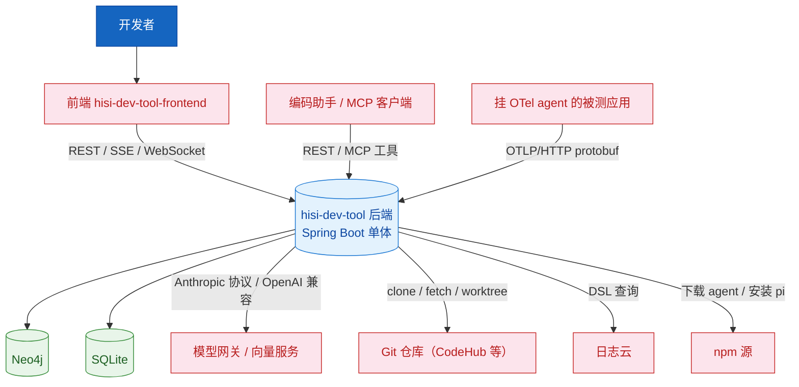
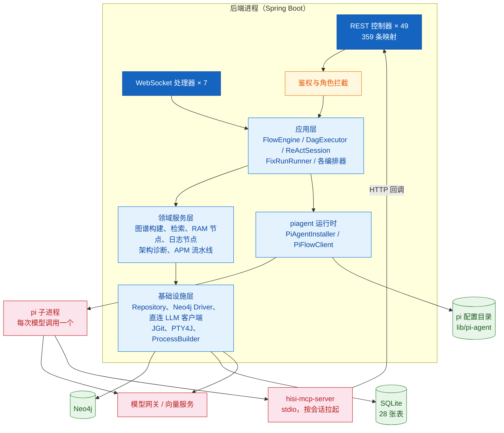
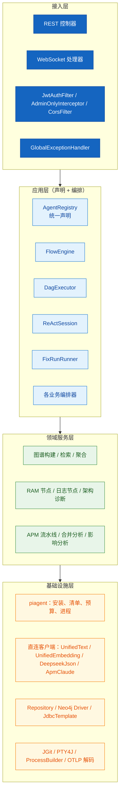
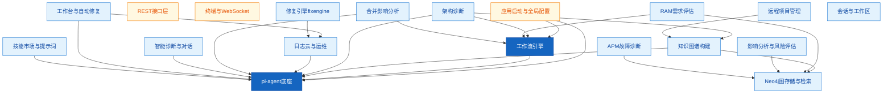
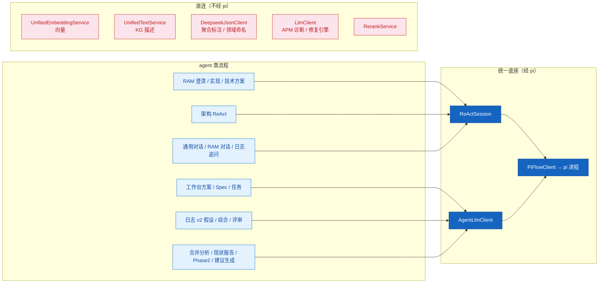
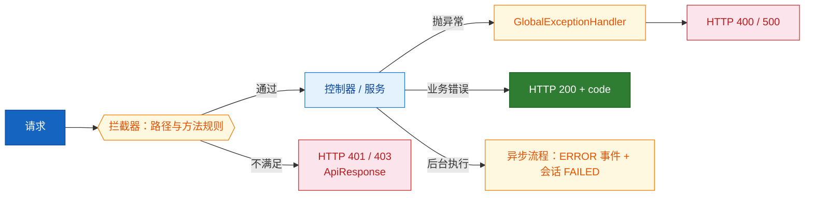

# 架构设计

> 自动生成于 2026-11-26，基于 `99d0037` 版本

---

## 1. 架构总览

### 1.1 系统上下文图（C4 Level 1）

| 角色 / 系统 | 类型 | 交互方式 | 数据流向 |
|------------|------|---------|---------|
| 开发者 | 人员 | 浏览器 | 提问、触发分析、确认方案 |
| `hisi-dev-tool-frontend` | 系统 | REST + SSE + 7 个 WebSocket 端点 | 请求 / 事件流 |
| 编码助手与 MCP 客户端 | 系统 | REST（经 `hisi-mcp-server` 的工具） | 只读查询为主 |
| Neo4j | 系统 | Bolt（外部）或进程内 harness | 图数据的读写 |
| SQLite | 文件 | JDBC | 会话、任务、报告、待办 |
| 模型网关与向量服务 | 系统 | HTTPS | agent 流经 pi；批量与部分单次调用直连 |
| Git 仓库 | 系统 | JGit / `git` 命令 | 克隆、拉取、worktree |
| 日志云 | 系统 | HTTP API | 拉取日志 |
| 被测应用 | 系统 | OTLP/HTTP protobuf 上报 | span |

### 1.2 容器图（C4 Level 2）

| 容器 | 技术 | 职责 | 端口 / 位置 | 数据存储 |
|------|------|------|-----------|---------|
| 后端进程 | Spring Boot 3.5.16、Java 17 | 全部业务逻辑与接口 | `server.port`（默认 8080） | — |
| pi 子进程 | `@earendil-works/pi-coding-agent`（Node） | 执行 agent 的模型调用与工具调用 | 无（stdio JSONL） | 会话目录在 pi 配置目录下 |
| `hisi-mcp-server` | Node | 给 pi 提供图谱、日志、APM 的只读工具与动作工具 | 无（stdio）；回调后端 HTTP | — |
| Neo4j | 5.11+ 或 harness | 知识图谱与向量索引 | 7687 或进程内 | 图数据 |
| SQLite | `sqlite-jdbc` | 本地元数据 | 文件 | 28 张表 |

---

## 2. 分层设计

### 2.1 分层架构图

### 2.2 各层职责

#### 接入层

- **职责**：协议转换（HTTP / JSON、SSE、WebSocket 文本帧）、身份解析、角色拦截、统一异常。
- **核心组件**：49 个控制器、7 个 WebSocket 处理器、`JwtAuthFilter`、`AdminOnlyInterceptor`、`GlobalExceptionHandler`。
- **约束**：鉴权不在控制器里写，统一由拦截器按路径规则施加；见 [REST接口层](../03-模块说明/REST接口层.md)。

#### 应用层

- **职责**：决定「跑什么、按什么顺序跑、在哪里停」。
- **核心组件**：`agentbase.AgentRegistry`（全部 agent 与工作流的唯一声明）、`FlowEngine`（声明 → 节点链 → 策略）、`workflow.DagExecutor`（游标、检查点、等待、事件）、`ReActSession`（按声明装配一次 pi 会话并做契约校验）、工作台的 `FixRunRunner`、各业务自带的编排器。
- **约束**：声明只描述结构，提示词正文在 skill 文件里；执行器不关心流程是什么。

#### 领域服务层

- **职责**：单项业务能力的实现。
- **核心组件**：图谱构建与聚合、混合检索、RAM 的 DAG 节点、日志分析的 v1 / v2 节点、架构诊断的报告与检测、APM 的接收 / 诊断 / 调试、合并分析与静态影响分析。
- **约束**：节点实现注册为 bean 后由注册表按名收集；LLM 调用只依赖 `AgentLlmClient` 或 `ReActSession`，不直接依赖某个模型客户端。

#### 基础设施层

- **职责**：与外部系统对接、持久化、子进程管理。
- **核心组件**：`piagent` 包（安装、每流工具清单、上下文预算、进程与事件）、4 类直连模型客户端、Neo4j 仓储与 Driver、`JdbcTemplate` 仓储、JGit、PTY4J、OTLP protobuf 解码。
- **约束**：不感知业务流程。

---

## 3. 模块依赖关系

### 3.1 模块依赖图

图中省略了所有模块对「应用启动与全局配置」和「REST 接口层」的依赖。

### 3.2 依赖规则

| 规则 | 说明 | 示例 |
|------|------|------|
| 单向依赖 | 控制器 → 应用层 → 领域服务 → 基础设施 | — |
| 声明与实现分离 | agent 的结构在 `AgentRegistry` 一处声明，实现在各模块 | 新增节点不改引擎 |
| 底座不反依赖业务 | `piagent` 包不 import 任何业务包；`agentbase` 只依赖 `workflow` 的类型与 `ram.contract` | — |
| 会话表共用 | `agent_session` / `agent_event` 由 RAM 的仓储定义，工作流、日志、合并、工作台、修复都复用 | 见 [RAM需求评估](../03-模块说明/RAM需求评估.md) |
| 允许循环依赖 | `spring.main.allow-circular-references=true`，yml 注释为「临时解决方案」 | — |

### 3.3 共享模块

| 共享模块 | 使用者 | 说明 |
|---------|--------|------|
| `model.ApiResponse` | 全部控制器 | 统一响应 |
| `ram.model.*`、`ram.repository.*` | 全部 agent 类流程 | 会话、事件、枚举 |
| `ram.contract.SchemaValidator` | 全部带契约的 ReAct agent | JSON Schema 校验 |
| `agentflow.AgentLlmClient` | 15 处一次性结构化调用 | 最小 LLM 接口，唯一实现是 `PiAgentLlmClient` |
| `agentflow.AgentFlowCancelRegistry` | 工作流 v2、工作台 | 取消登记 |
| `agentflow.EvidencePack` 等 | 日志分析 v2 | 证据与引用校验 |
| `apm.service.locator.LlmClient` | APM 诊断、修复引擎 | 直连的 `chat(system, user)` |
| `ram.kg.KgMcpClient` | RAM、合并分析、日志 v1 | 图谱查询（实现 `DirectKgClient`） |
| `cache.GlobalAnalysisCache` | 图谱构建、桥接扫描、静态影响分析 | 预扫描共享数据 |

---

## 4. LLM 调用架构

模型调用分三条路径。依据：主代码里 `org.springframework.ai` 引用为 0；`AgentLlmClient` 只有 `PiAgentLlmClient` 一个实现；直连客户端的调用方逐个核对如下。

| 路径 | 调用 | 实现 | 性质 |
|------|------|------|------|
| 经 pi | 全部 ReAct 会话与一次性结构化调用 | `ReActSession`、`AgentLlmClient` | agent 流程的 LLM 层 |
| 直连 | 向量化；KG 方法 / 入口点描述生成；聚合标注与领域命名 | `UnifiedEmbeddingService`、`UnifiedTextService`、`DeepseekJsonClient` | **批量 / 向量类**，不属于 agent 流程 |
| 直连 | `LlmClient.chat(system, user)`：APM 诊断、修复引擎的用例生成与修复生成 | `ApmClaudeLlmClient`，或 `UnifiedTextService` 支撑的默认 bean | **单次结构化调用但仍直连** |
| 直连 | 需求影响面的查询分解 | `QueryDecomposer`：首选 `UnifiedTextService`，其次 `AgentLlmClient`，最后规则切分 | 混合 |
| 直连 | 检索重排 | `RerankService`（默认关闭） | 向量类 |

「批量 / 向量直连」与「单次结构化调用仍直连」是两种不同情况：前者是吞吐与成本取向的批处理（令牌桶限流、分批提交），后者是沿用既有 `LlmClient` 接口、尚未迁到底座的业务调用。

---

## 5. 架构质量属性

| 优先级 | 质量属性 | 具体要求 | 架构保障措施 |
|--------|---------|---------|-------------|
| P0 | 模型调用可替换 | 换底层客户端不改业务 | 业务只依赖 `AgentLlmClient` / `ReActSession` / `LlmClient` 接口 |
| P0 | 权限边界清晰 | 模型只能用清单里的工具 | `FlowToolManifest` 在进程启动时固定白名单；git 工具永不入清单 |
| P0 | 结果有据可查 | 结论可追溯到证据与事件 | 事件追加写 `agent_event`；日志 v2 用证据编号与确定性验证 |
| P1 | 可续跑 | 长流程中断后从断点继续 | `DagExecutor` 按输入哈希复用检查点；工作台从 `CHECKPOINT` 恢复产物 |
| P1 | 可降级 | 外部依赖失败不拖垮主流程 | pi 未就绪走确定性降级；v2 日志失败回退 v1；检索无向量时回退关键词 |
| P1 | 可观测 | 进度实时可见 | SSE + WebSocket 推送节点事件 |
| P2 | 上下文可控 | 大输入不撑爆窗口 | `PromptBudget` 提交前预算 + pi 运行中压缩 |
| P2 | 资源可控 | 子进程与并发不失控 | 信号量、deadline、强制回收 |

### 架构权衡

| 权衡点 | 选择 | 放弃 | 理由（代码注释） |
|--------|------|------|----------------|
| 进程内 SDK vs 外部 agent 进程 | 每次模型调用起一个 pi 进程 | 进程内调用的低开销 | 换来统一的工具白名单、skill 与上下文管理；源码注释称启动约 1.2 秒可接受 |
| 手写 ReAct 循环 vs 声明 + pi | 删除手写循环，架构分析只走 pi | 可回退到旧实现 | `ArchReActNodeV2Factory` 注释：旧代码是本次版本刻意移除的 |
| 单体 vs 拆分 | Spring Boot 单体 | 独立扩缩 | 定位是开发者工具与内网服务 |
| 图与向量同库 | Neo4j 原生向量索引 | 独立向量库 | 少一个运维组件 |
| 无迁移框架 | 启动建表 + 幂等加列 | 版本化迁移 | 工具属性；代价是升级逻辑分散 |

---

## 6. 跨切面关注点

### 6.1 错误处理策略

| 场景 | 策略 |
|------|------|
| 接口层 | 拦截器先判权限；参数类异常 → 400；未预期异常 → 500；流式接口客户端断开不写响应 |
| 同步业务 | 多数用 `ApiResponse.code` 表达，HTTP 仍为 200 |
| 异步流程 | 不向上抛：记 `ERROR` 事件，会话置 `FAILED`，SSE 推 `RUN_FAILED` |
| 模型调用 | 超时、空输出、契约不过各有降级路径，见各模块文档 |

### 6.2 日志策略

| 层 | 级别 | 输出 | 说明 |
|----|------|------|------|
| `com.huawei.hisi` | info | 控制台 + 文件 | 业务日志 |
| `com.huawei.hisi.knowledgegraph`、`neo4j` | debug | 控制台 + 文件 | 图谱与检索细节 |
| `org.springframework` | warn | 控制台 + 文件 | 框架日志 |
| 查询串 | — | — | 令牌、口令类参数写日志前掩码 |

完整配置见 [部署运维](../07-部署运维/index.md)。

### 6.3 安全策略

| 关注点 | 策略 | 实现位置 |
|--------|------|---------|
| 身份 | JWT（`Authorization: Bearer` 或 `?token=`） | `JwtAuthFilter`、`JwtTokenProvider` |
| 权限 | 写操作需管理员；工作流与工作台全端点需登录 | `AdminOnlyInterceptor` |
| 模型工具边界 | 每流白名单；只读流排除写与执行工具；不信任工作目录里的项目级文件 | `FlowToolManifest.cliArgs()` |
| 提交推送 | 不交给模型，由后端执行；发现 HEAD 被改动则不采纳结果 | `DevelopStage` |
| 提示词注入面 | 只读流不读取被分析仓库的 AGENTS.md / CLAUDE.md 进系统上下文 | `--no-context-files` |
| 本地文件读取 | `SourceSnippetReader` 只读项目目录之下的源码，类名经白名单校验 | `loganalysis.v2` |
| 密钥 | 环境变量或本机文件；pi 进程经环境变量取密钥 | 各配置类、`PiFlowClient` |
| 跨域 | `cors.allowed-origins` | `CorsConfig`、`WebSocketConfig` |
| WebSocket | 握手不校验令牌 | `WebSocketConfig` |

### 6.4 事件与推送

| 通道 | 用途 | 数据源 |
|------|------|-------|
| SSE | 会话事件流、agent 对话增量、安装与诊断进度 | `agent_event` 轮询或进程内事件 |
| WebSocket | 终端、RAM 对话、日志分析与追问、APM、诊断事件、统一网关 | 各处理器内存状态 |

---

## 7. 部署架构

部署拓扑、端口、目录与启动自检流程见 [部署运维](../07-部署运维/index.md)。要点：

| 项目 | 说明 |
|------|------|
| 部署单元 | 一个可执行 jar；pi 与 `hisi-mcp-server` 在后端首次启动时就地安装 / 构建 |
| 实例数 | 按单实例设计：会话映射、确认等待、终端 PTY、多个缓存都在进程内存 |
| 数据库 | SQLite 单文件；Neo4j 外部或嵌入式 |
| 环境 | `dev`（仅 yml 里的 profile 名，无独立文件）、`prod`（`application-prod.yml`）、`local`（本机覆盖） |

---

## 8. 技术选型总结

| 领域 | 选择 | 备选 | 依据 | 对应 ADR |
|------|------|------|------|---------|
| 应用框架 | Spring Boot 3.5.16 | — | `pom.xml`；2026-07 由 3.2.0 升级 | — |
| agent 运行时 | pi（`@earendil-works/pi-coding-agent`） | Spring AI `ChatClient`、手写 ReAct | 主代码已无 Spring AI 引用 | [ADR-001](../08-技术决策/index.md) |
| agent 声明 | 代码内静态声明 `AgentRegistry` | YAML 清单 | 源码注释：一处声明、测试锁死 | [ADR-002](../08-技术决策/index.md) |
| 工作流骨架 | 有序管道 + 执行策略 | 责任链 | 源码注释：责任链只用于节点内多选一 | [ADR-003](../08-技术决策/index.md) |
| 图数据库 | Neo4j（图 + 向量索引） | 关系库 + 独立向量库 | `Neo4jConfig`、`Neo4jInitializer` | — |
| 本地元数据 | SQLite + 启动建表 | 关系库、迁移框架 | 各 SchemaInitializer | [ADR-008](../08-技术决策/index.md) |
| Java 解析 | JavaParser + Symbol Solver | — | `pom.xml` | — |
| Python 解析 | ANTLR4 + Python3 文法 | — | `pom.xml`、`src/main/antlr4` | — |
| 前端代码解析 | 外部 `codegraph` CLI | — | `CodegraphSidecarService` | — |
| 终端 | PTY4J | — | `pom.xml` | — |
| 认证 | JJWT + BCrypt | Spring Security 全家桶 | `pom.xml` 只引入 `spring-security-crypto` | [ADR-012](../08-技术决策/index.md) |
| OTLP 接收 | http/protobuf | http/json | `pom.xml` 与控制器注释 | — |

---

## 9. 架构约束与限制

| 约束类型 | 约束 | 影响 | 应对 |
|---------|------|------|------|
| 运行环境 | 需要 Node.js ≥ 22.19.0 与 npm | 部署机多一项依赖 | 启动自检并给出日志；失败可自动补装 |
| 运行环境 | Windows 与类 Unix 的进程 / 终端行为不同 | 代码里有分支处理 | `PiAgentInstaller`、`TargetProcessManager`、`TerminalWebSocketHandler` |
| 数据库 | Neo4j ≥ 5.11 才有向量索引 | 低版本检索降级为全表扫描 | `Neo4jVectorIndexService` 版本检测 |
| 数据库 | 向量索引维度绑定向量模型 | 换模型需重建索引并重算向量 | 维度取自 `embedding.dimension` |
| 版本 | Spring Boot 3.5.16 | — | `pom.xml` |
| 规范 | JUnit 5，JaCoCo 行覆盖 80% / 分支 70% | — | `pom.xml` 中的 `jacoco-check` |
| 规范 | JDK 17 | — | `pom.xml` |

---

## 10. 结构性的现状问题

这些不是设计意图，而是读代码时看到的现状，各模块文档中有详细说明：

| 现状 | 说明 |
|------|------|
| 声明与可执行节点不一致 | `AgentRegistry` 声明 7 条工作流，只有 4 条能经统一入口解析出节点链 |
| 两个框架没有实现类 | `DiagnosticAgent`、`ChannelHandler` 在主代码中实现数为 0 |
| 多个服务类没有调用方 | `service/risk`、`service/semantic`、`service/suggestion`、`AnalysisPipelineService`、`RootCauseAnalysisService(Impl)`、`CaseMatchingService(Impl)`、`AIAnalysisPromptService`、`ZhipuService`、`ApiResponseCache` |
| 残留依赖与配置 | `pom.xml` 仍声明 Spring AI 与 Playwright；`AnthropicHttpClient` 源文件仍在但无调用方；若干 yml 键无引用 |
| 两套自动修复并存 | 工作台 SDD 与修复引擎，模型调用路径不同 |
| 模型与表结构不一致 | `workspace_session` 不存 `claudeSessionId`、`title`、`scene` |

---

> **延伸阅读**：
> - 各模块详细设计 → [REST接口层](../03-模块说明/REST接口层.md)（含全部模块的索引）
> - 数据流转路径 → [04-数据流程](../04-数据流程/index.md)
> - 技术决策详情 → [08-技术决策](../08-技术决策/index.md)
> - 部署操作指南 → [07-部署运维](../07-部署运维/index.md)
