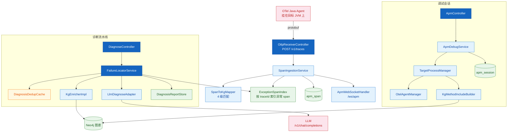
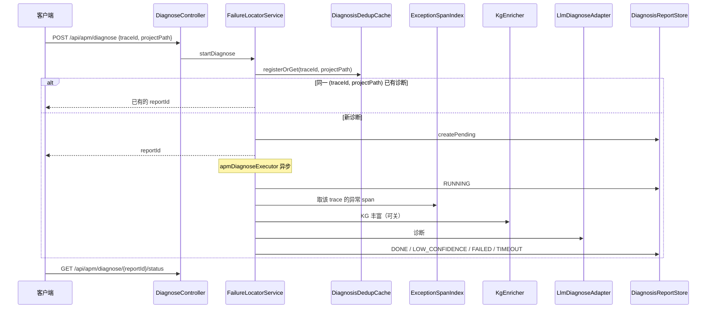

# APM 故障诊断

> 自动生成于 2026-11-26，基于 `99d0037` 版本

| 属性 | 值 |
|------|-----|
| **所属层** | 应用层（诊断流水线编排）+ 基础设施层（OTLP 接收、目标进程与 Agent 管理） |
| **目录** | `apm/`（45 个文件：`cache` 3、`config` 4、`controller` 4、`handler` 1、`model` 10、`repository` 3、`service` 8、`service/locator` 12） |
| **核心类** | `ApmController`、`DiagnoseController`、`OtlpReceiverController`、`ApmDebugService`、`TargetProcessManager`、`OtelAgentManager`、`SpanIngestionService`、`SpanToKgMapper`、`FailureLocatorService`、`LlmDiagnoseAdapter` |
| **REST** | `/api/apm`、`/api/apm/diagnose`、`/api/apm/test-cases`、`/v1/traces`，共 21 个端点 |
| **WebSocket** | `/ws/apm` |
| **SQLite 表** | `apm_session`、`apm_span`、`apm_test_case` |

---

## 1. 模块概述

### 1.1 职责定义

**核心职责**：用 OpenTelemetry Java Agent 拉起被测应用、采集方法级调用链 span，并把异常 trace 对应到知识图谱节点，最后由 LLM 产出根因诊断报告。

| 本模块负责 | 本模块不负责 | 由谁负责 |
|-----------|-------------|---------|
| 下载与定位 OTel Agent、启动 / 停止目标进程 | 被测应用本身的构建 | 目标项目 |
| 接收 OTLP/HTTP protobuf trace、落库、按 trace 索引异常 span | 通用日志分析 | [日志云与运维](./日志云与运维.md) |
| span → KG 方法节点的映射 | 图谱构建 | [知识图谱构建](./知识图谱构建.md) |
| 异步诊断流水线（去重、KG 丰富、LLM 诊断、报告状态机） | agent 流程编排 | [工作流引擎](./工作流引擎.md) |
| APM 测试用例的保存与回放配置 | — | — |

### 1.2 LLM 调用边界

APM 诊断的模型调用**不经 pi**，属于「单次结构化调用但仍直连」：

| Bean | 装配条件 | 底层 |
|------|---------|------|
| `ApmClaudeLlmClient`（`@Primary`） | `hisi.apm.diagnose.llm.api-key` 非空 | 直连 OpenAI 兼容的 `/v1/chat/completions`，配置 `hisi.apm.diagnose.llm.*`；用公平信号量限制全局并发 |
| `ApmDiagnoseConfig` 中的默认 `LlmClient` | 上一个不成立且上下文没有其他 `LlmClient`（`@ConditionalOnMissingBean`） | `UnifiedTextService`（system 与 user 提示词拼接后单轮调用） |
| `LlmDiagnoseAdapter`（`@Primary`） | 存在 `LlmClient` bean 且 `hisi.apm.diagnose.llm-enabled` 不为 false | 调上面的 `LlmClient`，带单次调用超时 |
| `stubLlmDiagnoser` | 没有 `LlmDiagnoseAdapter` 时 | 返回模板文本与 0.6 置信度 |

接口 `apm.service.locator.LlmClient.chat(system, user)` 的另一个使用方是 [修复引擎fixengine](./修复引擎fixengine.md) 的 `FixAgent` / `TestGenAgent`。详见 [pi-agent底座](./pi-agent底座.md)。

---

## 2. 模块架构

---

## 3. Trace 接收

`OtlpReceiverController` 的 `POST /v1/traces` 有两个处理方法：

| 请求体 | 处理 |
|-------|------|
| `application/x-protobuf` 的 `ExportTraceServiceRequest` | 用 `JsonFormat` 把 protobuf 转成 OTLP/JSON，再交给 Jackson 反序列化为 `OtlpTraceData` |
| OTLP/JSON | 直接反序列化 |

`SpanIngestionService.ingest`：展开嵌套的 resourceSpans → `ApmSpanEntity`，解析所属的 APM 会话，做 KG 映射，并推给 WebSocket。span kind 与 status code 的数字枚举映射为字符串（如 `SERVER` / `CLIENT`、`OK` / `ERROR`）。

`SpanToKgMapper` 的 4 级匹配（结果写入 `apm_span.kg_node_id` 与 `kg_match_level`）：

| 级别 | 常量 | 规则 |
|------|------|------|
| 1 | `MATCH_EXACT = 0` | `code.namespace` + `code.function` 属性精确匹配类名与方法名 |
| 2 | `MATCH_UNIQUE = 1` | 从 span 操作名解析 `className.methodName` |
| 3 | `MATCH_OVERLOADED = 2` | 按 HTTP 路由匹配 Controller 入口点 |
| 4 | `MATCH_UNMATCHED = 3` | 未匹配 |

`apm_span.kg_match_level` 的列默认值为 3。

---

## 4. 调试会话

### 4.1 启动目标进程

| 组件 | 职责 |
|------|------|
| `ApmDebugService` | 会话编排：launch / execute / stop / 查询 |
| `TargetProcessManager` | 按会话 ID 管理目标 JVM：识别构建系统（Maven / Gradle / JAR）、按操作系统拼命令、注入 OTel agent 环境变量、stdout 环形缓冲（500 行）、按端口探活（每 500 毫秒，自动端口从 18080 起）、优雅与强制关闭 |
| `OtelAgentManager` | 定位 agent JAR，顺序：配置的 `apm.otel-agent-path` → 项目目录 `lib/otel-agent/` → `~/.hisi-devtool/otel-agent/` 缓存 → 下载 |
| `KgMethodIncludeBuilder` | 从入口方法沿图谱被调树生成 `OTEL_INSTRUMENTATION_METHODS_INCLUDE`：默认深度 5、每类最多 32 个方法、总计最多 256 个 |

源码注释说明：OTel agent 不会自动插桩任意 `@Service` / `@Repository` / `@Component` 方法，要得到与图谱调用链一致的方法级 span 树，必须事先枚举方法。`TargetProcessManager` 中该字符串超过 16000 字符时改为写入 properties 文件、经 `-Dotel.javaagent.configuration-file` 传入。

`ApmSession` 的生命周期（类注释）：`CREATED → LAUNCHING → READY → RUNNING → COMPLETED | ERROR`。

### 4.2 调试报告

`DebugReportService` 由已存的 span 构建层级 span 树，取耗时前 5 的热点，并汇总错误点。

---

## 5. 诊断流水线

### 5.1 报告状态 `DiagnoseReport.Status`

`PENDING → RUNNING → DONE | FAILED | CANCELLED | TIMEOUT | LOW_CONFIDENCE`。后五个为终态。

### 5.2 KG 丰富 `KgEnricherImpl`

对异常 span 中每个不同的 `(className, methodName)` 解析一个 KG 方法锚点；只对第一个异常 span 追取最多 3 个直接上游调用方。装配条件：上下文里有 `KgQueryFacade`（即 `Neo4jMethodNodeRepository` 存在）；否则使用返回空列表的 no-op 实现。

### 5.3 缓存

| 组件 | 键 | 容量与过期 |
|------|-----|-----------|
| `DiagnosisReportStore` | `reportId` | 最多 500 条，访问后 2 小时过期；内部约束状态机只能向前流转 |
| `DiagnosisDedupCache` | `traceId + "|" + projectPath` → `reportId` | 最多 2000 条，30 分钟 |
| `ExceptionSpanIndex` | `traceId` → 异常 span 列表 | 最多 10000 个 trace，2 小时，每 trace 最多 50 个 span |

三个缓存都是进程内的，重启后丢失。

### 5.4 错误码 `ApmErrorCode`

| 区段 | 取值 |
|------|------|
| 1xxx OTel Agent / 目标进程 | `OTEL_AGENT_DOWNLOAD_FAILED` 1001、`OTEL_EXTENSION_MISSING` 1002、`OTEL_MDC_BROKEN` 1003、`OTEL_NO_SPAN_RECEIVED` 1004、`OTEL_PROCESS_DEAD` 1005 |
| 2xxx span 接收 | `INGEST_PARSE_FAILED` 2001、`INGEST_OVERLOAD` 2002 |
| 3xxx 诊断 | `DIAGNOSE_TRACE_NOT_FOUND` 3001、`DIAGNOSE_REQUEST_DUPLICATED` 3002、`DIAGNOSE_TIMEOUT` 3003、`DIAGNOSE_CANCELLED` 3004、`DIAGNOSE_NO_EXCEPTION_SPANS` 3006、`DIAGNOSE_INTERNAL_ERROR` 3500 |
| 4xxx LLM | `LLM_RATE_LIMITED` 4001、`LLM_TIMEOUT` 4002、`LLM_BUDGET_EXCEEDED` 4003、`LLM_INVALID_RESPONSE` 4004、`LLM_UPSTREAM_ERROR` 4500 |
| 5xxx 图谱 | `KG_UNAVAILABLE` 5001、`KG_QUERY_TIMEOUT` 5002、`KG_METHOD_NOT_FOUND` 5003 |
| 9xxx 测试 | `TEST_FIXTURE_MISSING` 9001 |

---

## 6. REST 端点与 WebSocket

鉴权：GET 放行；POST / PUT / DELETE 需要管理员。`/v1/traces` 是 POST，按同一规则同样需要管理员令牌。

### 6.1 调试会话 `/api/apm`

| 方法 | 路径 | 说明 |
|------|------|------|
| POST | `/api/apm/launch` | 启动目标进程并挂载 OTel agent |
| POST | `/api/apm/execute` | 向目标进程发 HTTP 请求 |
| POST | `/api/apm/stop` | 停止目标进程 |
| GET | `/api/apm/sessions` | 会话列表，`limit` 默认 20 |
| GET | `/api/apm/session/{id}` | 会话详情 |
| GET | `/api/apm/spans/{sessionId}` | 会话采集的 span |
| GET | `/api/apm/trace/{traceId}` | 按 trace 查看 span 树 |
| GET | `/api/apm/report/{sessionId}` | 调试报告 |
| GET | `/api/apm/process-output/{sessionId}` | 进程 stdout，`maxLines` 默认 100 |
| POST | `/api/apm/dev/register-session` | 开发用：手动注册会话 |

### 6.2 诊断 `/api/apm/diagnose`

控制器整体受 `hisi.apm.diagnose.enabled` 控制（缺省视为开启）。

| 方法 | 路径 | 说明 |
|------|------|------|
| POST | `/api/apm/diagnose` | 提交诊断；请求体 `traceId`、`projectPath` 必填；返回 `reportId` |
| GET | `/api/apm/diagnose/{reportId}` | 完整报告 |
| GET | `/api/apm/diagnose/{reportId}/status` | 状态：`reportId`、`status`、起止时间、耗时、置信度、错误码 |
| DELETE | `/api/apm/diagnose/{reportId}` | 取消 |

### 6.3 测试用例 `/api/apm/test-cases`

| 方法 | 路径 | 说明 |
|------|------|------|
| GET | `/api/apm/test-cases` | 按 `projectPath` 列出 |
| GET / PUT / DELETE | `/api/apm/test-cases/{id}` | 查、改、删 |
| POST | `/api/apm/test-cases` | 新建 |

### 6.4 OTLP 接收

| 方法 | 路径 | 说明 |
|------|------|------|
| POST | `/v1/traces` | 接收 OTLP/HTTP protobuf 与 OTLP/JSON |

### 6.5 WebSocket `/ws/apm`

`ApmWebSocketHandler` 向前端推送 span 批次与事件；单次发送时限 5000 毫秒，缓冲上限 65536 字节。

---

## 7. 数据模型

### `apm_session`

`id`（TEXT PK）、`project_path`、`service_name`、`target_port`、`status`（默认 `CREATED`）、`created_at`、`finished_at`。

### `apm_span`

`id`、`session_id`、`trace_id`、`span_id`、`parent_span_id`、`service_name`、`operation_name`、`span_kind`、`start_time_ns`、`end_time_ns`、`status_code`、`status_message`、`attributes`、`resource_attrs`、`kg_node_id`、`kg_match_level`（默认 3）、`created_at`。索引：`trace_id`、`session_id`、`created_at`。

### `apm_test_case`

`id`、`name`、`project_path`、`entry_node_id`、`method`、`url`、`headers`、`params`、`body`、`created_at`、`updated_at`。索引：`project_path`。

---

## 8. 配置项

| 键 | 代码默认值 | 说明 |
|----|-----------|------|
| `hisi.apm.diagnose.enabled` | `true` | 诊断功能总开关 |
| `hisi.apm.diagnose.executor-core-pool-size` / `executor-max-pool-size` / `executor-queue-capacity` / `executor-keep-alive-seconds` | `2` / `8` / `100` / `60` | 诊断专用线程池 `apmDiagnoseExecutor`（线程前缀 `apm-diagnose-`，拒绝策略 `CallerRunsPolicy`） |
| `hisi.apm.diagnose.timeout-seconds` | `60` | 单次诊断的总时限 |
| `hisi.apm.diagnose.llm-enabled` | `true` | LLM 诊断开关 |
| `hisi.apm.diagnose.llm-timeout-seconds` | `45` | 单次 LLM 调用超时 |
| `hisi.apm.diagnose.kg-enabled` | `true` | KG 丰富开关 |
| `hisi.apm.diagnose.confidence-low-threshold` | `0.5` | 低于该置信度记 `LOW_CONFIDENCE` |
| `hisi.apm.diagnose.llm.base-url` / `model` / `api-key` | 见 `application.yml` / 空 | 诊断 LLM 网关；环境变量 `APM_DIAGNOSE_LLM_API_KEY` |
| `hisi.apm.diagnose.llm.timeout-seconds` / `max-concurrency` / `temperature` / `max-tokens` | `40` / `2` / `0.2` / `8192` | 诊断 LLM 参数 |
| `apm.otel-agent-version` | `2.14.0` | OTel agent 版本 |
| `apm.otel-agent-path` | 空 | 本地 agent JAR 路径；环境变量 `APM_OTEL_AGENT_PATH` |
| `apm.otel-extension-path` | 空 | 扩展包路径（`TargetProcessManager` 读取） |
| `apm.target-ready-timeout-seconds` | 代码 60，yml `${APM_TARGET_READY_TIMEOUT:600}` | 目标 JVM 启动 + agent 加载 + 端口监听的总超时 |
| `apm.span-ttl-hours` | `24` | span 保留时长 |
| `apm.target-shutdown-grace-seconds` | `5` | 关闭宽限期 |
| `apm.otlp-receiver-port` | `0` | `ApmConfig` 中的字段 |

`ApmCleanupService` 每 10 分钟清理过期 span。

---

## 9. 错误处理

| 场景 | 处理 |
|------|------|
| agent 下载失败 / 扩展缺失 | 错误码 1001 / 1002 |
| 超时未收到 span | 1004 |
| 目标进程已退出 | 1005 |
| OTLP 解析失败 / 接收队列过载 | 2001 / 2002 |
| trace 不存在 | 3001 |
| 同一 `(traceId, projectPath)` 并发诊断 | 共用同一个 `reportId` |
| 该 trace 没有异常 span | `FAILED`，错误码 3006 |
| 诊断超时 / 取消 | `TIMEOUT` 3003 / `CANCELLED` 3004 |
| LLM 超时 / 响应无法解析 / 限流 | 4002 / 4004 / 4001 |
| 置信度低于阈值 | `LOW_CONFIDENCE` |
| 诊断控制器内的 404 / 409 / 校验失败 | 由控制器内的异常处理方法转成对应响应 |

---

## 10. 已知问题与扩展点

| 问题 | 说明 |
|------|------|
| 诊断报告与索引只在内存 | `DiagnosisReportStore`、`ExceptionSpanIndex` 重启即失，诊断结果不落库 |
| `/v1/traces` 受管理员拦截 | OTel agent 以 POST 上报，而写操作要求管理员令牌 |
| `ApmClaudeLlmClient` 类名与协议不符 | 实际走 OpenAI 兼容的 `/chat/completions` |
| 旧 wiki 的若干描述已不成立 | 报告状态、错误码、配置键均以本页为准 |

| 扩展点 | 方式 |
|-------|------|
| 换诊断模型 | 改 `hisi.apm.diagnose.llm.*`，或提供另一个 `LlmClient` bean |
| 换 KG 丰富逻辑 | 提供 `KgEnricher` 实现 |
| 调整插桩范围 | `KgMethodIncludeBuilder` 的深度与数量上限 |

---

## 11. 依赖关系

| 方向 | 依赖 | 用途 |
|------|------|------|
| 上游 | `io.opentelemetry.proto`、`protobuf-java-util` | OTLP 解码 |
| 上游 | [Neo4j图存储与检索](./Neo4j图存储与检索.md) | `KgQueryFacade` 查方法节点与上游调用方 |
| 上游 | `service/UnifiedTextService` | 默认 `LlmClient` |
| 下游 | [修复引擎fixengine](./修复引擎fixengine.md) | 共用 `LlmClient` |

---

> **相关文档**：
> - 架构总览 → [02-架构设计](../02-架构设计/index.md)
> - span 表结构 → [06-数据模型](../06-数据模型/index.md)
> - 接口全表 → [05-接口文档](../05-接口文档/index.md)
