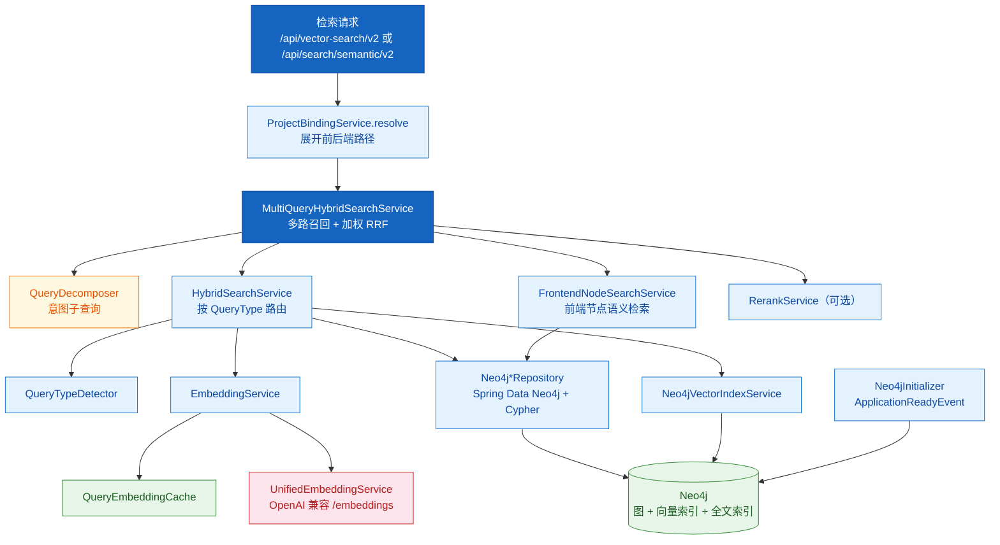
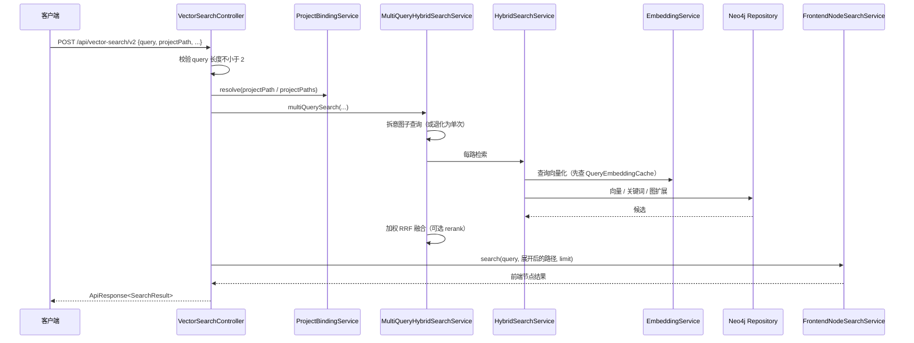

# Neo4j 图存储与检索

> 自动生成于 2026-11-26，基于 `99d0037` 版本

| 属性 | 值 |
|------|-----|
| **所属层** | 基础设施层（图模型与仓储）+ 领域服务层（检索） |
| **目录** | `neo4j/`（60 个文件：`config` 3、`controller` 2、`model` 29、`repository` 15、`service` 11） |
| **核心类** | `Neo4jInitializer`、`Neo4jMethodNodeRepository`、`HybridSearchService`、`MultiQueryHybridSearchService`、`QueryTypeDetector`、`Neo4jVectorIndexService`、`EmbeddingService` |
| **REST 基础路径** | `/api/vector-search`（2 个端点）、`/api/search`（5 个端点）；两段路径都不经过登录拦截 |
| **存储** | Neo4j（图 + 原生向量索引） |

---

## 1. 模块概述

### 1.1 职责定义

**核心职责**：定义知识图谱的节点与关系模型，提供 Spring Data Neo4j 仓储与 Cypher 查询，并在其上实现「按查询类型路由 + 多路召回 + 加权 RRF 融合 + 可选重排」的混合检索。

| 本模块负责 | 本模块不负责 | 由谁负责 |
|-----------|-------------|---------|
| `@Node` 实体、Repository、投影接口 | 把源码解析成节点并写入 | [知识图谱构建](./知识图谱构建.md) |
| 启动时建约束与索引 | Neo4j 的连接与事务管理器 | [应用启动与全局配置](./应用启动与全局配置.md) |
| 查询类型识别、多路召回、RRF 融合、重排 | 查询分解所用的 LLM 调用 | `ram.nodes.impact.QueryDecomposer` |
| 查询向量化与缓存 | 向量模型的 HTTP 调用 | `service/UnifiedEmbeddingService`（直连，不经 pi） |
| 前端节点语义检索 | 前后端项目绑定的管理 | [知识图谱构建](./知识图谱构建.md) 的 `binding` 子包 |

### 1.2 与旧描述不同的事实

| 旧说法 | 代码现状 |
|-------|---------|
| 节点标签为 `MethodNode` / `EntryPointNode` / `SqlNode` | 标签是 `Method` / `EntryPoint` / `Sql`；`*Node` 只是 Java 类名 |
| 有 `publicProjectPath`「公共图谱」范围键 | 该属性已退役：`Neo4jInitializer` 启动时删除相关索引并 `REMOVE n.publicProjectPath` |
| 向量索引名为 `idx_method_description_embedding` 等 | 现为 `method_description_vector_index` 等 10 个，见第 4 节 |
| 混合检索入口是 `POST /api/vector-search/search` | 现为 `POST /api/vector-search/v2` 与 `POST /api/search/semantic/v2` |
| `SearchErrorCode` 有 `EMBED_FAILED`、`INDEX_NOT_FOUND` | 现有 5 个取值，见第 8 节 |
| `QueryType` 有 9 个取值 | 枚举有 10 个 |

---

## 2. 模块架构

---

## 3. 图模型

### 3.1 节点标签（15 个 `@Node`）

| 标签 | Java 类 | 主键属性 | 说明 |
|------|--------|---------|------|
| `Method` | `MethodNode` | `nodeId` | 方法：最小代码单元 |
| `Class` | `ClassNode` | `classId` | 类，带分层角色 `classRole` |
| `EntryPoint` | `EntryPointNode` | `entryId` | 入口点（HTTP / 定时 / MQ 等），关联 `methodNodeId` |
| `Sql` | `SqlNode` | `nodeId` | MyBatis SQL 语句 |
| `Service` | `ServiceNode` | `serviceId` | 服务 |
| `DataModel` | `DataModelNode` | `nodeId` | 数据模型（DTO / 实体） |
| `ModuleNode` | `ModuleNode` | `moduleId` | 构建模块或包：`level` 为 `build-module` / `package`，带 `layerRole`、`instability` |
| `DomainNode` | `DomainNode` | `domainId` | 图谱社区检测得到的领域 |
| `Component` | `ComponentNode` | `componentId` | 前端组件 |
| `ApiClient` | `ApiClientNode` | `apiClientId` | 前端 API 客户端 |
| `FrontendRoute` | `FrontendRouteNode` | `frontendRouteId` | 前端路由 |
| `LogChunk` | `LogChunkNode` | `nodeId` | 日志块（相似日志检索） |
| `ChurnNode` | `ChurnNode` | `nodeId` | 文件变更频率与风险分 |
| `GenerationCheckpoint` | `GenerationCheckpointNode` | `checkpointId` | 全量构建检查点（`lastCommit` / `lastBranch`） |
| `AggregationCheckpoint` | `AggregationCheckpoint` | `checkpointId` | 聚合阶段检查点（`stageName` / `dataHash` / `status`） |

### 3.2 关系类型

下表为代码 Cypher 中出现的关系及可确认的两端：

| 关系 | 起点 → 终点 | 相关索引 / 说明 |
|------|-----------|---------------|
| `CALLS` | `Method` → `Method` | 调用 |
| `HAS_METHOD` | `Class` → `Method` | 类含方法 |
| `IMPLEMENTS` | `Method` → `Method` | 实现方法 → 接口方法 |
| `OVERRIDE` / `EXTENDS` / `PROXY` | 子 → 父 / 代理 → 目标 | 方法级覆写、继承、代理 |
| `EXECUTES_SQL` | `Method` → `Sql` | 方法执行 SQL |
| `USES_MODEL` | `Method` → `DataModel` | 方法使用数据模型 |
| `HAS_ENTRY` | `Service` → `EntryPoint` | 服务含入口 |
| `BELONGS_TO` | `Domain` → `Class` | 领域聚合（三层：Domain → Class → Method） |
| `INTERACTS_WITH` | 领域 → 领域 | 跨领域调用权重 |
| `DEPENDS_ON` | `ModuleNode` → `ModuleNode` | 模块 / 包依赖 |
| `CONTAINS` | `ModuleNode` → `MethodNode` | 支持 DSM 下钻到包内方法；也是 codegraph 写入的前端关系之一 |
| `INVOKES` | `Component` → `ApiClient` | 前端组件调用 API 客户端 |
| `INVOKES_API` | `ApiClient` → `EntryPoint` | 前端 API 客户端调用后端入口 |
| `IMPORTS` / `REFERENCES` | codegraph 写入的前端关系 | `Neo4jInitializer` 为三者建 `projectPath` 关系索引 |

### 3.3 关键节点字段

**`Method`**：`nodeId`、`className`、`methodName`、`signature`、`filePath`、`startLine` / `endLine`、`complexity`、`codeHash`、`comment`、`description`、`descriptionEmbedding`、`codeEmbedding`、`thrownExceptions`、`caughtExceptions`、`methodBody`、`packageName`、`serviceName`、`projectPath`、`language`、`framework`、`inDegree` / `outDegree`、`riskScore`、`communityId`。

**`Class`**：`classId`、`className`、`packageName`、`classRole`（`CONTROLLER` / `SERVICE` / `REPOSITORY` / `MODEL` / `UTILITY` / `UNKNOWN`）、`classRoleSource`、`methodCount`、`filePath`、`signature`、`classComment`、`description`、`descriptionEmbedding`、`projectPath`、`language`、`framework`。

**`EntryPoint`**：`entryId`、`entryKey`、`entryType`、`entryInfo`、`methodNodeId`、`serviceName`、`projectPath`、`language`、`framework`、`briefDescription` / `briefEmbedding`、`detailedDescription` / `detailedEmbedding`。

**`Sql`**：`nodeId`、`sqlId`、`statementType`、`sqlStatement`、`parameterType`、`resultType`、`resultMap`、`mapperInterface`、`methodName`、`xmlFilePath`、`projectPath`、`language`、`framework`、`sqlEmbedding`。

**`ModuleNode`**：`moduleId`（`projectPath + ":" + moduleName`）、`moduleName`、`level`、`methodCount`、`classCount`、`entryPointCount`、`avgComplexity`、`inDegree` / `outDegree`、`instability`（出度 / (入度 + 出度)）、`layerRole`、`projectPath`、`language`、`springRoles`、`groupId`、`artifactId`、`version`、`dependencyCoordinates`。

完整字段见 [06-数据模型](../06-数据模型/index.md)。

---

## 4. 约束与索引 `Neo4jInitializer`

`@EventListener(ApplicationReadyEvent.class)`，按以下顺序执行，每条失败只告警、不中断：

| 步骤 | 内容 |
|------|------|
| 1 | 唯一性约束：`Method.nodeId`、`EntryPoint.entryId`、`Service.serviceId`、`LogChunk.nodeId`、`Sql.nodeId`、`ModuleNode.moduleId`、`DomainNode.domainId`、`ChurnNode.nodeId`、`Class.classId`、`Component.componentId`、`ApiClient.apiClientId`、`FrontendRoute.frontendRouteId`、`AggregationCheckpoint.checkpointId` |
| 2 | 存在性约束：`Method.className`、`Method.methodName`、`EntryPoint.entryKey` 非空 |
| 3 | 全文索引：`method_fulltext_index`（`Method` 的 `className` / `methodName` / `signature` / `description`）、`entry_point_fulltext_index`（`EntryPoint` 的 `entryKey` / `entryType`） |
| 4 | 范围索引：`Method` 8 个、`EntryPoint` 5 个、`ModuleNode` 4 个、`ChurnNode` 2 个、`DomainNode` 2 个、`Class` 2 个、`ApiClient` 2 个、`Component` / `FrontendRoute` / `AggregationCheckpoint` 各 1 个；关系 `CONTAINS` / `IMPORTS` / `REFERENCES` 各 1 个 |
| 5 | 向量索引（维度取 `EmbeddingModelConfig.getDimension()`，相似度 cosine） |
| 6 | 删除废弃索引与约束：`method_vector_index`、`method_pub_path`、`entrypoint_pub_path`、`sql_pub_path`、`service_pub_path`、`sql_vector_index`、约束 `service_name_unique` |
| 7 | 回填语句（需幂等）：`REMOVE n.publicProjectPath`；`ModuleNode.layerRole` 的 `DATA` → `MODEL`、`MAPPER` → `REPOSITORY` |

向量索引共 10 个：

| 索引名 | 标签.属性 |
|-------|----------|
| `method_description_vector_index` | `Method.descriptionEmbedding` |
| `method_code_vector_index` | `Method.codeEmbedding` |
| `sql_node_vector_index` | `Sql.sqlEmbedding` |
| `classNode_description_vector_index` | `Class.descriptionEmbedding` |
| `entry_point_brief_vector_index` | `EntryPoint.briefEmbedding` |
| `entry_point_detailed_vector_index` | `EntryPoint.detailedEmbedding` |
| `logEmbedding` | `LogChunk.embedding` |
| `component_description_vector_index` | `Component.descriptionEmbedding` |
| `frontendRoute_description_vector_index` | `FrontendRoute.descriptionEmbedding` |
| `apiClient_description_vector_index` | `ApiClient.descriptionEmbedding` |

源码注释写明：codegraph sidecar 自建的 `interface_vector_index`（384 维）不在本后端的自愈范围内。

---

## 5. 检索

### 5.1 查询类型路由 `QueryTypeDetector` → `HybridSearchService`

`QueryTypeDetector` 用多规则评分取最高分（`MIN_SCORE_THRESHOLD = 4`）。`QueryType` 枚举 10 个取值；`HybridSearchService` 类注释列出的路由策略：

| QueryType | 主策略 |
|-----------|-------|
| `NATURAL_LANGUAGE` | `descriptionEmbedding` 向量检索 + 图扩展 |
| `METHOD_NAME` | `methodName` 模糊匹配 + 向量补充 + 图扩展 |
| `FULL_QUALIFIED_NAME` | `className` + `methodName` 精确匹配 + 图扩展 |
| `CLASS_NAME` | `className` 精确 / 模糊匹配 + 图扩展 |
| `SQL_SNIPPET` | `sqlEmbedding` 向量检索 → `EXECUTES_SQL` 反查 |
| `HTTP_URI` | `entryKey` 模糊匹配 → `methodNodeId` 关联 |
| `CODE_SNIPPET` | `codeEmbedding` 向量检索 + 图扩展 |
| `ANNOTATION` | `methodBody` / `comment` 包含匹配 |
| `EXCEPTION_TYPE` | `thrownExceptions` / `caughtExceptions` 包含匹配 |

第 10 个取值 `FULL_QUALIFIED_CLASS_NAME` 在枚举中存在，未出现在该注释的策略表里。

`HybridSearchService` 常量：`RRF_K = 60`、`DEFAULT_TOP_K = 10`、`DEFAULT_GRAPH_DEPTH = 2`、`SIMILARITY_THRESHOLD = 0.5`、`RELAXED_SIMILARITY_THRESHOLD = 0.3`、`CONTEXT_LIMIT = 3`、`VECTOR_INDEX_TOPK_MULTIPLIER = 20`。

### 5.2 多路召回与加权融合 `MultiQueryHybridSearchService`

把查询拆成多个带意图类型的子查询，分别检索后用加权 RRF 聚合；`QueryDecomposer` 不可用或只有 1 个子查询时退化为单次检索。默认 `limit` 为 10。

| 机制 | 说明 |
|------|------|
| 意图类型 `IntentType` 与权重 | `GENERAL` 1.0、`SCHEDULE` 2.0、`HTTP` 2.0、`SQL` / `EXCEPTION` / `LISTENER` / `CONFIG` / `AUTH` / `TRANSACTION` 各 1.8、`KEYWORD_SUPPLEMENT` 0.1（`application.yml` 注释给出的公式：`w_eff = 1 + α·ln(w_raw / w_base)`） |
| 注解加分 | 方法节点含关联注解（如 `@Scheduled`）时加分 |
| 被调方权重传播 | 入口方法的高权重按比例传给它调用的方法 |
| 显式检索类型 `SearchType` | `METHOD`（`Method.descriptionEmbedding`）、`CLASS`（`Class.descriptionEmbedding`）、`SQL`（`Sql.sqlEmbedding`）、`ENTRY`（`EntryPoint.briefEmbedding`）、`ALL`（四路合并）；请求未给时回退 `QueryTypeDetector` |

`QueryDecomposer` 的模型调用顺序：`UnifiedTextService` → `AgentLlmClient`（经 pi）→ 规则切分。该类的 Javadoc 仍写「Claude 不可用时回退 GLM」，与实际顺序相反，属注释过期。

### 5.3 其他检索组件

| 组件 | 职责 |
|------|------|
| `EmbeddingService` | 门面，委托 `service/UnifiedEmbeddingService`（OpenAI 兼容 `/embeddings`） |
| `QueryEmbeddingCache` | Caffeine 缓存查询向量：最多 1000 条、1 小时过期、key 为查询文本的 MD5 |
| `TokenRouter` | 判断每个分词走 `descriptionEmbedding` 还是 `codeEmbedding` |
| `Neo4jVectorIndexService` | 检测 Neo4j 版本；≥ 5.11 建向量索引并等待上线（每 2 秒轮询、最多 120 秒）；否则标记不可用，查询降级为全表扫描。带 `@ConditionalOnProperty(name = "neo4j.uri")` |
| `RerankService` | 调 OpenAI 兼容 `/rerank` 端点精排；连接超时 3 秒、读超时 5 秒；任何异常返回空结果，按 RRF 原序返回 |
| `FrontendNodeSearchService` | 在绑定展开后的路径集合内对 `Component` / `FrontendRoute` / `ApiClient` 做描述向量检索，映射为带 `nodeType` 的 `SearchResultItem`（阈值 0.3） |
| `ProxyVectorService` | 为方法生成代理向量的输入文本（最长 500 字符） |
| `GraphEmbeddingService` | 经 Neo4j GDS 训练 GraphSAGE 图嵌入：图名 `callGraph`、模型名 `callGraphSage`、默认维度 384 |

### 5.4 检索流程

---

## 6. REST 端点

`/api/vector-search/**` 与 `/api/search/**` 被排除在登录拦截器之外。

| 方法 | 路径 | 说明 |
|------|------|------|
| POST | `/api/vector-search/v2` | 混合检索。请求体 `SearchRequest`：`query`（必填，至少 2 字符）、`projectPath`（必填）、`limit`、`graphDepth`、`projectPaths`（多项目时优先）、`language`、`searchType`。返回 `ApiResponse<SearchResult>` |
| GET | `/api/vector-search/diagnose/{projectPath}` | 检索诊断，可用 `testQuery` 做一次向量化验证 |
| POST | `/api/search/semantic/v2` | 语义搜索（多路召回 + RRF），请求体为 Map；返回 `Map` |
| GET | `/api/search/history` | 搜索历史，`limit` 默认 20，可按 `projectPath` 过滤；每个项目最多保留 20 条 |
| GET | `/api/search/node/{nodeId}` | 代码节点详情 |
| GET | `/api/search/node/{nodeId}/relations` | 节点关系 |
| GET | `/api/search/suggestions` | 搜索建议，`query` 必填，`limit` 默认 5 |

---

## 7. 配置项

| 键 | `application.yml` 取值 | 说明 |
|----|------------------------|------|
| `search.intent-weights.*` | 见 5.2 | 各意图类型的原始权重 |
| `search.rrf.k` | `60` | RRF 的 k |
| `search.rrf.log-scale-alpha` / `log-scale-base` | `0.5` / `1.0` | 权重对数缩放参数 |
| `search.rrf.max-multi-hit-ratio` | `2.0` | 多路命中归一化上限系数 |
| `search.rrf.callee-propagation-ratio` | `0.3` | 被调方权重传播比例 |
| `search.rrf.annotation-bonus-score` | `0.5` | 注解命中加分 |
| `search.rrf.dual-channel-threshold` | `0.7` | 低置信度双通道阈值 |
| `search.rrf.required-word-filter-enabled` | `true` | 专用通道必选词过滤 |
| `search.rerank.enabled` / `base-url` / `model` / `api-key` | `false` / 空 | 外部重排；环境变量 `RERANK_BASE_URL`、`RERANK_MODEL`、`RERANK_API_KEY` |
| `embedding.*` | 仅 `api-key` 在本机文件中给 | 向量模型；代码默认 `dimension = 4096`，决定向量索引维度 |
| `neo4j.*` | 见 [应用启动与全局配置](./应用启动与全局配置.md) | 连接与数据库 |

---

## 8. 错误处理

`SearchException` 携带 `SearchErrorCode`，由全局异常处理按错误码的 HTTP 状态返回：

| 错误码 | HTTP | 用户提示 |
|-------|------|---------|
| `QUERY_TOO_SHORT` | 400 | 搜索内容过短，请输入至少 2 个字符 |
| `EMBEDDING_SERVICE_UNAVAILABLE` | 503 | 语义搜索暂时不可用，已切换到关键词搜索 |
| `GRAPH_SERVICE_ERROR` | 500 | 图谱服务异常，请稍后重试 |
| `TIMEOUT` | 504 | 搜索超时，请尝试简化搜索条件 |
| `UNKNOWN_ERROR` | 500 | 搜索服务异常，请稍后重试 |

| 场景 | 处理 |
|------|------|
| Neo4j 版本低于 5.11 | 不建向量索引，查询降级为全表扫描 |
| 向量索引未上线 | 轮询等待，最多 120 秒 |
| 重排端点异常 | 返回空结果，保持 RRF 原序 |
| 约束 / 索引创建失败 | 逐条告警，继续执行其余语句 |

---

## 9. 已知问题与扩展点

| 问题 | 说明 |
|------|------|
| 检索接口不要求登录 | 两段路径被排除在拦截器之外 |
| 仓储类体积大 | `Neo4jMethodNodeRepository` 约 2300 行、`HybridSearchService` 约 1850 行 |
| 注释与枚举不一致 | `QueryTypeDetector` 注释写「9 种」，`QueryType` 枚举为 10 个 |
| 图嵌入依赖 GDS 插件 | `GraphEmbeddingService` 需要 Neo4j GDS |
| 向量模型与索引维度绑定 | 维度来自 `embedding.dimension`，切换模型需重建向量索引并重新生成向量 |

| 扩展点 | 方式 |
|-------|------|
| 新增节点类型 | 新增 `@Node` 实体与 Repository，在 `Neo4jInitializer` 补约束与索引 |
| 新增向量检索面 | 在 `VECTOR_INDEX_SPECS` 增加一项，并在对应 Repository 写向量查询 |
| 调整融合权重 | 改 `search.intent-weights.*` 与 `search.rrf.*`，无需改代码 |

---

## 10. 依赖关系

| 方向 | 依赖 | 用途 |
|------|------|------|
| 上游 | [应用启动与全局配置](./应用启动与全局配置.md) | Driver、事务管理器、类型转换 |
| 上游 | `service/UnifiedEmbeddingService` | 向量化（直连） |
| 上游 | `ram.nodes.impact.QueryDecomposer` | 查询分解 |
| 上游 | `knowledgegraph.binding.service.ProjectBindingService` | 路径展开 |
| 下游 | [知识图谱构建](./知识图谱构建.md) | 节点写入与聚合落库 |
| 下游 | [影响分析与风险评估](./影响分析与风险评估.md)、[RAM需求评估](./RAM需求评估.md)、[日志云与运维](./日志云与运维.md)、[架构诊断](./架构诊断.md) | 检索与图查询 |
| 下游 | `hisi-mcp-server` 的 `hybrid_search` 等工具 | 经后端检索接口间接使用（工具清单见 [pi-agent底座](./pi-agent底座.md)） |

---

> **相关文档**：
> - 架构总览 → [02-架构设计](../02-架构设计/index.md)
> - 图谱写入 → [知识图谱构建](./知识图谱构建.md)
> - 检索数据流 → [04-数据流程](../04-数据流程/index.md)
> - 节点与关系全表 → [06-数据模型](../06-数据模型/index.md)
