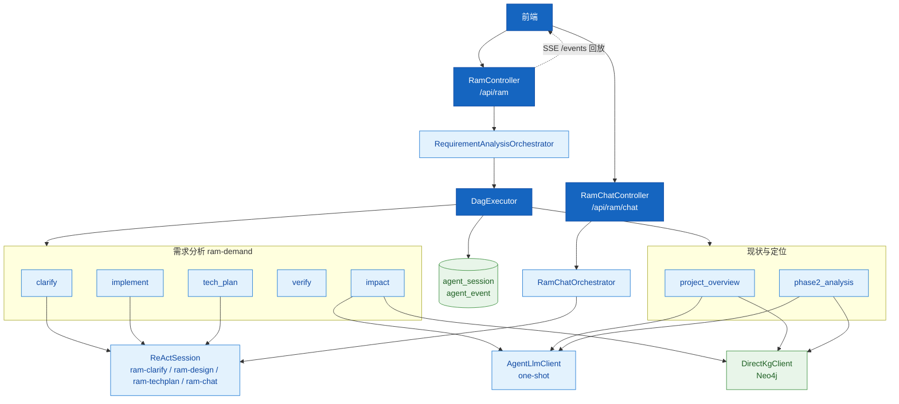
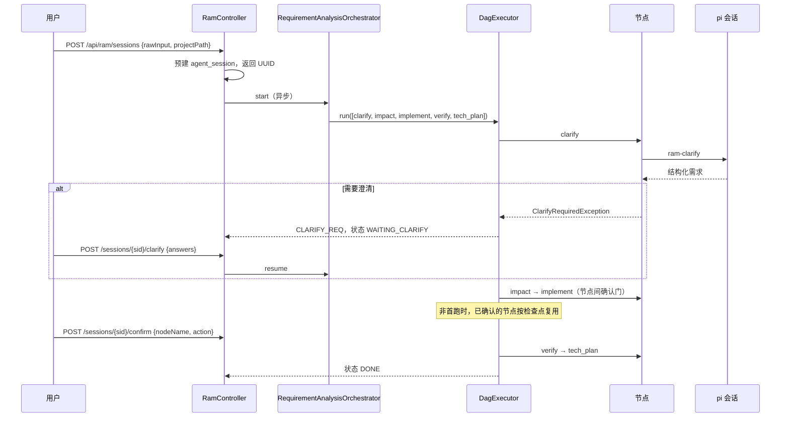

# RAM 需求评估

> 自动生成于 2026-11-26，基于 `99d0037` 版本

| 属性 | 值 |
|------|-----|
| **所属层** | 应用层（DAG 编排与 SSE 入口）+ 领域服务层（分析节点） |
| **目录** | `ram/`（95 个文件：`chat` / `config` / `contract` / `controller` / `hitl` / `kg` / `mcp` / `model` / `nodes` / `orchestrator` / `registry` / `repository` / `sdk` / `service`） |
| **核心类** | `RamController`、`RamChatController`、`RamChatOrchestrator`、`RequirementAnalysisOrchestrator`、`ClarifyNode`、`ImpactNode`、`ImplementNode`、`VerifyNode`、`TechPlanNode` |
| **REST 基础路径** | `/api/ram`（27 个端点，不经过登录拦截） |
| **工作流** | `ram-demand`、`ram-status`、`ram-phase2` |
| **SQLite 表** | `agent_session`、`agent_event`（被全部 agent 类流程共用） |

---

## 1. 模块概述

### 1.1 职责定义

**核心职责**：把一段需求描述或项目问题变成结构化分析——需求澄清、影响面、实现方案、技术方案，或项目现状报告与精准定位；过程中可在关键节点停下等人澄清或确认。

| 本模块负责 | 本模块不负责 | 由谁负责 |
|-----------|-------------|---------|
| 需求分析 DAG 的节点与编排 | DAG 的机械执行 | [工作流引擎](./工作流引擎.md) 的 `DagExecutor` |
| 澄清 / 影响 / 实现 / 验证 / 技术方案的提示词与结果归一化 | 模型与工具的执行 | [pi-agent底座](./pi-agent底座.md) |
| 项目现状分析、Phase2 精准定位 | 图谱数据 | [知识图谱构建](./知识图谱构建.md) |
| 会话事件表与 UUID 映射（供各流程共用） | SSE 的通用实现 | [工作流引擎](./工作流引擎.md) |
| RAM 对话助手（多轮，可发起分析） | — | — |

### 1.2 核心文件清单

| 文件 | 类型 | 职责 |
|------|------|------|
| `controller/RamController.java` | REST + SSE | 需求分析会话的启动、续跑、澄清、确认、中止、导出 |
| `controller/RamStatusController.java` | REST | 项目现状分析；类上标 `@deprecated`，由对话接口取代 |
| `controller/RamPhase2Controller.java` | REST | Phase2 精准定位 |
| `chat/RamChatController.java` 等 | REST + WS | 多轮对话式助手 |
| `orchestrator/RequirementAnalysisOrchestrator.java` | 编排 | `start` 建会话并跑节点链；`resume` 记录澄清后重跑 |
| `nodes/ClarifyNode.java`、`ImplementNode.java`、`TechPlanNode.java`、`VerifyNode.java` | DAG 节点 | 需求分析链的 4 个确定性 / LLM 节点 |
| `nodes/impact/*`（16 个文件） | DAG 节点与子组件 | `ImpactNode` 及影响环解析、查询分解、风险评分 |
| `nodes/ProjectOverviewNode.java`、`Phase2AnalysisNode.java` | DAG 节点 | 现状分析、Phase2 |
| `nodes/impl/*LlmClient.java`（8 个） | LLM 客户端 | pi 实现、基类、Stub |
| `nodes/Phase2LlmClient.java`、`ProjectOverviewLlmClient.java` | LLM 客户端 | 现状与 Phase2 的生成 |
| `mcp/RamMcpServer.java`、`mcp/tools/*` | 进程内工具 | 需求分析类工具的派发 |
| `kg/impl/DirectKgClient.java` | KG 访问 | 直接调用内部 Neo4j 服务 |
| `contract/SchemaValidator.java` | 契约校验 | JSON Schema（draft-07）校验，被全部 ReAct agent 复用 |
| `registry/AgentRegistry.java` | 注册表 | 读取 `ram/agents.yaml`（与 `agentbase.AgentRegistry` 不是同一个类） |
| `hitl/HitlQueue.java` | 内存队列 | 澄清问题与用户答案 |
| `service/SessionMappingService.java` | 服务 | 前端 UUID ↔ 后端会话 ID |
| `config/RamSchemaInitializer.java` | 建表 | `agent_session`、`agent_event` |

---

## 2. 模块架构

---

## 3. 三条工作流

| 工作流 | 节点链 | policy | 入口 |
|-------|-------|--------|------|
| `ram-demand` | `clarify` → `impact` → `implement` → `verify` → `tech_plan` | `hitlNodes = [clarify, impact, implement]` | `POST /api/ram/sessions` |
| `ram-status` | `project_overview` | `skipHitl`、`emitNodeEvents` | `POST /api/ram/status/start` |
| `ram-phase2` | `phase2_analysis` | `skipHitl`、`emitNodeEvents` | `POST /api/ram/status/phase2/start` |

### 3.1 节点说明

| 节点 | 类型 | 做什么 |
|------|------|-------|
| `clarify` | LLM | 读 `userRequirement`（必填），由 LLM 抽取结构化需求并按 `clarify.output` 契约校验；校验不过或模型标记需澄清时抛 `ClarifyRequiredException`，会话停在 `WAITING_CLARIFY` |
| `impact` | 确定性 + LLM | 输出面向工程师的影响面：`methods_to_modify`、`affected_entries`、`risk`、`validation`、`reasoning`、`markdown_report` |
| `implement` | LLM | 起草业务 / 界面 / 技术方案，按 `implement.output` 契约校验；不通过是硬错误 |
| `verify` | 确定性 | 对 `impact` 与 `implement` 的产出做 6 项交叉检查（见 3.2） |
| `tech_plan` | LLM | 待改方法明细、时序 / 流程图、测试范围，按 `tech_plan.output` 契约校验 |
| `project_overview` | 确定性 + LLM | 采集图谱数据，生成面向新人的项目现状报告 |
| `phase2_analysis` | 确定性 | 按用户的追问采集深层图谱数据，输出 `Phase2Context` |

### 3.2 `VerifyNode` 的 6 项检查

| 检查项 | 内容 |
|-------|------|
| `acceptance_criteria_addressed` | 每条验收标准都被业务方案步骤引用 |
| `api_changes_consistent` | 每个直接受影响的入口都有对应的接口变更 |
| `state_changes_complete` | 影响面提到枚举 / 状态变更时，实现方案有状态机变更 |
| `data_migration_covered` | 有状态机变更时必须有迁移说明或数据模型变更 |
| `impact_validation_passed` | 影响面的确定性校验通过 |
| `change_coverage_ratio` | `methods_to_modify` 被接口 / 状态 / 数据变更覆盖的比例 |

### 3.3 `Phase2AnalysisNode` 的 8 步

关键词抽取（LLM）→ 领域推断 → 多关键词混合检索（去重，上限 30）→ 上游调用链（`maxDepth=5`）→ 下游调用链（`maxDepth=5`）→ 入口点溯源 → 加载方法体（上限 20）→ 桥接点识别（Feign / MQ / Mapper）。

### 3.4 影响面子组件 `nodes/impact/`（16 个文件）

| 组件 | 职责（据类注释） |
|------|------|
| `QueryDecomposer` | 把需求意图拆成带意图类型的子查询 |
| `MultiQuerySearcher` | 对每个子查询做混合检索，用加权 RRF 合成一份种子列表：`score(d) = Σ w_eff / (K + rank_i(d))` |
| `MethodTargetResolver` | 把澄清输出里的 `target_methods`（形如 `ClassName#methodName`）解析为带 Neo4j `nodeId` 的 `MethodTarget` |
| `ScopeNarrowingService` | 把关：加载候选方法源码，由 LLM 判断是否与需求真正相关；LLM 不可用时返回原候选列表 |
| `InvolvedRing` / `InvolvedRingResolver` | 最内层影响环：直接牵涉的节点（种子 + 入口 + 实现） |
| `ModifiedRing` / `ModifiedRingResolver` | 中间层：沿各种子的被调树需要修改的方法 |
| `ImpactRing` / `ImpactRingResolver` | 最外层：受修改影响的节点（上游、下游、桥接） |
| `AffectedEntriesAnnotator` | 标注受影响入口 |
| `RiskScorer`（`RiskLevel` / `RiskScore`） | 0–100 风险分：桥接权重 `min(100, (bridges + crossService) × 20)` 占 50%；扇入 `min(100, max(involved.entries, impact.upstream) × 5)` 占 30%；深度 `100 / max(1, depth)` 占 20% |
| `DeterministicValidator` | 用图谱事实校验 LLM 声称的影响环：声称的入口必须以自身为根入口可达；每个牵涉的实现必须出现在修改环；SQL 字段一致性一项为占位 |

---

## 4. LLM 调用边界

RAM 是 agent 类流程，LLM 层经 pi，但各节点用的入口不同：

| 调用 | 入口 | 清单与契约 |
|------|------|-----------|
| 澄清 | `PiClarifyLlmClient`（`@Primary`，继承 `ClaudeClarifyLlmClient`）→ `ReActSession.run`，取声明 `ram-clarify` | 清单 `ram`；契约 `clarify.output`；失败回退 `StubClarifyLlmClient` |
| 实现方案 | `PiImplementLlmClient`（`@Primary`，继承 `ClaudeImplementLlmClient`），声明 `ram-design` | 清单 `ram`；契约 `implement.output`；失败回退 `StubImplementLlmClient` |
| 技术方案 | `PiTechPlanLlmClient`（`@Primary`，继承 `ClaudeTechPlanLlmClient`），声明 `ram-techplan` | 清单 `ram`；契约 `tech_plan.output` |
| RAM 对话 | `RamChatOrchestrator`，声明 `ram-chat` | 清单 `ram-act`（只读 + 5 个动作工具，带用户令牌） |
| 现状报告、Phase2 生成、受影响入口标注、范围收敛 | `AgentLlmClient` | 清单 `one-shot`（无工具、关闭思考） |
| 查询分解 | `QueryDecomposer` | **首选 `UnifiedTextService`（直连 GLM）**，其次 `AgentLlmClient`，最后规则切分 |

`Claude*` 三个类已不带 Spring bean 注解，只保留提示词与结果归一化供 pi 版继承。其中 `ClaudeImplementLlmClient` 的 Javadoc 仍写「Spring AI ChatClient」，属注释过期。`QueryDecomposer` 的类 Javadoc 写「Claude 不可用时回退 GLM」，与实际顺序相反。

---

## 5. 会话与事件

| 项目 | 说明 |
|------|------|
| 会话表 | `agent_session`：`status`、`current_node`、`uuid`（对外句柄）、`project_paths`、`rerun_from_node`、`session_type`、`source_branch` / `target_branch` 等 |
| 事件表 | `agent_event`：`session_id` + `seq` 唯一、`type`、`payload`、`idempotency_key` 唯一、`inputs_hash`、`clarify_round_no`、`circuit_state`、`validator_status`、`turn_id` 等 |
| 对外句柄 | 前端只看到 UUID；`SessionMappingService` 负责与后端自增 ID 的映射 |
| 状态机 | `RUNNING` → `WAITING_CLARIFY` / `WAITING_HITL` → `DONE` / `FAILED` / `ABORTED`（执行细节见 [工作流引擎](./工作流引擎.md)） |
| 澄清轮次 | `CLARIFY_REQ` 事件带 `clarifyRoundNo`，可按轮重跑 |

---

## 6. REST 端点

`/api/ram/**` 被排除在登录拦截器之外，读写都不要求登录。

### 6.1 需求分析 `/api/ram`

| 方法 | 路径 | 说明 |
|------|------|------|
| POST | `/api/ram/sessions` | 创建需求评估会话，异步启动 DAG，返回会话 UUID |
| GET | `/api/ram/sessions` | 最近的会话列表 |
| GET | `/api/ram/sessions/{sid}` | 会话信息（状态、当前序号、是否待澄清） |
| GET | `/api/ram/sessions/{sid}/stream` | SSE 事件流，支持 `afterSeq`（`text/event-stream`） |
| GET | `/api/ram/sessions/{sid}/events` | 回放全部事件 |
| POST | `/api/ram/sessions/{sid}/clarify` | 提交澄清答案 |
| POST | `/api/ram/sessions/{sid}/resume` | 恢复暂停的会话 |
| POST | `/api/ram/sessions/{sid}/confirm` | 节点确认（approve / reject / edit） |
| POST | `/api/ram/sessions/{sid}/nodes/tech-plan` | 手动触发技术方案节点 |
| POST | `/api/ram/sessions/{sid}/abort` | 中止 |
| POST | `/api/ram/sessions/{sid}/rerun-from/{nodeName}` | 从指定节点重跑 |
| GET | `/api/ram/sessions/{sid}/clarify-rounds` | 澄清轮次列表 |
| POST | `/api/ram/sessions/{sid}/rerun-from-round/{roundNo}` | 从指定澄清轮重跑 |
| GET | `/api/ram/sessions/{sid}/export/md` | 导出为 Markdown |
| GET | `/api/ram/health` | 健康检查 |

### 6.2 现状与 Phase2

| 方法 | 路径 | 说明 |
|------|------|------|
| POST | `/api/ram/status/start` | 启动项目现状分析 |
| GET | `/api/ram/status/{sid}/report` | 最新 `project_overview` 检查点输出 |
| POST | `/api/ram/status/phase2/start` | 启动 Phase2 精准定位 |
| GET | `/api/ram/status/phase2/{sid}/report` | 最新 `phase2_analysis` 检查点输出 |

`RamStatusController` 类上标有 `@deprecated`：新架构用多轮对话（`/api/ram/chat/*`）取代两阶段 REST 端点，但端点仍然注册。

### 6.3 对话 `/api/ram/chat`

| 方法 | 路径 | 说明 |
|------|------|------|
| POST | `/api/ram/chat/sessions` | 创建对话会话 |
| POST | `/api/ram/chat/{sid}/messages` | 发送消息 |
| GET | `/api/ram/chat/{sid}/events` | 事件 |
| GET | `/api/ram/chat/sessions` | 会话列表 |
| PATCH | `/api/ram/chat/{sid}/title` | 重命名 |
| DELETE | `/api/ram/chat/{sid}` | 删除会话 |
| POST | `/api/ram/chat/{sid}/inject` | 轮次进行中插入消息：打断当前轮，记 `TURN_INTERRUPTED` 并保留已产出的部分文本，再开新一轮；成功返回 202 |
| POST | `/api/ram/chat/{sid}/interrupt` | 中断当前轮 |

对话的流式回复经 WebSocket `/ws/ram-chat`（或 `/ws/ram-chat/{sid}`）推送，协议见 [终端与WebSocket](./终端与WebSocket.md)。

---

## 7. 进程内工具 `mcp/`

`RamMcpServer` 是进程内的门面：把工具调用派发给 Spring 自动发现的 `McpTool` 实现。它不是独立的 MCP 服务端；独立的 `hisi-mcp-server` 是另一个子项目。

| 工具 | 类 |
|------|-----|
| `analyze_requirement` | `AnalyzeRequirementTool` |
| `resume_session` | `ResumeSessionTool` |
| `submit_clarification` | `SubmitClarificationTool` |
| `submit_confirmation` | `SubmitConfirmationTool` |

`RamDagNodes` 把节点名映射到节点实例；`ExecutionResultMapper` 把执行结果转成工具响应。

---

## 8. 配置项

| 键 | 默认值 | 说明 |
|----|-------|------|
| `ram.sse.pool-size` | `2` | `RamController` 的 SSE 轮询线程池大小 |
| `ram.sse.poll-interval-ms` | `500`（yml）/ `3000`（WorkflowController 代码默认） | SSE 轮询间隔 |
| `ram.sse.timeout-ms` | `300000` | SSE 超时（由 `WorkflowController` 读取） |
| `ram.chat.timeout-seconds` | `300` | 对话轮次超时 |
| `ram.registry.path` | `ram/agents.yaml` | `ram.registry.AgentRegistry` 读取的清单 |
| `piagent.flows.ram` | `false` | 代码中未发现读取方 |

契约 schema 文件：`resources/schemas/ram/` 下的 `clarify.input.json`、`clarify.output.json`、`impact.output.json`、`implement.output.json`、`tech_plan.output.json`、`verify.output.json`。

---

## 9. 错误处理

| 场景 | 处理 |
|------|------|
| 需要澄清 | 节点抛 `ClarifyRequiredException`，会话 `WAITING_CLARIFY` |
| `implement` 契约校验不过 | 硬错误，会话 `FAILED` |
| 节点执行异常 | 记 `ERROR` 事件，会话 `FAILED` |
| 用户中止 | 会话 `ABORTED` |
| pi 未就绪 | 澄清 / 实现回退到 Stub；一次性调用方走确定性降级 |
| 对话注入时会话不存在 | 404；参数错误 400 |

---

## 10. 已知问题与扩展点

| 问题 | 说明 |
|------|------|
| 两个同名 `AgentRegistry` | `agentbase.AgentRegistry`（agent 与工作流声明）与 `ram.registry.AgentRegistry`（读 `agents.yaml`）并存，阅读时易混 |
| `HitlQueue` 为内存态 | 源码注释写明持久化留待后续阶段 |
| 现状 / Phase2 控制器已废弃但仍在路由 | 类上标 `@deprecated` |
| 多处 Javadoc 过期 | `ClaudeImplementLlmClient` 仍写「Spring AI ChatClient」；`QueryDecomposer` 的回退顺序与代码相反；`StubClarifyLlmClient` 仍称 `ClaudeClarifyLlmClient` 是 `@Primary` |
| `/api/ram/**` 不要求登录 | 写接口同样放行 |

| 扩展点 | 方式 |
|-------|------|
| 新增节点 | 实现 `DagNode` bean，并在 `agentbase.AgentRegistry` 的工作流声明中加入 |
| 新增澄清轮次能力 | 复用 `clarifyRoundNo` 与 `rerun-from-round` 端点 |

---

## 11. 依赖关系

| 方向 | 依赖 | 用途 |
|------|------|------|
| 上游 | [pi-agent底座](./pi-agent底座.md) | `ReActSession`、`AgentLlmClient`、声明与清单 |
| 上游 | [工作流引擎](./工作流引擎.md) | `DagExecutor`、`ExecutionPolicy` |
| 上游 | [Neo4j图存储与检索](./Neo4j图存储与检索.md)、[知识图谱构建](./知识图谱构建.md) | 图谱查询与检索 |
| 上游 | `service/UnifiedTextService` | `QueryDecomposer` 首选（直连） |
| 下游 | [合并影响分析](./合并影响分析.md)、[日志云与运维](./日志云与运维.md)、[工作台与自动修复](./工作台与自动修复.md)、[工作流引擎](./工作流引擎.md) | 共用 `agent_session` / `agent_event`、`SessionMappingService`、`SchemaValidator` |
| 下游 | `hisi-mcp-server` 的 `act_*` 工具 | 回调 RAM 的启动 / 澄清 / 确认接口 |

---

> **相关文档**：
> - 架构总览 → [02-架构设计](../02-架构设计/index.md)
> - 会话与事件表结构 → [06-数据模型](../06-数据模型/index.md)
> - 需求分析数据流 → [04-数据流程](../04-数据流程/index.md)
