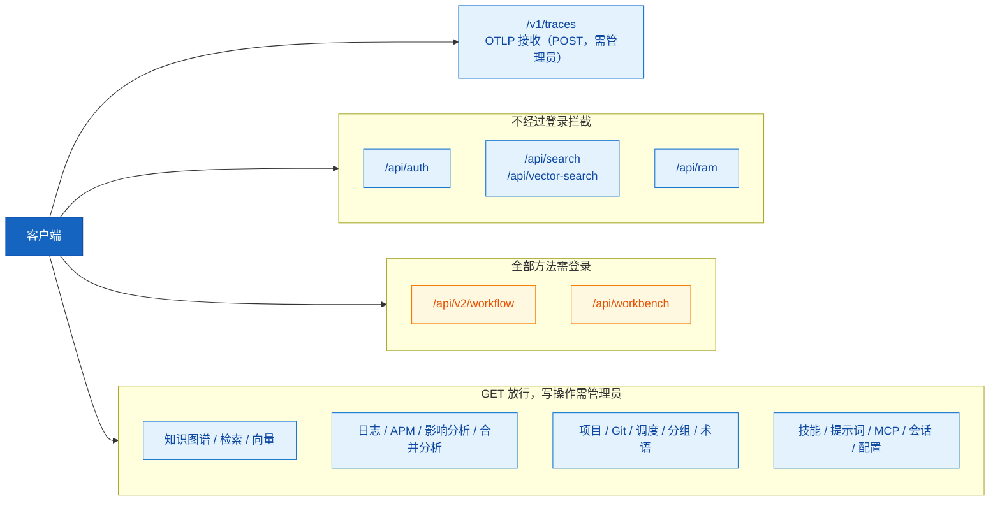
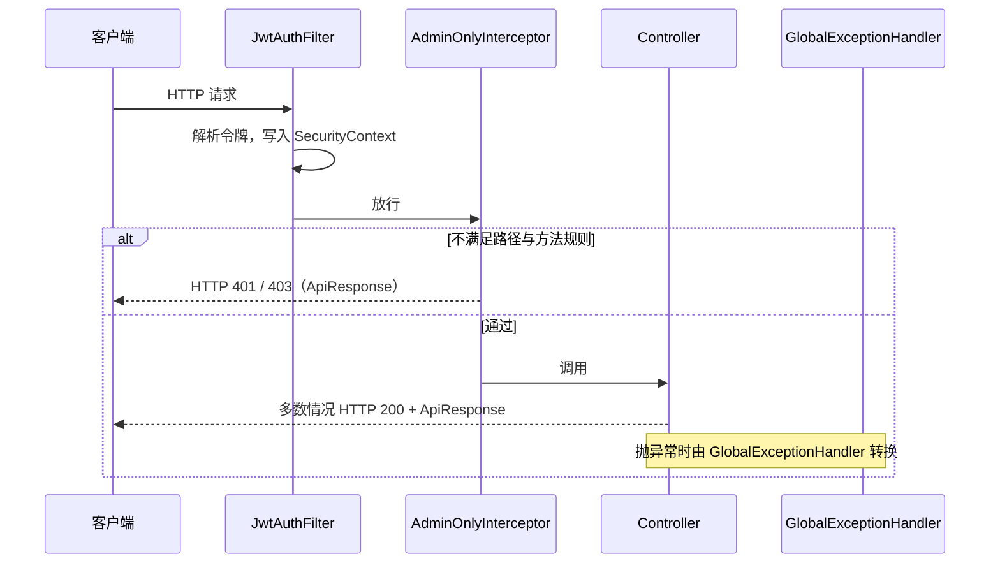

# REST 接口层

> 自动生成于 2026-11-26，基于 `99d0037` 版本；2026-11-28 按 `ecc9370` 更新

| 属性 | 值 |
|------|-----|
| **所属层** | 接入层 |
| **目录** | `controller/`（18 个控制器）+ 各业务包内的控制器（31 个） |
| **规模** | 49 个控制器，359 条方法与路径映射（358 个不同的「方法 + 路径」） |
| **方法分布** | GET 226、POST 109、DELETE 14、PUT 8、PATCH 2 |
| **鉴权分布** | 公开 235、需登录 21、需管理员 103 |

---

## 1. 层职责

**核心职责**：把 HTTP 请求路由到下游服务，统一响应包装、异常处理、鉴权与跨域。

| 约定 | 说明 |
|------|------|
| 注解风格 | 类上 `@RequestMapping`，方法上 `@GetMapping` / `@PostMapping` / `@PutMapping` / `@DeleteMapping` / `@PatchMapping` |
| 依赖注入 | 多为构造注入（`@RequiredArgsConstructor` + `final` 字段） |
| 统一响应 | `model.ApiResponse<T>`：`code`（200 成功）、`message`、`data`；另有 `isSuccess()` |
| 错误语义 | 拦截器产生的 401 / 403 用真实 HTTP 状态码；多数业务接口 HTTP 200、错误看 `code`；参数类异常（`IllegalArgumentException`、缺参、校验失败）是 HTTP 400；未预期异常 HTTP 500 |
| 数值序列化 | `Long` 一律输出为字符串 |
| 鉴权 | 由 `config/AdminOnlyInterceptor` 统一施加，控制器本身不写鉴权代码 |

---

## 2. 响应形态

并非所有接口都包 `ApiResponse`。按代码中的返回类型分四类：

| 形态 | 例子 |
|------|------|
| `ApiResponse<T>` | 绝大多数业务接口 |
| 裸领域对象 | `ImpactPredictionController`（`ResponseEntity<ImpactReport>` 等）、`SemanticSearchController.semanticSearchV2`（`Map`）、`OtlpReceiverController` |
| SSE | `AgentChatController.chat`、`RamController.stream`、`MergeAnalysisController.stream`、`WorkflowController.stream`（均为 `SseEmitter`，`produces = text/event-stream`） |
| 文件下载 | `SessionController.exportSession`、`LogAnalysisController`（导出 md / zip）、`MergeAnalysisController.exportReportMd`、`RamController.exportSessionAsMd`、`ArchitectureDiagnosisController.exportReport`、`OpsController.downloadLogs` |

SSE 与文件下载接口的协议细节见 [05-接口文档](../05-接口文档/index.md) 与 [终端与WebSocket](./终端与WebSocket.md)。

---

## 3. 鉴权矩阵

规则实现在 [应用启动与全局配置](./应用启动与全局配置.md)，此处只列对接口的影响：

| 路径或方法 | 要求 | 端点数 |
|-----------|------|-------|
| 以 `/api/auth/`、`/api/search/`、`/api/vector-search/`、`/api/ram/` 开头 | 不经过拦截器 | 3 + 5 + 2 + 27 = 37 |
| 以 `/api/workflow/`、`/api/v2/workflow/`、`/api/workbench/` 开头（全部方法） | 需登录 | 8 + 13 = 21 |
| 其余 GET（`/api/users` 开头除外） | 放行 | 198 |
| 其余非 GET，以及 `/api/users` 开头的 GET | 需管理员 | 103 |

令牌来源：`Authorization: Bearer <token>`，或查询参数 `token`（SSE 用）。令牌无效时请求照常进入拦截器，只是没有身份。

---

## 4. 控制器清单

「公开 / 登录 / 管理」为该控制器下三类端点的数量。

| 控制器 | 前缀 | 端点 | 公开 / 登录 / 管理 | 模块文档 |
|--------|------|-----|------------------|---------|
| `KnowledgeGraphController` | `/api/knowledge-graph` | 58 | 53 / 0 / 5 | [知识图谱构建](./知识图谱构建.md) |
| `KnowledgeGraphV2Controller` | `/api/v2/knowledge-graph` | 56 | 53 / 0 / 3 | [知识图谱构建](./知识图谱构建.md) |
| `RamController` | `/api/ram` | 15 | 15 / 0 / 0 | [RAM需求评估](./RAM需求评估.md) |
| `LogAnalysisController` | `/api/log` | 14 | 8 / 0 / 6 | [日志云与运维](./日志云与运维.md) |
| `WorkbenchController` | `/api/workbench` | 13 | 0 / 13 / 0 | [工作台与自动修复](./工作台与自动修复.md) |
| `ApmController` | `/api/apm` | 10 | 6 / 0 / 4 | [APM故障诊断](./APM故障诊断.md) |
| `MergeAnalysisController` | `/api/merge-analysis` | 9 | 6 / 0 / 3 | [合并影响分析](./合并影响分析.md) |
| `RamChatController` | `/api/ram/chat` | 8 | 8 / 0 / 0 | [RAM需求评估](./RAM需求评估.md) |
| `VectorGenerationController` | `/api/vector-generation` | 8 | 5 / 0 / 3 | [知识图谱构建](./知识图谱构建.md) |
| `GitController` | `/api/git` | 7 | 4 / 0 / 3 | [远程项目管理](./远程项目管理.md) |
| `SessionController` | `/api/sessions` | 7 | 3 / 0 / 4 | [会话与工作区](./会话与工作区.md) |
| `SkillMarketController` | `/api/skill-market` | 7 | 4 / 0 / 3 | [技能市场与提示词](./技能市场与提示词.md) |
| `WorkspaceSessionController` | `/api/workspace-sessions` | 7 | 2 / 0 / 5 | [会话与工作区](./会话与工作区.md) |
| `AppLogConfigController` | `/api/log/config` | 6 | 3 / 0 / 3 | [日志云与运维](./日志云与运维.md) |
| `DiagnosisController` | `/api/diagnosis` | 6 | 2 / 0 / 4 | [智能诊断与对话](./智能诊断与对话.md) |
| `ImpactPredictionController` | `/api/impact` | 6 | 2 / 0 / 4 | [影响分析与风险评估](./影响分析与风险评估.md) |
| `KgSkillsKitController` | `/api/kg-skills-kit` | 6 | 2 / 0 / 4 | [技能市场与提示词](./技能市场与提示词.md) |
| `RemoteProjectController` | `/api/remote-projects` | 6 | 1 / 0 / 5 | [远程项目管理](./远程项目管理.md) |
| `ApmTestCaseController` | `/api/apm/test-cases` | 5 | 2 / 0 / 3 | [APM故障诊断](./APM故障诊断.md) |
| `FixSessionController` | `/api/fix/sessions` | 5 | 3 / 0 / 2 | [修复引擎fixengine](./修复引擎fixengine.md) |
| `ProjectGroupController` | `/api/project-group` | 5 | 3 / 0 / 2 | [远程项目管理](./远程项目管理.md) |
| `PromptController` | `/api/prompts` | 5 | 2 / 0 / 3 | [技能市场与提示词](./技能市场与提示词.md) |
| `SemanticSearchController` | `/api/search` | 5 | 5 / 0 / 0 | [Neo4j图存储与检索](./Neo4j图存储与检索.md) |
| `SkillController` | `/api/skills` | 5 | 5 / 0 / 0 | [技能市场与提示词](./技能市场与提示词.md) |
| `ArchitectureDiagnosisController` | `/api/architecture-diagnosis` | 4 | 4 / 0 / 0 | [架构诊断](./架构诊断.md) |
| `AuthController` | `/api/auth` | 3 | 3 / 0 / 0 | [应用启动与全局配置](./应用启动与全局配置.md) |
| `ConfigController` | `/api/config` | 4 | 3 / 0 / 1 | 本页第 6 节 |
| `DiagnoseController` | `/api/apm/diagnose` | 4 | 2 / 0 / 2 | [APM故障诊断](./APM故障诊断.md) |
| `GlossaryController` | `/api/glossary` | 4 | 1 / 0 / 3 | [远程项目管理](./远程项目管理.md) |
| `KgScheduleController` | `/api/kg-schedules` | 4 | 1 / 0 / 3 | [远程项目管理](./远程项目管理.md) |
| `LogAnalysisV2Controller` | `/api/v2/log` | 4 | 2 / 0 / 2 | [日志云与运维](./日志云与运维.md) |
| `OpsController` | `/api/ops` | 4 | 2 / 0 / 2 | [日志云与运维](./日志云与运维.md) |
| `ProjectBindingController` | `/api/knowledge-graph/binding` | 4 | 1 / 0 / 3 | [知识图谱构建](./知识图谱构建.md) |
| `ProjectController` | `/api/projects` | 4 | 3 / 0 / 1 | [远程项目管理](./远程项目管理.md) |
| `ProjectNameGroupController` | `/api/project-name-group` | 4 | 2 / 0 / 2 | [远程项目管理](./远程项目管理.md) |
| `SettingsController` | `/api/settings` | 4 | 2 / 0 / 2 | 本页第 6 节 |
| `WorkflowV2Controller` | `/api/v2/workflow` | 8 | 0 / 8 / 0 | [工作流引擎](./工作流引擎.md) |
| `AgentChatController` | `/api/chat` | 2 | 0 / 0 / 2 | [智能诊断与对话](./智能诊断与对话.md) |
| `GenerationController` | `/api/knowledge-graph` | 2 | 0 / 0 / 2 | [知识图谱构建](./知识图谱构建.md) |
| `KgPathAdminController` | `/api/knowledge-graph/admin` | 2 | 1 / 0 / 1 | [知识图谱构建](./知识图谱构建.md) |
| `RamPhase2V2Controller` | `/api/ram/status/phase2/v2` | 3 | 3 / 0 / 0 | [RAM需求评估](./RAM需求评估.md) |
| `RamStatusController` | `/api/ram/status` | 2 | 2 / 0 / 0 | [RAM需求评估](./RAM需求评估.md) |
| `UserController` | `/api/users` | 2 | 0 / 0 / 2 | [应用启动与全局配置](./应用启动与全局配置.md) |
| `VectorSearchController` | `/api/vector-search` | 2 | 2 / 0 / 0 | [Neo4j图存储与检索](./Neo4j图存储与检索.md) |
| `OtlpReceiverController` | `/v1/traces` | 2 | 0 / 0 / 2 | [APM故障诊断](./APM故障诊断.md) |
| `CodeHubFetchController` | `/api/git/fetch` | 1 | 0 / 0 / 1 | [远程项目管理](./远程项目管理.md) |
| `CrossServiceBuildController` | `/api/knowledge-graph/cross-service` | 1 | 0 / 0 / 1 | [知识图谱构建](./知识图谱构建.md) |
| `RefreshController` | `/api/knowledge-graph/refresh` | 1 | 0 / 0 / 1 | [知识图谱构建](./知识图谱构建.md) |

`OtlpReceiverController` 的两条映射都是 `POST /v1/traces`，按请求体类型（protobuf / JSON）各有一个处理方法。

---

## 5. 路由关系图

---

## 6. 应用配置与设置接口

这两个控制器体量小、不属于任何业务模块，放在本页说明。

### 6.1 `ConfigController` `/api/config`

| 方法 | 路径 | 说明 |
|------|------|------|
| GET | `/api/config?key=` | 读取一条运行时配置（表 `app_config`：`key`、`value`、`updated_at`） |
| PUT | `/api/config` | 更新，请求体 `{key, value, updatedBy}` |
| GET | `/api/config/project-dir` | 项目目录 |
| GET | `/api/config/selected-project` | 当前选中的项目 |

### 6.2 `SettingsController` `/api/settings`

类注释：为前端的设置页提供读写 `application.yml` 的接口。

| 方法 | 路径 | 说明 |
|------|------|------|
| GET | `/api/settings/config` | 读取配置 |
| POST | `/api/settings/config` | 保存配置，并持久化到 `application.yml` |
| GET | `/api/settings/proxy` | 读取代理设置（`ProxyConfig`） |
| POST | `/api/settings/proxy` | 修改代理设置：内存立即生效，并持久化 |

配置文件的查找顺序（代码中的候选位置）：工作目录下的 `config/application.yml`、用户目录 `.hisi-devtool/application.yml`，找不到时回退到 classpath 的 `application.yml`。

---

## 7. 错误处理

| 异常 | 结果 |
|------|------|
| `IllegalArgumentException` / 缺参 / 校验失败 | HTTP 400 + `ApiResponse(code=400)` |
| `SearchException` | 按 `SearchErrorCode` 的状态码 |
| 其他 | HTTP 500；SSE 或路径含 `/stream`、`/chat` 时返回纯文本 |

---

## 8. 已知问题与扩展点

| 问题 | 说明 |
|------|------|
| 响应包装不统一 | 多数包 `ApiResponse`，部分返回裸对象或 `Map` |
| 错误语义不统一 | 拦截器用真实状态码，业务接口多用 body 内 `code` |
| 路径前缀分散 | 知识图谱相关接口分布在 `/api/knowledge-graph`、`/api/v2/knowledge-graph`、`/api/vector-search`、`/api/search`、`/api/vector-generation` |
| 巨类控制器 | `KnowledgeGraphController` 58 个端点、约 3700 行 |
| 继承得到的映射易被忽略 | `WorkflowV2Controller` 的 6 个端点来自不带控制器注解的基类 |
| 写接口大量要求管理员 | 包括 OTLP 上报 `/v1/traces` |

| 扩展点 | 方式 |
|-------|------|
| 新增接口 | 新建或扩展控制器，注入服务；无须改编排配置 |
| 调整鉴权范围 | 改 `AdminOnlyInterceptor` 的路径规则 |

---

## 9. 依赖关系

| 方向 | 依赖 | 用途 |
|------|------|------|
| 上游 | [应用启动与全局配置](./应用启动与全局配置.md) | 鉴权、CORS、异常处理、Jackson 配置 |
| 上游 | 全部业务模块的服务层 | 业务逻辑 |

---

> **相关文档**：
> - 架构总览 → [02-架构设计](../02-架构设计/index.md)
> - 全部端点 → [05-接口文档](../05-接口文档/index.md)
> - 数据流 → [04-数据流程](../04-数据流程/index.md)
