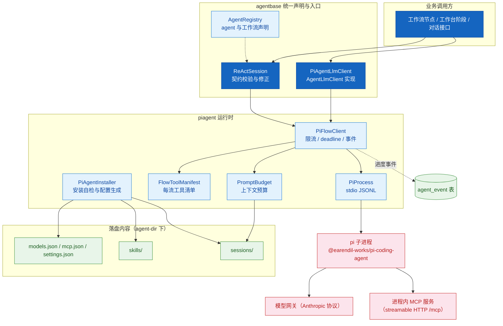
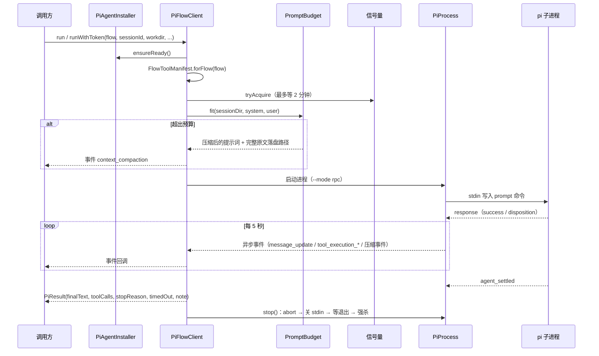

# pi agent 底座

> 自动生成于 2026-11-26，基于 `99d0037` 版本

| 属性 | 值 |
|------|-----|
| **所属层** | 基础设施层（agent 运行时底座） |
| **目录** | `agentbase/`（3 个文件）、`piagent/`（10 个文件，含 `context/` 子包）、`resources/pi-skills/`（13 个 skill） |
| **核心类** | `AgentRegistry`、`ReActSession`、`FlowEngine`、`PiAgentInstaller`、`PiFlowClient`、`FlowToolManifest`、`PromptBudget`、`PiAgentLlmClient` |
| **对外入口** | `ReActSession.run(...)`（ReAct 会话）、`AgentLlmClient`（一次性结构化调用）、`FlowEngine.run(...)`（工作流） |

---

## 1. 模块概述

### 1.1 职责定义

**核心职责**：为后端所有 agent 流提供统一的 LLM 执行层。每个流启动时按清单解析自己的工具白名单，由一个 pi 子进程完成模型调用与工具调用；底座同时负责 pi 的安装自检、并发限流、上下文预算、契约校验与进程回收。

| 本模块负责 | 本模块不负责 | 由谁负责 |
|-----------|-------------|---------|
| agent 与工作流的唯一声明（`AgentRegistry`） | 各节点的业务逻辑 | [工作流引擎](./工作流引擎.md) 与各业务模块 |
| pi 的安装、版本校验、配置文件生成、skill 同步 | npm / node 本身的安装 | 部署环境（见 [部署运维](../07-部署运维/index.md)） |
| 每流工具清单与 pi 启动参数 | 工具的实际实现 | [进程内MCP工具](./进程内MCP工具.md)（`com.huawei.hisi.mcp` 的 `@McpTool` 方法） |
| 并发槽位、deadline、取消、进程回收 | git 提交与推送 | 后端业务代码（清单里不含 git 工具） |
| 提交前上下文预算与保形压缩 | 运行中的会话压缩 | pi 自带能力，由 `settings.json` 设定阈值 |

### 1.2 与直连调用的边界

主代码中已无任何 `org.springframework.ai` 引用；`AgentLlmClient` 只有 `PiAgentLlmClient` 一个实现。**agent 类流程的 LLM 层全部经 pi**。仍有两类模型调用是直连的，二者性质不同。

**(a) 批量 / 向量类调用（不属于 agent 流程）**

| 调用 | 实现 | 端点与配置 | 使用方 |
|------|------|----------|-------|
| 向量化 | `service/UnifiedEmbeddingService` | OpenAI 兼容 `/embeddings`；`embedding.*` | `neo4j.service.EmbeddingService`、`VectorGenerationService` |
| KG 方法 / 入口点描述生成 | `service/UnifiedTextService` | OpenAI 兼容 `/chat/completions`；`text-model.*` | `LLMDescriptionService`、`EntryPointDescriptionService`、`VectorGenerationService` |
| 聚合标注、领域命名 | `knowledgegraph.aggregation.llm.DeepseekJsonClient` | 直连模型网关的 `/v1/chat/completions`；`anthropic.*` | `LayerRoleLlmService`、`MultiDimensionCommunityDetector`、`archdiagnosis` 的 `VerticalDomainNamer`；另作为构造参数注入 `ArchReActAgentNode` 基类 |
| 外部重排 | `neo4j.service.RerankService` | OpenAI 兼容 `/rerank`；`search.rerank.*`（默认关闭） | 多路检索融合后的精排 |

**(b) 单次结构化调用，但仍直连**

| 调用 | 实现 | 使用方 |
|------|------|-------|
| `apm.service.locator.LlmClient.chat(system, user)` | 配置了 `hisi.apm.diagnose.llm.api-key` 时为 `ApmClaudeLlmClient`（`@Primary`，直连 OpenAI 兼容的 `/v1/chat/completions`，配置 `hisi.apm.diagnose.llm.*`）；否则回退到 `ApmDiagnoseConfig` 中由 `UnifiedTextService` 支撑的默认 bean | APM 的 `LlmDiagnoseAdapter`；[修复引擎fixengine](./修复引擎fixengine.md) 的 `FixAgent` / `TestGenAgent` |
| 需求影响面的查询分解 | `ram.nodes.impact.QueryDecomposer`：首选 `UnifiedTextService`，其次 `AgentLlmClient`（经 pi），最后规则切分 | [RAM需求评估](./RAM需求评估.md) 的影响分析节点 |

相关模块：[Neo4j图存储与检索](./Neo4j图存储与检索.md)、[知识图谱构建](./知识图谱构建.md)、[架构诊断](./架构诊断.md)、[APM故障诊断](./APM故障诊断.md)。

---

## 2. 模块架构

> 说明：落库到 `agent_event` 的是各调用方传入的事件回调（如 `PiEventSink`），`PiFlowClient` 本身只负责把 pi 事件转发给回调。

---

## 3. 统一声明 `AgentRegistry`

所有 agent 一处声明。模式判定规则（源码注释）：步骤与顺序能事先定死、需要人在环或落库的走工作流；工作流里「需要模型自己探索或动手」的节点是 ReAct agent；独立成入口的纯 ReAct 只有对话类。

### 3.1 ReAct agent（17 个）

字段含义：`flow` 为工具清单键；`skills` 为注入的 skill；`contractSchema` 为 null 表示自由文本输出；`repairRounds` 为契约不过时的自动修正轮数。

| key | flow | skills | 契约 schema | 修正轮数 | 说明 |
|-----|------|--------|------------|---------|------|
| `arch-review` | `arch-react` | architecture-review | `arch/react-step` | 2 | 架构深度分析 |
| `wb-develop` | `workbench-dev` | java-fix-tdd | — | 0 | 工作台开发 |
| `wb-proposal` | `one-shot` | fix-proposal | — | 0 | 工作台候选方案 |
| `wb-spec` | `one-shot` | fix-spec | — | 0 | 工作台 Spec |
| `wb-tasks` | `one-shot` | fix-tasks | — | 0 | 工作台任务拆分 |
| `ram-clarify` | `ram` | requirement-clarify | `clarify.output` | 1 | 需求澄清 |
| `ram-design` | `ram` | solution-design | `implement.output` | 1 | 实现方案 |
| `ram-techplan` | `ram` | tech-plan | `tech_plan.output` | 1 | 技术方案 |
| `ram-overview` | `ram` | status-review | — | 0 | 项目现状解读 |
| `ram-locate` | `ram` | call-tree-triage | — | 0 | Phase2 精准定位 |
| `log-hypothesis` | `log-analysis` | log-triage | — | 1 | 日志根因探查 |
| `log-followup` | `log-analysis` | log-triage | — | 0 | 日志追问 |
| `ram-chat` | `ram-act` | ram-assistant | — | 0 | RAM 对话助手（带动作工具） |
| `merge-impact` | `one-shot` | merge-triage | — | 0 | 合并影响面 |
| `merge-test-scope` | `one-shot` | merge-triage | — | 0 | 合并测试范围 |
| `chat` | `chat-read` | （无） | — | 0 | 通用对话 |
| `oneshot` | `one-shot` | （无） | — | 0 | 零工具一次性结构化调用 |

### 3.2 工作流（7 条）

| key | 显示名 | 节点链（有序） | policy |
|-----|-------|--------------|--------|
| `arch-deep-analysis` | 架构深度分析 | `arch_evidence_collect` → `arch_react_agent` | `skipHitl`、`emitNodeEvents` |
| `ram-demand` | 需求分析 | `clarify` → `impact` → `implement` → `verify` → `tech_plan` | `hitlNodes=[clarify, impact, implement]` |
| `ram-status` | 项目现状分析 | `project_overview` | `skipHitl`、`emitNodeEvents` |
| `ram-phase2` | Phase2 精准定位 | `phase2_analysis` | `skipHitl`、`emitNodeEvents` |
| `wb-autofix` | 工作台自动修复 | `evidence` → `proposal` → `spec` → `tasks` → `develop` → `tests` → `e2e` → `ship` | `confirmGate=proposal`、`retryTarget=develop`、`maxIterations=3` |
| `log-analysis` | 日志分析 | `decode` → `collect` → `hypothesis` → `verify` → `synthesis` → `report` | `skipHitl`、`emitNodeEvents` |
| `merge-analysis` | 合并影响分析 | `diff` → `impact` → `test_scope` → `report` | `skipHitl`、`emitNodeEvents` |

工作流节点名到 ReAct agent 的映射（`NODE_TO_AGENT`）：`arch_react_agent → arch-review`、`develop → wb-develop`、`proposal → wb-proposal`、`spec → wb-spec`、`tasks → wb-tasks`。

### 3.3 `FlowEngine`

- `run(workflowKey, sessionId, initialInput)`：按声明解析节点链与 `ExecutionPolicy`，交给 `workflow.DagExecutor` 执行；未知工作流或解析不出的节点抛 `IllegalArgumentException`。
- `resolve(names)`：节点名解析为 bean 优先；`arch_react_agent` 由 `workflow.v2.ArchReActNodeV2Factory` 按次创建。

执行细节见 [工作流引擎](./工作流引擎.md)。

---

## 4. 每流工具清单 `FlowToolManifest`

`forFlow(flow)` 在每次流启动时解析清单，生成 pi 的 `--tools` / `--exclude-tools` 白名单。pi 的工具白名单只在启动时生效，清单即权限边界。

| flow | 内置工具 | MCP 工具数 | 最高级别 | 连 MCP | 关闭思考 |
|------|---------|----------|---------|-------|---------|
| `arch-react` | 只读 5 个 | 21 | READ | 是 | 否 |
| `log-analysis` | 只读 5 个 | 13 | READ | 是 | 否 |
| `ram` | 只读 5 个 | 8 | READ | 是 | 否 |
| `ram-act` | 只读 5 个 | 13（8 只读 + 5 动作） | READ | 是 | 否 |
| `chat-read` | 只读 5 个 | 19 | READ | 是 | 否 |
| `workbench-read` | 只读 5 个 | 8 | READ | 是 | 否 |
| `workbench-dev` | 只读 5 个 + 写/执行 3 个 | 8 | EXEC | 是 | 否 |
| `one-shot` | 无 | 0 | READ | 否 | 是 |
| 其他（未知 flow） | 只读 5 个 | 0 | READ | 否 | 否 |

工具分组：

| 分组 | 内容 |
|------|------|
| 内置只读 `READ_BUILTIN` | `read`、`grep`、`find`、`ls`、`codemode` |
| 内置写/执行 `WRITE_BUILTIN` | `write`、`edit`、`bash` |
| `ARCH_MCP` | `kg_select_scope`、`kg_list_projects`、`kg_status`、`kg_method_detail`、`kg_method_by_class`、`kg_root_entries`、`kg_callees_tree`、`kg_entry_points`、`kg_downstream`、`kg_affecting`、`kg_bridges`、`kg_implementations`、`kg_dashboard`、`kg_dsm`、`kg_hotspots`、`kg_domains`、`kg_service_topology`、`kg_blast_radius`、`kg_api_consumers`、`kg_backend_deps`、`hybrid_search` |
| `LOG_MCP` | `hybrid_search`、`kg_list_projects`、`kg_method_detail`、`kg_method_by_class`、`kg_root_entries`、`kg_callees_tree`、`kg_entry_points`、`kg_downstream`、`kg_affecting`、`kg_bridges`、`kg_mybatis_sql`、`log_query`、`log_report`、`log_report_status` |
| `RAM_MCP` | `hybrid_search`、`kg_list_projects`、`kg_method_detail`、`kg_method_by_class`、`kg_callees_tree`、`kg_root_entries`、`kg_entry_points`、`kg_bridges`、`kg_mybatis_sql` |
| `RAM_ACT_MCP`（动作工具） | `act_start_analysis`、`act_start_status`、`act_resume_session`、`act_submit_clarification`、`act_confirm_node` |
| `CHAT_MCP` | `hybrid_search`、`kg_list_projects`、`kg_method_detail`、`kg_method_by_class`、`kg_root_entries`、`kg_callees_tree`、`kg_entry_points`、`kg_bridges`、`kg_dashboard`、`kg_hotspots`、`kg_domains`、`kg_service_topology`、`kg_blast_radius`、`kg_api_consumers`、`log_query`、`log_report`、`log_report_status`、`apm_list_traces`、`apm_get_trace`、`apm_get_report` |

MCP 工具在白名单里带前缀 `mcp__hisi_mcp_inproc__`（服务名 `hisi-mcp-inproc` 归一化后的形式）。git（commit / push）不属于任何清单，提交推送由后端执行。

启动参数（`cliArgs()`）：

| 参数 | 生效条件 | 作用 |
|------|---------|------|
| `--no-tools` | 清单为空（仅 `one-shot`） | 整体关闭工具 |
| `--tools` / `--exclude-tools` | 清单非空 | 白名单；只读流排除 `write,edit,bash,powershell`，写流排除 `powershell` |
| `--no-mcp` | 不连 MCP | 关闭 MCP |
| `--no-approve` | 总是 | 不信任工作目录里的项目级扩展、skill、提示模板 |
| `--no-context-files` | 只读流 | 不把被分析仓库的 AGENTS.md / CLAUDE.md 读进系统上下文 |
| `--thinking off` | `one-shot` | 关闭模型思考，避免思考 token 挤占输出预算 |

> `workbench-read` 清单在代码中有定义，但 `AgentRegistry` 里没有使用它的 agent 声明。

---

## 5. 核心实现

### 5.1 启动自检与自动安装 `PiAgentInstaller`

`@PostConstruct init()`：`piagent.enabled=false` 或激活 `test` profile 时跳过。已经装好就同步把配置写完（快）；**需要跑 npm 时（pi 没装）转后台线程 `pi-agent-install` 执行**，启动不被拖住；`ensure()` 全部完成才把就绪标志置位。

| 步骤 | 动作 | 失败表现 |
|------|------|---------|
| 1 | 解析 `install-dir`、`agent-dir` 并建目录 | 记 error 日志，`installDir` 置空 |
| 2 | `checkNode()`：`node -v` ≥ 22.19.0 | 抛异常，整体失败 |
| 3 | `ensurePackage()`：包版本等于锁定版本且 CLI 入口存在才算已装；否则删旧目录后 `npm install` | 抛异常，整体失败 |
| 4 | `writeConfig(agentDir, false)` | 写 `models.json`、`mcp.json`（只含进程内 MCP）、`settings.json`，同步 skills |
| 5 | `writeConfig(agentDir-act, true)` | 同上，但 `mcp.json` 多一个令牌请求头 `X-Scope-Token: ${HISI_SCOPE_TOKEN}` |
| 7 | `writeSettingsJson()` | 合并写 `settings.json` 的 `compaction` 段 |
| 8 | `syncSkills()` | 把声明的 skill 同步到 `<agent-dir>/skills/`，删除已下线的 |

安装失败不阻断后端启动。`ensureReady()` 在每次流执行前被调用：未就绪则再装一次（后台还在装时**同步等待它结束**），无需重启后端。

生成的文件：

| 文件（`<agent-dir>/` 下） | 内容 |
|--------------------------|------|
| `models.json` | 两个 provider：`hisi-gw`（不声明推理能力）与 `hisi-gw-nothink`（`reasoning: true`）；`api` 为 `anthropic-messages`；`apiKey` 写环境变量引用 `$HISI_LLM_KEY`，真实密钥不落盘 |
| `mcp.json` | `mcpServers.hisi-mcp-inproc`：进程内 MCP 服务（streamable HTTP `<后端地址>/mcp`）。动作流用的配置目录在 `headers` 里多一个 `X-Scope-Token: ${HISI_SCOPE_TOKEN}`——pi 把自身进程环境传给 MCP 客户端后插值（实测：**空环境变量一律视为未设置**，所以 `HISI_SCOPE_TOKEN` 由 `PiFlowClient` 启动 pi 时按需放入环境，只读流不放） |
| `settings.json` | `compaction.enabled=true`、`reserveTokens`、`keepRecentTokens` |

安装的包为 `@earendil-works/pi-coding-agent`，CLI 入口为 `<install-dir>/node_modules/@earendil-works/pi-coding-agent/dist/bundle/cli.js`（由 node 直接运行，不依赖 PATH）。

### 5.2 运行一次流 `PiFlowClient`

启动命令形态：`node <cli.js> --mode rpc --session-id <id> --session-dir <dir> --model <provider>/<modelId> --system-prompt <文本>` + 清单参数 + 每个 skill 一个 `--skill <path>`。

| 环境变量 | 来源 | 作用 |
|---------|------|------|
| `PI_CODING_AGENT_DIR` | `<agent-dir>` | pi 配置目录 |
| `HISI_LLM_KEY` | `anthropic.api-key` | 模型网关密钥，只进进程环境 |
| `HISI_SCOPE_TOKEN` | 调用方传入的 `scopeToken` | 动作工具以用户身份回调后端；只读流不传 |

`provider` 选择：清单 `thinkingOff` 为真时用 `hisi-gw-nothink`，否则 `hisi-gw`。

| stopReason | 触发条件 |
|-----------|---------|
| `agent_settled` | 正常收敛 |
| `handled` | prompt 被扩展直接处理，没有启动 run |
| `cancelled` | 调用方的取消判定为真 |
| `process_died` | pi 进程在结束前退出 |
| `timeout` | 超过 `deadline-minutes`（此时 `timedOut=true`） |
| `aborted` | 结束事件带 `aborted` |

`note()` 字段在没拿到完整结论时给出原因：模型调用失败、pi 会话压缩失败、或最后一次回复被截断（`stop=length`）。

### 5.3 上下文管理（两层）

| 层 | 负责 | 实现 |
|----|------|------|
| 提交前预算 | 输入本身过大 | `PromptBudget.fit()`：按 3 字符 / token 估算 system + user；超过 `max-input-tokens` 时对提示词里的结构化载荷做保形压缩 |
| 运行中压缩 | 会话越跑越大 | pi 自带会话压缩，阈值由 `settings.json` 的 `compaction` 设定；压缩事件透传给监听器 |

保形压缩（`JsonCompactor`）规则：结构原样保留，只截短过长的列表与字符串；被截列表末尾追加 `_truncated` 标记；预算按深度加权（第 1–2 层 4 倍、第 3 层 2 倍、更深 1 倍）；列表起始预算 8000 字符，放不下则每次缩到 60%，下限 400 字符；单个字符串字段最多 400 字符。找不到可压缩的结构时只保留放得下的开头。

完整原文落盘到 `<agent-dir>/sessions/<sessionId>/context/prompt-full-<时间戳>.txt`，提示词里用 `_contextNotice` 告知路径，agent 可用 `read` 工具分段回看。

### 5.4 ReAct 会话 `ReActSession`

`run(agent, sessionId, workdir, systemPrompt, userPrompt, eventSink, cancelled, scopeToken)` 返回 `Result(text, json, note)`。

1. `installer.ensureReady()`，再按声明的 `skills` 解析 skill 路径（未同步的 skill 跳过并告警）。
2. 调 `PiFlowClient.runWithToken`。超时返回 note「pi 会话超时」；无正文且有 note 则原样返回。
3. 声明无契约（`contractSchema == null`）时正文原样返回，`json` 为 null。
4. 有契约时取正文里第一个可解析的 JSON 对象，交 `ram.contract.SchemaValidator` 校验（draft-07；名字含 `/` 时解析为 `schemas/<name>.json`，否则 `schemas/ram/<name>.json`）。
5. 不通过则带着具体问题开新会话修正（sessionId 加 `-fix<n>` 后缀），最多 `repairRounds` 轮；修正轮只改格式不改结论。

### 5.5 一次性结构化调用 `PiAgentLlmClient`

`@Primary @Component`，实现 `agentflow.AgentLlmClient`：

| 方法 | 行为 |
|------|------|
| `isAvailable()` | 先 `ensureReady()`，再要求已就绪且 `piagent.flows.one-shot` 开启 |
| `completeText(system, user, maxTokens)` | 空正文重试一次 |
| `completeJson(system, user, maxTokens)` | 解析不到 JSON 时追加「只输出 JSON」的指令重试一次，仍失败抛 `IllegalStateException` |

每次调用是一个独立 pi 进程，清单为 `one-shot`（无工具、不连 MCP、关闭思考）；工作目录为 `<agent-dir>/scratch`；超过 `agentflow.llm.call-timeout-seconds` 抛 `AgentLlmTimeoutException`。调用方约定在 `isAvailable()` 为假时走确定性降级。

### 5.6 `PiEventSink`

把 pi 事件写入 `agent_event`（类型 `NODE_DELTA`），复用现有 SSE 推流与回放。只处理 `tool_execution_start`、`tool_execution_end`、`agent_settled` 三类，摘要截断到 300 字符。

---

## 6. pi-skills 资源

`resources/pi-skills/<name>/SKILL.md`，共 13 个，与 `AgentRegistry` 声明的 skill 名一一对应（各 agent 用哪个 skill 见 3.1）。声明只描述结构，提示词正文在 skill 文件里。

---

## 7. 配置项

| 键 | 默认值 | 说明 |
|----|-------|------|
| `piagent.enabled` | `true` | 总开关；关闭时安装器与运行时都不工作 |
| `piagent.install-dir` | `lib/pi` | pi 安装目录 |
| `piagent.agent-dir` | `lib/pi-agent` | 配置目录（models.json / mcp.json / settings.json / skills / sessions） |
| `piagent.package-version` | `1.6.0` | 锁定的 pi 包版本 |
| `piagent.registry` | `https://registry.npmmirror.com` | npm 源 |
| `piagent.model-base-url` | 见 `application.yml` | 模型网关地址（Anthropic 协议） |
| `piagent.model-id` | `deepseek-v4-pro-cc` | 模型 id |
| `piagent.max-concurrent-processes` | `4` | 同时运行的 pi 进程上限 |
| `piagent.deadline-minutes` | `60` | 单次流时限，超时 abort 并强杀 |
| `piagent.context.max-input-tokens` | `32000` | 单次提交（system + user）的 token 上限 |
| `piagent.context.compaction-reserve-tokens` | `32000` | pi 会话压缩的触发保留量 |
| `piagent.context.compaction-keep-recent-tokens` | `20000` | pi 会话压缩保留的最近内容 |
| `piagent.flows.arch-react` | `true` | 架构分析是否走 pi |
| `piagent.flows.one-shot` | `true` | 一次性结构化调用是否走 pi |
| `piagent.flows.workbench-sdd` / `log-v2` / `ram` | `false` | 代码中未发现读取方 |

| 相关环境变量 | 用途 |
|-------------|------|
| `HISI_LLM_KEY` | 由后端注入 pi 进程环境，值取 `anthropic.api-key` |
| `HISI_SCOPE_TOKEN` | 动作工具回调后端用的用户令牌，由调用方传入，不落盘 |

`flowEnabled()` 只在两处被调用：`PiAgentLlmClient.isAvailable()`（`one-shot`）与 `ArchReActNodeV2Factory.create()`（`arch-react`）。其余 ReAct 会话不检查每流开关。

---

## 8. 错误处理

| 场景 | 处理 | 用户感知 |
|------|------|---------|
| 启动时安装失败 | 不阻断启动，记 error 日志；下次有流要用 pi 时 `ensureReady()` 重试 | pi 相关功能在装好前不可用 |
| node 未安装或版本过低 | `ensure()` 抛异常 | 同上 |
| 进程内 MCP 不可用 | pi 会连不上工具，模型调用仍可进行 | 该流的 MCP 工具不可用 |
| pi 未就绪时执行流 | `IllegalStateException`，消息指明 `piagent.enabled` 或安装失败 | 流启动失败 |
| 等不到并发槽位（2 分钟） | `IllegalStateException` | 流启动失败 |
| 超过 deadline | kill 进程，`stopReason=timeout`、`timedOut=true` | 结果带超时说明 |
| 模型调用出错（鉴权、限流） | pi 照常结束，原因记入 `note` | 调用方按 note 降级 |
| 契约校验不过且修正轮用尽 | `Result.note` 带问题清单 | 调用方降级 |
| skill 文件缺失 | 记 error 日志并跳过该 skill | 会话照常执行 |

---

## 9. 已知问题与扩展点

| 问题 | 说明 |
|------|------|
| 每次模型调用一个进程 | 源码注释给出实测启动约 1.2 秒；并发受 `max-concurrent-processes` 限制 |
| 三个每流开关无读取方 | `piagent.flows.workbench-sdd`、`log-v2`、`ram` 在代码中未被读取 |
| `agentForNode` 未见调用方 | `AgentRegistry.agentForNode` 在主代码中无调用；工作台 develop 阶段直接调用 `PiFlowClient.run`，未经过 `wb-develop` 声明的 skill 装配 |
| 10 个 agent 声明未被主代码按 key 取用 | 主代码经 `AgentRegistry.agent(key)` 取用的只有 `arch-review`、`ram-clarify`、`ram-design`、`ram-techplan`、`ram-chat`、`log-followup`、`chat` 七个；`wb-develop`、`wb-proposal`、`wb-spec`、`wb-tasks`、`ram-overview`、`ram-locate`、`log-hypothesis`、`merge-impact`、`merge-test-scope`、`oneshot` 目前只作为声明存在，对应业务直接调用 `AgentLlmClient` 或 `PiFlowClient` |
| token 估算偏保守 | 固定 3 字符 / token，未按模型分词 |
| `AnthropicHttpClient` 残留 | `ram/sdk/impl/AnthropicHttpClient.java` 仍在源码树中，但主代码中没有调用方：`ApmClaudeLlmClient` 与 `DeepseekJsonClient` 只在注释 / Javadoc 里引用它并沿用其 base-url 拼接约定，HTTP 调用各自用自建的 `RestTemplate`；测试代码中有直接实例化它的用例 |

| 扩展点 | 方式 |
|-------|------|
| 新增 ReAct agent | 在 `AgentRegistry` 静态块 `react(...)` 声明，并在 `resources/pi-skills/` 放对应 skill |
| 新增工作流 | 在 `AgentRegistry` 声明 `workflow(...)`，节点实现注册为 `DagNode` bean |
| 新增流清单 | 在 `FlowToolManifest.forFlow` 增加分支并定义 MCP 工具组 |
| 调整上下文预算 | 修改 `piagent.context.*`，无需改代码 |

---

## 10. 依赖关系

| 方向 | 依赖 | 用途 |
|------|------|------|
| 上游 | `ram.contract.SchemaValidator` | 契约校验 |
| 上游 | `ram.repository.AgentEventRepository`、`ram.model.*` | `PiEventSink` 写事件 |
| 上游 | [进程内MCP工具](./进程内MCP工具.md)（`com.huawei.hisi.mcp`） | 只读与动作工具 |
| 下游 | [工作流引擎](./工作流引擎.md) | `FlowEngine` 按声明建链 |
| 下游 | [工作台与自动修复](./工作台与自动修复.md) | `develop` 阶段直接调 `PiFlowClient`；`proposal` / `spec` / `tasks` 阶段走 `AgentLlmClient` |
| 下游 | [架构诊断](./架构诊断.md) | `arch-review` |
| 下游 | [RAM需求评估](./RAM需求评估.md) | `ram-clarify` / `ram-design` / `ram-techplan`、一次性调用 |
| 下游 | [日志云与运维](./日志云与运维.md) | `log-followup`、一次性调用 |
| 下游 | [合并影响分析](./合并影响分析.md) | 影响面与测试范围走 `AgentLlmClient` |
| 下游 | [智能诊断与对话](./智能诊断与对话.md) | `chat`、`ram-chat` |
| 下游 | [知识图谱构建](./知识图谱构建.md) | `GenerationController` 的一次性调用 |

---

> **相关文档**：
> - 架构总览 → [02-架构设计](../02-架构设计/index.md)
> - 工作流执行细节 → [工作流引擎](./工作流引擎.md)
> - 配置与部署 → [07-部署运维](../07-部署运维/index.md)
> - 技术决策 → [08-技术决策](../08-技术决策/index.md)
