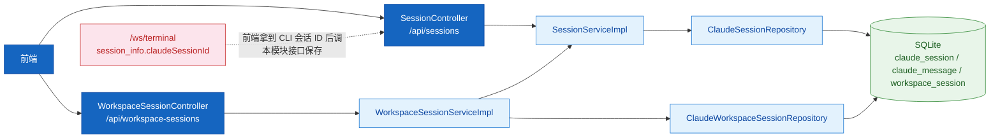

# 会话与工作区

> 自动生成于 2026-11-26，基于 `99d0037` 版本

| 属性 | 值 |
|------|-----|
| **所属层** | 领域服务层 + 基础设施层（SQLite） |
| **目录** | `controller/SessionController.java`、`controller/WorkspaceSessionController.java`、`service/SessionService(Impl)`、`service/WorkspaceSessionService(Impl)`、`repository/ClaudeSessionRepository.java`、`repository/ClaudeWorkspaceSessionRepository.java`、`model/ClaudeSession.java`、`ClaudeMessage.java`、`ClaudeWorkspaceSession.java` |
| **REST 基础路径** | `/api/sessions`（7 个端点）、`/api/workspace-sessions`（7 个端点） |
| **SQLite 表** | `claude_session`、`claude_message`、`workspace_session` |

---

## 1. 模块概述

### 1.1 职责定义

**核心职责**：为浏览器终端里的 `claude` CLI 对话提供会话与消息的本地持久化，以及「工作区会话」的增删改查、归档与导出。

| 本模块负责 | 本模块不负责 | 由谁负责 |
|-----------|-------------|---------|
| 终端会话与消息的落库、分页、归档、导出 | 终端通道与 PTY 进程 | [终端与WebSocket](./终端与WebSocket.md) |
| 工作区会话的 CRUD | 与 CLI 进程的绑定是否生效 | 见 4.2 的现状说明 |
| 建表 | — | `config/SQLiteSchemaInitializer`，见 [应用启动与全局配置](./应用启动与全局配置.md) |

这里的会话与 agent 流程的会话（`agent_session` / `agent_event`）是两套独立的数据，不要混淆：

| | 本页 | agent 流程会话 |
|---|------|---------------|
| 表 | `claude_session`、`claude_message`、`workspace_session` | `agent_session`、`agent_event` |
| 用途 | 终端对话历史 | RAM / 工作流 / 日志 / 合并 / 对话 / 修复 |
| 文档 | 本页 | [RAM需求评估](./RAM需求评估.md)、[工作流引擎](./工作流引擎.md) |

### 1.2 核心文件清单

| 文件 | 类型 | 职责 |
|------|------|------|
| `controller/SessionController.java` | REST | `/api/sessions` |
| `controller/WorkspaceSessionController.java` | REST | `/api/workspace-sessions` |
| `service/SessionServiceImpl.java` | 服务 | 终端会话与消息；方法级 `@Transactional` |
| `service/WorkspaceSessionServiceImpl.java` | 服务 | 工作区会话 |
| `repository/ClaudeSessionRepository.java` | 仓储 | `claude_session` 与 `claude_message` 的 JdbcTemplate 访问 |
| `repository/ClaudeWorkspaceSessionRepository.java` | 仓储 | `workspace_session` 的 JdbcTemplate 访问 |

---

## 2. 模块架构

---

## 3. 终端会话 `/api/sessions`

鉴权：GET 放行；PATCH / DELETE 需要管理员。

| 方法 | 路径 | 说明 |
|------|------|------|
| GET | `/api/sessions` | 分页列表，参数 `status`（可选）、`page`（默认 1）、`pageSize`（默认 20） |
| GET | `/api/sessions/{id}` | 详情 + 消息列表（按 `created_at` 升序） |
| PATCH | `/api/sessions/{id}` | 更新（如标题） |
| DELETE | `/api/sessions/{id}` | 删除会话，并级联删除其消息 |
| POST | `/api/sessions/{id}/archive` | 归档 |
| GET | `/api/sessions/{id}/export` | 导出，参数 `format` 默认 `markdown`（另支持 `json`）；以附件形式返回，文件名 `session-<id>.<format>` |
| DELETE | `/api/sessions/{id}/messages` | 清空消息 |

`SessionService` 另提供 `createSession(...)` / `createSessionWithId(...)`（可带 `workingDirectory`）与 `getSessionCount(status)`，供工作区服务内部调用。

### 3.1 数据模型

**`claude_session`**

| 字段 | 类型 | 说明 |
|------|------|------|
| `id` | TEXT PK | 会话 ID |
| `title` | TEXT | 标题 |
| `scene` | TEXT | 场景 |
| `status` | TEXT | 默认 `active` |
| `metadata` | TEXT | 元数据 |
| `working_directory` | TEXT | 工作目录 |
| `claude_session_code` | TEXT | `claude` CLI 的会话 ID |
| `created_at` / `updated_at` | INTEGER | 时间戳（秒） |

写入用 `INSERT ... ON CONFLICT(id) DO UPDATE`。

**`claude_message`**

| 字段 | 类型 | 说明 |
|------|------|------|
| `id` | INTEGER PK | 自增 |
| `session_id` | TEXT NOT NULL | 外键 → `claude_session(id)` |
| `role` | TEXT NOT NULL | 角色 |
| `content` | TEXT NOT NULL | 内容 |
| `created_at` | INTEGER | 时间戳 |

---

## 4. 工作区会话 `/api/workspace-sessions`

鉴权：GET 放行；POST / PUT / DELETE 需要管理员。

| 方法 | 路径 | 说明 |
|------|------|------|
| GET | `/api/workspace-sessions` | 列表，参数 `status`（可选） |
| GET | `/api/workspace-sessions/{id}` | 详情 |
| POST | `/api/workspace-sessions` | 创建，请求体 `{scene, initialPrompt, workingDirectory}` |
| PUT | `/api/workspace-sessions/{id}` | 更新标题 / 状态 |
| DELETE | `/api/workspace-sessions/{id}` | 删除 |
| POST | `/api/workspace-sessions/{id}/archive` | 归档（状态置 `archived`） |
| POST | `/api/workspace-sessions/{id}/bind-claude-session` | 绑定 `claude` CLI 会话 ID，请求体 `{claudeSessionId}`；会话不存在返回 `code=404` |

### 4.1 `workspace_session` 表

| 字段 | 类型 | 说明 |
|------|------|------|
| `id` | TEXT PK | 会话 ID |
| `project_path` | TEXT | 创建时写入的是 `workingDirectory` |
| `initial_prompt` | TEXT | 初始提示词 |
| `status` | TEXT | 默认 `active` |
| `created_at` | INTEGER | 时间戳 |

### 4.2 现状说明

`ClaudeWorkspaceSession` 模型有 `claudeSessionId`、`title`、`scene`、`updatedAt` 等字段，类注释称它「存储系统会话 ID 与 Claude CLI session_id 的映射关系」。但仓储的 `save` 只写 `id`、`project_path`、`initial_prompt`、`status`、`created_at` 五列。也就是说：

- `bind-claude-session` 接口会把 `claudeSessionId` 设进对象并返回，但该值不会落库；
- `title`、`scene` 同样不在表列中，更新标题后重新读取不会保留。

`status` 的更新可以落库（`project_path`、`initial_prompt`、`status` 在 upsert 的更新范围内）。

---

## 5. 配置项

本模块无专属配置键。数据源由 `spring.datasource.url` 决定。

---

## 6. 错误处理

| 场景 | 处理 |
|------|------|
| 会话不存在 | 更新 / 归档 / 绑定返回 `null`，接口转成 `code=404`；删除只记告警 |
| 删除会话 | 先删消息再删会话 |
| 导出格式 | `json` 返回 `application/json`，其余按 `text/markdown` |

---

## 7. 已知问题与扩展点

| 问题 | 说明 |
|------|------|
| 工作区模型与表结构不一致 | `claudeSessionId` / `title` / `scene` 不落库 |
| 单用户设计 | 表中没有用户维度字段 |
| 时间戳语义混用 | 模型用 `LocalDateTime`，表列为秒级整数 |

| 扩展点 | 方式 |
|-------|------|
| 让绑定真正生效 | 给 `workspace_session` 加列并扩展仓储的 upsert |

---

## 8. 依赖关系

| 方向 | 依赖 | 用途 |
|------|------|------|
| 上游 | [应用启动与全局配置](./应用启动与全局配置.md) | `JdbcTemplate`、建表 |
| 上游 | [终端与WebSocket](./终端与WebSocket.md) | CLI 会话 ID 的来源 |
| 下游 | 前端终端与工作区页面 | 两组 REST 接口 |

---

> **相关文档**：
> - 架构总览 → [02-架构设计](../02-架构设计/index.md)
> - 表结构 → [06-数据模型](../06-数据模型/index.md)
> - 接口全表 → [05-接口文档](../05-接口文档/index.md)
