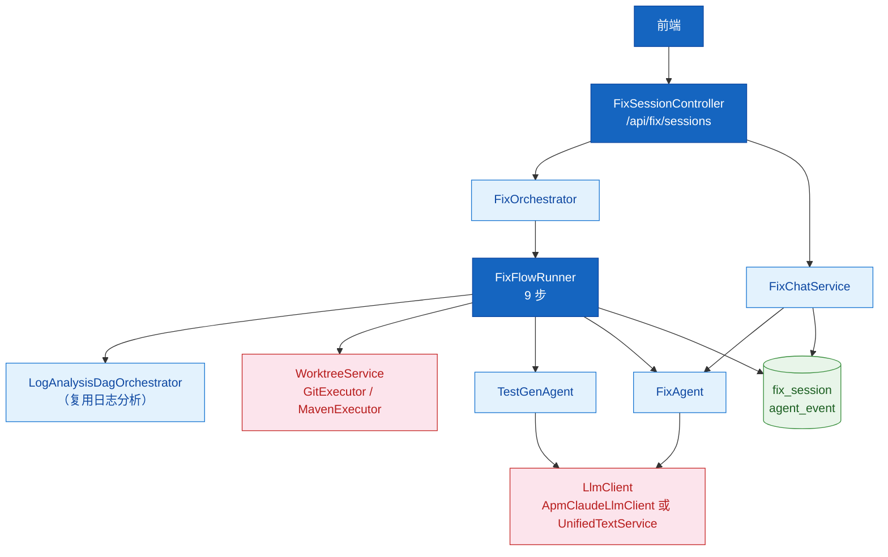
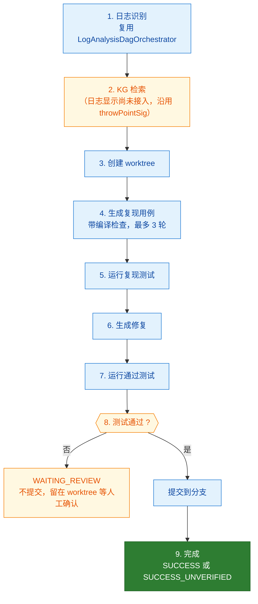

# 修复引擎 fixengine

> 自动生成于 2026-11-26，基于 `99d0037` 版本

| 属性 | 值 |
|------|-----|
| **所属层** | 应用层（修复流水线编排） |
| **目录** | `fixengine/`（18 个文件：`agent` 2、`config` 1、`controller` 1、`executor` 3、`model` 2、`repository` 3、`service` 6） |
| **核心类** | `FixOrchestrator`、`FixFlowRunner`、`FixChatService`、`FixAgent`、`TestGenAgent`、`WorktreeService` |
| **REST 基础路径** | `/api/fix/sessions`（5 个端点） |
| **SQLite 表** | `fix_session`；事件写入 `agent_event` |

---

## 1. 模块概述

### 1.1 职责定义

**核心职责**：从一条日志分析报告出发，在独立的 git worktree 里自动生成复现用例、生成修复、跑测试，通过后提交；过程中支持多轮追问。

它与 [工作台与自动修复](./工作台与自动修复.md) 是两套不同的修复机制：

| 对比项 | 修复引擎（本页） | 工作台 SDD 自动修复 |
|-------|----------------|-------------------|
| 入口 | `POST /api/fix/sessions?reportId=` | `POST /api/workbench/items/id/{id}/autofix` |
| 起点 | 一条日志分析报告 | 一条待办（日志或架构 issue） |
| 步骤 | 固定 9 步 | 8 个阶段，含方案确认门与迭代回路 |
| 写代码者 | 后端：`FixAgent` 产出整段方法源码，`WorktreeService.applyFix` 写文件 | pi 编码会话在 worktree 内自己改 |
| LLM 调用 | `apm.service.locator.LlmClient`，**直连** | pi（`one-shot` 清单与 `workbench-dev` 清单） |
| 交互 | 追问对话（事件经 WebSocket 推送） | 确认 / 驳回 / 中止 / 继续 |

### 1.2 LLM 调用边界

`FixAgent` 与 `TestGenAgent` 只依赖接口 `apm.service.locator.LlmClient`（`chat(system, user)` → 文本）。该接口**不经 pi**，是「单次结构化调用但仍直连」：

| 条件 | 实际注入的 bean |
|------|---------------|
| 配置了 `hisi.apm.diagnose.llm.api-key` | `ApmClaudeLlmClient`（`@Primary`，OpenAI 兼容的 `/v1/chat/completions`） |
| 未配置 | `ApmDiagnoseConfig` 中的默认实现，底层 `UnifiedTextService` |

详见 [APM故障诊断](./APM故障诊断.md) 与 [pi-agent底座](./pi-agent底座.md)。

### 1.3 核心文件清单

| 文件 | 类型 | 职责 |
|------|------|------|
| `controller/FixSessionController.java` | REST | 5 个端点 |
| `service/FixOrchestrator.java` | 编排 | 创建会话、异步启动流程、状态跟踪 |
| `service/FixFlowRunner.java` | 执行 | 9 步修复流水线（约 850 行） |
| `service/FixChatService.java` | 对话 | 修复会话内的多轮追问 |
| `agent/FixAgent.java` | LLM agent | 生成修复后的方法源码；提示词模板 `resources/prompt/fix-prompt.txt` |
| `agent/TestGenAgent.java` | LLM agent | 生成 Mockito 复现用例并按报错修正；模板 `resources/prompt/test-gen-prompt.txt` |
| `service/FixService.java`、`TestGenService.java`、`ReproService.java` | 服务 | 薄封装；用例生成最多 3 轮修复；复现与通过的 Maven 验证 |
| `service/WorktreeService.java` | 服务 | worktree 创建、写测试文件、应用修复、提交 |
| `executor/GitExecutor.java`、`MavenExecutor.java` | 执行器 | `ProcessBuilder` 执行 git 与 Maven |
| `model/FixSession.java`、`TestGenInput.java` | 模型 | 会话状态、用例生成输入 |
| `repository/impl/JdbcFixSessionRepository.java` | 仓储 | `fix_session` 表读写 |
| `config/FixSchemaInitializer.java` | 建表 | 启动时建 `fix_session` |

---

## 2. 模块架构

---

## 3. 九步流水线 `FixFlowRunner.run`

| 步骤 | 做什么 |
|------|-------|
| 1 日志识别 | 按报告 ID 调日志分析 DAG，得到 `exceptionType` 与抛出点签名 `throwPointSig`（取 `keyFrames[0].fullSignature`） |
| 2 KG 检索 | 源码中的日志为「KG search not yet integrated」，当前直接沿用 `throwPointSig` |
| 3 创建 worktree | `WorktreeService.createWorktree(branchName, repoPath, targetBranch)` |
| 4 生成复现用例 | `TestGenAgent` 产出 Mockito 单测；编译不过则把报错带回让它修，最多 3 轮 |
| 5 运行复现测试 | `ReproService.runAndCheckRepro`：要求用例能复现目标异常 |
| 6 生成修复 | `FixAgent` 读取抛出点方法源码，产出修复后的整段源码，`WorktreeService.applyFix` 写回 |
| 7 运行通过测试 | `ReproService.runAndCheckPass`：同一用例应当通过 |
| 8 提交 | **人在环闸门**：测试未通过时不提交，会话置 `WAITING_REVIEW`，留在 worktree 等人工确认；通过则提交 |
| 9 完成 | 无构建告警为 `SUCCESS`，有则为 `SUCCESS_UNVERIFIED` |

每一步向 `agent_event` 追加一对 `tool_use_start` / `tool_result` 事件，流程以 `checkpoint`（或失败时 `error`）事件收尾，事件形态与 RAM 对话一致。

缺少 `throwPointSig` 或 `exceptionType` 时流程在第 4 步前失败。

### 3.1 会话状态

| 状态 | 含义 |
|------|------|
| `RUNNING` | 建表默认值，流程进行中 |
| `WAITING_REVIEW` | 测试未通过，等待人工确认 |
| `SUCCESS` | 完成且无构建告警 |
| `SUCCESS_UNVERIFIED` | 完成，但有构建告警 |
| 失败 | 由 runner 写入（取值未在本次阅读中逐个确认） |

`FixSession.id` 是保存时生成的雪花式字符串。

---

## 4. 追问 `FixChatService`

| 项目 | 说明 |
|------|------|
| 入口 | `POST /api/fix/sessions/{sessionId}/follow-up`，请求体是纯文本的用户消息 |
| 持久化 | 先追加 `USER_MSG` 事件 |
| 执行 | 异步调 `FixAgent.handleFollowUp(chatSessionId, userMessage)` |
| 推送 | 回复经 WebSocket 推送 `assistant_delta` 与 `checkpoint` 事件（类注释：与 `RamChatOrchestrator` 同形态） |
| HTTP | 立即返回，AI 回复不走 HTTP 响应体 |

历史消息由 `GET /api/fix/sessions/{sessionId}/history` 从 `agent_event` 读取。

---

## 5. REST 端点

鉴权：GET 放行；POST 需要管理员。

| 方法 | 路径 | 入参 | 说明 |
|------|------|------|------|
| POST | `/api/fix/sessions` | 查询参数 `reportId` | 按日志分析报告启动修复会话，返回会话 ID |
| POST | `/api/fix/sessions/{sessionId}/follow-up` | 请求体为纯文本 | 追问 |
| GET | `/api/fix/sessions/{sessionId}/history` | — | 该会话关联对话的事件列表（`id`、`seq`、`type`、`payload`、`createdAt`） |
| GET | `/api/fix/sessions` | 查询参数 `reportId` | 某报告下的全部修复会话 |
| GET | `/api/fix/sessions/{sessionId}` | — | 会话信息 |

---

## 6. 数据模型

### `fix_session`

| 字段 | 类型 | 说明 |
|------|------|------|
| `id` | TEXT PK | 雪花式字符串 |
| `report_id` | TEXT NOT NULL | 来源日志分析报告 |
| `chat_session_id` | TEXT | 关联的对话会话 |
| `session_type` | TEXT | 默认 `FIX` |
| `status` | TEXT | 默认 `RUNNING` |
| `worktree_path` / `branch_name` / `commit_hash` | TEXT | 修复现场 |
| `throw_point_sig` / `error_msg` | TEXT | 抛出点签名、错误信息 |
| `tenant_id` / `create_by` / `update_by` / `del_flag` | — | 默认 `default` / `system` / `system` / `0` |

索引：`report_id`、`chat_session_id`、`branch_name`、`tenant_id`。

仓库里另有 `resources/db/migration/V2__create_fix_session.sql` 也创建 `fix_session`，但 `pom.xml` 没有 Flyway 等迁移工具依赖，实际建表由 `FixSchemaInitializer` 完成。

---

## 7. 配置项

| 键 | 默认值 | 说明 |
|----|-------|------|
| `hisi.fix.worktree-base-dir` | `${user.home}/.hisi-devtool/worktrees` | worktree 根目录 |
| `hisi.apm.diagnose.llm.*` | 见 [APM故障诊断](./APM故障诊断.md) | `ApmClaudeLlmClient` 的装配条件与参数 |

---

## 8. 错误处理

| 场景 | 处理 |
|------|------|
| 缺 `throwPointSig` / `exceptionType` | 流程失败，提示缺失项 |
| 用例编译不过 | 带报错让 `TestGenAgent` 修正，最多 3 轮 |
| 测试未通过 | 不提交，`WAITING_REVIEW` |
| 步骤抛异常 | 转成 `error` 事件并以「Step <名> failed」失败 |
| 提交失败 / 未取到 commit | 见 `GitExecutor` 调用结果（处理细节未在本次阅读中确认） |

---

## 9. 已知问题与扩展点

| 问题 | 说明 |
|------|------|
| KG 检索步骤未接入 | 第 2 步只有占位日志 |
| LLM 不走 pi | 与 agent 流程的底座不一致 |
| 与工作台修复并存 | 两套自动修复机制同时存在，入口与模型不同 |
| 迁移脚本不生效 | `db/migration` 下的 SQL 无迁移工具执行 |

| 扩展点 | 方式 |
|-------|------|
| 接入 KG 检索 | 在第 2 步调用 `KgMcpClient` |
| 换模型 | 改 `hisi.apm.diagnose.llm.*` 或提供另一个 `LlmClient` bean |

---

## 10. 依赖关系

| 方向 | 依赖 | 用途 |
|------|------|------|
| 上游 | `loganalysis.orchestrator.LogAnalysisDagOrchestrator` | 第 1 步日志识别 |
| 上游 | `apm.service.locator.LlmClient` | 生成用例与修复 |
| 上游 | `ram.repository.AgentEventRepository` | 事件落库 |
| 上游 | git / Maven（外部命令） | worktree、提交、测试 |
| 上游 | [日志云与运维](./日志云与运维.md) | 来源报告 |

---

> **相关文档**：
> - 架构总览 → [02-架构设计](../02-架构设计/index.md)
> - 另一套修复机制 → [工作台与自动修复](./工作台与自动修复.md)
> - `LlmClient` 的装配 → [APM故障诊断](./APM故障诊断.md)
