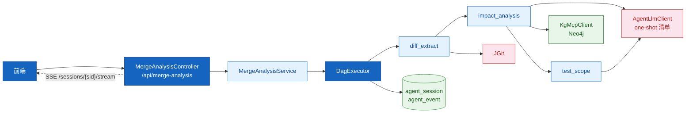
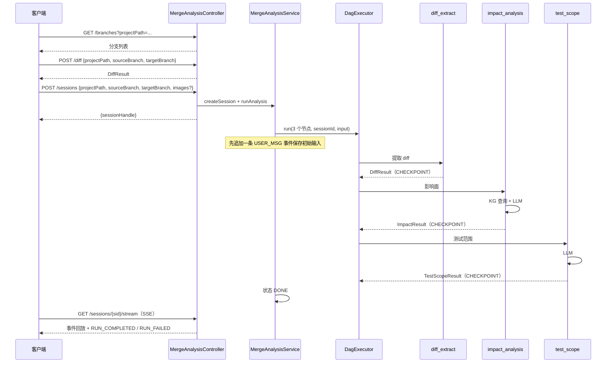

# 合并影响分析

> 自动生成于 2026-11-26，基于 `99d0037` 版本

| 属性 | 值 |
|------|-----|
| **所属层** | 应用层（3 节点 DAG 编排 + SSE 入口） |
| **目录** | `mergeanalysis/`（12 个文件：`controller` 1、`model` 3、`service` 8） |
| **核心类** | `MergeAnalysisController`、`MergeAnalysisService`、`MergeAnalysisDagNodes`、`DiffExtractService`、`ImpactAnalysisService`、`TestScopeService` |
| **REST 基础路径** | `/api/merge-analysis`（9 个端点） |
| **会话类型** | `SessionType.MERGE_ANALYSIS`，`user_id` 固定为 `merge-analysis` |

---

## 1. 模块概述

### 1.1 职责定义

**核心职责**：在分支合入前评估变更影响——用 JGit 提取源分支到目标分支的 diff，结合知识图谱判断影响面，再由 LLM 给出测试范围，全程经 SSE 推送进度，可导出 Markdown 报告。

| 本模块负责 | 本模块不负责 | 由谁负责 |
|-----------|-------------|---------|
| 分支列表、diff 提取 | 通用 Git 操作 | [远程项目管理](./远程项目管理.md) 的 `GitController` |
| 影响面与测试范围的提示词、结果归一化 | 模型调用 | [pi-agent底座](./pi-agent底座.md) 的 `AgentLlmClient` |
| 会话创建、异步执行、从节点重跑、SSE、导出 | 节点游标与检查点 | [工作流引擎](./工作流引擎.md) 的 `DagExecutor` |
| 图谱查询 | — | `ram.kg.KgMcpClient`（实现为 `DirectKgClient`） |

### 1.2 核心文件清单

| 文件 | 类型 | 职责 |
|------|------|------|
| `controller/MergeAnalysisController.java` | REST + SSE | 9 个端点；维护会话 UUID 映射（最多 10000 条） |
| `service/MergeAnalysisService.java` | 编排 | `createSession`、`runAnalysis`、`rerunFromNode`；自备 2 线程的 `ExecutorService` |
| `service/MergeAnalysisDagNodes.java` | 节点装配 | 手工 new 出 3 个 `DagNode`，**不注册为 bean** |
| `service/DiffExtractDagNode.java` / `DiffExtractService.java` | 节点 / 服务 | 节点名 `diff_extract`；JGit 取分支与 diff |
| `service/ImpactAnalysisDagNode.java` / `ImpactAnalysisService.java` | 节点 / 服务 | 节点名 `impact_analysis`；KG 查询 + LLM 评估业务影响 |
| `service/TestScopeDagNode.java` / `TestScopeService.java` | 节点 / 服务 | 节点名 `test_scope`；LLM 生成测试范围 |
| `model/DiffResult.java`、`ImpactResult.java`、`TestScopeResult.java` | 模型 | 三个节点的产物 |

---

## 2. 模块架构

---

## 3. 流程

| 项目 | 说明 |
|------|------|
| 节点顺序 | `diff_extract` → `impact_analysis` → `test_scope`（由 `MergeAnalysisDagNodes.nodes()` 固定） |
| 执行策略 | `dagExecutor.run(nodes, sessionId, input)` 的三参重载，即 `ExecutionPolicy.DEFAULT`（开启节点间确认门、不发节点生命周期事件） |
| 输入 | `projectPath`、`sourceBranch`、`targetBranch`，可选 `images` |
| 初始输入留痕 | `USER_MSG` 事件，幂等键 `initial-input-<sessionId>` |
| 异步 | `CompletableFuture.runAsync` 跑在模块自建的 2 线程池上；异常时会话置 `FAILED` |

### 3.1 从节点重跑

`POST /sessions/{sid}/rerun-from/{nodeName}`：控制器把会话的 `rerunFromNode` 设为目标节点，追加一条 `NODES_CLEARED` 事件（列出将被重算的下游节点，顺序按 `diff_extract`、`impact_analysis`、`test_scope`），再调 `MergeAnalysisService.rerunFromNode`，由 `DagExecutor` 的 `forceRerun` 机制跳过目标及其下游的检查点。

### 3.2 测试范围的两套提示词

`TestScopeService` 按受影响入口数量选择策略，阈值常量 `ENTRY_THRESHOLD = 30`：入口较少时逐入口给测试组（`SYSTEM_PROMPT_DETAILED`），入口很多时按 URL 文根聚合（`SYSTEM_PROMPT_AGGREGATED`）。

---

## 4. LLM 调用边界

影响面与测试范围都是「一次性的结构化调用」，经 `AgentLlmClient`（唯一实现 `PiAgentLlmClient`，清单 `one-shot`：无工具、不连 MCP、关闭思考）执行，属 agent 流程一侧，**经 pi**。KG 查询由确定性代码经 `KgMcpClient` 完成，不交给模型调工具。

`AgentRegistry` 里声明了 `merge-impact`、`merge-test-scope` 两个 ReAct agent（清单 `one-shot`、skill `merge-triage`），但主代码没有按 key 取用它们；本模块直接调用 `AgentLlmClient`。

---

## 5. 与统一工作流声明的关系

`AgentRegistry` 声明了工作流 `merge-analysis`：节点 `diff` → `impact` → `test_scope` → `report`。它与本模块实际运行的节点链**不一致**：

| 声明里的节点名 | 实际 `DagNode` | 是否为 bean |
|---------------|--------------|-----------|
| `diff` | `diff_extract` | 否（由 `MergeAnalysisDagNodes` 手工创建） |
| `impact` | `impact_analysis` | 否；同名 bean 是 RAM 的 `ImpactNode` |
| `test_scope` | `test_scope` | 否 |
| `report` | 无对应节点 | — |

本模块不经过 `FlowEngine`。按 `FlowEngine.resolve`「先找 `DagNode` bean，`arch_react_agent` 走工厂」的规则，经 `/api/v2/workflow/start` 启动 `merge-analysis` 时节点名 `diff` 解析不到。报告导出由控制器直接完成，不对应任何节点。

---

## 6. REST 端点

鉴权：GET 放行；POST 需要管理员。

| 方法 | 路径 | 说明 |
|------|------|------|
| GET | `/api/merge-analysis/branches` | 列出分支，参数 `projectPath` |
| POST | `/api/merge-analysis/diff` | 提取分支 diff，请求体 `{projectPath, sourceBranch, targetBranch}` |
| POST | `/api/merge-analysis/sessions` | 创建会话并异步启动，返回 `{sessionHandle}` |
| GET | `/api/merge-analysis/sessions/{sid}` | 会话信息 `{status, currentNode, lastSeq}` |
| POST | `/api/merge-analysis/sessions/{sid}/rerun-from/{nodeName}` | 从指定节点重跑 |
| GET | `/api/merge-analysis/sessions/{sid}/stream` | SSE 事件流；超时 30 分钟，轮询间隔 500 毫秒 |
| GET | `/api/merge-analysis/sessions` | 会话列表，`limit` 默认 50 |
| GET | `/api/merge-analysis/sessions/{sid}/events` | 全部事件 |
| GET | `/api/merge-analysis/sessions/{sid}/export/md` | 导出 Markdown（附件下载） |

SSE 流上除回放已落库事件外，会话结束时补发合成事件 `RUN_COMPLETED`（`DONE`）或 `RUN_FAILED`（`FAILED`）。

---

## 7. 配置项

本模块没有专属配置键。相关：

| 键 | 说明 |
|----|------|
| `piagent.*` | `AgentLlmClient` 的运行前提与一次性调用时限（`agentflow.llm.call-timeout-seconds`，默认 300 秒） |
| `ram.sse.*` | 不作用于本模块：本模块的 SSE 参数是控制器内的常量 |

---

## 8. 错误处理

| 场景 | 处理 |
|------|------|
| DAG 执行异常 | 会话置 `FAILED`，SSE 推 `RUN_FAILED` |
| 节点抛异常 | `DagExecutor` 记 `ERROR` 事件并返回 `FAILED` |
| 重跑时会话不存在 | 记日志后返回 |

---

## 9. 已知问题与扩展点

| 问题 | 说明 |
|------|------|
| 声明与实现脱节 | `merge-analysis` 工作流声明的节点名与实际节点不对应，经统一入口不可启动 |
| 重跑不带上 `images` | `rerunFromNode` 重建输入时只放分支与路径 |
| 自建线程池 | 模块内 `Executors.newFixedThreadPool(2)`，未复用 Spring 的执行器 |
| 声明的两个 ReAct agent 未被使用 | `merge-impact`、`merge-test-scope` 只存在于声明 |

| 扩展点 | 方式 |
|-------|------|
| 新增分析节点 | 实现 `DagNode` 并加入 `MergeAnalysisDagNodes.nodes()` |
| 调整测试范围策略 | 改 `TestScopeService` 的两套提示词与 `ENTRY_THRESHOLD` |

---

## 10. 依赖关系

| 方向 | 依赖 | 用途 |
|------|------|------|
| 上游 | JGit | 分支与 diff |
| 上游 | `ram.kg.KgMcpClient` | 图谱查询 |
| 上游 | [pi-agent底座](./pi-agent底座.md) | `AgentLlmClient` |
| 上游 | [工作流引擎](./工作流引擎.md) | `DagExecutor` |
| 上游 | `ram.repository`、`ram.model` | 会话与事件 |

---

> **相关文档**：
> - 架构总览 → [02-架构设计](../02-架构设计/index.md)
> - 另一条影响分析路径 → [影响分析与风险评估](./影响分析与风险评估.md)、[RAM需求评估](./RAM需求评估.md)
> - 数据流 → [04-数据流程](../04-数据流程/index.md)
