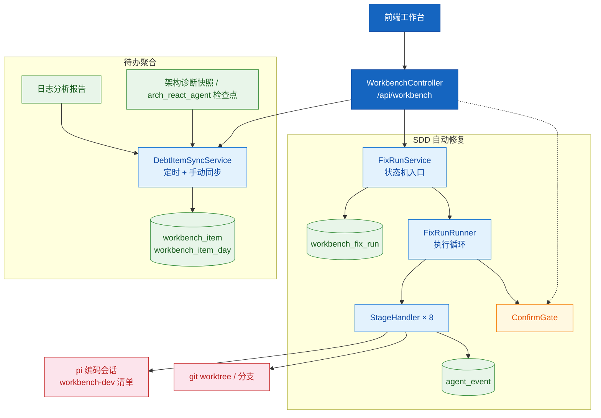
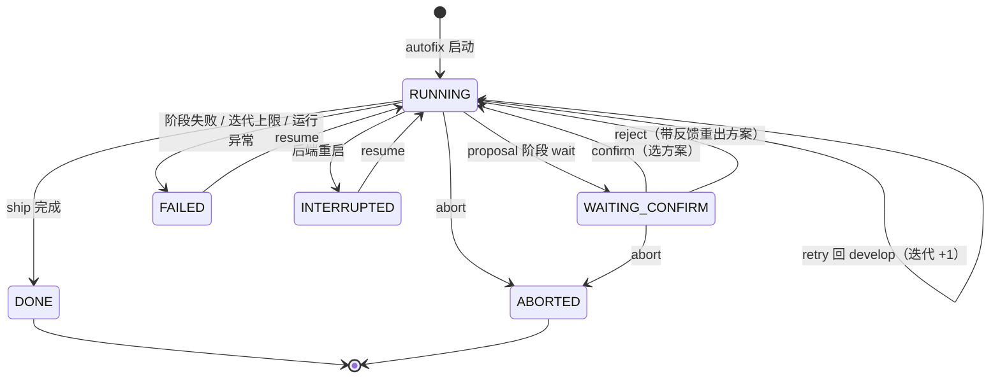
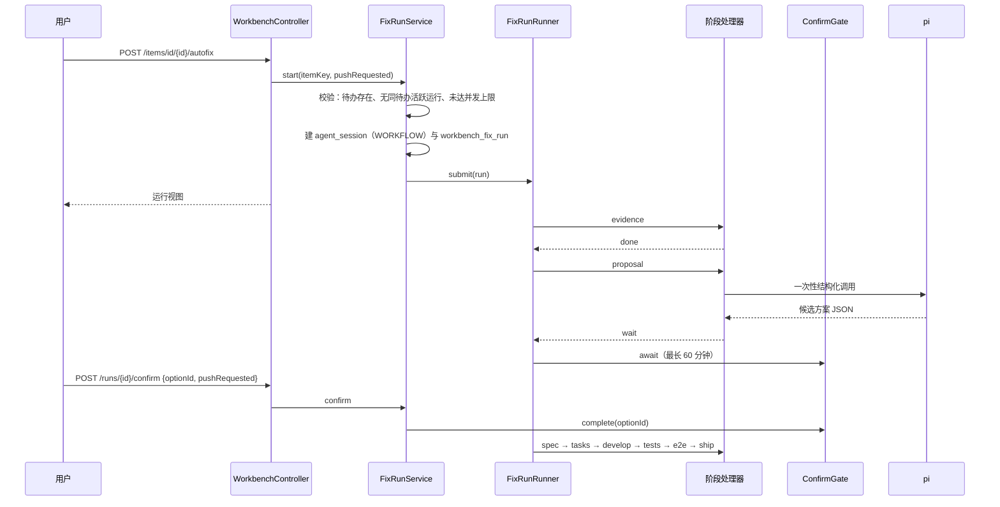

# 工作台与自动修复

> 自动生成于 2026-11-26，基于 `99d0037` 版本

| 属性 | 值 |
|------|-----|
| **所属层** | 应用层（跨项目聚合）+ 领域服务层（SDD 修复流水线） |
| **目录** | `workbench/`（26 个文件：`config` / `controller` / `model` / `repository` / `service` / `service/exec` / `service/stage`） |
| **核心类** | `WorkbenchController`、`DebtItemSyncService`、`FixRunService`、`FixRunRunner`、`WorkbenchStages`、各 `*Stage` |
| **REST 基础路径** | `/api/workbench`（13 个端点，全部要求登录） |
| **SQLite 表** | `workbench_item`、`workbench_item_day`、`workbench_fix_run` |

---

## 1. 模块概述

### 1.1 职责定义

**核心职责**：把各项目的技术债（日志分析 issue、架构诊断 issue）聚合成一张跨项目待办表，并对单条待办执行 SDD（Spec-Driven Development）自动修复流水线。

| 本模块负责 | 本模块不负责 | 由谁负责 |
|-----------|-------------|---------|
| 跨项目待办聚合、按键去重、出现次数与趋势 | 产生 issue | [日志云与运维](./日志云与运维.md)、[架构诊断](./架构诊断.md) |
| 待办状态流转（忽略 / 恢复 / 运行中 / 完成） | 用户与角色管理 | [应用启动与全局配置](./应用启动与全局配置.md) |
| SDD 八阶段修复的推进、确认门、迭代回路、中止与恢复 | 模型调用与工具执行 | [pi-agent底座](./pi-agent底座.md) |
| 修复运行的会话事件（复用 `agent_event` 与 SSE） | 通用 DAG 执行 | [工作流引擎](./工作流引擎.md) |
| git worktree、分支、提交、推送 | 交互式修复对话 | [修复引擎fixengine](./修复引擎fixengine.md) |

### 1.2 核心文件清单

| 文件 | 类型 | 职责 |
|------|------|------|
| `controller/WorkbenchController.java` | REST 入口 | 总览、待办列表、同步、状态操作、修复运行管理 |
| `service/DebtItemSyncService.java` | 聚合服务 | 读日志报告与架构诊断产出，按键 upsert 待办 |
| `service/FixRunService.java` | 状态机服务 | 创建运行、确认 / 驳回 / 中止 / 继续的入口校验，重启恢复 |
| `service/FixRunRunner.java` | 执行循环 | 按阶段链推进，处理等待、驳回、重试与收尾 |
| `service/ConfirmGate.java` | 确认通道 | runner 与确认接口之间的一次性 `CompletableFuture` 传递 |
| `service/WorkbenchEventSink.java` | 事件发射 | 把阶段进度写成 `agent_event` |
| `service/stage/*Stage.java` | 阶段实现（8 个） | 每个阶段一个 `StageHandler` |
| `service/exec/CommandRunner.java` | 命令执行 | 子进程执行、超时与输出采集 |
| `model/WorkbenchItem.java`、`WorkbenchFixRun.java`、`WorkbenchStages.java` | 模型 | 待办、修复运行、阶段定义 |
| `config/WorkbenchSchemaInitializer.java` | 建表 | 启动时 `CREATE TABLE IF NOT EXISTS` 三张表 |

---

## 2. 模块架构



---

## 3. 待办聚合

### 3.1 数据来源与键

| 来源 | `source` | `itemKey` 形态 | 严重度 |
|------|---------|---------------|-------|
| 日志分析报告 | `log` | `log:<project>:<errorFingerprint 或 reportId>` | 取根因结果的优先级；兼容 `P0/P1/P2` 与 `HIGH/MEDIUM/MIDDLE/LOW` 两套写法，缺省 `P2` |
| 架构深度分析（`arch_react_agent` 节点检查点里的问题） | `arch_ai` | `arch:ai:<project>:<ref 或 标题 sha16>` | 缺省 `P2` |
| 架构诊断报告（规则产出的问题） | `arch_rule` | `arch:rule:<project>:sha16(severity|sourceLevel|message)` | `P0` 置信度 `high`，其余 `medium` |

同步按 `itemKey` upsert：同一问题多次出现只更新内容与出现次数；用户的状态决定（`IGNORED` / `DONE` / `RUNNING` / `WAITING`）不会被覆盖。聚合只做读表，图谱影响面在需要时按需查询。

### 3.2 触发方式

| 方式 | 说明 |
|------|------|
| 定时 | `@Scheduled(fixedDelayString="${workbench.sync.interval-ms:600000}", initialDelayString="15000")`，`workbench.sync.enabled=false` 时直接返回 |
| 手动 | `POST /api/workbench/items/sync`，返回 `{logItems, archItems, created}` |

定时任务失败只记日志，不影响服务；手动同步失败由接口返回错误。

---

## 4. SDD 自动修复

### 4.1 八个阶段

顺序固定，`stageIndex` 对应下标。阶段链与回退目标取自 `AgentRegistry` 中 `wb-autofix` 的声明。

| # | key | 名称 | 做什么 | 结果 |
|---|-----|------|-------|------|
| 1 | `evidence` | 代码实证 | 把待办定位到「类#方法」，查方法节点、上游调用方与入口点，读本地源码取方法片段与 HTTP 接口映射 | 产出带引用的证据包 |
| 2 | `proposal` | 方案确认 | 基于证据包生成 2–3 个候选方案（风险 / 工作量 / 触及文件） | **停下等确认**（`wait`） |
| 3 | `spec` | Spec 生成 | 背景、目标、验收标准、非目标、测试用例清单（复现 / 单元 / API / E2E） | 结构检查不过则带问题重试一次 |
| 4 | `tasks` | 任务拆分 | 每个任务只涉及一个文件，`verify` 引用 Spec 用例名 | 同上 |
| 5 | `develop` | 迭代开发 | 在 git worktree 内由 pi 编码会话实现任务、写测试、编译 | 后端复核 `test-compile`，不过则带报错回同一会话 |
| 6 | `tests` | 用例回归 | 执行 Spec 中 repro / unit 用例所在的测试类 | 未通过 → `retry` 回 `develop` |
| 7 | `e2e` | 全链路 E2E | 构建 → 本地启动 → HTTP 健康检查 → 逐条执行 api 用例 → 有前端套件则跑 Playwright | 未通过 → `retry` 回 `develop` |
| 8 | `ship` | 提交推送 | 在 worktree 分支上提交；勾选推送且全局开关打开则推到 origin 同名分支 | 从不合并主干 |

回路：`tests` / `e2e` 失败且未达迭代上限时回到 `develop`，并把失败详情放进产物 `lastFailure`；`proposal` 被驳回后带反馈重跑并再次停下。

### 4.2 阶段契约 `StageHandler`

```java
String key();
StageOutcome execute(StageContext ctx) throws Exception;
record StageOutcome(String kind, Map<String, Object> output, String message)
```

| kind | runner 的处理 |
|------|-------------|
| `done` | 写检查点，进入下一阶段 |
| `wait` | 写检查点，运行置 `WAITING_CONFIRM`，阻塞等确认（最长 60 分钟） |
| `failed` | 记 `ERROR` 事件，运行以 `FAILED` 结束 |
| `retry` | 写检查点；`iteration >= maxIterations` 则失败，否则迭代数加一回到 `retryTarget`（`develop`） |

`StageContext` 提供按阶段键取产物的 `artifact(stageKey)`、`publish`、`log` 与 `cancelled()`。阶段一律按键取输入，不假设上一个阶段是什么。

### 4.3 执行循环 `FixRunRunner`

- 每次运行在固定 2 线程的线程池（线程名 `fix-run`）上执行，用 `AgentFlowCancelRegistry.callBound` 绑定 runId。
- 执行线程维护「阶段键 → 产物」全表；重新进入运行（重启后继续、失败后重试）时从 `agent_event` 的 `CHECKPOINT` 事件恢复，同一阶段多次产出取最后一次。
- 阶段进度经 `WorkbenchEventSink` 写入 `agent_event`：`NODE_START` / `NODE_COMPLETE` 只带节点名，`CHECKPOINT` 带阶段产物，运行日志走 `NODE_DELTA` 并节流合并。刻意不发 `HITL_REQ`，「等你确认」用会话状态 `WAITING_HITL` 表达。

### 4.4 运行状态机



| 运行状态 | 待办状态（`workbench_item.status`） |
|---------|---------------------------------|
| `RUNNING` | `RUNNING` |
| `WAITING_CONFIRM` | `WAITING` |
| `DONE` | `DONE` |
| `ABORTED` | `NEW` |
| `FAILED` | `FAILED` |
| `INTERRUPTED` | 不改写（重启恢复只改运行行，待办仍是启动时写入的 `RUNNING`） |

### 4.5 时序：从启动到方案确认



---

## 5. REST 端点

鉴权：`/api/workbench/**` 下全部端点（含 GET）要求登录；非 GET 另需 `ADMIN` 角色。

| 方法 | 路径 | 说明 | 关键参数 / 请求体 |
|------|------|------|-----------------|
| GET | `/api/workbench/summary` | 总览：`total` / `open` / `running` / `waiting` / `done` / `failed` / `ignored` / `p0` / `p1` / `p2` / `cleared7d` / `byProject` | — |
| GET | `/api/workbench/items` | 待办列表，每项带近 7 日 `trend` | — |
| POST | `/api/workbench/items/sync` | 手动触发聚合 | — |
| POST | `/api/workbench/items/id/{id}/ignore` | 忽略待办 | — |
| POST | `/api/workbench/items/id/{id}/restore` | 恢复为 `NEW` | — |
| POST | `/api/workbench/items/id/{id}/autofix` | 启动单条自动修复 | `{pushRequested}`，冲突返回 `code=409` |
| POST | `/api/workbench/items/autofix` | 批量启动 | `{itemIds, itemKeys, pushRequested}`，返回 `{started, failed}` |
| GET | `/api/workbench/runs` | 运行列表，最多 20 条 | — |
| GET | `/api/workbench/runs/{id}` | 运行详情：运行行 + `stages` + 各阶段 `checkpoints` + 最后 60 行 `logTail` | — |
| POST | `/api/workbench/runs/{id}/confirm` | 确认方案 | `{optionId, pushRequested}` |
| POST | `/api/workbench/runs/{id}/reject` | 驳回方案 | `{feedback}` |
| POST | `/api/workbench/runs/{id}/abort` | 中止运行 | 仅活跃运行可中止 |
| POST | `/api/workbench/runs/{id}/resume` | 继续运行 | 仅 `INTERRUPTED` 或 `FAILED` |

操作接口用数字 `id` 定位：`itemKey` 含冒号、斜杠、空格，不能放 URL 路径段。

---

## 6. 数据模型

### 6.1 `workbench_item`

| 字段 | 类型 | 说明 |
|------|------|------|
| `id` | INTEGER PK | 数字主键，操作接口用它定位 |
| `item_key` | TEXT UNIQUE | 去重键 |
| `source` | TEXT | `log` / `arch_rule` / `arch_ai` |
| `project_path` / `title` / `location` / `severity` | TEXT | 项目、标题、代码位置、`P0`–`P2`（默认 `P2`） |
| `status` | TEXT | `NEW`（默认）/ `RUNNING` / `WAITING` / `DONE` / `FAILED` / `IGNORED` |
| `confidence` / `chain_status` | TEXT | 证据强度 |
| `why` / `suggestion` | TEXT | 根因与建议 |
| `evidence_json` / `source_ref_json` | TEXT | 证据数组、跳回原页面的引用 |
| `occurrence_count` | INTEGER | 出现次数（默认 1） |
| `first_seen_at` / `last_seen_at` | INTEGER | 首次 / 最近出现 |
| `current_run_id` | INTEGER | 当前修复运行 |

### 6.2 `workbench_item_day`

主键 `(item_key, day)`，字段 `count`：每项每日累计出现次数。

### 6.3 `workbench_fix_run`

| 字段 | 说明 |
|------|------|
| `item_key` | 对应待办；同一待办同时只允许一个活跃运行 |
| `session_uuid`（UNIQUE）/ `session_id` | 对外的会话 UUID 与 `agent_session.id` |
| `project_path` | 项目路径 |
| `status` | `RUNNING`（默认）/ `WAITING_CONFIRM` / `DONE` / `FAILED` / `ABORTED` / `INTERRUPTED` |
| `current_stage` / `stage_index` / `iteration` | 当前阶段、下标、迭代轮次（默认 1） |
| `chosen_option` | 确认时选定的方案 |
| `push_requested` / `pushed` | 是否请求推送（受 `workbench.fix.push-enabled` 约束）、是否已推送 |
| `worktree_path` / `branch_name` / `commit_hash` | 修复现场 |
| `error_message` | 失败原因 |

`develop` 阶段创建的分支名为 `fix/wb-r<运行ID>-<itemKey 短哈希>`，基于项目当前分支建 worktree；`ship` 阶段的提交信息以 `fix: <待办标题>` 开头。

---

## 7. 配置项

| 键 | 默认值 | 说明 |
|----|-------|------|
| `workbench.sync.enabled` | `true` | 定时聚合同步开关 |
| `workbench.sync.interval-ms` | `600000` | 定时聚合同步间隔 |
| `workbench.fix.push-enabled` | `true` | 全局推送开关；关闭时即使勾选推送也只本地提交 |
| `workbench.fix.max-concurrent-runs` | `2` | 同时运行的自动修复上限 |
| `workbench.fix.max-iterations` | `3` | 迭代上限；`AgentRegistry` 声明里的 `maxIterations` 策略值同为 3，配置值作为兜底 |
| `workbench.fix.e2e.start-service` | `true` | E2E 是否本地启动服务 |
| `workbench.fix.e2e.isolate-home` | `true` | 回归 / E2E 用隔离的 `user.home` |

---

## 8. 错误处理

| 场景 | 处理 | 接口表现 |
|------|------|---------|
| 待办已有活跃运行 | `start` 返回错误 | `code=409` |
| 活跃运行数达上限 | `start` 返回错误 | `code=409` |
| 确认时运行不在 `WAITING_CONFIRM` | 拒绝 | `code=409` |
| 确认时未选方案 | 拒绝 | `code=409` |
| 等待确认超时（60 分钟） | 保持 `WAITING_CONFIRM`，线程退出；用户确认时重新提交 runner | — |
| 后端重启时仍有 `RUNNING` | `FixRunService.recoverAfterRestart()` 标为 `INTERRUPTED`，等待手动继续 | — |
| pi 改了 worktree 的提交历史（HEAD 变化） | 本次改动不采纳，运行失败 | 阶段失败 |
| 回归 / E2E 达到迭代上限 | 记 `ERROR` 事件，运行 `FAILED` | — |
| 中止 | 登记取消标记 + 结束该运行登记的子进程；runner 落 `ABORTED` | 接口返回后由 runner 收尾 |
| Spec 未定义可执行用例 | `tests` / `e2e` 明确失败，不视为通过 | 运行 `FAILED` |
| 不支持的构建工具 | 回归无法执行（只有 Maven 与 pytest 的回归执行器） | 运行 `FAILED` |

---

## 9. 已知问题与扩展点

| 问题 | 说明 |
|------|------|
| runner 线程池固定 2 线程 | `FixRunRunner` 用 `Executors.newFixedThreadPool(2)`，与 `max-concurrent-runs` 配置相互独立 |
| 等待确认超时后线程退出 | 再次确认需靠 `ConfirmGate.complete` 返回 false 触发重新提交 |
| 一次性结构化调用依赖 pi 就绪 | `isAvailable()` 为假时 `proposal` / `spec` / `tasks` 无法生成 |

| 扩展点 | 方式 |
|-------|------|
| 新增阶段 | 实现 `StageHandler`（bean），在 `AgentRegistry` 的 `wb-autofix` 节点链中加入 key |
| 调整回路目标 | 改 `wb-autofix` 声明里的 `retryTarget` |
| 新增待办来源 | 在 `DebtItemSyncService` 增加同步方法并定义 `itemKey` 规则 |

---

## 10. 依赖关系

| 方向 | 依赖 | 用途 |
|------|------|------|
| 上游 | [pi-agent底座](./pi-agent底座.md) | `develop` 阶段的编码会话；`proposal` / `spec` / `tasks` 的 `AgentLlmClient` |
| 上游 | `ram.repository`、`ram.model` | `agent_session` / `agent_event` 的读写 |
| 上游 | `agentflow.AgentFlowCancelRegistry` | 取消登记 |
| 上游 | `fixengine.service.WorktreeService`、`executor.GitExecutor` | worktree、提交、推送 |
| 上游 | `repository.LogAnalysisRepository`、`archdiagnosis.repository.ArchDiagnosisSnapshotRepository` | 聚合数据源 |
| 下游 | 前端工作台页面 | `/api/workbench/**` |

---

> **相关文档**：
> - 架构总览 → [02-架构设计](../02-架构设计/index.md)
> - pi 运行时 → [pi-agent底座](./pi-agent底座.md)
> - 交互式修复 → [修复引擎fixengine](./修复引擎fixengine.md)
> - 待办来源 → [架构诊断](./架构诊断.md)、[日志云与运维](./日志云与运维.md)
> - 数据模型 → [06-数据模型](../06-数据模型/index.md)
