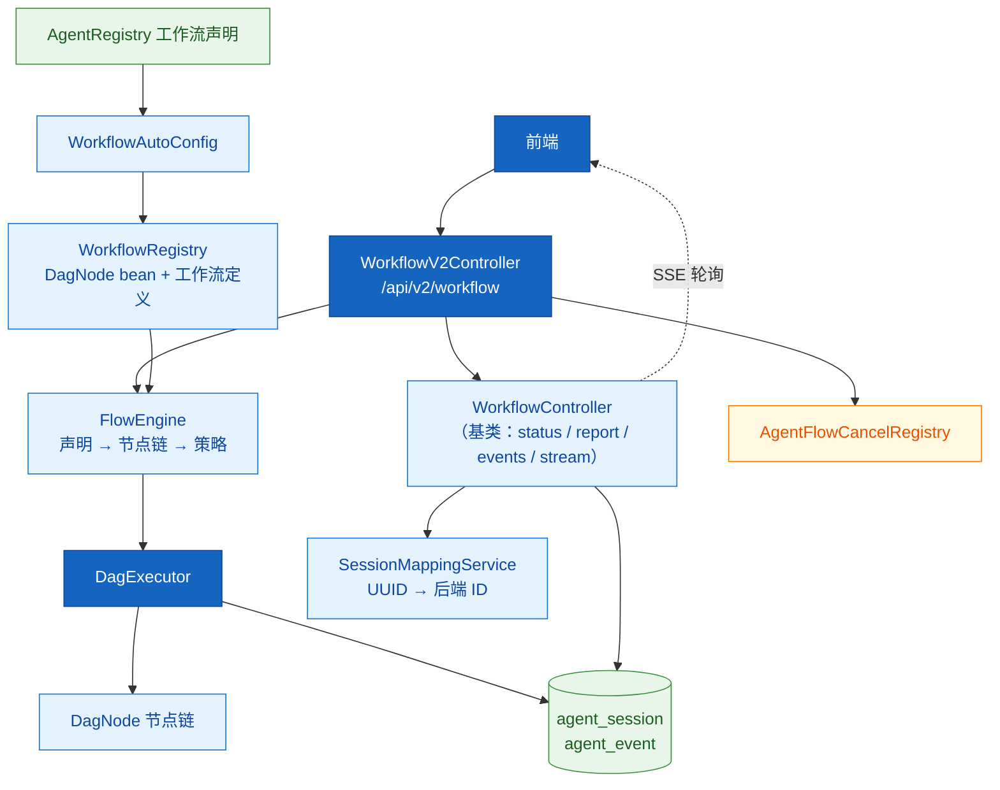
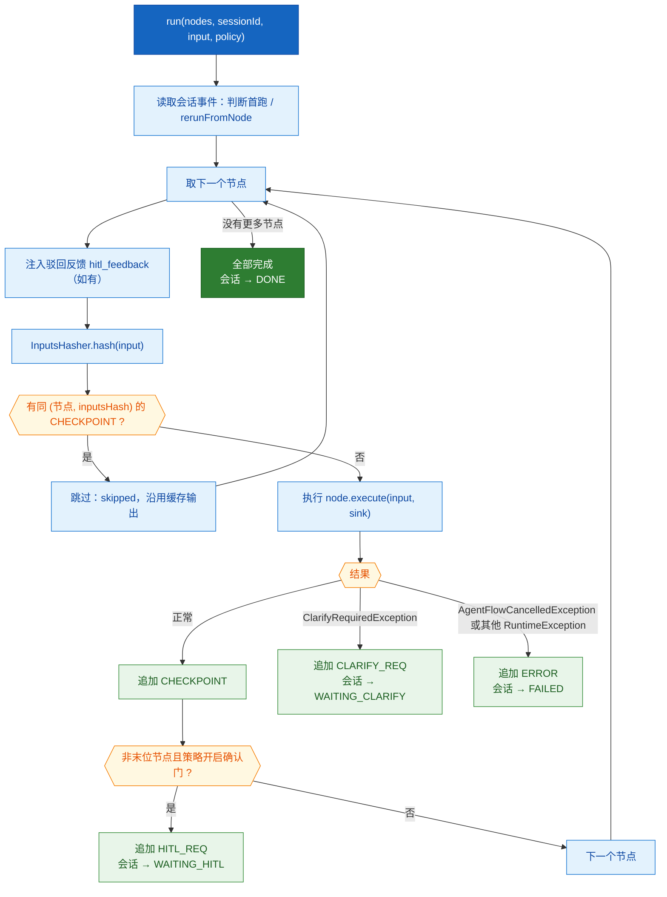

# 工作流引擎

> 自动生成于 2026-11-26，基于 `99d0037` 版本

| 属性 | 值 |
|------|-----|
| **所属层** | 应用层（流程编排基础设施） |
| **目录** | `workflow/`（20 个文件；架构专用部分见 [架构诊断](./架构诊断.md)）、`agentflow/`（9 个文件） |
| **核心类** | `DagExecutor`、`WorkflowRegistry`、`FlowEngine`（位于 `agentbase`）、`WorkflowV2Controller`、`AgentFlowCancelRegistry` |
| **REST 基础路径** | `/api/v2/workflow`（8 个端点，全部要求登录） |
| **持久化** | `agent_session`、`agent_event`（SQLite，见 [RAM需求评估](./RAM需求评估.md) 的 `RamSchemaInitializer`） |

---

## 1. 模块概述

### 1.1 职责定义

**核心职责**：按声明把一组有序节点跑成一个可暂停、可续跑、可回放的会话。骨架是有序管道（源码注释：责任链只用于节点内「多选一」）；检查点按节点输入哈希复用；节点可以等待用户（澄清 / 确认）或失败；事件追加写入 `agent_event`，经 SSE 推给前端。

| 本模块负责 | 本模块不负责 | 由谁负责 |
|-----------|-------------|---------|
| 节点 bean 与工作流定义的注册 | 节点的业务逻辑 | [RAM需求评估](./RAM需求评估.md)、[日志云与运维](./日志云与运维.md)、[合并影响分析](./合并影响分析.md)、[架构诊断](./架构诊断.md) 等 |
| 游标推进、检查点复用、等待、失败、中止 | agent 与工作流的「声明内容」 | [pi-agent底座](./pi-agent底座.md) 的 `AgentRegistry` |
| 会话事件的落库与 SSE 推流 / 回放 | 事件的前端渲染 | 前端 |
| 取消登记 | 取消后具体怎么停 | 各节点（在耗时步骤之间检查） |
| 工作台修复运行的阶段推进 | — | [工作台与自动修复](./工作台与自动修复.md) 自带 `FixRunRunner`，只复用本模块的事件表与 SSE 约定 |

### 1.2 核心文件清单

| 文件 | 类型 | 职责 |
|------|------|------|
| `workflow/DagNode.java` | 接口 | 节点契约：`name()`、`agentId()`、`execute(input)`、`execute(input, sink)` |
| `workflow/DagExecutor.java` | 执行器 | 纯机械执行：游标、检查点、等待、中止、事件 |
| `workflow/ExecutionPolicy.java` | 策略记录 | `interNodeHitlEnabled`、`emitNodeEvents` |
| `workflow/ExecutionResult.java` | 结果记录 | `sessionId`、`status`、`executedNodes`、`skippedNodes`、`lastNodeOutput` |
| `workflow/WorkflowDefinition.java` | 定义记录 | `workflowType`、`displayName`、`description`、`nodeNames`、`metadata` |
| `workflow/WorkflowRegistry.java` | 注册表 | 自动收集全部 `DagNode` bean，按 `name()` 注册；登记工作流定义 |
| `workflow/WorkflowAutoConfig.java` | 启动装配 | 把 `AgentRegistry` 里的 7 条工作流装进注册表 |
| `workflow/InputsHasher.java` | 工具 | 输入 Map 的规范化 JSON 做 SHA-256 |
| `workflow/NodeEventSink.java` | 接口 | 节点过程消息通道 |
| `workflow/WorkflowController.java` | 端点基类 | 会话读写与 SSE 实现；**自身不带控制器注解** |
| `workflow/v2/WorkflowV2Controller.java` | REST 入口 | 继承基类，重写 `start` 与 `abort` |
| `workflow/ClarifyRequiredException.java`、`HitlConfirmException.java` | 异常 | 澄清暂停、确认暂停 |
| `agentflow/AgentFlowCancelRegistry.java` | 取消登记 | 线程绑定的流程取消标记 |
| `agentflow/AgentFlowCancelledException.java` | 异常 | 节点感知取消后抛出 |

---

## 2. 模块架构

`/api/workflow` 前缀已退役：基类不再单独注册为控制器，前端只走 `/api/v2/workflow`。

---

## 3. 执行语义 `DagExecutor`

| 机制 | 规则 |
|------|------|
| 检查点复用 | 同一会话、同一节点、同一 `inputsHash` 的最近一条 `CHECKPOINT` 事件命中即跳过执行 |
| 首跑 | 会话没有任何事件时全部执行，不查缓存，也不插确认门 |
| 从节点重跑 | 会话的 `rerunFromNode` 非空时，走到该节点起 `forceRerun=true`：目标及其下游不查缓存、跳过确认门；结束后清掉该字段 |
| 驳回反馈 | 最近一条该节点的 `HITL_RES` 动作为 `reject` 时，把 `feedback` 注入输入的 `hitl_feedback`，输入哈希改变，缓存必然未命中 |
| 已确认判定 | 该节点最近一条 `HITL_RES` 存在，或最近一条 `CHECKPOINT` 带 `edited=true` |
| 节点间确认门 | 非末位节点执行后，若策略开启且该节点未确认，追加 `HITL_REQ` 并把会话置 `WAITING_HITL` |
| 澄清暂停 | 节点抛 `ClarifyRequiredException` → 追加 `CLARIFY_REQ`（带轮次号），会话置 `WAITING_CLARIFY` |
| 失败 | 节点抛其他运行时异常 → 追加 `ERROR`（`validatorStatus=FAIL`），会话置 `FAILED` |
| 用户取消 | 节点抛 `AgentFlowCancelledException`：同样记 `ERROR` 与 `FAILED`，由发起方再还原为 `ABORTED` |

### 3.1 执行策略 `ExecutionPolicy`

| 字段 | 含义 | 来源 |
|------|------|------|
| `interNodeHitlEnabled` | 是否插入节点间确认门 | 声明里 `skipHitl=true` 时关闭 |
| `emitNodeEvents` | 是否为实际执行的节点发出 `NODE_START` / `NODE_COMPLETE` | 声明里 `emitNodeEvents=true` 时开启 |

`DEFAULT` 策略为「开启确认门、不发节点生命周期事件」。源码注释写明：新的执行策略需求在此类型上扩展，而不是在执行器里累加分支。

### 3.2 事件类型

`DagExecutor` 追加写入 `agent_event` 的事件：

| 事件 | payload 要点 | 何时 |
|------|-------------|------|
| `NODE_START` / `NODE_COMPLETE` | `nodeName` | 节点开始 / 完成（仅 `emitNodeEvents` 时） |
| `NODE_DELTA` | `nodeName`、`message` | 节点经 `NodeEventSink` 输出过程消息（仅 `emitNodeEvents` 时） |
| `CHECKPOINT` | `nodeName`、`inputsHash`、`output` | 节点正常完成 |
| `CLARIFY_REQ` | `nodeName`、`questions`、`originalInput`、可选 `partialOutput` | 节点要求澄清 |
| `HITL_REQ` | `nodeName`、`output` | 节点间确认门 |
| `ERROR` | `nodeName`、`error`、`type` | 节点失败或被取消 |

`ram.model.EventType` 全量取值（17 个）：`USER_MSG`、`ASSISTANT_DELTA`、`TOOL_USE`、`TOOL_RESULT`、`CHECKPOINT`、`CLARIFY_REQ`、`CLARIFY_RES`、`HITL_REQ`、`HITL_RES`、`NODE_START`、`NODE_COMPLETE`、`NODE_DELTA`、`NODES_CLEARED`、`ERROR`、`TURN_INTERRUPTED`、`MESSAGE`。其余事件由各业务流程自行追加。

### 3.3 会话状态

`ram.model.SessionStatus`：`RUNNING`、`WAITING_CLARIFY`、`WAITING_HITL`、`PAUSED`、`DONE`、`FAILED`、`ABORTED`、`ARCHIVED`。`DagExecutor` 只写 `WAITING_CLARIFY`、`WAITING_HITL`、`FAILED`、`DONE`。

`ram.model.SessionType`：`DEMAND`、`STATUS`、`PHASE2`、`MERGE_ANALYSIS`、`LOG_FOLLOWUP`、`FIX`、`WORKFLOW`。本模块启动的会话固定为 `WORKFLOW`。

---

## 4. REST 端点

鉴权：`/api/v2/workflow/**` 全部端点要求登录（未带有效令牌返回 HTTP 401）。

| 方法 | 路径 | 说明 |
|------|------|------|
| POST | `/api/v2/workflow/start` | 启动工作流。请求体 `{workflowType, input}`，`input.projectPaths` 必须是非空数组；返回 `{sessionId}`（会话 UUID） |
| GET | `/api/v2/workflow/definitions` | 已注册的工作流定义列表 |
| GET | `/api/v2/workflow/nodes` | 可用节点：`name → {name, agentId}` |
| GET | `/api/v2/workflow/sessions/{sid}/status` | `{status, currentNode}` |
| GET | `/api/v2/workflow/sessions/{sid}/report` | 最新检查点输出；可带 `nodeName` 取指定节点 |
| GET | `/api/v2/workflow/sessions/{sid}/events` | 全部事件 |
| GET | `/api/v2/workflow/sessions/{sid}/stream` | SSE 事件流，可带 `afterSeq` |
| POST | `/api/v2/workflow/sessions/{sid}/abort` | 中止：登记取消标记 + 会话置 `ABORTED` |

后 6 个端点由基类实现、子类继承，因此脚本式扫描容易漏掉；`start` 与 `abort` 在 `WorkflowV2Controller` 中重写。

### 4.1 启动流程

1. 校验 `workflowType` 已注册、`input.projectPaths` 非空，否则返回 `code=400`。
2. 种一行 `agent_session`（状态 `RUNNING`、用户 `anonymous`、类型 `WORKFLOW`），生成 UUID 并注册到 `SessionMappingService`，使 SSE 可立即挂接。
3. `FlowEngine.resolve` 解析节点链，`ExecutionPolicy.fromMetadata` 取策略。
4. 清掉该会话旧的取消标记，`CompletableFuture.runAsync` 异步执行。
5. 执行线程用 `AgentFlowCancelRegistry.callBound` 绑定会话 ID；若结果是 `FAILED` 且取消标记仍在，把会话状态还原为 `ABORTED`。

### 4.2 SSE 协议

| 项目 | 值 |
|------|-----|
| 响应类型 | `text/event-stream`，响应头 `Cache-Control: no-cache, no-transform`、`X-Accel-Buffering: no` |
| 轮询 | 单独的 2 线程调度池（线程名 `workflow-sse`），间隔 `ram.sse.poll-interval-ms` |
| 超时 | `ram.sse.timeout-ms` |
| 心跳 | 每个轮询周期发一条注释行 `heartbeat` |
| 事件数据 | `{seq, type, payload[, clarifyRoundNo]}` |

流上除按 `seq` 回放已落库事件外，还会补发合成事件并随即关流：

| 合成事件 | 触发 |
|---------|------|
| `CLARIFY_REQUIRED` | 回放到 `CLARIFY_REQ` |
| `HITL_REQUIRED` | 回放到 `HITL_REQ` |
| `RUN_COMPLETED` / `RUN_FAILED` / `RUN_ABORTED` | 会话状态为 `DONE` / `FAILED` / `ABORTED` |
| `RUN_ABORTED`（payload `reason=user_requested`） | 会话在本进程内被调用过中止接口 |

会话映射在 120 个轮询周期内仍未出现时以错误结束流。客户端断开导致的写失败按 debug 记录并停止轮询。

---

### 4.3 声明的 7 条工作流与节点解析

`FlowEngine.resolve` 先按名字找 `DagNode` bean，只有 `arch_react_agent` 走工厂。主代码中注册为 bean 的 `DagNode` 共 8 个：`arch_evidence_collect`、`clarify`、`impact`、`implement`、`phase2_analysis`、`project_overview`、`tech_plan`、`verify`。

| 工作流 | 能否经统一入口解析 | 说明 |
|-------|-----------------|------|
| `arch-deep-analysis` | 能 | `arch_evidence_collect` 是 bean，`arch_react_agent` 由工厂创建 |
| `ram-demand` | 能 | 5 个节点都是 bean |
| `ram-status`、`ram-phase2` | 能 | — |
| `wb-autofix` | 不能 | 8 个阶段是 `StageHandler`，由 `FixRunRunner` 推进，不是 `DagNode`（见 [工作台与自动修复](./工作台与自动修复.md)） |
| `log-analysis` | 不能 | `decode` / `collect` / `hypothesis` / `synthesis` / `report` 没有 `DagNode` bean；`verify` 会解析到 RAM 的 `VerifyNode`（见 [日志云与运维](./日志云与运维.md)） |
| `merge-analysis` | 不能 | `diff` / `test_scope` / `report` 没有 `DagNode` bean；`impact` 会解析到 RAM 的 `ImpactNode`（见 [合并影响分析](./合并影响分析.md)） |

后三条的声明目前只体现在统一登记与 `GET /definitions` 的返回里；它们的执行由各自的运行器驱动，不经 `FlowEngine`。此结论依据 `FlowEngine.resolve` 的逻辑与现有 bean 名得出，未实际调用接口验证。

---

## 5. 取消 `AgentFlowCancelRegistry`

| 方法 | 作用 |
|------|------|
| `callBound(flowId, body)` | 在当前线程绑定流程 ID 并执行；节点在同一线程内运行时才能感知取消 |
| `isCurrentCancelled()` | 当前线程绑定的流程是否已被请求取消；未绑定恒为 false |
| `requestCancel(flowId)` | 登记取消 |
| `clear(flowId)` | 流程结束后清掉标记 |

节点在耗时步骤之间检查，为真时抛 `AgentFlowCancelledException`（继承 `RuntimeException`，能穿过只捕获运行时异常的执行器）。流程 ID 由调用方定义：工作流用会话的后端 ID，工作台修复用运行 ID。

---

## 6. 配置项

| 键 | 代码默认值 | 说明 |
|----|-----------|------|
| `ram.sse.timeout-ms` | `300000` | SSE 连接超时 |
| `ram.sse.poll-interval-ms` | `3000` | SSE 轮询间隔（`application.yml` 中设为 500） |

---

## 7. 错误处理

| 场景 | 处理 |
|------|------|
| `workflowType` 未知或 `projectPaths` 缺失 | `ApiResponse.error(400, ...)`，HTTP 状态仍为 200 |
| 节点解析不出 | `start` 在建会话之前抛 `IllegalArgumentException` → 全局异常处理返回 HTTP 400 |
| 会话 UUID 未注册 | `status` / `report` / `events` / `abort` 返回 `code=404` |
| DAG 执行抛出未捕获异常 | 异步任务里把会话置 `FAILED` |
| `arch-react` 流开关关闭 | `ArchReActNodeV2Factory.create()` 抛 `IllegalStateException` |

---

## 8. 已知问题与扩展点

| 问题 | 说明 |
|------|------|
| 已中止会话集合仅在内存 | `WorkflowController.abortedSessions` 不落库，重启后丢失 |
| 基类 Javadoc 与实际端点不一致 | 基类注释列出了 `clarify` / `confirm` / `rerun-from`，但基类并未实现这些映射；这些操作在各业务的控制器里 |
| 业务错误用 body 内 `code` 表达 | 多数接口 HTTP 状态为 200，错误看 `code` 字段 |
| 3 条声明的工作流不可经统一入口启动 | `wb-autofix`、`log-analysis`、`merge-analysis` 的节点名解析不到，见 4.3 |

| 扩展点 | 方式 |
|-------|------|
| 新增节点 | 实现 `DagNode` 并注册为 bean，`WorkflowRegistry` 自动按 `name()` 收集 |
| 新增工作流 | 在 `AgentRegistry` 声明，`WorkflowAutoConfig` 启动时自动装进注册表 |
| 新增执行策略 | 扩展 `ExecutionPolicy`，不在 `DagExecutor` 里加分支 |

---

## 9. 依赖关系

| 方向 | 依赖 | 用途 |
|------|------|------|
| 上游 | [pi-agent底座](./pi-agent底座.md) | `AgentRegistry` 声明、`FlowEngine` |
| 上游 | `ram.repository`、`ram.model`、`ram.service.SessionMappingService` | 会话与事件的读写、UUID 映射 |
| 下游 | [RAM需求评估](./RAM需求评估.md) | 需求分析 / 现状分析 / Phase2 |
| 下游 | [日志云与运维](./日志云与运维.md) | `log-analysis` 工作流 |
| 下游 | [合并影响分析](./合并影响分析.md) | `merge-analysis` 工作流 |
| 下游 | [架构诊断](./架构诊断.md) | `arch-deep-analysis` 工作流 |

---

> **相关文档**：
> - 架构总览 → [02-架构设计](../02-架构设计/index.md)
> - 事件与会话表结构 → [06-数据模型](../06-数据模型/index.md)
> - 接口总表 → [05-接口文档](../05-接口文档/index.md)
