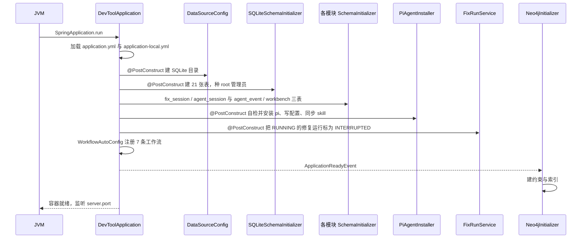
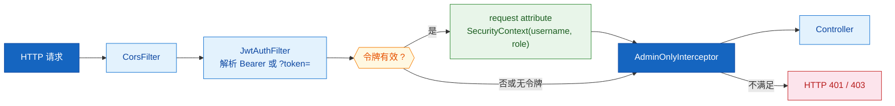

# 应用启动与全局配置

> 自动生成于 2026-11-26，基于 `99d0037` 版本

| 属性 | 值 |
|------|-----|
| **所属层** | 基础设施层 |
| **目录** | `DevToolApplication.java`、`config/`（24 个文件）、`resources/application*.yml`、`resources/logback-spring.xml` |
| **职责** | 进程入口、配置类装配、启动自检与建表、鉴权与角色拦截、CORS、全局异常、日志、Neo4j 连接、SQLite 数据源、HTTP 代理 |
| **框架版本** | Spring Boot 3.5.16、Java 17 |

---

## 1. 模块概述

### 1.1 职责定义

**核心职责**：让进程起来并具备全局能力——建好全部 SQLite 表、装好 pi、恢复中断的运行、注册 WebSocket 端点，并对所有 HTTP 请求统一施加鉴权、跨域与异常包装。

| 本模块负责 | 本模块不负责 | 由谁负责 |
|-----------|-------------|---------|
| Spring 容器启动与配置属性绑定 | 业务逻辑 | 各业务模块 |
| 启动时建表、管理员账号种子、pi 安装自检、运行恢复 | 运行期的数据读写 | 各模块的 Repository |
| 令牌签发与校验、角色拦截 | 具体接口的参数校验 | 各 Controller |
| 统一响应与全局异常 | 领域异常的定义 | `neo4j.model.SearchException` / `SearchErrorCode` 等 |
| Neo4j Driver 与事务管理器 | 图模型与 Cypher | [Neo4j图存储与检索](./Neo4j图存储与检索.md) |
| 出站 HTTP 的代理设置 | 各客户端的超时与重试 | 各客户端 |

### 1.2 核心文件清单

| 文件 | 类型 | 职责 |
|------|------|------|
| `DevToolApplication.java` | 启动类 | `@SpringBootApplication`、`@EnableCaching`、`@EnableScheduling` |
| `config/SecurityConfig.java` | 配置 | `BCryptPasswordEncoder`；把 `JwtAuthFilter` 注册到 `/*` |
| `config/JwtProperties.java`、`JwtTokenProvider.java` | 鉴权 | `jwt.*` 属性；令牌签发与校验 |
| `config/JwtAuthFilter.java`、`SecurityContext.java`、`AdminOnlyInterceptor.java` | 鉴权 | 解析身份、请求级身份记录、角色拦截 |
| `config/CorsConfig.java` | 配置 | 注册拦截器 + `CorsFilter` |
| `config/DataSourceConfig.java` | 配置 | SQLite `DataSource` 与 `JdbcTemplate`；静态字段 `PROJECT_DIR` |
| `config/SQLiteSchemaInitializer.java` | 建表 | 启动时建 21 张表并种管理员账号 |
| `config/Neo4jConfig.java`、`Neo4jHarnessConfig.java`、`Neo4jEmbeddedEnvironmentPostProcessor.java` | 配置 | Neo4j Driver、事务管理器、类型转换；进程内嵌入式模式 |
| `config/AsyncConfig.java` | 配置 | 默认异步执行器 `analysisTaskExecutor` |
| `config/GlobalExceptionHandler.java` | 异常 | `@RestControllerAdvice` |
| `config/JacksonConfig.java` | 序列化 | `Long` 一律序列化为字符串 |
| `config/WebSocketConfig.java` | 配置 | 注册 7 个 WebSocket 端点 |
| `config/AgentTypeRegistry.java` | 配置 | `hisi.agents.*` 绑定 |
| `config/ProxyConfig.java` | 配置 | `proxy.*`、共享 `RestTemplate`、运行时热修改 |
| `config/EmbeddingModelConfig.java`、`TextModelConfig.java`、`ZhipuConfig.java`、`LogCloudConfig.java` | 配置属性 | `embedding.*`、`text-model.*`、`zhipu.*`、`logcloud.*` |
| `config/AnalysisFeatureConfig.java` | 配置属性 | `analysis.features.*` |
| `config/JwtHandshakeInterceptor.java` | 鉴权 | 已定义但未被 `WebSocketConfig` 挂载 |

---

## 2. 启动流程

| 阶段 | 动作 | 失败影响 |
|------|------|---------|
| 容器初始化前 | `Neo4jEmbeddedEnvironmentPostProcessor` 在嵌入式开启时注入占位 `neo4j.uri` | — |
| `DataSourceConfig` | 按 `spring.datasource.url` 建父目录 | 启动失败 |
| `SQLiteSchemaInitializer` | `CREATE TABLE IF NOT EXISTS` 21 张表、索引、幂等加列与迁移、种 `root` | 启动失败 |
| `FixSchemaInitializer` / `RamSchemaInitializer` / `WorkbenchSchemaInitializer` | 分别建 1 / 2 / 3 张表 | 启动失败 |
| `PiAgentInstaller` | pi 自检与安装 | **不阻断启动**，下次用到时重试 |
| `FixRunService.recoverAfterRestart` | `RUNNING` → `INTERRUPTED` | — |
| `WorkflowAutoConfig` | 把 `AgentRegistry` 的工作流装进注册表 | — |
| `Neo4jInitializer` | `ApplicationReadyEvent` 时初始化 | 见 [Neo4j图存储与检索](./Neo4j图存储与检索.md) |

---

## 3. 鉴权与角色

### 3.1 链路

- `JwtAuthFilter` 挂在 `/*`，顺序 `HIGHEST_PRECEDENCE + 10`。先看 `Authorization: Bearer <token>`，没有再取查询参数 `token`（SSE / EventSource 设不了请求头）。**令牌无效时不拒绝请求**，只是不设置身份。
- `SecurityContext` 是请求属性，`isAdmin()` 即 `role == "ADMIN"`。
- 真正的拒绝发生在 `AdminOnlyInterceptor`（挂在 `/**`）。

### 3.2 拦截规则

| 请求 | 规则 |
|------|------|
| `OPTIONS` | 放行 |
| 路径以 `/api/auth/`、`/api/search/`、`/api/vector-search/`、`/api/ram/` 开头 | 不经过拦截器，无需登录 |
| 路径以 `/api/workflow/`、`/api/v2/workflow/`、`/api/workbench/` 开头 | **所有方法**都要登录；未登录返回 HTTP 401 |
| 其余 `GET`（`/api/users` 开头除外） | 放行 |
| 其余非 `GET`，以及 `/api/users` 开头的 `GET` | 未登录返回 HTTP 401；已登录但不是 `ADMIN` 返回 HTTP 403 |

拒绝时响应体为 `ApiResponse`：`{"code": 401, "message": "请先登录后再执行此操作", "data": null}` 或 `{"code": 403, "message": "仅管理员可执行此操作", "data": null}`，HTTP 状态码与 `code` 一致。

### 3.3 令牌 `JwtTokenProvider`

| 项目 | 规则 |
|------|------|
| 算法 | JJWT `Keys.hmacShaKeyFor` + `parseSignedClaims` |
| 载荷 | `subject` = 用户名，`role` 声明，签发与过期时间 |
| 有效期 | `jwt.expiration-ms`（`application.yml` 中 86400000，即 24 小时） |
| 密钥 | `jwt.secret`（环境变量 `JWT_SECRET`）；配置值不足 32 字节则启动抛 `IllegalStateException` |
| 未配置密钥 | 每次启动随机生成并打印告警；重启后已签发令牌全部失效 |

### 3.4 账号

| 端点 | 说明 |
|------|------|
| `POST /api/auth/login` | 请求体 `{username, password}`；成功返回 `{token, username, role}`；失败返回 `code=401` |
| `POST /api/auth/register` | 开放注册，角色固定 `MEMBER`；用户名 2–32 字符、口令至少 4 位；重名返回 `code=409` |
| `GET /api/auth/me` | 返回 `{username, role}`，未登录返回 `data=null` |
| `GET /api/users` | 用户列表（需管理员） |
| `PUT /api/users/{id}/role` | 改角色，`role` 只能是 `ADMIN` 或 `MEMBER`（需管理员） |

口令用 BCrypt 存储。首次启动且 `sys_user` 中没有 `root` 时创建 `root`（`ADMIN`）：初始口令取 `hisi.auth.root-password`（环境变量 `HISI_ROOT_PASSWORD`），未配置则随机生成并打印在启动日志里。

### 3.5 WebSocket 握手

`JwtHandshakeInterceptor` 实现了从 `?token=` 校验令牌的握手拦截，但 `WebSocketConfig` 注册的 7 个端点挂的都是 `HttpSessionHandshakeInterceptor`，主代码中没有其他地方使用它。即：按当前代码，WebSocket 握手不做令牌校验。

---

## 4. 统一响应与异常

### 4.1 `ApiResponse<T>`

`model/ApiResponse`：字段 `code`（200 成功）、`message`、`data`；静态方法 `success(data)`、`error(code, message)`、`error(message)`（默认 500）；`isSuccess()` 即 `code == 200`。`JacksonConfig` 把 `Long` / `long` 一律序列化为字符串（避免雪花 ID 超出 JS 安全整数范围）。

### 4.2 `GlobalExceptionHandler`

| 异常 | HTTP 状态 | 响应体 |
|------|---------|-------|
| `MethodArgumentNotValidException` | 400 | `ApiResponse.error(400, "参数校验失败: ...")` |
| `IllegalArgumentException` | 400 | `ApiResponse.error(400, ex.getMessage())` |
| `MissingServletRequestParameterException` | 400 | `ApiResponse.error(400, "缺少必需参数: <参数名>")` |
| `SearchException` | 取自 `SearchErrorCode.getHttpStatus()` | `ApiResponse.error(code, userMessage)` |
| 其他 `RuntimeException` | 500 | `ApiResponse.error(500, "服务内部错误: ...")` |
| 其他 `Exception` | 500 | SSE 请求或路径含 `/stream`、`/chat` 时返回纯文本「服务异常: ...」，否则 `ApiResponse.error(500, ...)` |
| `HttpMessageNotWritableException` | 500 | 同上的纯文本 / `ApiResponse` 分支 |

流式接口上客户端断开（异常链含 `AsyncRequestNotUsableException`，或 `/stream` 路径上的 `IOException`）不算服务端错误：按 debug 记录且不再写响应。

写日志时查询串里的 `token`、`access_token`、`password`、`passwd`、`secret`、`api_key`、`authorization` 会被替换为 `***`。

---

## 5. CORS

| 项目 | 值 |
|------|-----|
| 配置键 | `cors.allowed-origins`（环境变量 `CORS_ALLOWED_ORIGINS`），逗号分隔 |
| 默认 | `CorsConfig` 中为 `*`；`application.yml` 中为 `${CORS_ALLOWED_ORIGINS:*}` |
| 匹配方式 | `addAllowedOriginPattern` |
| 请求头 / 方法 | 全部允许 |
| 携带凭证 | 是 |
| 预检缓存 | 3600 秒 |

`WebSocketConfig` 读同一个键；该键缺省时代码内置的默认值是本机 5173 / 5174 / 5175 / 3000 端口。

---

## 6. WebSocket 端点注册

| 端点 | Handler | 用途 |
|------|---------|------|
| `/ws/terminal` | `handler.TerminalWebSocketHandler` | 终端 |
| `/ws/diagnosis` | `agent.event.AgentEventPublisher` | 诊断事件 |
| `/ws/apm` | `apm.handler.ApmWebSocketHandler` | APM 实时推送 |
| `/ws/ram-chat`、`/ws/ram-chat/*` | `ram.chat.RamChatWebSocketHandler` | RAM 对话 |
| `/ws/log-analysis` | `loganalysis.websocket.LogAnalysisWebSocketHandler` | 日志分析节点进度 |
| `/ws/log-followup` | `loganalysis.websocket.LogFollowupWebSocketHandler` | 日志追问 |
| `/ws/agent` | `websocket.UnifiedWebSocketHandler` | 统一 Agent 网关（频道化路由） |

协议细节见 [终端与WebSocket](./终端与WebSocket.md)。

---

## 7. Neo4j 连接

| 模式 | 生效条件 | 实现 |
|------|---------|------|
| 外部 Bolt 服务器 | `neo4j.embedded.enabled=false`（`application.yml` 的默认取值） | `Neo4jConfig.neo4jDriver()` 按 `neo4j.uri` / `username` / `password` 建Driver |
| 进程内嵌入式 | `neo4j.embedded.enabled=true`，或该键缺省 | `Neo4jHarnessConfig` 用 `neo4j-harness` 起进程内实例，数据目录 `neo4j.embedded.data-directory`，无认证 |

两种模式都提供 `DatabaseSelectionProvider`（取 `neo4j.database`）与 `SessionConfig`；`Neo4jConfig` 另提供 `@Primary` 的 `neo4jTransactionManager` 与 `Neo4jConversions`（注册 5 个 `float[]` 向量与 Neo4j 列表互转的转换器），并在 `com.huawei.hisi.neo4j.repository` 上启用 Spring Data Neo4j 仓储。

---

## 8. 其他全局能力

| 能力 | 实现 | 要点 |
|------|------|------|
| 异步执行器 | `AsyncConfig.getAsyncExecutor()` | bean 名 `analysisTaskExecutor`：核心 5、最大 10、队列 100、线程前缀 `log-analysis-`、拒绝策略 `CallerRunsPolicy`、关闭时最多等 60 秒 |
| 代理 | `ProxyConfig` | `@ConfigurationProperties("proxy")`；`RestTemplate` bean 共享；`updateProxy(...)` 运行时热修改；`disable-ssl-verification=true` 时信任所有证书 |
| 代理范围 | — | 源码注释：所有外部 HTTP 调用共享该 `RestTemplate` |
| 代码分析开关 | `AnalysisFeatureConfig` | `analysis.features.*` 四个布尔开关，代码默认全为 false |
| Agent 类型表 | `AgentTypeRegistry` | `hisi.agents.<key>.system-prompt / provider / tool-call-limit`；YAML 为空时回退代码内置的 6 个类型 |

---

## 9. 配置项清单

| 键 | 默认值 | 说明 |
|----|-------|------|
| `server.port` | 8080（Spring 默认，代码中读取） | HTTP 端口；pi 的 `mcp.json` 用它拼回调地址 |
| `spring.profiles.active` | `dev,local` | 激活的 profile |
| `spring.config.import` | `optional:classpath:application-local.yml` | 本机覆盖配置入口 |
| `spring.datasource.url` | `jdbc:sqlite:${user.home}/.hisi-devtool/devtool.db?foreign_keys=on` | SQLite 文件 |
| `spring.main.allow-circular-references` | `true` | 源码注释为「临时解决方案」 |
| `spring.websocket.max-text-message-buffer-size` / `max-binary-message-buffer-size` | 65536 | WebSocket 缓冲上限 |
| `spring.autoconfigure.exclude` | 7 个 Spring AI 自动配置类 | 主代码已无 Spring AI 引用，显式排除以免启动失败 |
| `jwt.secret` / `jwt.expiration-ms` | 空 / 86400000 | 令牌密钥与有效期 |
| `hisi.auth.root-password` | 空 | root 初始口令；为空则随机生成并打印 |
| `cors.allowed-origins` | `*` | 跨域白名单 |
| `neo4j.embedded.enabled` / `data-directory` | `false` / `./neo4j-data` | 嵌入式模式开关与数据目录 |
| `neo4j.uri` / `username` / `password` / `database` | `bolt://127.0.0.1:7687` / `neo4j` / 空 / `codeKnowledge` | 外部 Neo4j 连接 |
| `neo4j.pool.max-connection-pool-size` / `connection-timeout` | `50` / `30s` | 连接池 |
| `app.project_dir` | 见 `application.yml` | 被多处当作项目根目录读取；经静态字段 `DataSourceConfig.PROJECT_DIR` 暴露 |
| `app.codeHubUser` / `app.codeHubPassword` | 占位 | 拉取代码用的凭据 |
| `proxy.enabled` / `host` / `port` / `type` / `username` / `password` / `non-proxy-hosts` / `disable-ssl-verification` | `false` / 空 / `0` / `HTTP` / 空 / 空 / 见 yml / `true` | 出站 HTTP 代理 |
| `embedding.*` | `baseUrl` 默认指向 SiliconFlow 兼容端点，`model` = `Qwen/Qwen3-VL-Embedding-8B`，`dimension` = 4096 | 向量模型；`api-key` 在 `application-local.yml` 或环境变量中给 |
| `text-model.*` | `model` = `GLM-4.7-Flash`（yml）；`qps` 3.0、`burst` 5 | 文本模型（代码描述生成） |
| `analysis.features.enhanced-interface-resolution` 等四项 | yml 中全为 `true`（代码默认 false） | 代码分析开关 |
| `hisi.agents.*` | 6 个 agent 类型 | 系统提示词、provider、工具调用上限 |
| `logging.level.*` | 见 yml | 日志级别（见下节） |

需要在本机 `application-local.yml` 覆盖的键：`embedding.api-key`、`text-model.api-key`、`neo4j.password`、`neo4j.database`、`hisi.apm.diagnose.llm.api-key`、`anthropic.api-key` / `anthropic.base-url` / `anthropic.model`、`proxy.enabled`、`jwt.secret`。

---

## 10. 日志

`logback-spring.xml`：

| 项目 | 值 |
|------|-----|
| 输出 | 控制台 + 文件 `${user.home}/.hisi-devtool/devtool.log` |
| 格式 | `%d{yyyy-MM-dd HH:mm:ss.SSS} [%thread] %-5level %logger{36} - %msg%n` |
| 滚动 | 按日期与大小：单文件 100MB，保留 30 天，总量上限 10GB |
| `com.huawei.hisi.knowledgegraph` | DEBUG（`additivity=false`） |
| `com.huawei.hisi.neo4j` | DEBUG（`additivity=false`） |
| root | INFO |

`application.yml` 的 `logging.level` 另把 `org.springframework` 及其 `beans` / `context` 子包设为 warn，并把 Spring Data Neo4j 的弃用与未识别属性告警压到 error。

---

## 11. 错误处理

| 场景 | 处理 |
|------|------|
| 未登录访问受保护接口 | HTTP 401，`ApiResponse(code=401)` |
| 非管理员执行写操作 | HTTP 403，`ApiResponse(code=403)` |
| JWT 密钥短于 32 字节 | 启动失败（`IllegalStateException`） |
| 非法参数 / 缺参 / 校验失败 | HTTP 400 |
| 未预期异常 | HTTP 500 |
| 流式接口客户端断开 | 不写响应，debug 日志 |
| pi 安装失败 | 不阻断启动 |

---

## 12. 已知问题与扩展点

| 问题 | 说明 |
|------|------|
| WebSocket 握手未校验令牌 | `JwtHandshakeInterceptor` 已实现但未挂载 |
| 允许循环依赖 | `spring.main.allow-circular-references=true`，源码注释为临时方案 |
| pom 仍声明 Spring AI 依赖 | 主代码零引用，靠 `spring.autoconfigure.exclude` 排除自动配置 |
| 错误语义不统一 | 拦截器用真实 HTTP 状态码；多数业务接口 HTTP 200、错误看 `code` |
| `application-local.yml` 仍含 `spring.ai.*` 段 | 主代码已不读取该段（属本机文件内容，随部署而异） |
| 敏感配置分散 | 密钥类配置有环境变量与本机文件两条路径，缺少统一的必填校验 |

| 扩展点 | 方式 |
|-------|------|
| 新增需要登录 / 管理员的路径 | 在 `AdminOnlyInterceptor.preHandle` 增加路径前缀规则 |
| 新增 WebSocket 端点 | 实现 `WebSocketHandler`，在 `WebSocketConfig.registerWebSocketHandlers` 注册 |
| 新增启动期任务 | `@PostConstruct`（建表类）或 `ApplicationReadyEvent`（依赖图数据库的初始化） |

---

## 13. 依赖关系

| 方向 | 依赖 | 用途 |
|------|------|------|
| 上游 | Spring Boot / Spring MVC / Spring WebSocket | 容器、过滤器、拦截器、握手 |
| 上游 | `org.neo4j`（driver、harness） | 图数据库连接 |
| 上游 | `org.xerial:sqlite-jdbc` | 本地数据源 |
| 下游 | 全部业务模块 | 配置、鉴权、异常、日志 |
| 下游 | [REST接口层](./REST接口层.md) | 统一响应与鉴权矩阵 |

---

> **相关文档**：
> - 架构总览 → [02-架构设计](../02-架构设计/index.md)
> - 部署与环境变量 → [07-部署运维](../07-部署运维/index.md)
> - 全部配置键 → [07-部署运维](../07-部署运维/index.md)
> - 技术决策 → [08-技术决策](../08-技术决策/index.md)
