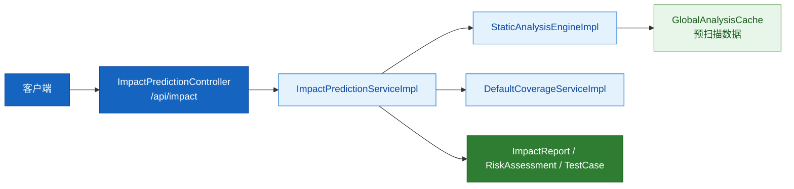
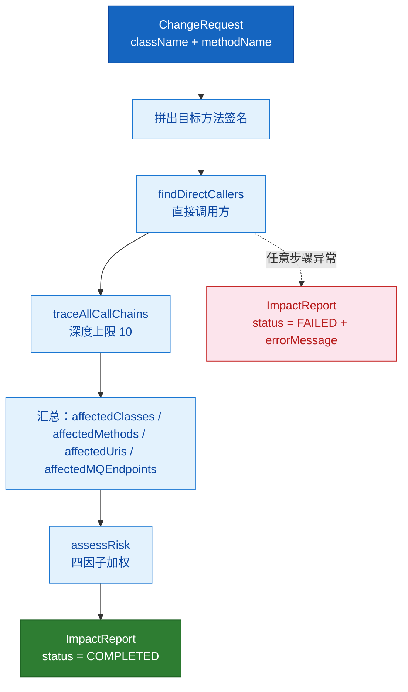

# 影响分析与风险评估

> 自动生成于 2026-11-26，基于 `99d0037` 版本

| 属性 | 值 |
|------|-----|
| **所属层** | 领域服务层（静态分析） |
| **目录** | `controller/ImpactPredictionController.java` + `service/impact/`（13 个文件）；另有 `service/risk/`（3）、`service/semantic/`（11）、`service/suggestion/`（3） |
| **核心类** | `ImpactPredictionServiceImpl`、`StaticAnalysisEngineImpl`、`DefaultCoverageServiceImpl`、`ChangeParser` |
| **REST 基础路径** | `/api/impact`（6 个端点） |
| **数据来源** | JavaParser 静态分析 + `cache.GlobalAnalysisCache`（预扫描数据），不查询 Neo4j |

---

## 1. 模块概述

### 1.1 职责定义

**核心职责**：给定一处代码变更（类 + 方法），用静态分析找出直接调用方与到入口点的调用链，汇总受影响的类、方法、URI 与 MQ 端点，给出风险评分与回归用例。

本页描述的是**基于 JavaParser 静态分析**的影响分析。系统里另有两条基于知识图谱的影响分析路径，不要混淆：

| 路径 | 入口 | 数据来源 | 文档 |
|------|------|---------|------|
| 静态分析影响预测 | `POST /api/impact/*` | JavaParser + `GlobalAnalysisCache` | 本页 |
| 需求影响面（DAG 节点） | `ram-demand` 工作流的 `impact` 节点 | Neo4j 图谱 + 检索 | [RAM需求评估](./RAM需求评估.md) |
| 图谱爆炸半径 | `GET /api/knowledge-graph/blast-radius/{nodeId}` | Neo4j 图谱 | [知识图谱构建](./知识图谱构建.md) |

### 1.2 核心文件清单

| 文件 | 类型 | 职责 |
|------|------|------|
| `controller/ImpactPredictionController.java` | REST | 6 个端点，直接返回领域对象 |
| `service/impact/ImpactPredictionService.java` + `impl/ImpactPredictionServiceImpl.java` | 服务 | 影响分析编排、风险评分、用例生成 |
| `service/impact/StaticAnalysisEngine.java` + `impl/StaticAnalysisEngineImpl.java` | 服务 | 调用链追踪、依赖分析、调用方与入口点查找 |
| `service/impact/CoverageService.java` + `impl/DefaultCoverageServiceImpl.java` | 服务 | 覆盖率数据（默认实现只返回配置的默认分） |
| `service/impact/ChangeParser.java` | 接口 | 解析代码变更 |
| `service/impact/model/*`（6 个） | 模型 | `ChangeRequest`、`ImpactReport`、`RiskAssessment`、`TestCase`、`CallChain`、`Caller` |

### 1.3 主代码中没有调用方的三个子包

| 子包 | 内容 | 说明 |
|------|------|------|
| `service/risk/` | `RiskScoringEngine` / `RiskScoringEngineImpl` | 六因子加权评分引擎；除自身包外未发现注入方 |
| `service/semantic/` | `CodeSemanticParser`、`CodeKnowledgeGraph` / `InMemoryCodeKnowledgeGraph` | 用 JavaParser 抽取方法结构并（类注释所述）调用 LLM 做意图标注，建内存图谱用于异常传播路径分析；除自身包外未发现注入方 |
| `service/suggestion/` | `FixSuggestionService` / `FixSuggestionServiceImpl` | 按错误类型套模板的修复建议；除自身包外未发现注入方 |

三者仍是 Spring bean，但没有 Controller 或其他服务使用它们。旧 wiki 把它们写成了在用的能力（「异常路径分析」「推荐引擎」），与代码不符；`ExceptionPathController`、`ExceptionPathService`、`RiskAnalysisService`、`SuggestionService` 等类名在代码中不存在。

---

## 2. 模块架构

---

## 3. 影响分析流程 `analyzeChange`

| 步骤 | 实现 |
|------|------|
| 拼签名 | `buildMethodSignature(className, methodName)` |
| 直接调用方 | `StaticAnalysisEngine.findDirectCallers` |
| 调用链 | `StaticAnalysisEngine.traceAllCallChains(signature, DEFAULT_MAX_DEPTH)`，`DEFAULT_MAX_DEPTH = 10`（引擎内另有 `DEFAULT_TRACE_DEPTH = 10`） |
| 汇总 | `extractAffectedClasses` / `extractAffectedMethods` / `extractAffectedUris` / `extractAffectedMQEndpoints` |
| 影响总数 | `affectedClasses + affectedUris + affectedMQEndpoints` 的数量之和 |
| 风险 | `assessRisk(request)` |

`StaticAnalysisEngineImpl` 对外方法：`traceCallChain`、`traceAllCallChains`、`analyzeDependencies`、`findDirectCallers`、`findEntryPoints`、`methodExists`。

### 3.1 风险评分权重

`ImpactPredictionServiceImpl` 中的四个权重：

| 因子 | 权重 |
|------|------|
| 影响范围 `IMPACT_SCOPE_WEIGHT` | 0.30 |
| 业务关键度 `BUSINESS_CRITICALITY_WEIGHT` | 0.25 |
| 代码复杂度 `CODE_COMPLEXITY_WEIGHT` | 0.20 |
| 测试覆盖 `TEST_COVERAGE_WEIGHT` | 0.25 |

覆盖率来自 `DefaultCoverageServiceImpl`：没有真实覆盖率数据时返回 `impact.default-coverage-score`（默认 50）。

---

## 4. 模型

### 4.1 `ChangeRequest`

`className`、`methodName`、`projectId`、`changeType`（默认 `ChangeType.MODIFY`）、`description`、`filePath`、`startLine`、`endLine`、`originalCode`、`newCode`、`context`。

### 4.2 `ImpactReport`

| 字段组 | 字段 |
|-------|------|
| 标识 | `reportId`、`changeRequest`、`analysisTime`、`durationMs`、`status`（`COMPLETED` / `FAILED`）、`errorMessage` |
| 调用关系 | `directCallers`（`Caller` 列表）、`callChains`（`CallChain` 列表）、`maxDepth` |
| 影响面 | `affectedClasses`、`affectedMethods`、`affectedUris`、`affectedMQEndpoints`、`totalImpactedCount` |
| 评估 | `riskAssessment`、`testCases`、`metadata` |

`Caller`：`className`、`methodName`、`methodSignature`、`callLineNumber`、`filePath`、`callerType`、`isEntryPoint`、`associatedUri`、`associatedMQEndpoint`、`callFrequency`、`contextDescription`。

`CallChain`：`chainId`、`entryPoint`、`nodes`、`depth`、`containsAsyncCall`、`crossesServiceBoundary`、`containsMQCall`、`riskLevel` 等。

### 4.3 `RiskAssessment`

`overallRiskLevel`、`overallRiskScore`，四个因子分 `impactScopeScore`、`businessCriticalityScore`、`codeComplexityScore`、`testCoverageScore`，`risks`（`RiskItem` 列表）、`recommendations`、`scoreBreakdown`、`confidenceLevel`、`assessmentTime`。

---

## 5. REST 端点

鉴权：GET 放行；POST 需要管理员。

| 方法 | 路径 | 入参 | 返回 |
|------|------|------|------|
| POST | `/api/impact/analyze` | `ChangeRequest`（`@Valid`） | `ImpactReport` |
| POST | `/api/impact/testcases` | `ImpactReport` | `List<TestCase>` |
| POST | `/api/impact/risk` | `ChangeRequest`（`@Valid`） | `RiskAssessment` |
| GET | `/api/impact/preview` | `className`、`methodName` | 影响预览 |
| POST | `/api/impact/batch` | `List<ChangeRequest>` | `List<ImpactReport>` |
| GET | `/api/impact/summary/{reportId}` | 路径参数 | 摘要 `Map` |

这组接口的返回类型是领域对象本身（如 `ResponseEntity<ImpactReport>`），不是 `ApiResponse` 包装。

---

## 6. 配置项

| 键 | 默认值 | 说明 |
|----|-------|------|
| `impact.default-coverage-score` | `50`（环境变量 `IMPACT_DEFAULT_COVERAGE_SCORE`） | 没有真实覆盖率数据时使用的默认分 |

---

## 7. 错误处理

| 场景 | 处理 |
|------|------|
| 分析过程任意异常 | 不抛出；返回 `status = FAILED` 且带 `errorMessage` 的 `ImpactReport` |
| 覆盖率数据缺失 | 用默认分 |

---

## 8. 已知问题与扩展点

| 问题 | 说明 |
|------|------|
| 覆盖率只有默认值 | `CoverageService` 的实现未接入 JaCoCo 等真实数据 |
| 数据来源是预扫描缓存 | 依赖 `GlobalAnalysisCache` 中的扫描结果 |
| 三个子包无调用方 | `service/risk`、`service/semantic`、`service/suggestion` |
| 响应未统一包装 | 直接返回领域对象 |

| 扩展点 | 方式 |
|-------|------|
| 接入真实覆盖率 | 提供另一个 `CoverageService` 实现 |
| 更换解析实现 | 实现 `ChangeParser` |

---

## 9. 依赖关系

| 方向 | 依赖 | 用途 |
|------|------|------|
| 上游 | JavaParser（`javaparser-symbol-solver-core`） | 静态分析 |
| 上游 | `cache.GlobalAnalysisCache` | 预扫描数据 |
| 下游 | 前端影响分析页 | `/api/impact/*` |

---

> **相关文档**：
> - 架构总览 → [02-架构设计](../02-架构设计/index.md)
> - 图谱影响面 → [RAM需求评估](./RAM需求评估.md)、[合并影响分析](./合并影响分析.md)
> - 接口全表 → [05-接口文档](../05-接口文档/index.md)
