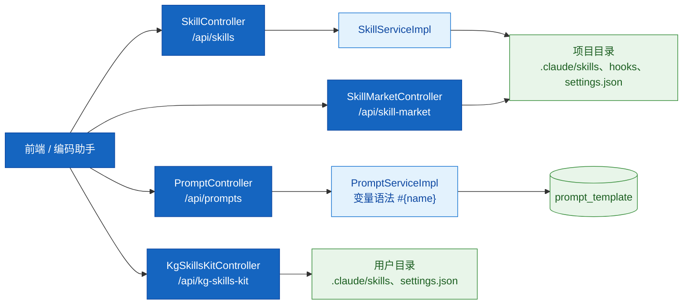

# 技能市场与提示词

> 自动生成于 2026-11-26，基于 `99d0037` 版本；2026-11-28 按 `ecc9370` 更新

| 属性 | 值 |
|------|-----|
| **所属层** | 应用层 |
| **目录** | `skill/`（8 个文件）、`controller/SkillMarketController`、`KgSkillsKitController`、`PromptController`、`service/PromptService(Impl)`、`repository/PromptRepository` |
| **REST** | `/api/skills`（5）、`/api/skill-market`（7）、`/api/kg-skills-kit`（6）、`/api/prompts`（5） |
| **SQLite 表** | `prompt_template` |
| **资源** | `resources/codeai-skills/`、`resources/pi-skills/`（13 个，见 [pi-agent底座](./pi-agent底座.md)）、`resources/prompts/`、`resources/prompt/` |

---

## 1. 模块概述

### 1.1 职责定义

**核心职责**：把「技能」（给编码助手用的 SKILL.md、钩子脚本、设置片段）安装到项目目录或用户目录，并提供提示词模板的读写与渲染。

这里的「技能」有三处，互不相同：

| 名称 | 位置 | 用途 | 安装目标 |
|------|------|------|---------|
| 技能市场条目 | `SkillServiceImpl` 中以代码定义 | 面向使用 `claude` CLI 的项目 | 项目目录下的 `.claude/` |
| KG Skills 套件 | `KgSkillsKitController` 中以代码定义 | 全局的图谱检索 / 追踪 / 诊断技能 | 用户目录下的 `.claude/skills/` |
| pi skills | `resources/pi-skills/<name>/SKILL.md` | 后端 agent 流的提示词正文 | pi 配置目录下的 `skills/`，由 `PiAgentInstaller` 启动时同步 |

### 1.2 核心文件清单

| 文件 | 类型 | 职责 |
|------|------|------|
| `skill/SkillController.java`、`skill/SkillService(Impl)` | REST / 服务 | 技能定义查询、项目安装状态检测 |
| `skill/model/*`（5 个） | 模型 | `SkillDefinition`、`SkillDetail`、`SkillFile`、`SkillListResponse`、`ProjectSkillStatus` |
| `controller/SkillMarketController.java` | REST | 技能列表、安装、卸载、检查更新、升级 |
| `controller/KgSkillsKitController.java` | REST | 全局 KG 技能套件的安装 / 卸载 |
| `controller/PromptController.java`、`service/PromptService(Impl)`、`repository/PromptRepository` | REST / 服务 / 仓储 | 提示词模板 |

---

## 2. 模块架构

---

## 3. 技能

### 3.1 `/api/skills`（`skill/SkillController`）

鉴权：全部 GET，放行。

| 方法 | 路径 | 说明 |
|------|------|------|
| GET | `/api/skills/list` | 技能定义列表 |
| GET | `/api/skills/status?projectDir=` | 项目已安装状态 |
| GET | `/api/skills/detail/{id}` | 技能详情 |
| GET | `/api/skills/categories` | 分类 |
| GET | `/api/skills/by-category?category=` | 按分类列出 |

`SkillServiceImpl` 的分类常量：`mcp`、`hook`、`backend-skill`、`frontend-skill`、`general-skill`。技能条目以代码定义，每条含若干 `SkillFile`（`source` 来源相对路径、`target` 安装目标、`type`）。安装目标都位于项目目录的 `.claude/` 下：

| 目标 | 来源（`source`） |
|------|----------------|
| `.claude/settings.json` | `mcp/hisi-dev-tool-mcp` |
| `.claude/hooks/pre-tool-use.js`、`.claude/hooks/skill-forced-eval.js` | `hooks/` 下的同名文件 |
| `.claude/memory/lessons.md` | `memory/lessons.md.template` |
| `.claude/skills/<name>/SKILL.md` | `skills/<name>/SKILL.md`，`name` 取 `lesson-learned`、`crud-development`、`api-development`、`database-ops`、`error-handler`、`ui-pc`、`http-client`、`code-patterns`、`git-workflow`、`bug-detective` |

`source` 的解析基准未在本次阅读中确认；`resources/codeai-skills/skills/` 下实际只有 `crud-development` 与 `lesson-learned` 两个目录。

项目安装状态的检测方式：看 `.claude/skills/*/SKILL.md` 是否存在、`.claude/hooks/` 下有哪些文件、`.claude/settings.json` 是否存在。

### 3.2 `/api/skill-market`（`controller/SkillMarketController`）

鉴权：GET 放行；POST 需要管理员。

| 方法 | 路径 | 说明 |
|------|------|------|
| GET | `/api/skill-market/list` | 技能列表，含各分类计数 |
| GET | `/api/skill-market/project-status?projectDir=` | 项目安装状态 |
| GET | `/api/skill-market/detail/{id}` | 详情 |
| POST | `/api/skill-market/install` | 安装到项目 |
| POST | `/api/skill-market/uninstall` | 卸载 |
| GET | `/api/skill-market/check-updates?projectDir=` | 检查更新 |
| POST | `/api/skill-market/update` | 升级 |

类注释给出的分类：`diagnosis`（诊断类）、`analysis`（分析类）、`generation`（生成类）、`operation`（操作类：MCP 工具、钩子、自动化）、`other`。安装目标同样是项目目录的 `.claude/skills/` 或 `.claude/hooks/`。配置键 `skill.market.codeai.path`（默认空）。

### 3.3 `/api/kg-skills-kit`（`controller/KgSkillsKitController`）

鉴权：GET 放行；POST 需要管理员。

| 方法 | 路径 | 说明 |
|------|------|------|
| GET | `/api/kg-skills-kit/list` | 套件列表与安装状态、安装目录 |
| POST | `/api/kg-skills-kit/install/{skillId}` | 安装单个 |
| POST | `/api/kg-skills-kit/uninstall/{skillId}` | 卸载单个 |
| POST | `/api/kg-skills-kit/install-all` | 全部安装 |
| POST | `/api/kg-skills-kit/uninstall-all` | 全部卸载 |
| GET | `/api/kg-skills-kit/guide` | 使用指南 |

类注释列出的套件：`kg-search`（知识图谱混合检索）、`kg-trace`（调用链追踪）、`kg-diagnose`（日志诊断与影响分析）。安装目标是用户目录下的 `.claude/skills/<skillId>/SKILL.md`。

---

## 4. MCP 安装接口已移除

旧的 `/api/mcp/*`（`controller/McpController`，6 个端点：包信息、下载、npm 安装进度 SSE、状态、配置模板、安装脚本）在 MCP 服务迁入进程内（Spring AI MCP server，见 [进程内MCP工具](./进程内MCP工具.md)）后随 `hisi-mcp-server` 子项目一并删除，不再单独安装与启动。

技能市场里仍保留 `mcp` 分类条目：向项目目录的 `.claude/settings.json` 写入 `mcp/hisi-dev-tool-mcp` 的配置片段（`SkillServiceImpl` 第 55-61 行），服务对象是本机外置编码助手；对应的 npm 包已不随仓库分发。

---

## 5. 提示词模板 `/api/prompts`

| 方法 | 路径 | 说明 |
|------|------|------|
| GET | `/api/prompts` | 全部模板 |
| GET | `/api/prompts/{key}` | 单个模板 |
| PUT | `/api/prompts/{key}` | 更新，请求体 `{content, variables}` |
| POST | `/api/prompts/{key}/render` | 渲染，请求体为变量名到值的 `Map` |
| POST | `/api/prompts/extract-variables` | 从文本抽取变量，请求体 `{content}` |

鉴权：GET 放行；PUT / POST 需要管理员。

| 项目 | 说明 |
|------|------|
| 变量语法 | `#{name}`（`PromptServiceImpl.VARIABLE_PATTERN`）；旧 wiki 写的 `{{var}}` 与代码不符 |
| 表 | `prompt_template`：`template_key`（PK）、`name`、`content`、`variables`、`description`、`updated_at` |
| 初始数据 | `PromptRepository.init()`（`@PostConstruct`）在模板不存在时写入 5 个内置模板 |

内置模板与变量：

| key | 名称 | 变量 |
|-----|------|------|
| `log-analysis` | 日志分析 | `errorMessage`、`errorType`、`stackTrace`、`projectPath` |
| `code-analysis` | 代码分析 | `codeSnippet`、`language`、`projectContext` |
| `trace-analysis` | 调用链分析 | `traceId`、`entryPoint`、`callChain` |
| `impact-analysis` | 影响分析 | `changedFile`、`changedMethod`、`changeType`、`projectName` |
| `free-chat` | 自由对话 | （无） |

模板正文由代码中的构建方法生成，不是从 `resources/prompts/*.txt` 读取。

---

## 6. 资源文件

| 目录 | 文件 | 使用方（按主代码中的路径引用） |
|------|------|--------|
| `resources/pi-skills/` | 13 个 `<name>/SKILL.md` | `PiAgentInstaller.syncSkills` |
| `resources/prompt/` | `fix-prompt.txt`、`test-gen-prompt.txt` | [修复引擎fixengine](./修复引擎fixengine.md) 的 `FixAgent`、`TestGenAgent` |
| `resources/schemas/` | `arch/`、`ram/` 下的 JSON Schema | `ram.contract.SchemaValidator` |
| `resources/ram/agents.yaml` | — | `ram.registry.AgentRegistry` |
| `resources/codeai-skills/` | `hooks/pre-tool-use.js`、`hooks/skill-forced-eval.js`、`skill-definitions.json`、`skills/crud-development`、`skills/lesson-learned` | 主代码中未发现按 `codeai-skills` 路径的引用；加载方未在代码中确认 |
| `resources/prompts/`、`resources/ram/prompts/` | （已删除，`ecc9370`） | 原为 4 个 `*.txt` 与 2 个 `implement.*.md` 提示词文件，均无代码引用（同名模板已内联在 `PromptRepository.defaultTemplates`），随死代码清理删除 |

---

## 7. 配置项

| 键 | 默认值 | 说明 |
|----|-------|------|
| `skill.market.codeai.path` | 空 | 技能市场资源路径 |

---

## 8. 错误处理

| 场景 | 处理 |
|------|------|
| 提示词模板不存在 | `render` 记告警并返回空字符串 |

---

## 9. 已知问题与扩展点

| 问题 | 说明 |
|------|------|
| 两套技能入口并存 | `/api/skills` 与 `/api/skill-market` 分类体系不同（前者按载体，后者按用途） |
| 分类注释与统计不一致 | `SkillMarketController` 类注释列了 5 类（含 `other`），`categoryStats` 只初始化 4 类 |
| `mcp` 分类条目装的是外置助手的配置片段 | 对应的 npm 包已不随仓库分发，见第 4 节 |
| 多个资源文件未见加载方 | 见第 6 节 |

| 扩展点 | 方式 |
|-------|------|
| 新增技能条目 | 在 `SkillServiceImpl` 或 `SkillMarketController` 的技能定义处增加一条并指定安装目标 |
| 新增提示词模板 | 调 `PUT /api/prompts/{key}` 覆盖，或在内置模板表里加一行 |

---

## 10. 依赖关系

| 方向 | 依赖 | 用途 |
|------|------|------|
| 上游 | [应用启动与全局配置](./应用启动与全局配置.md) | `JdbcTemplate`、建表 |
| 相关 | [pi-agent底座](./pi-agent底座.md) | `resources/pi-skills` 的同步与使用 |

---

> **相关文档**：
> - 架构总览 → [02-架构设计](../02-架构设计/index.md)
> - 接口全表 → [05-接口文档](../05-接口文档/index.md)
