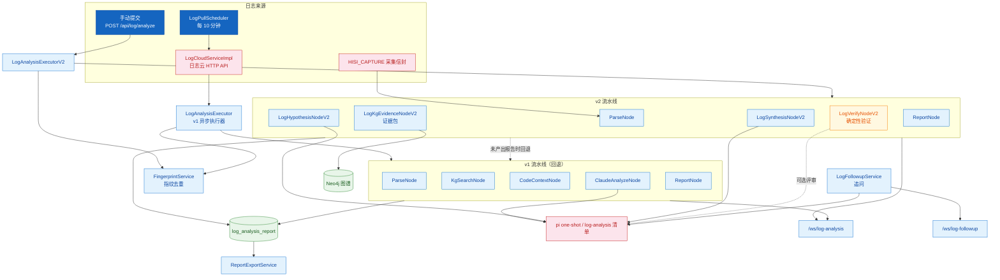
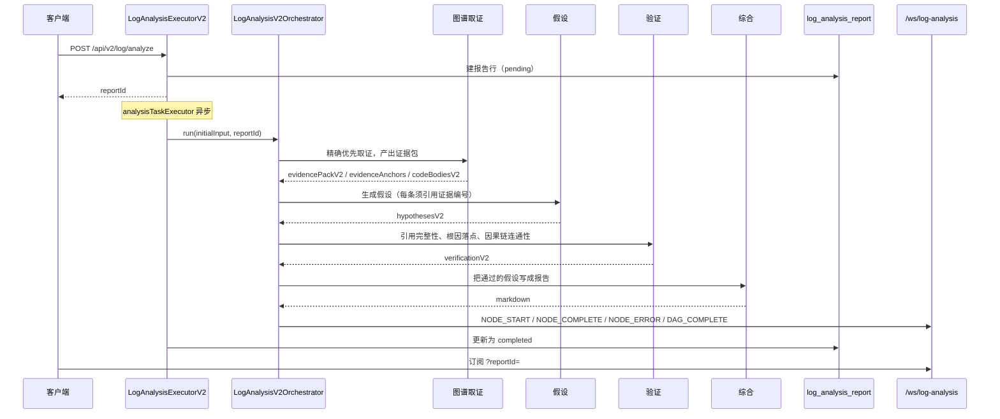

# 日志云与运维

> 自动生成于 2026-11-26，基于 `99d0037` 版本

| 属性 | 值 |
|------|-----|
| **所属层** | 应用层（分析流水线编排）+ 领域服务层（日志云接入、报告管理、导出） |
| **目录** | `loganalysis/`（27 个文件）+ `controller/LogAnalysisController`、`AppLogConfigController`、`OpsController` + `service/LogCloud*`、`LogAnalysisExecutor`、`FingerprintService`、`ReportExportService` + `scheduler/LogPullScheduler` |
| **核心类** | `LogAnalysisExecutor`、`LogAnalysisDagOrchestrator`、`LogAnalysisExecutorV2`、`LogAnalysisV2Orchestrator`、`LogKgEvidenceNodeV2`、`LogVerifyNodeV2`、`LogFollowupService`、`LogCloudServiceImpl` |
| **REST** | `/api/log`（14）、`/api/log/config`（6）、`/api/ops`（4）、`/api/v2/log`（4） |
| **WebSocket** | `/ws/log-analysis`、`/ws/log-followup` |
| **SQLite 表** | `log_analysis_report`、`log_error_embedding_map`、`app_log_config`、`diagnosis_cases` |

---

## 1. 模块概述

### 1.1 职责定义

**核心职责**：把一条异常日志（手动提交、从日志云定时拉取、或随请求采集上报）变成有证据支撑的根因分析报告：解析堆栈 → 到知识图谱取证 → 形成假设 → 确定性验证 → 成文，并支持追问、导出与相似报告聚合。

| 本模块负责 | 本模块不负责 | 由谁负责 |
|-----------|-------------|---------|
| 堆栈解析、指纹去重、图谱取证、假设与验证、报告成文 | 图谱的构建与检索实现 | [知识图谱构建](./知识图谱构建.md)、[Neo4j图存储与检索](./Neo4j图存储与检索.md) |
| 日志云 HTTP API 查询、定时拉取配置 | 日志云本身 | 外部日志云服务 |
| 报告的落库、列表、导出、追问 | APM trace 诊断 | [APM故障诊断](./APM故障诊断.md) |
| 健康检查等运维接口 | 应用配置读写 | [会话与工作区](./会话与工作区.md)、[远程项目管理](./远程项目管理.md) |
| 把报告聚合成待办 | 修复执行 | [工作台与自动修复](./工作台与自动修复.md) |

### 1.2 LLM 调用边界

本模块的模型调用全部经 `AgentLlmClient` / `ReActSession`，**属 agent 类流程，经 pi**：

| 调用 | 入口 |
|------|------|
| v1 分析节点 `ClaudeAnalyzeNode`（三轮递进） | `AgentLlmClient`（清单 `one-shot`） |
| v2 假设、综合、可选评审 | `AgentLlmClient`（清单 `one-shot`） |
| 日志追问 | `ReActSession`，取声明 `log-followup`（清单 `log-analysis`，skill `log-triage`） |

源码里仍有 `Claude` 字样的类名与注释（如 `ClaudeAnalyzeNode`、`loganalysis/nodes/` 下的 Javadoc）不代表底层是某个厂商的 SDK。

---

## 2. 模块架构

---

## 3. 日志来源

| 来源 | 实现 | 说明 |
|------|------|------|
| 手动提交 | `POST /api/log/analyze` → `LogAnalysisExecutor.submitForAnalysis(...)`（v1）；`POST /api/v2/log/analyze` → `LogAnalysisExecutorV2` | 带消息、堆栈等；`userId` 默认 `sys_admin` |
| 日志云定时拉取 | `scheduler/LogPullScheduler` | `@Scheduled(fixedRate = 600000)`，遍历 `app_log_config` 中启用的配置，调 `LogCloudService.queryLogs` 查询后逐条 `submitForAnalysis`（带指纹去重） |
| 日志云查询 | `service/LogCloudServiceImpl` | HTTP API 方式；接口方法 `login()`、`queryLogs(LogQueryDto)`、`logout()`；配置 `logcloud.*` |
| 采集信封解码 | `loganalysis/decoder/CaptureDecoder` | 解码 `hisi-capture-spring-boot-starter` 产生的 `HISI_CAPTURE` JSON 信封（算法 `hybrid-rsa-aes-gcm`），由 `ParseNode` 识别 |

`application.yml` 中的 `log.pull.enabled` 与 `log.pull.default-interval-minutes` 在 Java 代码中没有引用：拉取只取决于 `app_log_config.enabled`，周期是注解里的固定 10 分钟。

Playwright：`pom.xml` 仍有依赖、`application.yml` 仍有 `logcloud.browser.*`（注释为「保留以兼容旧代码」），但主代码中没有任何 Playwright 引用。旧 wiki 描述的「HTTP API 为主 + Playwright 兜底」双模式与现状不符。

---

## 4. 分析流程

### 4.1 v2（当前主路径）

`LogAnalysisV2Orchestrator`：`ParseNode`（复用 v1）→ `LogKgEvidenceNodeV2` → `LogHypothesisNodeV2` → `LogVerifyNodeV2` → `LogSynthesisNodeV2` → `ReportNode`（复用 v1）。节点间以 `Map` 传递上下文。

| 节点 | 要点（据类注释） |
|------|------|
| `LogKgEvidenceNodeV2` | 堆栈帧本身就是精确坐标：先按「类名.方法名」精确命中，未命中才回退语义检索并标记为模糊证据；按堆栈先后确定「抛出点」与「调用方」；除下游调用树外还取上游调用链；取抛出点直接下游方法的源码；图谱里没有源码的方法按堆栈文件名与行号从本地源码读取（`SourceSnippetReader`） |
| `LogHypothesisNodeV2` | 一次 LLM 调用给出按置信度排序的根因假设，最多 3 条，每条必须引用证据编号；模式类型改由异常名的确定性规则判定；LLM 不可用时 `hypothesesV2` 为 null |
| `LogVerifyNodeV2` | **不调用模型**的确定性检查：引用是否都在证据包里、指认的根因方法是否精确存在于图谱、根因是否位于某个堆栈帧的上游调用链上。因果链状态取值 `verified`、`stack_verified`、`unverified`、`unknown`、`at_throw_site`。可选评审：`loganalysis.v2.evaluator.enabled=true` 时由一次独立的 LLM 调用充当评审 |
| `LogSynthesisNodeV2` | 输入只有「通过验证的假设 + 证据」；成文后再做一次引用校验，编造的引用替换为「未验证」并拉低置信度；LLM 不可用时由证据直接生成确定性报告 |

证据机制（`agentflow` 包）：`EvidencePack` 按加入顺序编号 `E1`、`E2`…；`EvidenceAnchor` 的 `kind` 取值 `frame` / `method` / `semantic` / `source` / `upstream` / `entry` / `downstream` / `sql` / `bridge`；模型用 `[[E n]]` 引用；`GroundingVerifier` 做集合运算判定是否有编造引用；`Citations` 负责提取、标记与转写。

`LogAnalysisExecutorV2` 与 v1 写同一张 `log_analysis_report` 表、同一组列，所以 v1 的读接口对 v2 报告同样有效；v2 只在 `root_cause` 里多存 `evidenceAnchors` 与 `verification`。v2 没有产出报告时回退到 v1。

### 4.2 v1

`LogAnalysisDagOrchestrator`：`ParseNode` → `KgSearchNode` → `CodeContextNode` → `ClaudeAnalyzeNode` → `ReportNode`。无检查点缓存（日志是一次性分析）、无 HITL 暂停。

| 节点 | 要点 |
|------|------|
| `ParseNode` | 从原始日志抽取异常类型、根因异常、非框架的关键栈帧、供图谱检索的方法签名；识别 `HISI_CAPTURE` 信封并解码 |
| `KgSearchNode` | 经 `KgMcpClient` 按栈帧检索图谱；递进搜索：第一批结果为空时继续搜后续帧（每批 5 个，最多 3 批） |
| `CodeContextNode` | 从图谱加载方法体作为代码上下文 |
| `ClaudeAnalyzeNode` | 三轮递进：模式识别（2000 token）→ 因果推理（8000 token，输出 Markdown）→ 修复方案（4000 token）；前一轮失败时按注释所述逐级降级 |
| `ReportNode` | 整理成结构化报告，准备落库 |

### 4.3 报告状态与去重

| 项目 | 说明 |
|------|------|
| 报告状态 | `pending` → `processing` → `completed` / `failed` |
| 指纹 | `FingerprintService`：错误类型 + 前 3 个非框架栈帧（类名 + 方法名，不含行号） |
| 出现次数 | `occurrence_count`（默认 1）：同一指纹重复出现时累计 |
| 向量相似 | `log_error_embedding_map` 记录报告与向量嵌入的对应及相似度，阈值列默认 0.85 |

`AnalysisPipelineService`（四节点流水线：解析 → 去重 → 分析 → 完成）、`RootCauseAnalysisService(Impl)`、`CaseMatchingService(Impl)`、`AIAnalysisPromptService` 在主代码中没有调用方；`CaseMatchingServiceImpl` 仍以 `@PostConstruct` 建 `diagnosis_cases` 表。

---

## 5. 追问 `LogFollowupService`

| 项目 | 说明 |
|------|------|
| 持久化 | 每个追问会话是 `agent_session` 的一行（`session_type = LOG_FOLLOWUP`）；每条用户 / 助手消息追加到 `agent_event`（`type = MESSAGE`，payload 含 `role`、`content`、`createdAt`） |
| 执行 | `ReActSession` + 声明 `log-followup`（清单 `log-analysis`：图谱与日志的只读 MCP 工具） |
| 推送 | 回复经 `/ws/log-followup?sessionId=` 实时推送 |
| 超时 | `log.followup.timeout-seconds` |

---

## 6. REST 端点

鉴权：GET 放行；POST / DELETE 需要管理员。

### 6.1 `/api/log`

| 方法 | 路径 | 说明 |
|------|------|------|
| POST | `/api/log/query` | 查询日志云（请求体 `LogQueryDto`） |
| POST | `/api/log/analyze` | 提交分析（请求体 `LogAnalyzeRequest`），异步，返回 `reportId` |
| GET | `/api/log/reports` | 报告列表（支持筛选与分页） |
| GET | `/api/log/reports/by-app/{appId}` | 按应用 |
| GET | `/api/log/reports/by-config/{configId}` | 按拉取配置 |
| GET | `/api/log/report/{id}` | 报告详情 |
| POST | `/api/log/report/{id}/reanalyze` | 重新分析 |
| GET | `/api/log/report/{id}/status` | 状态 |
| DELETE | `/api/log/report/{id}` | 删除 |
| GET | `/api/log/report/{id}/export/md` | 导出 Markdown |
| GET | `/api/log/reports/export/zip` | 按时间段批量导出 ZIP |
| POST | `/api/log/report/{id}/followup` | 发起追问 |
| POST | `/api/log/followup/{sessionId}/message` | 继续追问 |
| GET | `/api/log/followup/{sessionId}` | 追问会话信息 |

### 6.2 `/api/v2/log`

| 方法 | 路径 | 说明 |
|------|------|------|
| POST | `/api/v2/log/analyze` | 请求体与响应体和 v1 一致，走 v2 流程 |
| POST | `/api/v2/log/report/{id}/reanalyze` | 重新分析（v2） |
| GET | `/api/v2/log/report/{id}/status` | 委托 v1 |
| GET | `/api/v2/log/report/{id}` | 委托 v1 |

### 6.3 `/api/log/config`（拉取配置）

| 方法 | 路径 | 说明 |
|------|------|------|
| GET | `/api/log/config/graphed-projects` | 已建图项目（供选择项目路径） |
| GET | `/api/log/config` | 配置列表 |
| GET | `/api/log/config/{appId}` | 单条 |
| POST | `/api/log/config` | 保存 |
| DELETE | `/api/log/config/{appId}` | 删除 |
| POST | `/api/log/config/{appId}/toggle` | 启用 / 停用 |

### 6.4 `/api/ops`（运维）

| 方法 | 路径 | 说明 |
|------|------|------|
| GET | `/api/ops/health` | 健康检查 |
| POST | `/api/ops/analysis/impact` | 影响分析（`ImpactAnalysisRequest`） |
| GET | `/api/ops/docs/interface` | 按 URI 生成接口文档 |
| POST | `/api/ops/logs/download` | 下载错误日志 |

`OpsServiceImpl` 的类注释写明：使用 Neo4j 知识图谱替代旧的 `CallChainService`。

---

## 7. WebSocket

| 端点 | Handler | 用途 |
|------|---------|------|
| `/ws/log-analysis?reportId={reportId}` | `LogAnalysisWebSocketHandler` | 分析节点进度；同一 `reportId` 一个连接 |
| `/ws/log-followup?sessionId={sessionId}` | `LogFollowupWebSocketHandler` | 追问的流式回复与工具事件 |

v1 / v2 的事件类型一致：`NODE_START`、`NODE_COMPLETE`、`NODE_ERROR`、`DAG_COMPLETE`，由 `LogAnalysisEventEmitter` 发出。

---

## 8. 数据模型

| 表 | 关键字段 |
|----|---------|
| `log_analysis_report` | `id`、`report_id`（UNIQUE）、`report_no`（UNIQUE）、`user_id`、`query_params`、`log_message`、`log_stack_trace`、`filtered_stack_trace`、`error_type`、`trace_id`、`service_name`、`log_summary`、`error_summary`、`root_cause`、`fix_suggestions`、`code_snippets`、`status`（默认 `pending`）、`created_at` / `updated_at`；后补列 `error_fingerprint`、`embedding_id`、`similarity_threshold`、`analysis_status`、`occurrence_count`、`root_cause_text`、`fix_suggestion_text`、`config_id`、`app_id` |
| `log_error_embedding_map` | `report_id`、`embedding_id`、`similarity_score`、`matched_report_id`、`created_at` |
| `app_log_config` | `app_id`（UNIQUE）、`project_path`、`dsl_query`、`pull_interval_minutes`（默认 10）、`enabled`（默认 1）、`last_pull_at`、`project_package_prefixes`、`created_at` / `updated_at` |
| `diagnosis_cases` | 由 `CaseMatchingServiceImpl.init()` 创建；列结构未在本次阅读中确认 |

Neo4j 的 `LogChunk` 节点（`reportId`、`fingerprint`、`errorType`、`message`、`stackTrace`、`embedding`）与向量索引 `logEmbedding` 用于相似日志检索。

---

## 9. 配置项

| 键 | 说明 |
|----|------|
| `logcloud.base-url`、`app-id`、`username`、`password` | 日志云；环境变量 `LOGCLOUD_USERNAME`、`LOGCLOUD_PASSWORD` |
| `logcloud.api.base-url` / `query-path` / `header-xhw-id` / `header-appkey` / `timeout` / `connect-timeout` | HTTP API；环境变量 `LOGCLOUD_APPKEY` |
| `logcloud.browser.*` | 旧 Playwright 模式遗留，主代码无引用 |
| `log.pull.enabled`、`log.pull.default-interval-minutes` | 环境变量 `LOG_PULL_ENABLED`、`LOG_PULL_INTERVAL`；**Java 代码无引用** |
| `log.followup.timeout-seconds` | 追问超时 |
| `loganalysis.v2.max-frames` / `max-bodies` / `body-chars` / `upstream-depth` / `evidence-max-chars` | v2 取证规模 |
| `loganalysis.v2.hypothesis-max-tokens` / `synthesis-max-tokens` / `evaluator-max-tokens` | v2 各次模型调用的输出上限 |
| `loganalysis.v2.evaluator.enabled` | 是否启用独立评审 |
| `hisi.capture.crypto.private-key-path` / `private-key-b64` | 解码采集信封的私钥 |

`application.yml` 中的 `exception.inheritance.enable-defaults` 在 Java 代码中没有引用。

`loganalysis.v2.*` 只在代码中给默认值，`application.yml` 未配置，具体默认数值未在本次阅读中逐个确认。

---

## 10. 错误处理

| 场景 | 处理 |
|------|------|
| v2 未产出报告 | 回退到 v1 流程 |
| v2 假设阶段 LLM 不可用或输出不合法 | `hypothesesV2` 为 null，后续节点走确定性降级 |
| v2 综合阶段 LLM 不可用 | 由证据直接生成确定性报告 |
| 编造的证据引用 | 替换为「未验证」并拉低置信度 |
| v1 前一轮失败 | 逐级降级（单轮回退 / 用前一轮假设当根因并给默认建议） |
| 分析失败 | 报告 `failed` |
| 拉取某应用失败 | 记日志，继续其他应用 |
| 重复日志 | 按指纹跳过分析 |

---

## 11. 已知问题与扩展点

| 问题 | 说明 |
|------|------|
| 声明的工作流 `log-analysis` 不可经统一入口启动 | 其节点不是 `DagNode` bean，见 [工作流引擎](./工作流引擎.md) |
| 多个服务类无调用方 | `AnalysisPipelineService`、`RootCauseAnalysisService(Impl)`、`CaseMatchingService(Impl)`、`AIAnalysisPromptService` |
| 拉取周期写死 | 注解固定 10 分钟，`app_log_config.pull_interval_minutes` 是否被尊重未在代码中确认 |
| 两个配置键无引用 | `log.pull.enabled`、`log.pull.default-interval-minutes` |
| 依赖残留 | Playwright 依赖与 `logcloud.browser.*` |
| 类名与注释滞后 | `ClaudeAnalyzeNode` 等名称沿用旧实现 |

| 扩展点 | 方式 |
|-------|------|
| 新增取证维度 | 扩展 `LogKgEvidenceNodeV2` 并向 `EvidencePack` 追加证据 |
| 调整评审 | `loganalysis.v2.evaluator.enabled` |

---

## 12. 依赖关系

| 方向 | 依赖 | 用途 |
|------|------|------|
| 上游 | [pi-agent底座](./pi-agent底座.md) | `AgentLlmClient`、`ReActSession` |
| 上游 | [Neo4j图存储与检索](./Neo4j图存储与检索.md)、`ram.kg.KgMcpClient` | 图谱取证 |
| 上游 | `agentflow.EvidencePack` 等 | 证据与引用校验 |
| 上游 | `ram.repository`、`ram.model` | 追问会话 |
| 上游 | 外部日志云 | 日志查询 |
| 下游 | [工作台与自动修复](./工作台与自动修复.md) | 报告聚合成 `log` 待办 |
| 下游 | [修复引擎fixengine](./修复引擎fixengine.md) | 按报告 ID 启动修复会话 |

---

> **相关文档**：
> - 架构总览 → [02-架构设计](../02-架构设计/index.md)
> - 日志分析数据流 → [04-数据流程](../04-数据流程/index.md)
> - 报告表结构 → [06-数据模型](../06-数据模型/index.md)
> - 部署与日志云凭据 → [07-部署运维](../07-部署运维/index.md)
