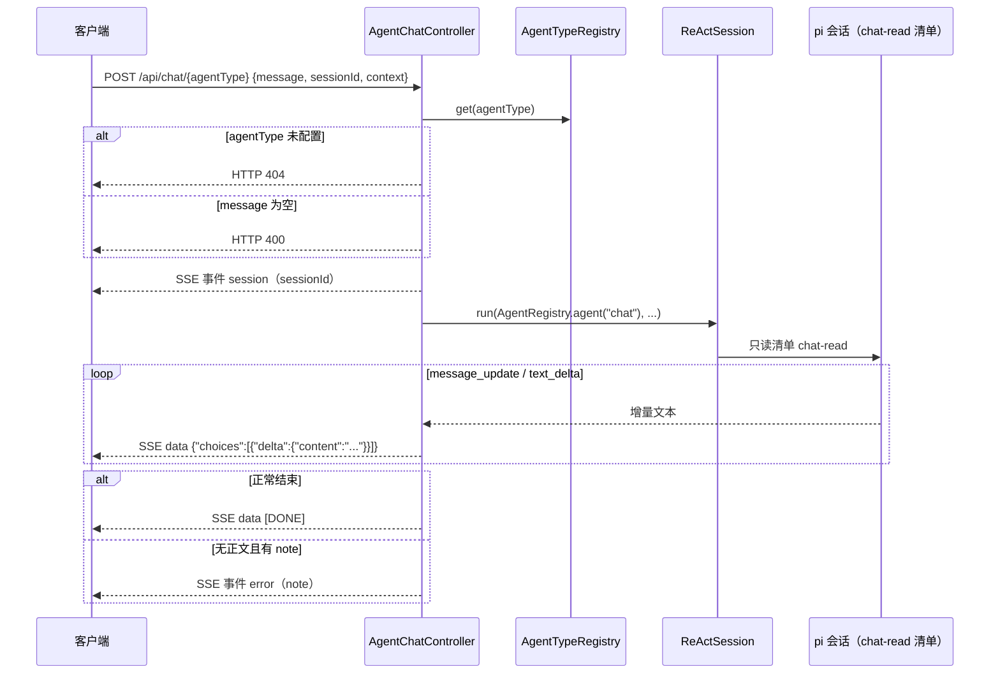
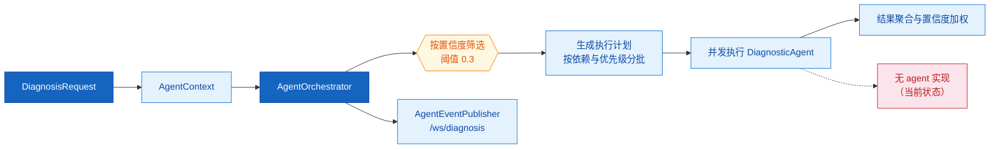

# 智能诊断与对话

> 自动生成于 2026-11-26，基于 `99d0037` 版本

| 属性 | 值 |
|------|-----|
| **所属层** | 应用层 |
| **目录** | `agent/`（13 个文件）+ `controller/AgentChatController.java` |
| **核心类** | `AgentChatController`、`AgentOrchestrator`、`DiagnosisController`、`AgentEventPublisher` |
| **REST** | `/api/chat/{agentType}`、`/api/chat/_list`（2 个）；`/api/diagnosis/*`（6 个） |
| **WebSocket** | `/ws/diagnosis` |

---

## 1. 模块概述

### 1.1 职责定义

**核心职责**：提供「自然语言提问 → agent 查图谱 / 日志 / APM → 流式回答」的通用对话入口；并保留一套多 Agent 协作诊断的编排框架。

本页两部分现状差别很大，先说结论：

| 部分 | 现状 |
|------|------|
| 通用对话 `/api/chat/*` | **在用**。经 [pi-agent底座](./pi-agent底座.md) 的 `ReActSession` 执行声明为 `chat` 的 agent |
| 多 Agent 协作诊断 `/api/diagnosis/*` | **框架在、实现为空**：`DiagnosticAgent` 接口在主代码中没有任何实现类，`AgentOrchestrator` 注入的 agent 列表为空 |

旧 wiki 描述的 `service/intent/` 包（`DialogController`、`IntentRecognizer`、`DialogContext`、`InterventionHandler`、`NaturalLanguageDiagnosisCoordinator` 等）在代码中不存在。

### 1.2 核心文件清单

| 文件 | 类型 | 职责 |
|------|------|------|
| `controller/AgentChatController.java` | REST（SSE） | 统一的 agent 对话入口 |
| `agent/DiagnosticAgent.java` | 接口 | 诊断 agent 契约：置信度评估与执行 |
| `agent/orchestrator/AgentOrchestrator.java` | 编排 | 按置信度筛选 agent、生成执行计划、并发执行、结果聚合；常量 `CONFIDENCE_THRESHOLD = 0.3`、`HIGH_CONFIDENCE_THRESHOLD = 0.7` |
| `agent/orchestrator/DiagnosisResult.java` | 模型 | 多 agent 结果的聚合报告 |
| `agent/controller/DiagnosisController.java` | REST | 诊断接口：同步、异步、流式、响应式 |
| `agent/event/AgentEventPublisher.java` | WebSocket + 事件 | `/ws/diagnosis` 的处理器；按 `requestId` 分组推送 |
| `agent/model/*`（7 个） | 模型 | `AgentContext`、`AgentEvent`、`AgentResult`、`DiagnosisRequest`、`DiagnosisResponse` 等 |

---

## 2. 通用对话 `/api/chat`

| 项目 | 值 |
|------|-----|
| 路径 | `POST /api/chat/{agentType}`，`produces = text/event-stream` |
| 请求体 | `ChatRequest(message, sessionId, context)` |
| `agentType` 合法性 | 取自 `hisi.agents.*`（`AgentTypeRegistry`）；6 个内置类型见 [应用启动与全局配置](./应用启动与全局配置.md) |
| 系统提示词 | `hisi.agents.<agentType>.system-prompt` |
| 执行 | 不论 `agentType` 是哪个，都取同一个声明 `AgentRegistry.agent("chat")`：清单 `chat-read`、无 skill、无契约 |
| 工作目录 | 后端进程的工作目录 |
| 取消判定 | 恒为 false（不取消） |
| SSE 超时 | 300 秒 |
| 鉴权 | POST，需要管理员 |

SSE 事件三种：命名事件 `session`（携带 `sessionId`）；未命名的 `data`，内容为 OpenAI 风格的 `{"choices":[{"delta":{"content":"<增量>"}}]}`；结束标记 `data: [DONE]`。出错时发命名事件 `error`。

`POST /api/chat/_list` 返回 `{agentTypes: [...]}`，供前端发现可用类型。

---

## 3. 多 Agent 协作诊断 `/api/diagnosis`（框架，无实现）

### 3.1 设计

| 组件 | 说明 |
|------|------|
| `DiagnosticAgent` | 接口；源码注释的设计原则：单一职责、置信度机制、并发安全 |
| `AgentOrchestrator` | 构造时注入 `List<DiagnosticAgent>`，按 `getPriority()` 排序；`calculateConfidences` → `filterExecutableAgents` → `generateExecutionPlan` → 分批执行 |
| `AgentEvent` | 事件工厂方法：`requestReceived`、`agentStarted`、`agentCompleted`、`agentFailed`、`orchestrationStart`、`orchestrationEnd` 等 |
| `AgentResult` | 统一结果格式；支持携带流（`Flux<String>`） |
| `DiagnosisResult` | 聚合报告；`hasValidConclusion`、`isAllFailed` 等 |

### 3.2 现状

主代码里 `implements DiagnosticAgent` 的类为 0 个。因此 `AgentOrchestrator` 没有可执行的 agent，`/api/diagnosis/*` 目前只是一组注册在路由上的端点。

### 3.3 REST 端点

鉴权：GET 放行；POST 需要管理员。

| 方法 | 路径 | 说明 |
|------|------|------|
| POST | `/api/diagnosis/analyze` | 同步诊断 |
| POST | `/api/diagnosis/analyze/async` | 异步诊断 |
| POST | `/api/diagnosis/analyze/stream` | 流式诊断 |
| POST | `/api/diagnosis/analyze/reactive` | 响应式诊断 |
| GET | `/api/diagnosis/agents` | 已注册的 agent 类型 |
| GET | `/api/diagnosis/health` | 健康检查 |

---

## 4. 系统里的其他对话入口

| 入口 | 清单 | 文档 |
|------|------|------|
| `/api/chat/{agentType}` | `chat-read` | 本页 |
| RAM 对话助手 `/api/ram/chat/*` + `/ws/ram-chat` | `ram-act`（带动作工具） | [RAM需求评估](./RAM需求评估.md) |
| 日志追问 `/api/log/followup/*` + `/ws/log-followup` | `log-analysis` | [日志云与运维](./日志云与运维.md) |

---

## 5. 配置项

| 键 | 说明 |
|----|------|
| `hisi.agents.<key>.system-prompt` / `provider` / `tool-call-limit` / `hitl.*` | agent 类型表；`fix` 类型另有 `tool-call-limit: 5` 与 `hitl.mode: post-react`、`hitl.timeout-minutes: 30`（`hitl.*` 的读取方未在本次阅读中确认） |
| `piagent.*` | 见 [pi-agent底座](./pi-agent底座.md) |

---

## 6. 错误处理

| 场景 | 处理 |
|------|------|
| `agentType` 未配置 | HTTP 404 |
| `message` 为空 | HTTP 400 |
| pi 未就绪 / 会话失败 | `ReActSession` 抛异常 → SSE 事件 `error` |
| 会话结束但无正文 | SSE 事件 `error`（携带 note） |
| SSE 发送失败 | 结束 emitter |
| 诊断执行线程池关闭 | 控制器与编排器的 `@PreDestroy` |

---

## 7. 已知问题与扩展点

| 问题 | 说明 |
|------|------|
| 诊断框架无实现 | 没有 `DiagnosticAgent` 实现类 |
| `agentType` 只影响系统提示词 | 执行的都是同一个 `chat` 声明，`provider` 字段只进日志 |
| 对话不可取消 | 取消判定恒为 false |
| 请求不落库 | 对话会话 ID 是随机串，不写 `agent_session` |

| 扩展点 | 方式 |
|-------|------|
| 新增 agent 类型 | 在 `hisi.agents.*` 增加一段 |
| 启用多 Agent 诊断 | 实现 `DiagnosticAgent` 并注册为 bean，`AgentOrchestrator` 自动收集 |

---

## 8. 依赖关系

| 方向 | 依赖 | 用途 |
|------|------|------|
| 上游 | [pi-agent底座](./pi-agent底座.md) | `ReActSession`、`AgentRegistry.agent("chat")` |
| 上游 | [应用启动与全局配置](./应用启动与全局配置.md) | `AgentTypeRegistry` |
| 上游 | Reactor | `Flux` 流式结果 |

---

> **相关文档**：
> - 架构总览 → [02-架构设计](../02-架构设计/index.md)
> - WebSocket 端点总表 → [终端与WebSocket](./终端与WebSocket.md)
> - 接口全表 → [05-接口文档](../05-接口文档/index.md)
