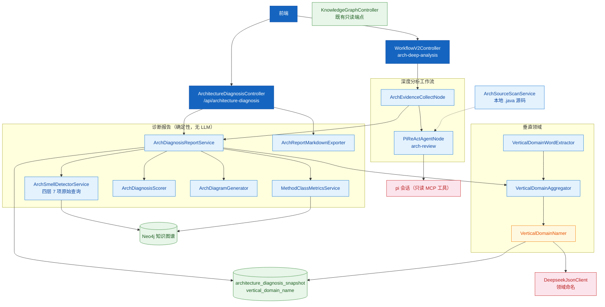
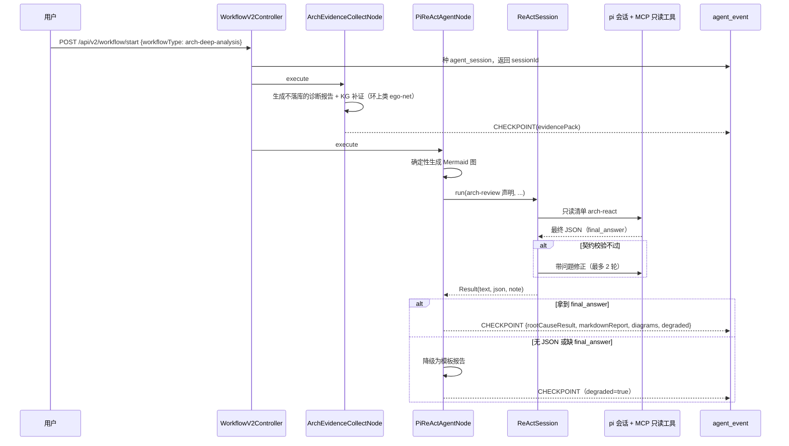

# 架构诊断

> 自动生成于 2026-11-26，基于 `99d0037` 版本；2026-11-28 按 `ecc9370` 更新

| 属性 | 值 |
|------|-----|
| **所属层** | 领域服务层（只读聚合 + 规则检测）+ 应用层（深度分析工作流节点） |
| **目录** | `archdiagnosis/`（16 个文件）、`workflow/nodes/`、`workflow/agent/`、`workflow/v2/`（架构工作流专用部分） |
| **核心类** | `ArchDiagnosisReportService`、`ArchSmellDetectorService`、`MethodClassMetricsService`、`ArchSourceScanService`、`ArchDiagnosisScorer`、`VerticalDomain*`、`ArchEvidenceCollectNode`、`PiReActAgentNode` |
| **REST 基础路径** | `/api/architecture-diagnosis`（4 个 GET 端点） |
| **工作流** | `arch-deep-analysis`（经 `/api/v2/workflow/start` 启动） |
| **SQLite 表** | `architecture_diagnosis_snapshot`、`vertical_domain_name` |

---

## 1. 模块概述

### 1.1 职责定义

**核心职责**：对一或多个项目的知识图谱做只读聚合，产出「四层坏味道检测 + 健康评分」的诊断报告；并可进一步启动深度分析工作流，由 pi 按只读工具清单逐条查证，产出问题清单与治理路线图。

| 本模块负责 | 本模块不负责 | 由谁负责 |
|-----------|-------------|---------|
| 报告聚合、坏味道检测、健康评分、快照落库 | 图谱的生成与聚合落库 | [知识图谱构建](./知识图谱构建.md) |
| 领域词提取、垂直领域聚合、领域命名（LLM 只做命名） | 图谱社区检测（`DomainNode`） | `knowledgegraph.aggregation` |
| 源码注入点扫描（恢复「接口注入 vs 直接依赖实现类」语义） | 修改源码 | — |
| 诊断报告导出 Markdown、确定性生成 Mermaid 图 | 写架构治理建议的正文 | `arch-review` ReAct agent |
| 深度分析的 ReAct 查证节点 | 工作流推进与 SSE | [工作流引擎](./工作流引擎.md) |

### 1.2 核心文件清单

| 文件 | 职责 |
|------|------|
| `service/ArchDiagnosisReportService.java` | 报告聚合入口：组合既有只读端点 + 方法/类实时聚合 + 四层检测，算健康分并落快照 |
| `service/ArchSmellDetectorService.java` | 需要原始查询的 7 项坏味道检测 |
| `service/MethodClassMetricsService.java` | 方法级热点、类级上帝类 / 枢纽类度量 |
| `service/ArchSourceScanService.java` | 源码注入点扫描与源码检索 |
| `ArchDiagnosisScorer.java` | 固定扣分制健康评分 |
| `ArchDiagramGenerator.java` | 由报告章节数据确定性生成 Mermaid 图 |
| `ArchReportMarkdownExporter.java` | 报告导出 Markdown |
| `domain/VerticalDomainWordExtractor.java` 等 5 个 | 垂直领域词提取 → 聚合 → LLM 命名（SQLite 缓存） |
| `repository/ArchDiagnosisSnapshotRepository.java` | 快照存取 |
| `controller/ArchitectureDiagnosisController.java` | REST 入口 |
| `workflow/nodes/ArchEvidenceCollectNode.java` | 工作流节点 `arch_evidence_collect`：确定性证据收集 |
| `workflow/v2/PiReActAgentNode.java` | 工作流节点 `arch_react_agent`：pi ReAct 查证 |
| `workflow/agent/ArchAgentToolRegistry.java` 等 | 基类持有的只读工具注册表与观察结果截断器 |

---

## 2. 模块架构

---

## 3. 诊断报告

### 3.1 生成入口

`ArchDiagnosisReportService.generate(projectPaths, language, persist)`。`persist=false` 为实时查询，不落快照；默认 `persist=true`，复选 N 个项目时落 N 条快照，每条 `scope` 为单个 `projectPath`。

源码注释写明：报告生成为确定性业务逻辑（规则 + 只读查询聚合）；LLM 只参与领域命名。

### 3.2 健康评分 `ArchDiagnosisScorer`

| 规则 | 值 |
|------|-----|
| 初始分 | 100 |
| 扣分 | `HIGH` −10、`MEDIUM` −5、`LOW` −2 |
| 每维度封顶扣除 | 25 |
| 最低分 | 10 |
| 等级 | A ≥ 90、B ≥ 75、C ≥ 60、D < 60 |

### 3.3 四层坏味道检测

源码注释：项目 / 模块 / 类 / 方法四层共 11 项检测，其中 7 项需要原始查询，由 `ArchSmellDetectorService` 以只读 Cypher 实时聚合实现。阈值走百分位（相对项目规模自适应）加绝对值下限。

| 检测 | 方法 | 绝对值下限 |
|------|------|-----------|
| 臃肿包 | `bloatedPackages` | — |
| 实现类外泄 | `implementationLeaks` | — |
| 幽灵类 | `ghostClasses` | — |
| 贫血数据类 | `anemicDataClasses` | — |
| 超长方法 | `longMethods` | `MIN_LOC = 50` |
| 过多参数 | `tooManyParams` | `MIN_PARAMS = 5` |
| 过深调用链 | `deepCallChains` | `MIN_CHAIN_DEPTH = 8` |

类级另有 `MIN_CLASS_COUNT = 3`。每个方法返回 `{items: [...], thresholds: {...}}`，供报告服务与 ReAct 工具注册表复用。报告内问题数量有上限（`ISSUE_CAP = 20`）。

### 3.4 方法级与类级度量 `MethodClassMetricsService`

| 方法 | 产出 |
|------|------|
| `methodHotspots(paths, limit)` | 方法级热点 |
| `classMetrics(paths)` | 上帝类 / 枢纽类度量 |
| `classCallGraph(paths)` | 类调用图数据 |

与聚合管线解耦，只做派生值计算，不落库。

### 3.5 垂直领域

| 步骤 | 类 | 说明 |
|------|-----|------|
| 领域词提取 | `VerticalDomainWordExtractor` | 类名剥离技术后缀得核心领域词；后缀按长度降序匹配（`ServiceImpl` 先于 `Impl`），短全大写后缀大小写敏感 |
| 聚合 | `VerticalDomainAggregator` | 同领域词 × 分层角色贯穿 → 领域；只读 `ClassNode.classRole`（`CONTROLLER` / `SERVICE` / `REPOSITORY` / `MODEL` / `UTILITY` / `UNKNOWN`）；输出完整领域与孤立数据对象 |
| 命名 | `VerticalDomainNamer` | LLM 消歧与中文名，不改变领域边界；结果按领域词缓存到 `vertical_domain_name`；LLM 失败回退领域词原文 |

领域边界来自命名领域词，与图谱社区检测（`DomainNode`）是两条独立链路。

### 3.6 源码注入点扫描 `ArchSourceScanService`

直接扫描本地 `.java` 源码（最多 10000 个文件），识别 `@Autowired` / `@Resource` / `@Inject` 字段注入与构造器注入的声明类型，判定为接口 / 实现类 / 项目外类型。原因（源码注释）：图谱构建把接口注入淡化为直达实现类的 `CALLS` 边，丢失了「接口注入 vs 直接依赖实现类」的语义，本服务从源码声明类型恢复该信息。

| 方法 | 用途 |
|------|------|
| `injectionSummary` | 注入点汇总 |
| `injectionSites` | 按类名 / 包过滤的注入点 |
| `injectionSitesByInjectedType` | 按被注入类型查 |
| `grepSource` | 源码正则检索 |

### 3.7 图与导出

- `ArchDiagramGenerator`（确定性，无 LLM）从报告章节数据生成 6 类 Mermaid 图：分层架构、DSM 依赖矩阵、循环依赖环、领域边界、部署拓扑、关键调用链。数据不足时跳过该图，不抛异常。规模上限：调用节点 30、调用边 40、违例边 8、DSM 边 15、环数 4、单环节点 5。
- `ArchReportMarkdownExporter` 把报告导出为 Markdown：空章节不输出标题、相同行合并并标注次数、同源明细折叠。

---

## 4. REST 端点

全部为只读 GET。按 [应用启动与全局配置](./应用启动与全局配置.md) 的拦截规则，GET 请求不要求登录。

| 方法 | 路径 | 参数 | 说明 |
|------|------|------|------|
| GET | `/api/architecture-diagnosis/report` | `projectPaths`（必填）、`language`、`persist`（默认 `true`） | 诊断报告；`projectPaths` 缺失返回 `code=400` |
| GET | `/api/architecture-diagnosis/snapshots` | `scope` 或 `projectPath`（二选一必填）、`limit`（默认 20） | 历史趋势列表，不回传 `reportJson` |
| GET | `/api/architecture-diagnosis/report/snapshot` | `snapshotId` | 按快照还原完整报告；不存在返回 `code=404` |
| GET | `/api/architecture-diagnosis/report/export` | `projectPaths` 或 `snapshotId`、`language` | 导出 Markdown（`text/markdown; charset=UTF-8`）；参数缺失返回 HTTP 400 |

---

## 5. 深度分析工作流 `arch-deep-analysis`

节点链：`arch_evidence_collect` → `arch_react_agent`；策略 `skipHitl`、`emitNodeEvents`。

### 5.1 证据收集节点 `ArchEvidenceCollectNode`

确定性、无 LLM。生成不落库的架构诊断报告，并补充 KG 只读证据（环上类的 ego-net），输出证据包。降级语义：KG 缺失或查询失败时空集也算合法证据包（`degraded=true`）；报告生成本身失败则快速失败（工作流 `FAILED`）。

### 5.2 ReAct 查证节点 `PiReActAgentNode`

| 项目 | 值 |
|------|-----|
| 节点名 | `arch_react_agent`（与旧实现同名，前端写死） |
| `agentId` | `arch-react-agent-pi` |
| 取用的声明 | `AgentRegistry.agent("arch-review")`：清单 `arch-react`、skill `architecture-review`、契约 `arch/react-step`、修正 2 轮 |
| 输入 | 上游的 `evidencePack`（缺失抛 `IllegalArgumentException`） |
| 工作目录 | 第一个项目路径；目录不存在则用后端工作目录 |
| 输出契约 | `{rootCauseResult, markdownReport, diagrams, degraded}` |
| 降级 | 结果无 JSON、`final_answer` 缺失或带 note 时，用降级模板生成报告 |

pi 模式系统提示词要求：先看证据包里的证据，只对拿不准的候选问题调工具抽查；第一步用 `kg_select_scope` 设置项目路径；最后只输出一个 `{"thought", "final_answer"}` JSON。输入里的 `_truncated` 与 `_contextNotice` 标记来自 [pi-agent底座](./pi-agent底座.md) 的上下文预算。

手动 ReAct 循环已删除：`ArchReActAgentNode` 不再注册为 bean，只作为契约与报告组装的基类；`ArchReActNodeV2Factory` 每次启动流程创建新的 `PiReActAgentNode`。

### 5.3 工具

- pi 版节点的工具调用经 MCP 清单 `ARCH_MCP` 完成（21 个只读 MCP 工具 + 5 个内置只读工具），见 [pi-agent底座](./pi-agent底座.md)。
- `ArchAgentToolRegistry` 仍是 bean，源码注释写明其 18 个工具各委托 `KnowledgeGraphController` 的既有只读端点，不新增端点、不改生成侧。

### 5.4 与工作台的关系

[工作台与自动修复](./工作台与自动修复.md) 的聚合同步会读取 `arch_react_agent` 节点的检查点，把其中的问题转成 `source=arch_ai` 的待办；规则产出的问题转成 `arch_rule`。

---

## 6. 数据模型

### `architecture_diagnosis_snapshot`

| 字段 | 类型 | 说明 |
|------|------|------|
| `id` | INTEGER PK | 快照 ID |
| `scope` | TEXT NOT NULL | 单个项目路径 |
| `health_score` | INTEGER | 健康分 |
| `grade` | TEXT | 等级 |
| `high_count` / `medium_count` / `low_count` | INTEGER | 各严重度问题数 |
| `report_json` | TEXT | 全量报告体，供历史导出还原 |
| `created_at` | TEXT | 本地时间 |

索引：`scope`。仓库方法：`save`、`listTrendByScope`、`findById`、`findLatestByScope`、`listScopes`。

### `vertical_domain_name`

主键 `domain_word`，字段 `name`、`created_at`。「实时生成/刷新」时清空重算。

---

## 7. 配置项

| 键 | 代码默认值 | 说明 |
|----|-----------|------|
| `piagent.flows.arch-react` | `true` | 关闭时 `create()` 直接抛异常（架构分析只能走 pi） |

v1 手动循环的 `arch.react.max-steps` / `arch.react.observation-max-chars` 两个键随循环删除（`ecc9370`），不再有读取方。

`DeepseekJsonClient` 的配置键见 [知识图谱构建](./知识图谱构建.md)。

---

## 8. 错误处理

| 场景 | 处理 |
|------|------|
| 报告接口缺 `projectPaths` | `ApiResponse.error(400, ...)` |
| 报告生成异常 | `ApiResponse.error(500, "Report generation failed: ...")` |
| 快照接口 `scope` 与 `projectPath` 都缺 | `code=400` |
| 快照不存在 | `code=404` |
| 导出接口参数缺失或快照不存在 | HTTP 400，纯文本 |
| KG 缺失或查询失败 | 证据包 `degraded=true`，流程继续 |
| 证据收集阶段报告生成失败 | 工作流 `FAILED` |
| pi 会话无有效输出 | 降级为模板报告 |
| 领域命名 LLM 失败 | 回退领域词原文 |

---

## 9. 已知问题与扩展点

| 问题 | 说明 |
|------|------|
| `DeepseekJsonClient` 仍被架构工作流节点基类注入 | 手动 ReAct 循环删除后，该依赖只为基类的辅助逻辑保留 |
| 报告读接口不要求登录 | GET 请求按全局拦截规则放行 |

| 扩展点 | 方式 |
|-------|------|
| 新增一项检测 | 在 `ArchSmellDetectorService` 增加方法，返回 `{items, thresholds}` |
| 调整评分 | 改 `ArchDiagnosisScorer` 的常量（纯静态工具） |
| 新增架构查证工具 | 在 `FlowToolManifest.ARCH_MCP` 加入 MCP 工具名，并在 `com.huawei.hisi.mcp` 实现该 `@McpTool` |

---

## 10. 依赖关系

| 方向 | 依赖 | 用途 |
|------|------|------|
| 上游 | [知识图谱构建](./知识图谱构建.md) | `KnowledgeGraphController` 的只读端点、`ClassNode` / `DomainNode` 等图谱数据 |
| 上游 | `knowledgegraph.aggregation.llm.DeepseekJsonClient` | 领域命名 |
| 上游 | [pi-agent底座](./pi-agent底座.md) | `ReActSession`、清单、上下文预算 |
| 上游 | [工作流引擎](./工作流引擎.md) | 会话、事件、SSE |
| 下游 | [工作台与自动修复](./工作台与自动修复.md) | `arch_rule` / `arch_ai` 待办来源 |

---

> **相关文档**：
> - 架构总览 → [02-架构设计](../02-架构设计/index.md)
> - 图谱聚合（模块 / 分层 / 领域 / 热点） → [知识图谱构建](./知识图谱构建.md)
> - 数据流 → [04-数据流程](../04-数据流程/index.md)
