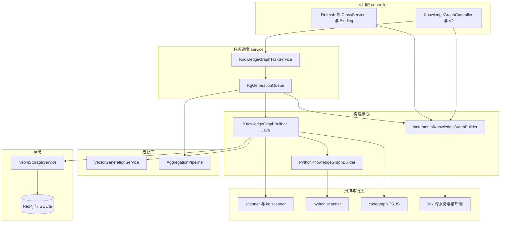
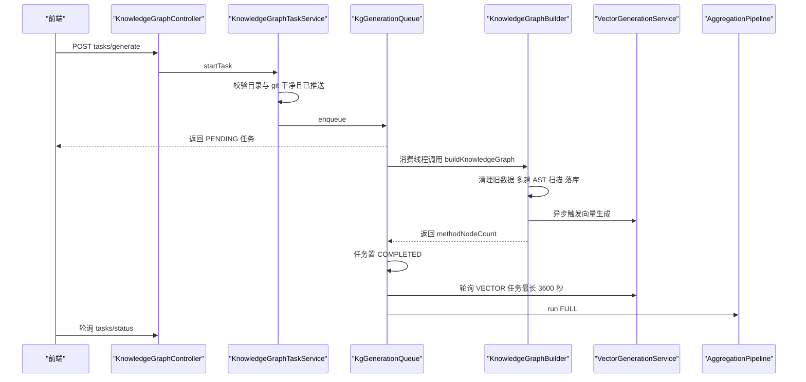

# 知识图谱构建模块

> 基于当前工作区代码重新核实（2026-11-24）。路径均以 `hisi-dev-tool/src/main/java/com/huawei/hisi/` 为前缀，下文简写为 `<kg>` = `knowledgegraph/`。

## 0. 属性表

| 属性 | 值 |
|---|---|
| 所属层 | 领域服务层（含 Controller，未严格分层） |
| 包路径 | `com.huawei.hisi.knowledgegraph`（14 个子包） |
| 类/文件数 | 121 |
| 代码行数 | 26,925 |
| 对外 HTTP 端点 | 128 个，分布在 7 个 Controller |
| 入口类 | `<kg>controller/KnowledgeGraphController`、`KnowledgeGraphV2Controller`、`GenerationController`、`RefreshController`、`CrossServiceBuildController`、`VectorGenerationController`、`binding/controller/ProjectBindingController` |
| 内部入口（非 HTTP） | `<kg>service/KgGenerationQueue`（单消费线程）、`scheduler/service/KgSchedulerService`（cron） |
| 上游依赖包 | `neo4j`(143 处 import)、`model`(14)、`service`(7)、`utils`(6)、`scanner`(4)、`glossary`(4)、`cache`(2)、`config`(1) |
| 下游消费包 | `archdiagnosis`(5 文件)、`workflow`(4)、`ram`(4)、`service`(3)、`neo4j`(3)、`scheduler`(1) |

## 1. 模块概述

### 1.1 职责定义

把 Java / Python / TypeScript-JavaScript-Vue 源码解析为 Neo4j 图（方法、类、入口点、调用、桥接、SQL、数据模型），生成描述与向量，再聚合出架构现状（模块、分层、领域、热点、变更频率）。

### 1.2 职责边界

| 做什么 | 不做什么 | 由谁负责 |
|---|---|---|
| 任务入队、串行执行、状态落 SQLite | 任务持久化队列、重试 | `KgGenerationQueue`（内存队列） |
| Java：JavaParser 静态解析 + 调用解析 | 依赖 jar 内类型解析 | 无（`buildSolver` 只含源码目录，见问题 3.5） |
| Python：ANTLR4 解析 + 框架路由识别 | Python 依赖包解析 | 无 |
| TS/JS/Vue：调用外部 `codegraph` CLI | 自研前端 AST | `codegraph/FrontendAstParser` 仅服务绑定构建 |
| 描述 + 向量生成 | Embedding/LLM 调用 | `neo4j/service/EmbeddingService`、`LLMDescriptionService` |
| 架构聚合 | 架构诊断与建议 | `archdiagnosis` 包 |
| 调用链/桥接/DSM 查询端点 | 语义/向量检索 | `neo4j/controller/*SearchController` |

## 2. 核心文件清单

| 文件 | 行数 | 说明 |
|---|---|---|
| `<kg>controller/KnowledgeGraphController.java` | 3719 | 58 个端点，查询与任务管理混合 |
| `<kg>service/KnowledgeGraphBuilder.java` | 2625 | 全量构建核心（Java 为主，分发多语言） |
| `<kg>python/PythonKnowledgeGraphBuilder.java` | 1127 | Python 全量构建 |
| `<kg>service/IncrementalKnowledgeGraphBuilder.java` | 852 | 基于 checkpoint 的增量刷新 |
| `<kg>python/call/PythonCallGraphResolver.java` | 837 | Python 调用解析 |
| `<kg>service/VectorGenerationService.java` | 745 | 描述 + 向量，`@Async` |
| `<kg>service/storage/Neo4jStorageService.java` | 740 | 图落库 |
| `<kg>service/KgGenerationQueue.java` | 475 | 内存串行队列 |
| `<kg>controller/KnowledgeGraphV2Controller.java` | 483 | 56 个端点，全部转发 V1 |
| `<kg>service/GitStatusService.java` | 362 | git CLI + JGit 混用 |

## 3. 模块架构

### 3.1 内部结构

### 3.2 全量构建时序

## 4. 对外接口

| 前缀 | Controller | 端点数 | 代表端点 |
|---|---|---|---|
| `/api/knowledge-graph` | `KnowledgeGraphController` | 58 | `POST /tasks/generate`、`/tasks/status`、`/tasks/queue`、`POST /incremental`（已废弃）、`/callees-tree`、`/call-chain/*`、`/mybatis/*`、`/dsm`、`/hotspots`、`/domains`、`/blast-radius/{nodeId}` |
| `/api/v2/knowledge-graph` | `KnowledgeGraphV2Controller` | 56 | `/api-consumers`、`/backend-deps`、`/frontend-backend/graph`，其余为 V1 转发 |
| `/api/knowledge-graph` | `GenerationController` | 2 | `POST /test-suggestions`、`/refactor-suggestions`（Spring AI `ChatClient`） |
| `/api/knowledge-graph` | `RefreshController` | 1 | `POST /refresh`（同步增量刷新，无 checkpoint 返回 409） |
| `/api/knowledge-graph/cross-service` | `CrossServiceBuildController` | 1 | `POST /build` |
| `/api/knowledge-graph/binding` | `ProjectBindingController` | 4 | 绑定 CRUD + `POST /build` |
| `/api/knowledge-graph/admin` | `KgPathAdminController` | 2 | `GET /paths/diagnosis`、`POST /paths/migrate` |
| `/api/vector-generation` | `VectorGenerationController` | 8 | `/start`、`/regenerate`、`/status`、`/missing`、`/refresh-missing` |

## 5. 依赖关系

| 方向 | 依赖 | 耦合度 | 说明 |
|---|---|---|---|
| 上游 | `neo4j`（model/repository/service） | 高 | 节点模型、Repository、`EmbeddingService` |
| 上游 | `service.CodeAnalysisCoreService` | 中 | `findJavaFiles`、`EXCLUDED_SCAN_DIRS` 静态常量 |
| 上游 | `scanner`、`cache.GlobalAnalysisCache` | 高 | 桥接扫描结果经单例缓存传递 |
| 上游 | `glossary` | 低 | `LLMDescriptionService`、`EntryPointDescriptionService` 读术语表 |
| 上游 | `config.DataSourceConfig` | 中 | 静态 `PROJECT_DIR` |
| 下游 | `archdiagnosis`、`workflow`、`ram` | 中 | 使用 `DeepseekJsonClient`、聚合结果、KG 查询端点 |
| 下游 | `scheduler` | 中 | `KgSchedulerService` 直接调用 `IncrementalKnowledgeGraphBuilder` 与 `KnowledgeGraphTaskService` |
| 下游 | `neo4j` 检索 Controller | 中 | 使用 `ProjectBindingService.resolve` 做绑定范围展开 |

## 6. 配置项

| 键 | 默认值 | 来源 | 备注 |
|---|---|---|---|
| `analysis.features.enhanced-interface-resolution` | `true`（代码默认 `false`） | `resources/application.yml:219`、`config/AnalysisFeatureConfig.java:27` | 消费方未在代码中确认 |
| `analysis.features.spring-annotation-aware` | `true` | `application.yml:223` | 仅见 `CodeAnalysisCoreService.java:1498` 注释引用 |
| `vector.generation.concurrency` | 6 | `<kg>service/VectorGenerationService.java:74` | |
| `vector.generation.batch-size` | 0 | 同上 `:81` | 0 表示不分批（未确认） |
| `embedding.batch-size` | 20 | 同上 `:84` | |
| `vector.generation.progress-update-interval` | 10 | 同上 `:87` | |
| `kg.vector.skip` | 无 | 系统属性，同上 `:221` | 非 yml 配置 |
| `codegraph.dist-path` | `lib/codegraph` | `<kg>codegraph/CodegraphSidecarService.java:51` | |
| `codegraph.timeout-seconds` | 600 | 同上 `:52` | |
| `anthropic.model` | `deepseek-v4-pro-cc` | `<kg>aggregation/llm/DeepseekJsonClient.java:44` | |
| `deepseek.connect-timeout-ms` / `read-timeout-ms` | 代码常量 | 同上 `:45-46` | yml 未配置 |
| `neo4j.uri` / `neo4j.database` | `bolt://127.0.0.1:7687` / `codeKnowledge` | `application.yml:234-235` | 另有 `neo4j.embedded.enabled` 默认 `false` |
| `embedding.model` / `embedding.dimension` | `Qwen/Qwen3-VL-Embedding-8B` / 4096 | `application.yml:57-58` | |
| `text-model.model` | `GLM-4.7-Flash` | `application.yml:75` | 描述生成 |
| `logging.level.com.huawei.hisi.knowledgegraph` | `debug` | `application.yml:165` | 整包默认 debug |

## 7. 错误处理

| 场景 | 处理方式 | 位置 |
|---|---|---|
| 路径不存在 | `IllegalArgumentException` | `<kg>service/KnowledgeGraphTaskServiceImpl.java:68-71` |
| 工作区有未提交 / 未推送 | `IllegalStateException`，非 git 目录仅告警 | 同上 `:73-86` |
| 并发构建 | `Semaphore.tryAcquire` 失败即抛异常，不等待 | `<kg>service/KnowledgeGraphBuilder.java:217-219` |
| 取不到 commit | `NoGitCommitException` | 同上 `:241-244` |
| 增量无 checkpoint | `NoCheckpointException` → 409 | `<kg>controller/RefreshController.java:42-46` |
| 任务异常 | 记 `FAILED` + `e.getMessage()` | `<kg>service/KgGenerationQueue.java:285-289` |
| 卡死任务 | RUNNING 超 24h 标 FAILED | `<kg>service/KnowledgeGraphTaskServiceImpl.java:130-142` |
| 应用重启 | 孤儿 KG 任务标 FAILED | `<kg>service/KgGenerationQueue.java:85-99` |
| 聚合阶段失败 | 记日志与 checkpoint，不阻断 | `<kg>aggregation/AggregationPipeline.java:47-54` |

## 8. 已知问题与扩展点

| # | 问题 | 证据 | 扩展点 |
|---|---|---|---|
| 1 | Controller 巨类：任务、查询、原生 Cypher、DTO schema、架构分析混在一起；V2 的 56 个端点全部转发 V1 | `<kg>controller/KnowledgeGraphController.java:64`、`:74-75`、`:432-451`、`KnowledgeGraphV2Controller.java:34-428` | 按任务/调用链/桥接/架构拆分 |
| 2 | 递归遍历 N+1：每个节点 2 次 Neo4j 查询 | `KnowledgeGraphController.java:1368`、`:1393` | 改单条变长路径 Cypher |
| 3 | 全项目加载：按方法名查全部方法节点仅为兜底和打样例日志 | 同上 `:824-842`、`:1285`、`:1313` | 限制查询范围或分页 |
| 4 | 用异常消息文本区分错误类型 | 同上 `:145` | 引入错误码或异常类型 |
| 5 | `/call-chain/by-type` 每个入口点 2 次深度 50 遍历 | 同上 `:1040-1050` | 合并为一次查询 |
| 6 | 路径管理端点全部使用不存在的标签 `MethodNode`/`EntryPointNode`/`SqlNode`（实际为 `Method`/`EntryPoint`/`Sql`），查询恒为 0 行 | `<kg>controller/KgPathAdminController.java:49`、`:61`、`:141-210` | 修正标签或下线 |
| 7 | 同文件在 Controller 内直接注入 `Driver` 执行 Cypher，并依赖静态 `DataSourceConfig.PROJECT_DIR`、硬编码 `remote-repos/` | 同上 `:27-28`、`:36`、`:89` | 下沉到 Repository 与配置 |
| 8 | git 双机制：外部 `git` CLI 与 JGit 并存；CLI 合并 stderr、无超时 | `<kg>service/GitStatusService.java:338-361`、`:239-254`、`:265-307` | 统一 JGit |
| 9 | `isValidGitDirectory` 要求 `.git` 是目录，worktree / 子模块 / 嵌套项目被当作非 git；全量构建却强依赖 commit，入队能过、执行才失败 | 同上 `:315-327`、`KnowledgeGraphTaskServiceImpl.java:84-86`、`KnowledgeGraphBuilder.java:241-244` | 入队前统一校验 |
| 10 | 信号量快速失败与队列不协调：同步 `/refresh` 持锁时，队列任务直接 FAILED | `<kg>service/IncrementalKnowledgeGraphBuilder.java:109-115`、`KnowledgeGraphBuilder.java:217-219` | 队列内改为等待或合并 |
| 11 | 队列为内存态，重启丢排队项；VECTOR 孤儿任务不恢复 | `<kg>service/KgGenerationQueue.java:46`、`:83-99` | 持久化队列 |
| 12 | 增量入队硬编码 `generateArchitecture=true`，但聚合被 `!item.incremental()` 跳过；增量分支 `maxVectorTaskIdBefore` 恒为 0，陈旧 VECTOR 任务即可满足等待；增量完成时计数全写 0 | 同上 `:195`、`:310`、`:317`、`:341-345` | 统一任务参数模型 |
| 13 | 增量只 MERGE SQL 节点，不删陈旧 SQL；`EXECUTES_SQL` 仅按过滤后关系重建；重命名只返回新路径，旧路径节点成孤儿 | `<kg>service/IncrementalKnowledgeGraphBuilder.java:457-486`、`GitStatusService.java:294-299` | 先删后建 |
| 14 | 增量构建直接访问 Python builder 的 public 字段 | 同上 `:659`、`:680`、`:691`、`:716`、`:725`、`:732` | 收敛为接口方法 |
| 15 | Builder 构造器 25 个参数，字段全 `protected` 供子类直取 | `<kg>service/KnowledgeGraphBuilder.java:129-154` | 拆分阶段对象 |
| 16 | 一轮全量至少 4 趟完整 AST 解析 + 桥接扫描 | 同上 `:441`、`:458`、`:493`、`:668`、`:679` | 单趟 Visitor |
| 17 | 静态调用解析对每个调用线性扫描全部签名 key，并有硬编码排除表、丢弃 `build*` | 同上 `:1492`、`:1497-1509`、`:1523-1533` | 预建索引 |
| 18 | 祖先接口解析的 visited 集合跨顶层类共享，后者可能漏接口 | 同上 `:2180-2183`、`:2215-2218` | 每次调用新建集合 |
| 19 | `buildOverrideRelations` 仅按方法名匹配 | 同上 `:2527-2528` | 带签名匹配 |
| 20 | `signatureHash` 为 32 位 `hashCode` 十六进制，有碰撞风险 | 同上 `:2622-2624` | 改 SHA-256 截断 |
| 21 | commit 哈希写在 `KG_LOG` 任务的 `errorMessage` 字段，再由 `/git-status` 读回 | 同上 `:2263-2274`、`KnowledgeGraphController.java:334-339` | 独立字段或只用 checkpoint |
| 22 | 清理逻辑两份近似重复；`cleanProjectData` 无事务且不删 `ServiceNode`，`cleanProjectDataForReuse` 为单个大事务且删 | 同上 `:2305-2349`、`<kg>service/storage/Neo4jStorageService.java:614-674`、`:682-738` | 抽公共清理器 |
| 23 | 存储接口声称多后端，实际仅 Neo4j 一个实现；4 个方法不在接口上；节点映射代码重复 | `<kg>service/storage/KnowledgeGraphStorageService.java:19`、`Neo4jStorageService.java:84-107`、`:269-290`、`:312-356` | 接口与实现对齐 |
| 24 | 类型解析器只有 `ReflectionTypeSolver` + 源码目录，无 jar 依赖，第三方类型调用解析不到 | `<kg>service/KnowledgeGraphBuilder.java:2351-2358` | 加 `JarTypeSolver` |
| 25 | 入口点：`entryId` 无签名哈希；`RequestMapping` 不看 `method` 一律 GET；死分支 `AfterConstruct`；Dubbo 复用 `TYPE_GRPC`；手拼 JSON 只转义 `\` 与 `"` | 同上 `:1726`、`:1809`、`:1838`、`:1870-1934`、`:2047` | 改 DTO 序列化 |
| 26 | 聚合管道注释写 6 个 Stage，实际 7 个；仅 2 个 Stage 写 checkpoint；`deriveDirtyPackages` 按 `className.methodName.hash` 取包名，但 nodeId 实际为 `projectPath:className.methodName.sigHash`，得到的脏包名带路径前缀 | `<kg>aggregation/AggregationPipeline.java:13`、`:107`、`:119-126`、`KnowledgeGraphBuilder.java:969` | 修正 nodeId 解析 |
| 27 | codegraph 把 `codegraph.db` 写进目标项目 `.codegraph/`，可能弄脏目标仓库；转换时跳过 class 节点，TS 图无类层级；`framework` 恒 `unknown`；结果 key 为 `elapsedMs` 而其他语言为 `costTimeMs` | `<kg>codegraph/CodegraphSidecarService.java:45`、`:106`、`CodegraphToNeo4jTransformer.java:95-98`、`:222`、`KnowledgeGraphBuilder.java:372`、`:711` | 输出目录可配置 |
| 28 | 两套 URL 归一化规则并存：占位符转 `{}` 与转 `:param`，前者保留 `/api`、后者剥离；`/api` 前缀硬编码 | `<kg>link/HttpRestLinkStrategy.java:95-123`、`<kg>link/UrlNormalizer.java:32`、`:68` | 统一归一化器 |
| 29 | 跨服务构建「先算后删再写」无事务，写失败即丢旧边；同步执行多项目增量刷新 | `<kg>service/CrossServiceBuildService.java:44-64` | 事务或先写后删 |
| 30 | `CheckpointMigrationService` 无调用方，且读取 `KG` 任务而哈希写在 `KG_LOG` | `<kg>migration/CheckpointMigrationService.java:20`、`:39` | 删除或接到启动流程 |
| 31 | 重复的 `toKnowledgeGraphTask` 与卡死检测；未使用的 `@Lazy self`；字段注入 | `<kg>service/KnowledgeGraphTaskServiceImpl.java:41-43`、`:97-107`、`<kg>service/KgGenerationQueue.java:449-474` | 抽转换器 |
| 32 | `GenerationController` 的 `moduleName` 只进提示词不做过滤，并把 `e.getMessage()` 返回客户端 | `<kg>controller/GenerationController.java:86`、`:100-101`、`:120` | 真正按模块过滤 |
| 33 | 向量端点以 HTTP 200 + body 内 500 报错，`/missing` 却返回 400；`/refresh-missing` 与 `/start` 等价 | `<kg>controller/VectorGenerationController.java:55`、`:75`、`:172`、`:190` | 统一响应语义 |
| 34 | `KnowledgeGraphCommonUtils.normalizePath` 已 `@Deprecated` 仍被入口和队列使用 | `<kg>util/KnowledgeGraphCommonUtils.java:29-32`、`KnowledgeGraphTaskServiceImpl.java:67` | 改用 `PathUtils` |
| 35 | 工具类反向依赖 `service.CodeAnalysisCoreService.EXCLUDED_SCAN_DIRS`；语言识别只看根目录标记 | `<kg>util/ProjectLanguageDetector.java:82-98`、`:127` | 常量下沉 |

## 9. 测试策略

本轮未运行测试（任务约束）。重构时建议优先为 `KgGenerationQueue.processItem`、`IncrementalKnowledgeGraphBuilder` 阶段 B/F、`KnowledgeGraphBuilder.resolveStaticMethodCall`、`AggregationPipeline.deriveDirtyPackages` 补单测。

## 10. 相关文档

- [Neo4j图存储与检索](./Neo4j图存储与检索.md)
- [远程项目管理](./远程项目管理.md)（含定时调度、术语表、`scanner` 包说明）
