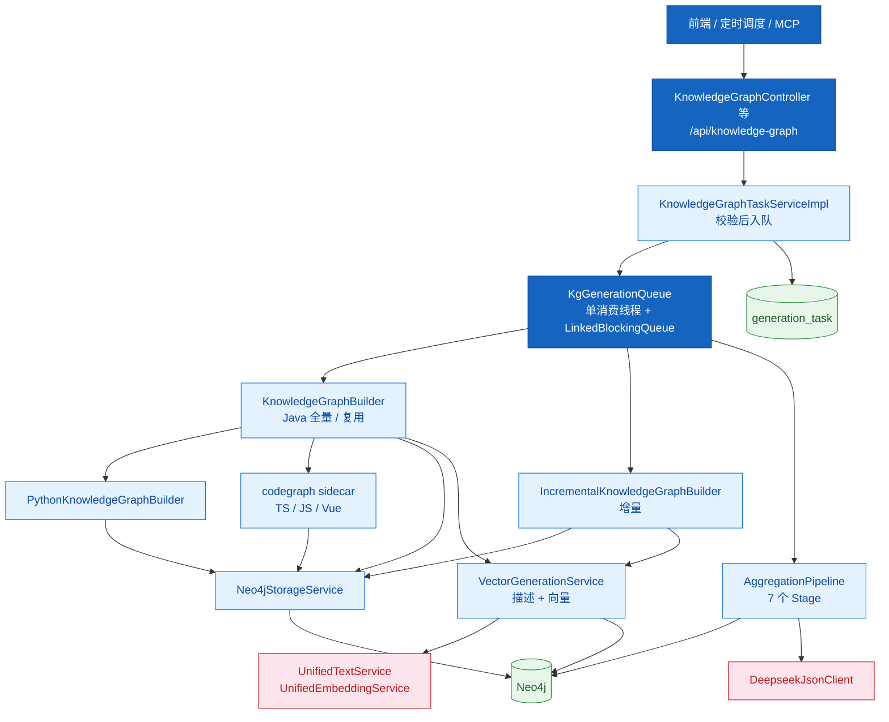
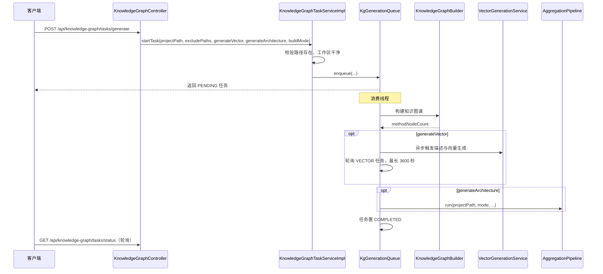

# 知识图谱构建

> 自动生成于 2026-11-26，基于 `99d0037` 版本

| 属性 | 值 |
|------|-----|
| **所属层** | 领域服务层（含自己的 Controller 与任务队列） |
| **目录** | `knowledgegraph/`（121 个文件，14 个子包）+ `service/KnowledgeGraphTaskService(Impl)` + `scanner/` |
| **核心类** | `KnowledgeGraphTaskServiceImpl`、`KgGenerationQueue`、`KnowledgeGraphBuilder`、`IncrementalKnowledgeGraphBuilder`、`PythonKnowledgeGraphBuilder`、`VectorGenerationService`、`AggregationPipeline`、`KnowledgeGraphController` |
| **REST** | 8 个 Controller，共 132 个端点（V1 58、V2 56、其余 18） |
| **存储** | Neo4j（图数据）+ SQLite `generation_task`、`kg_project_binding` |

---

## 1. 模块概述

### 1.1 职责定义

**核心职责**：把 Java / Python / TypeScript-JavaScript-Vue 源码解析成 Neo4j 图（方法、类、入口点、调用、桥接、SQL、数据模型），生成描述与向量，再聚合出架构现状（模块、分层、领域、热点、变更频率）。

| 本模块负责 | 本模块不负责 | 由谁负责 |
|-----------|-------------|---------|
| 任务入队、串行执行、状态落库 | 节点模型与检索 | [Neo4j图存储与检索](./Neo4j图存储与检索.md) |
| Java 静态解析与调用解析 | 运行期信息 | — |
| Python 解析与框架路由识别 | Python 依赖包解析 | — |
| 调用外部 `codegraph` CLI 解析 TS / JS / Vue | 自研前端 AST | `codegraph`（Node 实现） |
| 描述与向量生成 | 模型 HTTP 调用 | `UnifiedTextService` / `UnifiedEmbeddingService`（直连） |
| 架构现状聚合 | 架构诊断报告与治理建议 | [架构诊断](./架构诊断.md) |
| 调用链 / 桥接 / DSM 查询端点 | 语义检索 | [Neo4j图存储与检索](./Neo4j图存储与检索.md) |
| 按 cron 触发构建 | — | [远程项目管理](./远程项目管理.md) 的 `KgSchedulerService` |

### 1.2 子包

| 子包 | 文件数 | 内容 |
|------|-------|------|
| `controller/` | 7 | `KnowledgeGraphController`（约 3700 行）、`KnowledgeGraphV2Controller`、`GenerationController`、`RefreshController`、`CrossServiceBuildController`、`KgPathAdminController`、`VectorGenerationController` |
| `service/` | 20 | 构建器、增量构建、队列、向量与描述生成、环检测、跨服务链接、`BuildMode`、`storage/`（存储接口与 Neo4j 实现） |
| `aggregation/` | 22 | `AggregationPipeline`、`AggregationCheckpointManager`、`RiskScoreCalculator`、`stage/` 18 个、`llm/DeepseekJsonClient` |
| `python/` | 22 | `PythonKnowledgeGraphBuilder`、`PythonAstVisitor`、框架路由扫描器、调用图解析、ANTLR 词法/语法基类 |
| `model/` | 18 | `GenerationTask`、`VectorGenerationTask`、`KgGenerationLog`、`BridgeRelation`、`CallTarget`、`EntryPointType` 等 |
| `link/` | 6 | 跨服务与前后端链接策略 |
| `scanner/` | 2 | `JavaDataModelScanner`、`MyBatisXmlScanner` |
| `codegraph/` | 4 | `CodegraphSidecarService`、`CodegraphSqliteReader`、`CodegraphToNeo4jTransformer`、`FrontendAstParser` |
| `binding/` | 4 | 前后端项目绑定 |
| `repository/` | 4 | `GenerationTaskRepository` 与 3 个仅 3 行的接口文件 |
| `util/`、`vector/`、`exception/`、`migration/` | 5 / 3 / 3 / 1 | 工具类、向量写入、构建异常、检查点迁移 |

顶层包 `scanner/`（5 个文件：`EndpointScanner`、`FeignClientScanner`、`HttpCallScanner`、`MQEndpointScanner`、`ProxyClassScanner`）不在本包内，但只被 `KnowledgeGraphBuilder` 的桥接扫描使用，说明见 [远程项目管理](./远程项目管理.md)。

---

## 2. 模块架构

---

## 3. 构建任务

### 3.1 入口 `KnowledgeGraphTaskServiceImpl.startTask(...)`

参数：`projectPath`、`excludePaths`、`generateVector`、`generateArchitecture`、`buildMode`（默认 `REUSE`）。校验通过后调 `KgGenerationQueue.enqueue(...)`。

| 校验 | 失败表现 |
|------|---------|
| 项目路径不存在 | `IllegalArgumentException` |
| 工作区有未提交改动 | `IllegalStateException`，提示先提交再生成 |
| 取不到最新任务 | 同上 |

`getLatestTask` / `getTaskStatus` 读取时做卡死检测：`RUNNING` 超过 24 小时的任务自动标 `FAILED`。

### 3.2 队列 `KgGenerationQueue`

源码注释：保证多项目严格顺序执行，每个项目完整走完「图谱生成 → 描述生成 → 向量生成」后才开始下一个。

| 项目 | 值 |
|------|-----|
| 实现 | 单消费线程 + `LinkedBlockingQueue`（内存态） |
| 任务类型 | `KG`、`VECTOR` |
| 任务状态 | `PENDING` → `RUNNING` → `COMPLETED` / `FAILED` |
| 向量任务等待 | 每 3 秒轮询，最长 3600 秒 |
| 启动恢复 | `@PostConstruct init()`：把遗留的 `KG` 类 `RUNNING` / `PENDING` 任务标 `FAILED`；`VECTOR` 孤儿任务不恢复 |
| 对外方法 | `enqueue(...)`（3 个重载）、`enqueueIncremental`、`enqueueBatch`（3 个重载）、`getQueueStatus`、`getQueueSize` |

### 3.3 构建模式 `BuildMode`

| 模式 | 含义 |
|------|------|
| `INCREMENTAL` | 依赖 git diff 只重建变更文件，未变更节点的向量保留 |
| `REUSE` | 全量扫描 + `codeHash` 判定：命中则复用向量，未命中重算；构建末尾清理孤儿节点。仅 Java 链路支持，非 Java 项目自动降级为 `WIPE` |
| `WIPE` | 全量全删全插，确定性兜底 |

### 3.4 时序

---

## 4. 解析链路

| 语言 | 实现 | 说明 |
|------|------|------|
| Java | `KnowledgeGraphBuilder`（约 2600 行），JavaParser + Symbol Solver | 多趟 AST 扫描：方法、类、调用关系、入口点、接口实现、数据模型；复用 `service.CodeAnalysisCoreService` 的核心方法 |
| Python | `python/PythonKnowledgeGraphBuilder`、`PythonAstVisitor` | ANTLR4 运行时 + 文法 `src/main/antlr4/.../Python3Lexer.g4`、`Python3Parser.g4`（Maven 插件生成，开 visitor、关 listener）；框架路由扫描器覆盖 Flask、FastAPI、Django、Celery |
| TS / JS / Vue | `codegraph/CodegraphSidecarService` | 子进程运行 `codegraph init -v <projectPath>`，产出 `<projectPath>/.codegraph/codegraph.db`，由 `CodegraphSqliteReader` 读取、`CodegraphToNeo4jTransformer` 写入 Neo4j |

`ProjectLanguageDetector` 判断项目语言组合；`IncrementalKnowledgeGraphBuilder` 以组合方式复用 `KnowledgeGraphBuilder`，与全量构建共享同一个 `generationSemaphore` 互斥。源码注释：增量与全量只在三处不同——只 `DETACH DELETE` 变更文件的节点、第一趟只扫变更文件、调用关系全量扫描后过滤。

存储经 `service/storage/KnowledgeGraphStorageService` 接口，实现为 `Neo4jStorageService`。

### 4.1 链接 `link/`

| 类 | 职责 |
|----|------|
| `CrossServiceLinker` | 跨服务链接编排 |
| `HttpRestLinkStrategy`、`MqLinkStrategy` | HTTP 与 MQ 两种链接策略 |
| `UrlNormalizer` | URL 归一化 |
| `FrontendBackendLinker` | 前后端链接（`ApiClient` → `EntryPoint`） |

`CrossServiceBuildService` 按「先算 → 再删 → 再写」的顺序建立跨项目链接（源码注释：先在内存算出匹配关系，链接失败时可暴露问题而不是静默丢边）。

### 4.2 前后端绑定 `binding/`

`ProjectBindingService` 提供绑定 CRUD 与「绑定范围展开」：给定前端或后端目录，展开为该目录及其所有绑定对的对侧目录集合，供检索与总览入口复用。表 `kg_project_binding`（`backend_path` + `frontend_path` 唯一）。

---

## 5. 描述与向量

| 组件 | 职责 |
|------|------|
| `VectorGenerationService` | 协调方法 / SQL / 入口点 / 类节点的描述与向量生成；固定线程池，分批提交；任务类型 `VECTOR`；`@Async("analysisTaskExecutor")` |
| `LLMDescriptionService` | 方法描述生成（`UnifiedTextService`） |
| `EntryPointDescriptionService` | 入口点描述（简短 + 详细两份） |
| `ClassDescriptionService` | 类描述 |
| `vector/VectorWriter`、`FrontendNodeVectorizer` | 向量写入；前端节点向量化 |
| `util/MethodBodyCompressor`、`CommentExtractor` | 方法体压缩与注释提取 |

向量生成属批量类调用，直连 `UnifiedTextService` / `UnifiedEmbeddingService`，**不经 pi**（边界说明见 [pi-agent底座](./pi-agent底座.md)）。限流由下游令牌桶承担：线程数取 `min(embedding.burst, text-model.burst)`。

`VectorGenerationController`（`/api/vector-generation`）的 8 个端点见第 7 节。

---

## 6. 架构现状聚合 `AggregationPipeline`

`run(projectPath, mode, rebuiltNodeIds, changedFiles)`，`mode` 为 `FULL` 或 `INCREMENTAL`。类注释写「6 个 Stage」，实际代码是 7 个：

| Stage | 内容 | 失败处理 |
|-------|------|---------|
| 1 `ModuleStats` | `ModuleStatsAggregator.aggregate`：模块统计 + DSM | 写检查点失败并**直接返回**（后续 Stage 依赖模块数据） |
| 2 `BuildModule` | `BuildModuleDependencyAggregator`：构建模块级依赖 | 记日志，不阻断 |
| 3 `Hotspot` | `HotspotScorer`：热点风险评分 | 不阻断 |
| 4 `Churn` | `ChurnCollector`：文件变更频率 | 不阻断 |
| 5 `Community` | `CommunityDetector`：社区检测 | 写检查点失败并返回 |
| 6 `DomainName` | `DomainNameGenerator`：LLM 领域命名；增量模式下仅在漂移时执行 | 不阻断 |
| 7 `FreeLayerRole` | `FreeLayerRoleResolver`：LLM 补全游离节点层级（类级 + 包级） | 不阻断 |

`RiskScoreCalculator`：`riskScore = 复杂度归一 × 0.35 + 变更频率归一 × 0.35 + 入度归一 × 0.20 + 环惩罚 × 0.10`。复杂度用分段映射，变更频率与入度用百分位排名。

`ArchitectureAnalysisService` 是另一条独立串行队列（任务类型 `ARCH_ANALYSIS`）：后台执行「领域归纳 → 领域交互边 → 游离节点层级补全」，接口立即返回 `taskId`。源码注释说明不与 `KgGenerationQueue` 混用，避免与 KG 任务抢队列。

聚合阶段的 LLM 调用走 `aggregation/llm/DeepseekJsonClient`（直连模型网关，强制 `json_object`）。

---

## 7. REST 端点

鉴权：GET 放行；POST 需要管理员。全部 132 个端点的逐条清单见 [05-接口文档](../05-接口文档/index.md)。

| Controller | 前缀 | 端点数 | 内容 |
|-----------|------|-------|------|
| `KnowledgeGraphController` | `/api/knowledge-graph` | 58 | 任务、构建、状态、调用链、方法、MyBatis、桥接、架构看板 |
| `KnowledgeGraphV2Controller` | `/api/v2/knowledge-graph` | 56 | 查询类接口统一用 `projectPaths`（必填），委托 V1 执行；另有 3 个 V2 独有端点 |
| `VectorGenerationController` | `/api/vector-generation` | 8 | 向量生成状态与控制 |
| `ProjectBindingController` | `/api/knowledge-graph/binding` | 4 | 绑定 CRUD 与 `POST /build` |
| `GenerationController` | `/api/knowledge-graph` | 2 | 测试建议、重构建议（经 `AgentLlmClient`） |
| `KgPathAdminController` | `/api/knowledge-graph/admin` | 2 | 路径诊断与迁移 |
| `RefreshController` | `/api/knowledge-graph` | 1 | `POST /refresh` 同步增量刷新 |
| `CrossServiceBuildController` | `/api/knowledge-graph/cross-service` | 1 | `POST /build` |

V1 的 58 个端点按主题分组：

| 主题 | 路径（均在 `/api/knowledge-graph` 下） |
|------|------------------------------------|
| 任务（5） | `POST /tasks/generate`、`GET /tasks/status`、`GET /tasks/latest`、`POST /tasks/generate-batch`、`GET /tasks/queue` |
| 构建与分析（4） | `GET /git-status`、`POST /incremental`、`POST /architecture-analysis`、`GET /architecture-analysis/status` |
| 项目与类（2） | `GET /projects`、`GET /classes` |
| 图谱状态（3） | `GET /status`、`GET /status/batch`、`GET /type/schema` |
| 入口与调用链（12） | `root-entries`、`callees-tree`、`entry-types`、`entry-points`、`call-chain/by-key`、`call-chain/by-type`、`call-chain/affecting`、`call-chain/downstream`、`call-chain/graph`、`implementations`、`interfaces`、`cycles/detect` |
| 方法（3） | `method/search`、`method/detail`、`method/by-class` |
| MyBatis（4） | `POST /mybatis/scan`、`mybatis/mappers`、`mybatis/sql`、`mapper/{mapperInterface}/sql` |
| 桥接与服务拓扑（6） | `call-chain/{nodeId}/bridges`、`feign/{serviceName}/call-chain`、`mq/{topic}/call-chain`、`bridge-stats`、`bridges/by-type`、`service-topology` |
| 架构现状看板（19） | `dashboard`、`module-dependency-graph`、`domain-dependency-graph`、`build-modules`、`build-module-cycles`、`build-module-layer-violations`、`package-dependencies`、`package-cycles`、`module-cycles`、`class-layer-violations`、`class-dependencies`、`class-ego-net`、`layer-domain-matrix`、`dsm`、`dsm/drill-down`、`hotspots`、`domains`、`domains/{domainId}/classes`、`blast-radius/{nodeId}` |

`POST /tasks/generate` 的参数：`projectPath`（必填）、`excludePaths`、`generateVector`（默认 `true`）、`generateArchitecture`（默认 `true`）、`buildMode`（默认 `reuse`）。

`GenerationController`：`POST /test-suggestions`（`nodeId` + 路径）以爆炸半径数据为上下文生成测试建议；`POST /refactor-suggestions`（`moduleName` + 路径）以 DSM 与热点数据为上下文生成重构建议。两者都调 `AgentLlmClient.completeJson`（经 pi 的 `one-shot` 清单），失败返回错误。该类 Javadoc 仍提到「`.entity()` 强制（anthropic 走 tool use）」，与现状不符。

---

## 8. 数据模型

| 存储 | 对象 | 说明 |
|------|------|------|
| SQLite | `generation_task` | 任务：`task_type`（`KG` / `VECTOR` / `ARCH_ANALYSIS`）、`project_path`、`status`、`progress`、`total_count` / `success_count` / `fail_count`、`error_message`、`started_at` / `finished_at` |
| SQLite | `kg_project_binding` | 前后端绑定，`UNIQUE(backend_path, frontend_path)` |
| Neo4j | 全部业务节点与关系 | 见 [Neo4j图存储与检索](./Neo4j图存储与检索.md) |
| Neo4j | `GenerationCheckpoint` | 全量构建检查点：`checkpointId`、`projectPath`、`lastCommit`、`lastBranch`、`generatedAt` |
| Neo4j | `AggregationCheckpoint` | 聚合阶段检查点：`stageName`、`dataHash`、`status`、`errorMessage`、`lastSuccessAt` |

---

## 9. 配置项

| 键 | 默认值 | 说明 |
|----|-------|------|
| `vector.generation.concurrency` | `6` | 向量生成线程数 |
| `vector.generation.batch-size` | `0` | 分批提交的批大小 |
| `embedding.batch-size` | `20` | 向量接口批量大小 |
| `vector.generation.progress-update-interval` | `10` | 进度更新间隔 |
| `codegraph.dist-path` | `lib/codegraph` | codegraph 发行包目录（相对后端工作目录） |
| `codegraph.timeout-seconds` | `600` | codegraph 子进程超时 |
| `anthropic.base-url` / `anthropic.api-key` / `anthropic.model` | 空 / 空 / `deepseek-v4-pro-cc` | `DeepseekJsonClient` 直连模型网关用 |
| `deepseek.connect-timeout-ms` / `deepseek.read-timeout-ms` | `10000` / `600000` | 同上，超时 |
| `text-model.*`、`embedding.*` | 见 [应用启动与全局配置](./应用启动与全局配置.md) | 描述与向量生成 |
| `analysis.features.*` | 四个开关 | 代码分析特性 |

---

## 10. 错误处理

| 场景 | 处理 |
|------|------|
| 路径不存在 | `IllegalArgumentException` → HTTP 400 |
| 工作区不干净 | `IllegalStateException` → HTTP 400 |
| 任务卡死（`RUNNING` 超 24 小时） | 读取时标 `FAILED` |
| 后端重启 | 遗留 `KG` 任务标 `FAILED`，需重新触发 |
| 并发构建 | 全量与增量共用 `generationSemaphore` |
| 向量任务长时间未完成 | 队列最多等 3600 秒 |
| 聚合 Stage 1 或 5 失败 | 记检查点并终止后续 Stage，不影响图谱本身 |
| 其他聚合 Stage 失败 | 记日志，不阻断 |
| codegraph 超时 | `destroyForcibly()` 并抛 `IOException` |
| LLM 建议生成失败 | 返回错误信息 |

---

## 11. 已知问题与扩展点

| 问题 | 说明 |
|------|------|
| 队列为内存态 | 重启丢排队项 |
| Controller 巨类 | `KnowledgeGraphController` 约 3700 行，任务、查询、架构看板混在一起 |
| V2 大面积转发 V1 | 56 个端点中多数只是把 `projectPaths` 转成 `projectPath` 调 V1 |
| 类注释与实际不符 | `AggregationPipeline` 写 6 个 Stage，实际 7 个；`GenerationController` 仍提 `.entity()` |
| V1 增量服务已废弃 | `IncrementalUpdateService` 标 `@deprecated`，检查点存在 SQLite 的 `errorMessage` 字段里，不可靠 |
| codegraph 把数据库写进目标项目 | `<projectPath>/.codegraph/codegraph.db` 可能弄脏被分析仓库 |
| 路径管理端点的标签写错 | `KgPathAdminController` 的 Cypher 用的是 `MethodNode` / `EntryPointNode` / `SqlNode`，而图里的标签是 `Method` / `EntryPoint` / `Sql`（见 [Neo4j图存储与检索](./Neo4j图存储与检索.md)）；实际命中情况未运行验证 |

| 扩展点 | 方式 |
|-------|------|
| 新增语言 | 新增 builder，并在 `KnowledgeGraphBuilder` 的多语言分发处接入 |
| 新增聚合 Stage | 实现 Stage 类并在 `AggregationPipeline.run` 中按序调用 |
| 新增查询端点 | 在 V1 增加方法，V2 做转发 |

---

## 12. 依赖关系

| 方向 | 依赖 | 用途 |
|------|------|------|
| 上游 | [Neo4j图存储与检索](./Neo4j图存储与检索.md) | 节点模型、仓储、`EmbeddingService` |
| 上游 | [pi-agent底座](./pi-agent底座.md) | `GenerationController` 的 `AgentLlmClient` |
| 上游 | `service.CodeAnalysisCoreService`、`scanner` 包 | Java 文件发现与桥接端点扫描 |
| 上游 | [远程项目管理](./远程项目管理.md) | `glossary` 术语表注入描述提示词；`KgSchedulerService` 触发构建 |
| 下游 | [架构诊断](./架构诊断.md) | 只读端点与 `ClassNode` / `DomainNode` 数据 |
| 下游 | [RAM需求评估](./RAM需求评估.md)、[影响分析与风险评估](./影响分析与风险评估.md) | 调用链与桥接查询 |
| 下游 | `hisi-mcp-server` | `kg_*` 只读工具经这些端点取数 |

---

> **相关文档**：
> - 架构总览 → [02-架构设计](../02-架构设计/index.md)
> - 构建数据流 → [04-数据流程](../04-数据流程/index.md)
> - 任务表与节点模型 → [06-数据模型](../06-数据模型/index.md)
> - 接口全表 → [05-接口文档](../05-接口文档/index.md)
