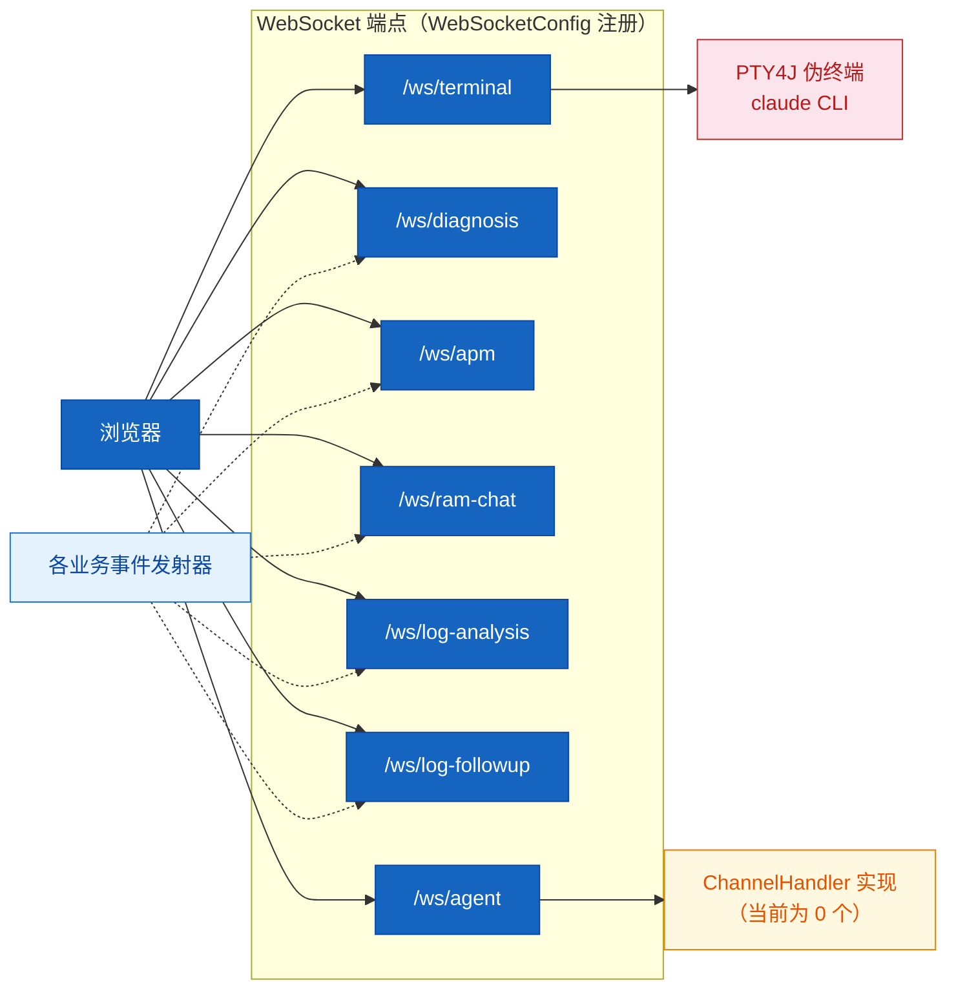
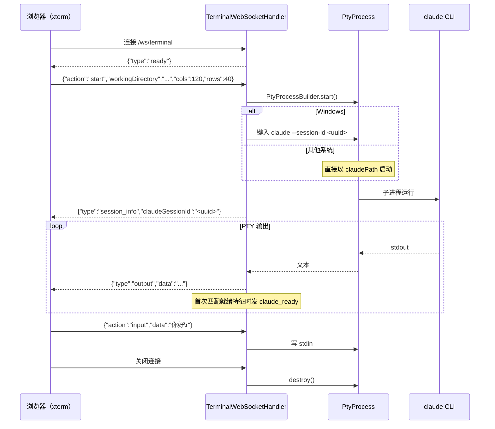

# 终端与 WebSocket

> 自动生成于 2026-11-26，基于 `99d0037` 版本

| 属性 | 值 |
|------|-----|
| **所属层** | 接入层（WebSocket 端点）+ 基础设施层（PTY 子进程） |
| **目录** | `handler/TerminalWebSocketHandler.java`、`websocket/UnifiedWebSocketHandler.java`、`websocket/ChannelHandler.java`、`config/WebSocketConfig.java`；其余处理器分属各业务包 |
| **端点数** | 7 个 WebSocket 端点（1 个统一网关 + 6 个专用端点） |
| **协议** | 文本帧，JSON |

---

## 1. 模块概述

### 1.1 职责定义

**核心职责**：为前端提供浏览器内的伪终端通道（对接本地 `claude` CLI），并把各业务流程的实时进度经 WebSocket 推给前端。

| 本模块负责 | 本模块不负责 | 由谁负责 |
|-----------|-------------|---------|
| 终端帧协议、PTY 进程生命周期、就绪检测 | 会话持久化 | [会话与工作区](./会话与工作区.md) |
| 端点注册与跨域来源 | 握手鉴权 | [应用启动与全局配置](./应用启动与全局配置.md) |
| 统一网关的路由框架 | 各频道业务 | 各业务模块 |
| 各业务事件的推送通道 | 事件内容 | 对应业务模块 |

### 1.2 端点总表

| 端点 | Handler | 连接要求 |
|------|---------|---------|
| `/ws/terminal` | `handler.TerminalWebSocketHandler` | 无 |
| `/ws/diagnosis` | `agent.event.AgentEventPublisher` | 无 |
| `/ws/apm` | `apm.handler.ApmWebSocketHandler` | 连接后需发 `connect` |
| `/ws/ram-chat`、`/ws/ram-chat/*` | `ram.chat.RamChatWebSocketHandler` | 需带会话 ID，否则立即关闭 |
| `/ws/log-analysis` | `loganalysis.websocket.LogAnalysisWebSocketHandler` | 查询参数 `reportId` |
| `/ws/log-followup` | `loganalysis.websocket.LogFollowupWebSocketHandler` | 查询参数 `sessionId` |
| `/ws/agent` | `websocket.UnifiedWebSocketHandler` | 无（统一网关） |



---

## 2. 连接管理

| 项目 | 值 |
|------|-----|
| 注册方式 | `WebSocketConfig implements WebSocketConfigurer`，`@EnableWebSocket` |
| 允许来源 | 读 `cors.allowed-origins`（逗号分隔）；该键缺省时代码内置本机 5173 / 5174 / 5175 / 3000 端口 |
| 握手拦截器 | 7 个端点挂的都是 `HttpSessionHandshakeInterceptor` |
| 令牌校验 | 无。`config/JwtHandshakeInterceptor` 实现了 `?token=` 校验，但没有被任何端点挂载 |
| 文本 / 二进制帧缓冲 | `spring.websocket.max-text-message-buffer-size`、`max-binary-message-buffer-size`，均为 65536 |
| 心跳 | 由各处理器自行支持 `ping` → `pong`（终端、RAM 对话、APM 三个处理器实现了） |
| 重连 | 服务端不保存连接状态；RAM 对话与日志分析按会话 ID 重新关联新连接，APM 在 `connect` 时回放缓冲的进程输出 |

---

## 3. 终端 `/ws/terminal`

### 3.1 机制

`TerminalWebSocketHandler extends TextWebSocketHandler`。收到 `start` 后用 PTY4J 起一个伪终端进程，把前端输入写进 PTY 的 stdin，把 PTY 的输出以文本帧发回前端。每个 WebSocket 连接对应至多一个 `PtyProcess`（再次 `start` 会返回错误）。

| 项目 | 值 |
|------|-----|
| 默认工作目录 | `claude.working-directory`（默认 `${user.dir}`） |
| CLI 路径 | `claude.claude-path`（默认 `claude`，从 PATH 解析） |
| 默认窗口 | 120 列 × 30 行（未传 `cols` / `rows` 或非正数时） |
| 终端环境 | `TERM=xterm-256color`、`LANG` / `LC_ALL=en_US.UTF-8` |
| Windows | PTY 里启动的是 `cmd.exe`，再向它键入 `<claudePath> --session-id <新 UUID> [ "<initialPrompt>" ]` 或 `<claudePath> --resume <claudeSessionId> [...]` |
| 非 Windows | 直接以 `claudePath` 为命令启动 PTY |
| 就绪检测 | 输出匹配 `CLAUDE_READY_PATTERN`（`Welcome to Claude`、`Claude Code`、提示符框线等）后发一次 `claude_ready` |
| 连接关闭 | 销毁对应 PTY 进程并清理映射 |

### 3.2 协议

客户端 → 服务端：

```json
{ "action": "start", "workingDirectory": "<目录>", "cols": 120, "rows": 40, "initialPrompt": "<可选>" }
{ "action": "resume", "claudeSessionId": "<UUID>", "workingDirectory": "<目录>", "cols": 120, "rows": 40 }
{ "action": "continue", "workingDirectory": "<目录>", "cols": 120, "rows": 40 }
{ "action": "input", "data": "文本" }
{ "action": "resize", "cols": 100, "rows": 30 }
{ "action": "ping" }
```

不以 `{` 开头的帧，以及解析失败的帧，按原始输入直接写入 PTY。

服务端 → 客户端：

| `type` | 字段 | 时机 |
|-------|------|------|
| `ready` | — | 连接建立 |
| `session_info` | `claudeSessionId` | 新建会话时，后端生成 UUID 并下发 |
| `output` | `data` | PTY 输出 |
| `claude_ready` | — | 首次匹配到就绪特征 |
| `pong` | — | 响应 `ping` |
| `error` | `data` | 缺 `action`、未知 `action`、进程已在运行、启动失败等 |



---

## 4. 业务事件端点

| 端点 | 连接后首帧 | 客户端可发 | 服务端推送的事件 |
|------|-----------|-----------|----------------|
| `/ws/diagnosis` | — | — | `AgentEventPublisher` 按 `requestId` 推送的 agent 执行事件（见 [智能诊断与对话](./智能诊断与对话.md)） |
| `/ws/apm` | 发 `{"action":"connect","sessionId":"..."}` 后收到 `connected` | `connect`、`ping` | `connected`、`PROCESS_LOG`（连接时回放此前缓冲的进程 stdout，最多 500 行，`replayed: true`）、span 批次、事件 |
| `/ws/ram-chat`（`?sessionId=` 或 `/ws/ram-chat/{sid}`） | `{"type":"connected","sessionId":"..."}` | `ping` | RAM 对话轮次事件 |
| `/ws/log-analysis`（`?reportId=`） | `{"type":"connected","reportId":"..."}` | — | `NODE_START`、`NODE_COMPLETE`、`NODE_ERROR`、`DAG_COMPLETE` |
| `/ws/log-followup`（`?sessionId=`） | `{"type":"connected","sessionId":"..."}` | — | 追问的流式回复与工具事件 |

RAM 对话、日志追问、修复会话三处代码里出现的推送事件 `type` 取值：`user_msg`、`assistant_delta`、`tool_use_start`、`tool_result`、`checkpoint`、`turn_complete`、`turn_interrupted`、`error`。

`/ws/ram-chat` 不带会话 ID 时服务端直接关闭连接。同一会话只保留一个活跃连接；用户关掉页面后后台这一轮可能仍在跑，剩余事件不再推送。

---

## 5. 统一网关 `/ws/agent`

`UnifiedWebSocketHandler` 用一条连接承载多个频道，按消息里的 `channel` 字段路由到 `ChannelHandler` 实现。

| 方向 | 消息 |
|------|------|
| 客户端 → 服务端 | `{"type":"subscribe","channel":"ram-chat","sessionId":"...","lastSeq":0}` |
| 客户端 → 服务端 | `{"type":"message","channel":"ram-chat","payload":{...}}` |
| 服务端 → 客户端 | `{"type":"subscribed","channel":"ram-chat"}` |
| 服务端 → 客户端 | `{"type":"event","channel":"ram-chat","eventType":"...","seq":42}` |
| 服务端 → 客户端 | `{"type":"error","channel":"...","eventType":"unknown_channel"}` 或 `unknown_type` |

`ChannelHandler` 接口定义了 `channelName()`、`onSubscribe(session, sessionId, lastSeq)`、`onMessage(session, payload)`、`onDisconnect(session)`。

**现状**：主代码中 `ChannelHandler` 的实现类为 0 个。`UnifiedWebSocketHandler` 的构造器按 `channelName()` 注册频道，因此当前没有任何已注册频道，任何 `subscribe` / `message` 都会收到 `unknown_channel`。类注释写它「replaces 6 fragmented WS endpoints」，但 6 个专用端点仍全部注册并在用，见 [应用启动与全局配置](./应用启动与全局配置.md)。

---

## 6. 配置项

| 键 | 默认值 | 说明 |
|----|-------|------|
| `claude.working-directory` | `${user.dir}` | 终端默认工作目录 |
| `claude.claude-path` | `claude` | `claude` CLI 可执行文件 |
| `cors.allowed-origins` | `*` | 同时用于 WebSocket 允许来源 |
| `spring.websocket.max-text-message-buffer-size` / `max-binary-message-buffer-size` | `65536` | 帧缓冲上限 |

---

## 7. 错误处理

| 场景 | 处理 |
|------|------|
| 终端帧缺 `action` 或 `action` 未知 | `error` 消息 |
| 同一连接重复 `start` | `error`：「Process already running for this session」 |
| PTY 启动失败 | `error`，带异常信息 |
| RAM 对话连接缺会话 ID | 直接关闭连接 |
| 目标会话无活跃连接 | 剩余事件不再推送，只记一次日志 |
| 网关频道不存在 | `error`，`eventType = unknown_channel` |
| 网关消息类型未知 | `error`，`eventType = unknown_type` |

---

## 8. 已知问题与扩展点

| 问题 | 说明 |
|------|------|
| 握手不校验令牌 | `JwtHandshakeInterceptor` 未挂载 |
| 统一网关是空壳 | 没有 `ChannelHandler` 实现 |
| 终端状态在内存 | `ptyProcessMap` 等映射不支持多实例 |
| 协议命名不统一 | 终端用 `action` / `type`，APM 用 `eventType`，RAM 对话用 `type` |

| 扩展点 | 方式 |
|-------|------|
| 新增 WebSocket 端点 | 实现 `WebSocketHandler`，在 `WebSocketConfig.registerWebSocketHandlers` 注册 |
| 接入统一网关 | 实现 `ChannelHandler` 并注册为 bean，构造器自动按频道名收集 |
| 握手鉴权 | 在 `registerWebSocketHandlers` 里挂 `JwtHandshakeInterceptor` |

---

## 9. 依赖关系

| 方向 | 依赖 | 用途 |
|------|------|------|
| 上游 | Spring WebSocket、PTY4J | 端点与伪终端 |
| 上游 | [应用启动与全局配置](./应用启动与全局配置.md) | 注册与来源配置 |
| 下游 | [会话与工作区](./会话与工作区.md) | 终端会话 ID 的持久化由前端调 REST 接口完成 |
| 下游 | [RAM需求评估](./RAM需求评估.md)、[日志云与运维](./日志云与运维.md)、[APM故障诊断](./APM故障诊断.md)、[智能诊断与对话](./智能诊断与对话.md) | 事件推送通道 |

---

> **相关文档**：
> - 架构总览 → [02-架构设计](../02-架构设计/index.md)
> - REST 接口约定 → [REST接口层](./REST接口层.md)
> - 接口文档中的 WebSocket 章节 → [05-接口文档](../05-接口文档/index.md)
