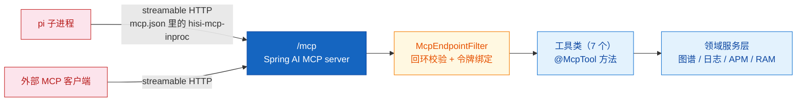

# 进程内MCP工具

> 自动生成于 2026-11-26，基于 `99d0037` 版本；MCP 迁入进程内（`4b6cbca`）后逐点核对

| 属性 | 值 |
|------|-----|
| **所属层** | 接入层 |
| **目录** | `mcp/`（10 个类）+ `config/McpEndpointFilter.java` |
| **规模** | 40 个工具，分布在 7 个工具类 |
| **协议** | MCP 2025-11-25，streamable HTTP，端点 `/mcp`（Spring AI MCP server，webmvc） |
| **服务名** | `hisi-mcp-inproc` |

---

## 1. 模块概述

本模块是**后端进程内的 Spring 原生 MCP 服务端**，取代了此前的 Node 子项目 `hisi-mcp-server`（独立启动、spring 启动时脚本构建）。

**核心职责**：把后端自己的接口能力（知识图谱检索、日志、APM、RAM 动作）以 MCP 工具的形式暴露给两类客户端：

| 客户端 | 用途 |
|--------|------|
| pi 子进程（主要） | 各 agent 流在 `FlowToolManifest` 白名单内调用图谱 / 日志 / APM / 动作工具，见 [pi-agent底座](./pi-agent底座.md) |
| 外部编码助手 | 与 REST 并列的另一种接入方式，只读查询为主 |

**为什么换成进程内**：工具直接标注在后端接口的实现上（`@McpTool`），接口迭代与工具契约同步演进——没有第二套数据模型、没有独立构建与启动、没有随版本漂移失效的中间层。MCP 只封装后端自己的接口；文件读写、执行命令等留在 pi 内置工具里。

---

## 2. 架构



配置（`application.yml`）：

```yaml
spring:
  ai:
    mcp:
      server:
        enabled: true
        name: hisi-mcp-inproc
        version: 1.0.0
        type: SYNC
        protocol: STREAMABLE
        streamable-http:
          mcp-endpoint: /mcp
```

`/mcp` 在 `CorsConfig` 里被排除在管理员拦截器之外；访问控制由 `McpEndpointFilter` 做：非回环地址 403；带 `X-Scope-Token` 请求头的会话把令牌按 `Mcp-Session-Id` 绑定进 `McpRequestContext`（2 小时 TTL）。

---

## 3. 工具清单（40 个）

| 工具类 | 数量 | 工具 |
|--------|-----|------|
| `KgScopeMcpTools` | 1 | `kg_select_scope` |
| `KgQueryMcpTools` | 10 | `hybrid_search`、`kg_list_projects`、`kg_status`、`kg_method_detail`、`kg_method_by_class`、`kg_root_entries`、`kg_callees_tree`、`kg_entry_points`、`kg_downstream`、`kg_affecting` |
| `KgBridgeMcpTools` | 6 | `kg_bridges`、`kg_bridge_stats`、`kg_feign_chain`、`kg_mq_chain`、`kg_mybatis_sql`、`kg_implementations` |
| `KgArchitectureMcpTools` | 8 | `kg_dashboard`、`kg_dsm`、`kg_hotspots`、`kg_domains`、`kg_service_topology`、`kg_blast_radius`、`kg_api_consumers`、`kg_backend_deps` |
| `LogMcpTools` | 4 | `log_query`、`log_analyze`、`log_report`、`log_report_status` |
| `ApmMcpTools` | 6 | `apm_start_session`、`apm_stop_session`、`apm_execute_request`、`apm_list_traces`、`apm_get_trace`、`apm_get_report` |
| `ActMcpTools` | 5 | `act_start_analysis`、`act_start_status`、`act_resume_session`、`act_submit_clarification`、`act_confirm_node` |

工具名与参数契约由 `McpToolCatalogTest` 锁死（64 条实时断言，逐一核对工具名 / 参数名 / 必填 / 类型 / 枚举常量）。

---

## 4. 会话与作用域（`McpToolSupport`）

| 机制 | 说明 |
|------|------|
| 项目作用域 | 以 MCP `sessionId()` 为键保存会话级项目路径集合，30 分钟 TTL；`kg_select_scope` 显式设置，其余工具按它解析路径 |
| 参数优先 | `resolveBoth` / `resolvePaths` / `resolvePath`：显式传参优先；没传则用会话作用域补齐 `projectPaths` 与 `projectPath` |
| 严格工具 | 必填作用域的查询工具（如 `hybrid_search`）在没有作用域时返回 `scopeNotSet` 错误，而不是拿空列表去查 |
| 路径归一化 | 入参路径 `\` 统一转 `/`，再按后端现有校验规则解析 |

## 5. 动作工具的令牌链路（`ActMcpTools`）

`act_*` 是**写操作**，不能匿名执行。链路：

1. 动作流用独立的 pi 配置目录，其 `mcp.json` 对 `hisi-mcp-inproc` 声明请求头 `X-Scope-Token: ${HISI_SCOPE_TOKEN}`；
2. `PiFlowClient` 启动 pi 时把用户令牌放进 `HISI_SCOPE_TOKEN`（只读流不放，pi 对空环境变量一律视为未设置）；
3. `McpEndpointFilter` 在握手后把令牌按 `Mcp-Session-Id` 存入 `McpRequestContext`；
4. 工具执行时经 `ctx.sessionId()` 取令牌，以 `Bearer` 回调后端 REST；
5. 没有令牌时工具直接失败：「缺少用户令牌：动作工具不能以匿名身份执行」。

令牌不落盘、2 小时 TTL。

## 6. 错误语义

业务结果统一走 `McpToolSupport.envelope`：`ApiResponse.code` 不是 200 时返回 `McpSchema.CallToolResult`（`isError=true`），工具失败对 pi 可见，而不是把 HTTP 200 里的业务错误当成功。MCP 传输层本身的状态码与业务 `code` 分离。

## 7. 已知问题与扩展点

| 问题 | 说明 |
|------|------|
| 参数名由 Java 参数名决定 | `@McpArg(name=...)` 不生效，`act_*` 因此用 snake_case 参数名对齐旧契约；改参数名即改契约，需同步更新 `McpToolCatalogTest` |
| `@ToolParam(required=false)` 不生效 | 可选性只能靠 `@McpToolParam` 表达 |
| 枚举绑定按常量名 | 小写常量（`java`、`list`、`approve`）与旧契约一致；新增枚举要保证常量名与旧 MCP 契约相同 |

| 扩展点 | 方式 |
|-------|------|
| 新增工具 | 在对应工具类加 `@McpTool` 方法，同步更新 `McpToolCatalogTest` 与 [mcp-tools-guide](../../mcp-tools-guide.md) |
| 新增客户端 | 新服务名或复用 `hisi-mcp-inproc`（注意 `FlowToolManifest` 的前缀 `mcp__hisi_mcp_inproc__` 依赖服务名） |

---

## 8. 依赖关系

| 方向 | 依赖 | 用途 |
|------|------|------|
| 上游 | 各业务服务层（图谱、日志、APM、RAM 会话） | 工具的业务实现 |
| 上游 | [应用启动与全局配置](./应用启动与全局配置.md) | `McpEndpointFilter` 注册、`/mcp` 放行 |
| 下游 | [pi-agent底座](./pi-agent底座.md) | pi 经 streamable HTTP 连接本服务 |
| 下游 | 外部 MCP 客户端 | 只读查询 |

---

> **相关文档**：
> - 工具使用说明 → [mcp-tools-guide](../../mcp-tools-guide.md)
> - 工具白名单与每流清单 → [pi-agent底座](./pi-agent底座.md)
> - 鉴权与过滤器 → [应用启动与全局配置](./应用启动与全局配置.md)
