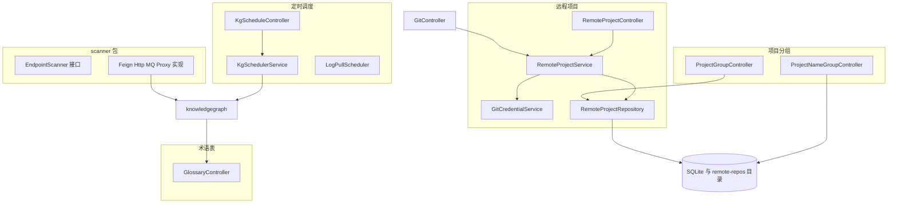
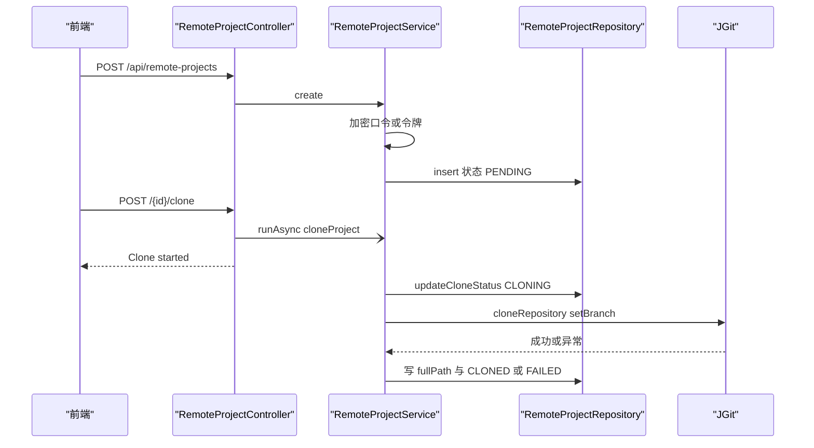
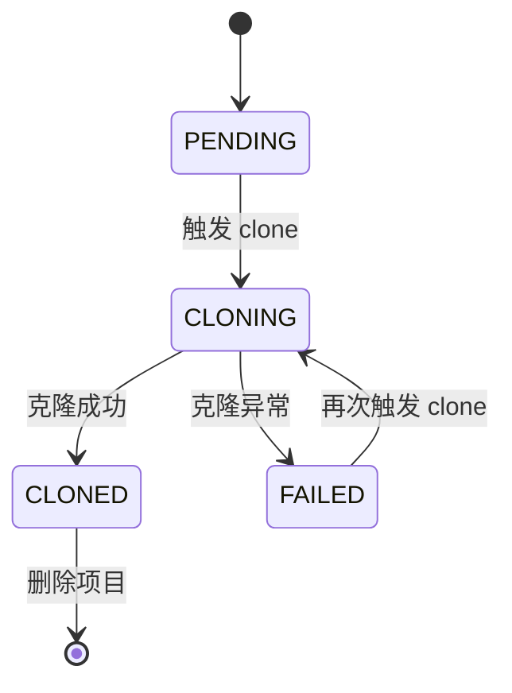

# 远程项目管理模块（含项目分组、KG 定时调度、术语表、扫描器包）

> 基于当前工作区代码重新核实（2026-11-24）。路径均以 `hisi-dev-tool/src/main/java/com/huawei/hisi/` 为前缀；`resources/` 指 `hisi-dev-tool/src/main/resources/`。
> 旧版文档中的 `hisi.remote-project.clone-dir / encryption-key / auto-pull-enabled / auto-pull-cron` **在代码中不存在**，已按实际配置重写。

## 0. 属性表

| 属性 | 值 |
|---|---|
| 包路径 | `project`（remote / group / namegroup）、`scheduler`、`scanner`、`glossary` |
| 类/文件数 | 25（project 12 / scheduler 5 / scanner 5 / glossary 3） |
| 代码行数 | 3,623（project 1,413 / scanner 1,454 / scheduler 561 / glossary 195） |
| HTTP 端点 | 23 个，5 个 Controller |
| 入口类 | `project/remote/controller/RemoteProjectController`、`project/group/controller/ProjectGroupController`、`project/namegroup/controller/ProjectNameGroupController`、`scheduler/controller/KgScheduleController`、`glossary/controller/GlossaryController`、`scheduler/LogPullScheduler`（`@Scheduled`） |
| 存储 | SQLite 表 `remote_project`、`project_group`、`project_name_group`、`kg_schedule`、`glossary_term`（建表在 `config/SQLiteSchemaInitializer.java:183`、`:253`、`:276`、`:314`、`:329`） |
| 上游 | `config.DataSourceConfig`（静态 `PROJECT_DIR`）、JGit + JSch、`model.ApiResponse`、`utils.PathUtils` |
| 下游 | `knowledgegraph`（读术语表）、`controller.GitController`（取凭据）、`service.LogAnalysisExecutor` |

## 1. 职责边界

| 做什么 | 不做什么 | 由谁负责 |
|---|---|---|
| 远程项目登记、克隆、拉取、删除 | 构建知识图谱 | `knowledgegraph` |
| 凭据加密存储与解密使用 | 用户认证 | JWT 过滤器 |
| 按 appId / 名称模式给项目分组 | 分组级联删除时的关联清理 | 无（见问题 6） |
| 按 cron 触发 KG 增量或全量 | 任务排队与执行 | `knowledgegraph/service/KgGenerationQueue` |
| 术语表 CRUD | 术语注入提示词 | `knowledgegraph/service/LLMDescriptionService` |
| Java 桥接端点扫描并写入全局缓存 | 调用关系解析 | `knowledgegraph/service/KnowledgeGraphBuilder` |
| 定时拉取日志并提交分析 | 日志诊断 | `service/LogAnalysisExecutor` |

## 2. 模块架构

### 2.1 克隆流程

### 2.2 克隆状态机

## 3. 对外接口

| 前缀 | 方法与路径 | 说明 | 位置 |
|---|---|---|---|
| `/api/remote-projects` | `GET` | 列表，附带 `groupName` | `project/remote/controller/RemoteProjectController.java:43` |
| | `POST` | 登记，`cloneStatus=PENDING` | `:51` |
| | `PUT /{id}` | 更新 | `:60` |
| | `DELETE /{id}` | 删目录后删记录 | `:69` |
| | `POST /{id}/clone` | 异步克隆，立即返回 | `:75` |
| | `POST /{id}/pull` | 异步拉取，立即返回 | `:85` |
| `/api/project-group` | `GET`、`GET /{appId}`、`POST`、`DELETE /{appId}`、`GET /by-path` | 按 appId 分组 | `project/group/controller/ProjectGroupController.java:33-130` |
| `/api/project-name-group` | `GET`、`GET /{groupName}`、`POST`、`DELETE /{groupName}` | 按名称模式分组 | `project/namegroup/controller/ProjectNameGroupController.java:35-73` |
| `/api/kg-schedules` | `GET`、`POST`、`PUT /{id}`、`DELETE /{id}` | KG 定时任务 CRUD | `scheduler/controller/KgScheduleController.java:34-102` |

`RemoteProject` 字段：`id`、`name`、`gitUrl`、`username`、`encryptedPassword`、`branch`、`localPath`、`cloneStatus`、`cloneError`、`lastSyncAt`、`createdAt`、`authType`（PASSWORD / TOKEN / SSH_KEY）、`sshKeyPath`、`encryptedToken`、`groupId`、`fullPath`（`project/remote/model/RemoteProject.java:13-38`）。

## 4. 配置项

| 键 | 默认值 | 来源 | 说明 |
|---|---|---|---|
| `app.project_dir` | `C:\Users\47583\projects\hisi-dev-tool` | `resources/application.yml:130`、`config/DataSourceConfig.java:19-24` | 克隆根目录为 `<project_dir>/remote-repos/<localPath>`；以静态字段被读取 |
| `hisi.encrypt.key` | 无 → 回退内置默认密钥 | `project/remote/service/GitCredentialService.java:23-31` | 长度 <16 同样回退 |
| `log.pull.enabled` | `false` | `resources/application.yml:201` | Java 代码无引用，**失效配置** |
| `log.pull.default-interval-minutes` | 10 | `resources/application.yml:203` | Java 代码无引用，**失效配置** |
| `log.pull` 实际周期 | 固定 600,000 ms | `scheduler/LogPullScheduler.java:39` | 硬编码 |

## 5. 错误处理

| 场景 | 处理 | 位置 |
|---|---|---|
| id 不存在 | `RuntimeException` → 500 | `project/remote/service/RemoteProjectService.java:47-50` |
| 克隆失败 | 只记 `FAILED` + 根因消息（截断 500 字符），不抛出 | 同上 `:252-256`、`:349-360` |
| 拉取失败 | 抛 `RuntimeException`，但已在异步线程，仅记日志 | 同上 `:289-291`、`RemoteProjectController.java:87-91` |
| 删目录失败 | 吞掉异常继续删记录 | 同上 `:327-347` |
| 定时任务失败 | 仅记日志，`lastRunAt` 不更新 | `scheduler/service/KgSchedulerService.java:98-100` |
| 鉴权类型非法 | `IllegalArgumentException` | `RemoteProjectService.java:166-168` |

## 6. 已知问题与扩展点

| # | 问题 | 证据 | 扩展点 |
|---|---|---|---|
| 1 | 未配置 `hisi.encrypt.key` 时回退到源码内置默认密钥，口令/令牌等同明文存储；密钥由原始字节补零/截断得到，未经 KDF | `project/remote/service/GitCredentialService.java:23-31` | 强制配置或改用系统密钥库 |
| 2 | SSH 会话工厂是 JVM 全局单例，克隆/拉取并发时互相覆盖；`StrictHostKeyChecking=no` | 同上 `:171-195`、`:258-260`、`:293-295` | 按克隆传入 `SshSessionFactory` |
| 3 | 克隆/拉取跑在 `CompletableFuture.runAsync` 公共线程池，无并发保护、无超时，重复点击可并发克隆 | `project/remote/controller/RemoteProjectController.java:77`、`:87` | 走任务队列并限流 |
| 4 | 目标目录非空即整目录删除，`localPath` 仅由名称清洗得到，存在误删风险 | `RemoteProjectService.java:212-229`、`:318-325` | 克隆前校验目录归属 |
| 5 | 删除与拉取按 `localPath` 重算目录，不用克隆时固化的 `fullPath`；改过 `app.project_dir` 后会删错或拉错目录 | 同上 `:200-203`、`:270`、`:304-312` | 统一使用 `fullPath` |
| 6 | 分组同步把 `app_id` 字符串写入 INTEGER 列 `group_id`，而列表却按数字 `id` 查分组，`groupName` 取不到；删分组不清 `group_id` | `project/group/controller/ProjectGroupController.java:86`、`:101`、`:116-125`，`RemoteProjectController.java:113-118`，`RemoteProjectRepository.java:42`、`:235-240` | 统一关联键 |
| 7 | `findContainingPath` 对 JSON 串做 `LIKE %path%`，前缀相同的路径互相误命中 | `project/group/repository/ProjectGroupRepository.java:137-142` | 改关联表 |
| 8 | `Files.list` 返回的流未关闭，Windows 上可能占住目录句柄 | `RemoteProjectService.java:226`、`RemoteProjectRepository.java:116` | try-with-resources |
| 9 | 建表后的补列逻辑分散两处：`SQLiteSchemaInitializer.addColumnIfAbsent` 与 Repository 内 `@PostConstruct` 探测式 `ALTER` | `RemoteProjectRepository.java:28-51` | 集中迁移 |
| 10 | 启动时回填 `fullPath` 硬编码历史路径 `D:/hisi-code-analyser/...` | 同上 `:93-99` | 移到配置 |
| 11 | `setGroupIdByPath` 的 `groupName` 参数未使用；`create`/`update` 各 3 个重载 | 同上 `:235-240`、`RemoteProjectService.java:53-65`、`:96-108` | 用请求对象替代重载 |
| 12 | 定时调度自建 `ThreadPoolTaskScheduler`，未注册为 bean，无销毁钩子 | `scheduler/service/KgSchedulerService.java:38-41` | 注入 Spring 的 scheduler |
| 13 | `nextRunAt` 只读不写，接口恒返回 null | `scheduler/repository/KgScheduleRepository.java:34`、`KgScheduleController.java:121` | 注册后回写下次触发时间 |
| 14 | INCREMENTAL 在调度线程同步直调 builder，绕过队列、无任务记录；REUSE/WIPE 走 `startTask` 入队 | `KgSchedulerService.java:86-94` | 统一入队 |
| 15 | 更新接口不校验 cron 与 `buildMode`；创建只校验 `buildMode`；非法 cron 被注册时吞掉，接口仍返回成功 | `KgScheduleController.java:74-100`、`:124-138`、`KgSchedulerService.java:60-62` | 保存前校验 |
| 16 | `git pull` 用外部 CLI，`waitFor` 无超时且不读输出 | `KgSchedulerService.java:118-122` | 加超时并消费输出 |
| 17 | `log.pull.*` 两个配置无人读取，周期与开关硬编码；入库用户名硬编码 `sys_admin` | `resources/application.yml:197-203`、`scheduler/LogPullScheduler.java:39`、`:109` | 接回配置 |
| 18 | 名称分组的 `findMatchingGroup` 无调用方，注释说把 `*` 转 `%` 但未实现，`groupName` 参数未使用 | `project/namegroup/repository/ProjectNameGroupRepository.java:140-146` | 删除或补实现 |
| 19 | 分组与术语表无 Service 层，Controller 直连 Repository；`ProjectGroupController` 把 `e.getMessage()` 返回客户端 | `ProjectGroupController.java:27-28`、`:40`、`:57`、`:109`、`:123` | 统一异常处理 |
| 20 | 术语表按 `projectPath` 精确匹配，未做路径规范化；更新时不校验 id 与路径归属 | `glossary/repository/GlossaryTermRepository.java:54-60`、`:69-74` | 规范化后比对 |
| 21 | 扫描器包只被 `KnowledgeGraphBuilder` 一个类消费，却位于顶层包 | `knowledgegraph/service/KnowledgeGraphBuilder.java:23-26`、`scanner/EndpointScanner.java:17` | 并入 `knowledgegraph` |

## 7. 相关文档

- [知识图谱构建](./知识图谱构建.md)
